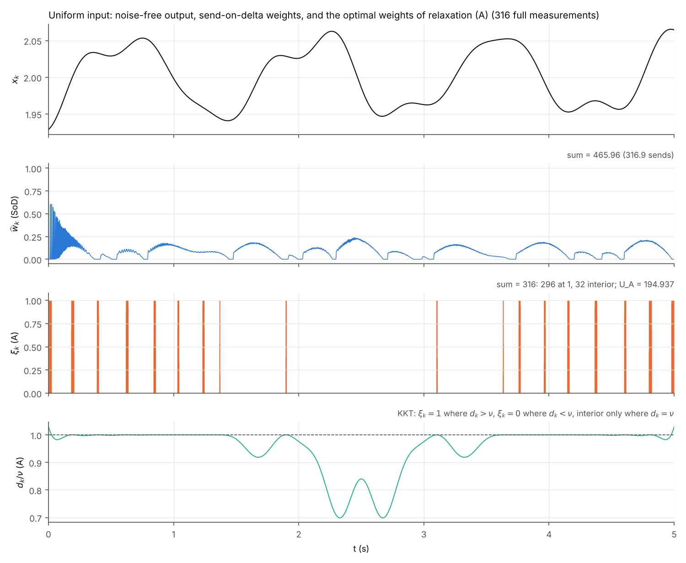
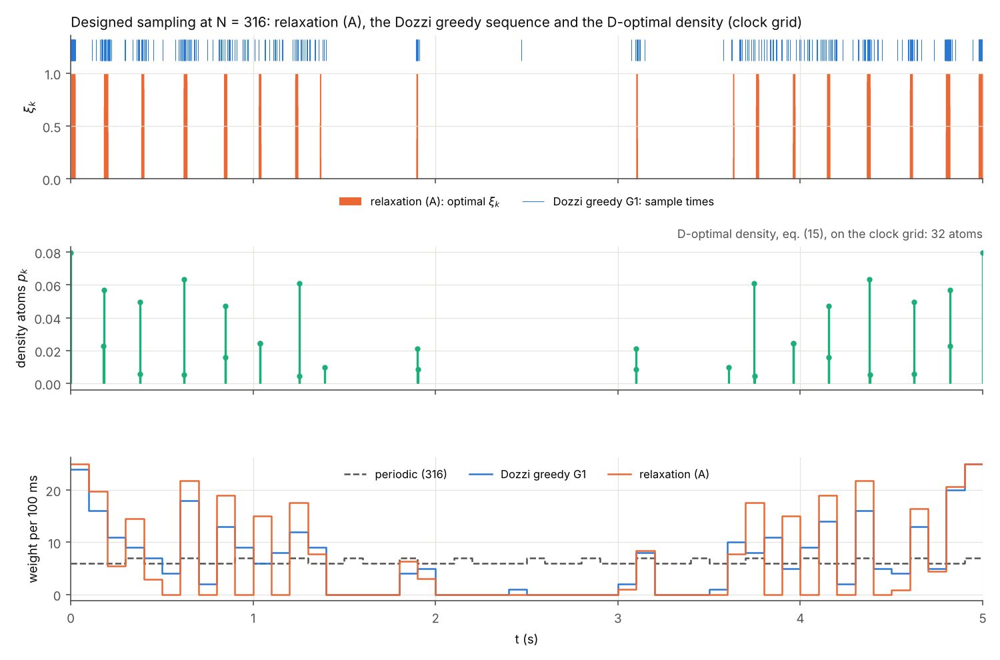

# Route 1: free-weight D-optimal relaxation: report

Date 2026-10-14.

**Setup.** System, tones, clock grid and σ are those of `mc83.py`:
- K = 5000 clock points, Δt = 1 ms, T = 5 s;
- Δ\* = 0.002384694482635785 and σ = Δ\*/20;
- regressors from `regressors(a, chi, t)` of `mc85_scan.py`.

**Order of work.** The predictions (`predictions.md`) were committed before any run. The task was then changed by a review (`review_note.md`):
- the outer search over the input was dropped and replaced by an identity check (Script 3);
- variant B uses each input's own total weight S(u);
- every inner solve is certified by a cutting-plane upper bound;
- the wording of (A) and of the Dozzi comparison was corrected.

**Traceability.** Every number below is copied from `bound_inner.log`, `bound_dozzi.log`, `bound_identity.log` or `runtime.log`, rounded as printed. Full precision is in `inner_unif.json`, `dozzi.json` and `identity.json`.

**What is random.** Nothing is Monte Carlo except two things:
- the reused send-on-delta weights from earlier stages (`wk_d20_10000.npy`: mc837.py, R = 10000, seed 20261006; batch-1 weights `stage2/final_qxw.npz`: R = 4000, seed 20261013);
- the random inputs and weights of the identity check (seed 20261022).

**Notation.**
- F(ξ) = log det(σ⁻² Σ_k ξ_k h_k h_kᵀ).
- U is the certified upper value of max F over Ξ_W = {0 ≤ ξ_k ≤ cap, Σ ξ_k = W}.
- **Bounds are quoted as U.** U = F(ξ̃) + max_{ξ∈Ξ_W} ∇F(ξ̃)ᵀ(ξ − ξ̃), the cutting-plane bound. The maximisation is a linear program over the box-and-sum set, solved by sorting.
- "Ratio" is the geometric-mean axis ratio of the 9-parameter confidence ellipsoids, e^{−Δ/18}. A ratio below 1 means the row is more informative than the reference.

## 1. Summary table

Rows are at the uniform input (a_m = 1/2, χ = 0) unless stated.
Columns: log det in nat, its difference to J_sod(u_unif) = 197.197, and the ratio.

| row | log det | − J_sod(u_unif) | ratio | source |
|---|---|---|---|---|
| J_per(316), periodic t_i = iT/316 (off the clock grid) | 194.155 | −3.041 | 1.184 | Table 1, `bound_inner.log` |
| Dozzi et al. greedy sequence, 316 distinct grid points (G1) | 194.929 | −2.267 | 1.134 | Table 2, `bound_dozzi.log` |
| **U_A**: relaxation bound for 316 full measurements on the clock grid, each instant at most once (W = 316, cap 1) | 194.937 | −2.259 | 1.134 | Table 1 |
| U_C: W = 316, no cap (Kiefer–Wolfowitz; = Dozzi density on the grid, E[J] at N = 316) | 194.958 | −2.238 | 1.132 | Table 1 |
| J_sod(u_unif), S = Σ ŵ_k = 465.958 | 197.197 | 0 | 1 | Table 1 |
| best budgeted send-on-delta input NM-none-P5514 (+0.697 over J_sod(u_unif)) | 197.894 | +0.697 | 0.962\* | stage 2 (Δm_D^(C), batch 1); direct batch-1 value 197.899, Table 3 of `bound_identity.log` |
| **U_B**: free placement at the same total weight, W = S(u_unif) = 465.958, cap 1 | 198.423 | +1.227 | 0.934 | Table 1 |
| U_B for NM-none-P5514 at its own S(u) = 486.518 | 198.810 | +1.614\* | 0.914\* | Table 3, `bound_identity.log` |
| max over inputs of U_316(u) (identity, §4) | = U_A = 194.937 | −2.259 | 1.134 | §4 |
| max over inputs of U_W(u) at fixed W = S(u_unif) (identity) | = U_B = 198.423 | +1.227 | 0.934 | §4 |

\* Computed here from the logged values (difference to 197.197 and e^{−Δ/18}); not printed by a script.

**Two rows not quoted.** The table has no "outer-optimised" bound rows, because the outer search was dropped after review. The identity of §4 makes the input maximum of U_W at any fixed W equal to its value at uniform power, with any phases. Script 3 checks this numerically.

**The best-budgeted-input row.** Its value follows the task definition, 197.197 + 0.697 = 197.894. Δm_D^(C) = +0.697 is measured against the uniform input on the same batch-1 draws, whose ld J_sod is 197.202. The direct batch-1 log det is 197.899.

## 2. Predictions vs results

Predictions from `predictions.md`; results from the logs named.

| # | prediction | result | verdict |
|---|---|---|---|
| 1 | U_A − J_per = +1.5 nat (range +0.9 to +2.2) | **+0.782** | **wrong**: below the range. The two-cluster heuristic for the close pair 12/12.3 rad/s overstated what moving weight to the ends gains |
| 2 | U_A − J_sod = −1.55 (range −2.3 to −0.9); J_sod above the 316-measurement limit | **−2.259**; J_sod is above U_A | sign right; value inside the range, at its edge |
| 3 | U_B − J_sod = +1.7 (range +1.0 to +2.5), **more** than 1 nat | **+1.227** (W = S(u_unif)) | right: more than 1 nat, inside the range |
| 4 | U_C − U_A = +0.7 (range +0.3 to +1.5) | **+0.021** | **wrong**: the cap ξ_k ≤ 1 hardly binds on a 1 ms grid (§3.1) |
| 5 | U_C − J_per = +2.2 (range +1.5 to +3.0) | +0.803 | **wrong** (follows from 1 and 4) |
| 6 | ≤ 10 interior weights in A and B | **32** (A), **30** (B) | **wrong** |
| 7 | A: two end blocks plus a few short inner blocks | 18 short blocks, symmetric about t = 2.5 s, mostly in [0, 1.4] s and [3.6, 5] s. 21.3% of the weight lies in each of the first and last 0.5 s, against 10% of the window | partly right |
| 8 | C on 15–30 support points | **32** (≤ 45) | just outside |
| 9 | Clarabel and own projected gradient agree to < 1e-5 nat on A; PG gap < 1e-6 | exchange vs SCS 1.2e-10, vs Clarabel 1.6e-7; **PG gap 1.87e-5 after 20 000 iterations** | agreement right; PG accuracy **wrong** |
| 10 | grid-rounded periodic within 0.01 nat of J_per | +0.000002 | right |
| 11 | Dozzi greedy between J_per and U_A, 0.1–0.5 nat below U_A | between; **0.008** below U_A | direction right; it is much closer than predicted |
| 12 | Dozzi start choice moves log det by < 0.1 nat | spread 0.0055 over G1–G4 | right |
| 13 | outer optimum: no power move, no phase effect, gain 0 exactly | identity confirmed (§4) | right (analytic, as predicted) |
| 14 | finalists: UNIF below its B by 1.7–1.8; P5514 by 1.0–1.1 | at own S(u): **1.224** and **0.911** | magnitudes too high (from #3). P5514 is closer than UNIF, as predicted |
| 15 | "+0.697 nat of the best input is entirely better placement, not an increase of the bound" | of +0.697: **+0.385 from its larger S(u)** (486.5 vs 466.1), **+0.312 from a smaller placement gap** (Table 4) | **wrong** once B uses the input's own S(u). At a fixed W the bound indeed does not move |
| 16 | runtime: Script 1 < 5 min, Script 2 < 1 min; cold inner solve < 2 s | 5.37 min, 0.66 min; own exchange method 11–44 s cold, Clarabel 1.2 s (A only) | Script 2 right; Script 1 slightly over; cold-solve time **wrong** for my own method |

Predictions 13 and 14 were made with a fixed W. The review changed B to the input's own S(u), which turns 15 into a decomposition rather than a yes/no question.

## 3. Script 1: the relaxation at the uniform input (`bound_inner.py`)

### 3.1 Values and certificates

**Table A** (source: `bound_inner.log`, per-variant blocks; times are cold starts).

| variant | W, cap | F(ξ̃) (own exchange) | U (cutting plane) | gap | KKT max violation | interior / at cap / support | exchange time | SPG (own): gap, time | SCS (eps 1e-9): gap, \|F − F_exch\| | Clarabel |
|---|---|---|---|---|---|---|---|---|---|---|
| A | 316, 1 | 194.9374368696 | 194.9374368697 | 8.9e-11 | 3.5e-11 | 32 / 296 / 328 | 44.4 s | 1.87e-5, 59.0 s | 5.6e-9, 1.2e-10 | optimal, 1.2 s, gap 2.5e-7 |
| B | 465.958, 1 | 198.4234663320 | 198.4234663321 | 8.3e-11 | 3.8e-11 | 30 / 454 / 484 | 10.8 s | 7.55e-6, 58.0 s | 2.2e-8, 7.3e-11 | **failed** |
| C | 316, none | 194.9581063685 | 194.9581063686 | 9.7e-11 | 7.9e-13 | 32 support points (≤ 45), max weight 25.14 | 27.0 s | 1.60e-4, 57.0 s | 1.3e-7, 6.7e-11 | **failed** |

**Solvers.** The convex problems are solved globally to a certified cutting-plane gap below 1e-10 nat.
- **Own exchange method.** A batched pairwise vertex exchange with an exact line search; only gradients are used.
- **Cross-checks.** SCS agrees to ≤ 1.2e-10 nat on all three variants. Clarabel agrees to 1.6e-7 on A. With default settings Clarabel fails on B and C ("Solver 'CLARABEL' failed").
- **Own projected gradient (SPG).** It agrees in value but converges slowly: the gap is 1.9e-5 on A after 20 000 iterations. Its ξ differs visibly from the converged one, because it is unconverged in flat directions.
- **Duality bound.** The secondary duality bound is printed as well. It equals U to the printed digits.

**The cap hardly binds** (U_C − U_A = +0.021 nat).
- The Kiefer–Wolfowitz design C has 32 atoms of up to 25 samples each.
- Spreading each atom over about 25 adjacent 1 ms grid points costs almost nothing. The fastest tone, 12.3 rad/s, turns by only 0.3 rad in 25 ms.

**Structure of ξ_A** (Figure 1).
- 296 weights are at 1 and 32 are interior. The KKT condition holds: ξ_k = 1 where d_k > ν and 0 where d_k < ν, with ν = 0.02842.
- The weights form 18 blocks of 9–26 points, symmetric about t = 2.5 s. Time reversal k → K+1−k maps each tone's (cos, sin) pair by an orthogonal matrix, so it leaves F invariant.
- Weight in the first and last 0.5 s: 21.3% each, against 12.3% and 12.5% for the send-on-delta weights.
- Weight in (0.5, 4.5] s: 57.3%, against 75.2% for send-on-delta.
- Only the blocks at 1.9 s and 3.1 s lie in (1.4, 3.6) s.

**Grid check.** The grid-rounded periodic schedule is feasible for A, with ld 194.155296. U_A ≥ it, U_B ≥ ld J_sod and U_C ≥ F_A all hold ("checks" block).

### 3.2 What A, B and C bound

**What U_A bounds.** U_A is the relaxation bound for 316 full measurements on the clock grid, each instant at most once. It bounds every scheme whose per-step information weights are each ≤ 1 and sum to ≤ 316.

**Send-on-delta is not such a scheme.** With 316.9 sends its weights sum to S = 465.96, because the non-send steps carry censoring information. So J_sod lying 2.259 nat *above* U_A is no contradiction. U_A is not a limit for send-on-delta, and the difference J_sod − U_A is not a distance of send-on-delta from its own limit.

**Which relaxation contains send-on-delta.** U_B does: its weights are each ≤ 1, with total S(u), the input's own total. The send-on-delta weights satisfy 0 ≤ ŵ_k ≤ 1 (max 1.000 at k = 0, none above 1) and sum to S(u_unif). Hence ld J_sod ≤ U_B.

**Equivalent sample counts** (`bound_inner.log`, "equivalent total weight").
- Send-on-delta's information at the uniform input equals that of **406.4** optimally placed full measurements on the grid (U(W) = J_sod at W = 406.415).
- It equals that of **443.0** uniformly placed ones.

## 4. Script 3: the input-factorisation identity and the finalists (`bound_identity.py`)

**Identity** (review (1)). For every input,
- H(u) = H(u_unif) T(u), with T(u) = blockdiag(1, (a_m/0.5) R(χ_m)) and det T = ∏_m 4p_m;
- so F_u(ξ) = F_unif(ξ) + 2 Σ_m log(4p_m) for every fixed ξ;
- and U_W(u) = U_W(u_unif) + 2 Σ_m log(4p_m) for every fixed W.

This is independent of the phases and maximised exactly at uniform power, since Σ_m log(4p_m) ≤ 0 by Jensen. An outer search over the input therefore cannot raise the bound at a fixed W. This was predicted analytically in `predictions.md` §0.

**Numerical checks** (`bound_identity.log` §§1–3).
- **Factorisation.** max |H(u) − H(u_unif)T(u)| = 6.3e-15, and max |det T/∏4p_m − 1| = 1.3e-15. This was checked at 20 random inputs (p ~ Dirichlet(1,1,1,1), χ ~ U[0, 2π)⁴, seed 20261022) and the 7 finalists.
- **Fixed weights.** At 81 (input, random feasible ξ) pairs, capped and uncapped, the residual F_u(ξ) − F_unif(ξ) − 2Σ log 4p_m is ≤ 1.2e-13 nat.
- **At the optimum.** U_316(u) was solved cold at 4 random inputs and the 7 finalists, all with non-zero phases. It matches U_316(u_unif) + 2Σ log 4p_m to ≤ 9.0e-10 nat, with each side carrying a cutting-plane gap ≤ 1e-9.
- **Maximisers.** The maximisers found at different u differ by up to 0.02 per weight. Evaluated at the uniform input, they are within 1.2e-11 nat of the optimum. The objective is flat near the optimum, and both are maximisers.

**Table 3. Free-placement relaxation gap at equal total weight**, ld J_sod(u) − U_{S(u)}(u) (review (2)).
Source: Table 3, `bound_identity.log`. S(u) and J_sod(u) come from the batch-1 weights (R = 4000, seed 20261013), and ld J_sod matches `stage2/final_J.npz` exactly. The relaxation is solved at W = S(u), cap 1, at input u, with gaps ≤ 1e-10.

| id | Δm_D^(C) | S(u) | 2Σ log 4p | ld J_sod(u) (batch se) | U_{S(u)}(u) | relaxation gap | ratio |
|---|---|---|---|---|---|---|---|
| NM-none-P5514 | +0.697 | 486.518 | −0.0005 | 197.899 (0.004) | 198.810 | **−0.911** | 1.052 |
| NM-none-P5450 | +0.650 | 485.674 | −0.0026 | 197.852 (0.004) | 198.793 | −0.940 | 1.054 |
| P5014 | +0.566 | 482.761 | 0 | 197.768 (0.003) | 198.741 | −0.974 | 1.056 |
| NM-0.3-P4312 | +0.428 | 479.292 | −0.0340 | 197.630 (0.004) | 198.643 | −1.013 | 1.058 |
| AB-0.5 | +0.397 | 478.914 | −0.0412 | 197.599 (0.004) | 198.628 | −1.029 | 1.059 |
| NM-0.7-UNIF | +0.023 | 468.941 | −0.0045 | 197.225 (0.003) | 198.476 | −1.252 | 1.072 |
| UNIF | 0 | 466.071 | 0 | 197.202 (0.003) | 198.426 | −1.224 | 1.070 |

At R = 10000 (Script 1, S = 465.958) the uniform input's gap is −1.227.

**Monte Carlo sensitivity of U.** U_{S(u)} changes by ν ≈ 0.0184–0.0193 nat per unit of S. An error of 0.1 in the Monte Carlo estimate S(u) therefore moves it by about 0.002 nat. No standard error of S(u) was logged by stage 2, so none is quoted.

**Table 4. Decomposition against UNIF** (same draws; Table 4, `bound_identity.log`).
Δ ld J_sod = ΔU_{S(u)} + Δgap, where ΔU = (shift 2Σ log 4p) + (effect of the larger S(u)).

| id | ΔS | Δ ld J_sod | ΔU | of which p | of which S | Δ gap |
|---|---|---|---|---|---|---|
| NM-none-P5514 | +20.45 | +0.697 | +0.385 | −0.0005 | +0.385 | +0.312 |
| NM-none-P5450 | +19.60 | +0.650 | +0.367 | −0.0026 | +0.370 | +0.283 |
| P5014 | +16.69 | +0.566 | +0.316 | 0 | +0.316 | +0.250 |
| NM-0.3-P4312 | +13.22 | +0.428 | +0.217 | −0.0340 | +0.251 | +0.211 |
| AB-0.5 | +12.84 | +0.397 | +0.203 | −0.0412 | +0.244 | +0.195 |
| NM-0.7-UNIF | +2.87 | +0.023 | +0.051 | −0.0045 | +0.055 | −0.028 |

## 5. Script 2: Dozzi et al. (`bound_dozzi.py`)

**What their method is.** Dozzi, Oomen and González (arXiv:2605.13120) optimise a **continuous** sampling density on [0, T] for i.i.d. random sampling instants (eq. 15). Only afterwards do they build a deterministic sequence, by a greedy rule on a grid (§4.1).

**How it relates to (A).** The discrete capped problem (A) is related to theirs, not identical with it:
- their density has no cap: an atom carries up to 25 expected samples here;
- their sequence is a heuristic, not the solution of a relaxation.

**Implementation.** Same system, tone set and window as in their simulation.
- **(a) Density.** Eq. (15) discretised on the clock grid. It is the unit-amplitude version of variant C, and the regressors' amplitudes and phases factor out of the determinant, as in their eq. (6). It has 32 atoms, symmetric about 2.5 s, with E[J] at N = 316 equal to U_C = 194.958.
  - **Continuous vs grid.** The cutting-plane bound over all t ∈ [0, T], with d(t) evaluated on a 0.01 ms grid, puts the continuous optimum at most 0.012 nat higher (U = 194.970).
  - **Where that comes from.** The whole 0.012 comes from the endpoint t = 0, which the clock grid t_k = kΔt, k = 1..K, does not contain. Restricted to [Δt, T] the gap is 7.8e-6.
- **(b) Greedy sequence.** t_{k+1} = argmax_t ψ(t)ᴴ R_k⁻¹ ψ(t), implemented with their complex ψ.

**Choices the paper leaves open**, fixed as follows:
- **Grid:** the 1 ms clock grid, L = 5000.
- **No repeated grid points.** The paper states that the grid resolution bounds the inter-sample time, which holds only if a grid point is used once.
- **Singular start (R_k singular for k < 9):** the limit ε → 0 of R_0 = εI. This is greedy on the residual |(I − P_k)ψ(t)|².
- **Ties:** values within 1e-12 relative of the maximum count as ties, broken by the smallest index. The first pick is a 5000-way tie.

**Sensitivity runs.**
- G2: ties broken by the largest index.
- G3: ridge start R_0 = I.
- G4: t_1 = 2.5 s.
- W1: with replacement.

**Table 2** (`bound_dozzi.log`).

| design | log det | − J_per | − U_A | share of (U_A − J_per) |
|---|---|---|---|---|
| G1 (main) | 194.929 | +0.774 | −0.008 | 0.990 |
| G2 | 194.929 | +0.774 | −0.008 | 0.990 |
| G3 | 194.924 | +0.769 | −0.014 | 0.983 |
| G4 | 194.929 | +0.774 | −0.008 | 0.990 |
| W1 (repeats allowed; 243 distinct points; not feasible for A) | 194.948 | +0.793 | +0.011 | 1.014 |

**The greedy sequence lies just below the relaxation.** It is between J_per(316) and U_A, 0.008 nat below U_A, and recovers 99% of the gain of optimal placement over periodic sampling.

**Its samples sit elsewhere.** Only 38% of its samples lie in the support of ξ_A (overlap 120 of 316 points), yet it gives nearly the same information. The optimum is flat (Figure 2).

## 6. What the gaps mean

**The schedule limit at 316 full measurements.** The best placement of 316 full measurements on the clock grid, each instant at most once, gains only **+0.782 nat** over periodic sampling. That is a geometric-mean axis ratio of 0.957: confidence-ellipsoid axes about 4% shorter. Dozzi et al.'s greedy construction gets 99% of this gain.

**Where send-on-delta sits.** At the uniform input, send-on-delta lies **2.259 nat above** this limit. It also lies 3.041 nat above periodic sampling. This is not because it places 316 samples better. Its information comes from total weight 466: the sends plus the censoring information of the non-send steps. Measured in full measurements, send-on-delta at 316.9 sends is worth about 406 optimally placed ones, or 443 uniformly placed ones. U_A is not a limit for send-on-delta, and the difference is not a distance of send-on-delta from its own limit.

**How well its weights are placed, given their total.**
- At the uniform input, send-on-delta is **1.227 nat** below U_B, the best free placement of the same total weight (ratio 1.070: axes about 7% longer).
- Placing that same total uniformly would give 197.651, **0.454 nat** better than send-on-delta.
- So send-on-delta's own placement loses 0.454 nat to uniform placement and 1.227 nat to the best placement. It puts 75% of its weight in the middle 4 s, where the best placement puts 57%.

**How much input design could add at most.**
- At a fixed total weight W, input design cannot raise the bound at all. The input enters only through 2Σ log(4p_m) ≤ 0, so the bound is maximal at uniform power and the phases are irrelevant.
- An input can raise the relaxation only by raising send-on-delta's own total weight S(u). The best budgeted input raises S by 20.4, worth +0.385 nat of bound.
- Within that, it can close the placement gap. The best budgeted input closes 0.312 nat of it and leaves **0.911 nat** (ratio 1.052) between its J_sod and the free-placement relaxation at its own S(u).
- That 0.911 nat is the most any change of *where* its weight falls could add at that total. It is not a bound on what other inputs could reach, because S(u) is not bounded by this relaxation.
- How large S(u) can become under the 316-send budget is a separate question. It depends on the trigger, and the relaxation does not answer it.

## 7. Assumptions that make the bound a bound

1. **Weights free of the trigger.**
   - **What is relaxed.** In send-on-delta, ŵ_k is fixed by the input, θ, the noise and Δ. The relaxation lets the weights move freely in the box-and-sum set.
   - **Why the box holds.** Conditional on the past, the data at step k is a function of z_k = x_k + e_k. Its Fisher information is c_k h_k h_kᵀ/σ², with c_k ≤ 1 (data processing). The expected information is therefore Σ_k ŵ_k h_k h_kᵀ/σ² with 0 ≤ ŵ_k ≤ 1. This is the chain-rule form that `cfun` evaluates.
   - **The total.** It is the Monte Carlo estimate S(u), at R = 10000 or R = 4000.
2. **The clock grid.**
   - **What is covered.** Information is collected only at t_k = kΔt, k = 1..5000. A scheme that uses continuous-time crossings or off-grid instants is not covered.
   - **J_per itself is off the grid.** Its grid-rounded version differs by 2e-6 nat.
   - **t = 0 is missing.** The grid lacks t = 0, which is worth up to 0.012 nat in the uncapped problem (§5).
3. **σ known, θ known.**
   - The noise is Gaussian and i.i.d. with known σ = Δ\*/20.
   - The regressors are the steady-state sinusoids of the nominal model, so the design is local at θ.
   - The send-on-delta weights are evaluated at the true θ.
4. **The criterion.** The bound is on log det of the expected Fisher information (D-criterion), not on the covariance of a particular estimator. Whether the censored ML estimator attains J_sod⁻¹ was examined in stage 2 (`mc84.py`).

## 8. Runtime and environment

`runtime.log` lists the final run of each script; 4 vCPUs, single-threaded BLAS. No script came near the 60-minute limit.

| script | elapsed |
|---|---|
| bound_inner.py (Script 1) | 322.4 s (5.37 min) |
| bound_dozzi.py (Script 2) | 39.9 s (0.66 min) |
| bound_identity.py (Script 3) | 351.8 s (5.86 min) |

**Earlier runs that do not count.**
- Script 1 was started six times; three runs completed.
  - Three were stopped early: when the review arrived, after a log-format fix (W = 465.958 had been printed as "466"), and for figure labels.
  - Of the two completed runs before the final one, the first exposed a bug in the final sum correction of the exchange method. It turned exact zeros into weights of about 1e-13, which broke the block and support listings; the values were unaffected. The second was repeated to fix figure labels.
- Script 2 was rerun once, to add the [Δt, T] line and fix figure labels.
- Script 3 was rerun once, to add Table 4 and the cross-evaluation check.
- Values were identical across runs to the printed digits.

**Packages** (installed in this session; not in `requirements.txt`): cvxpy 1.9.3, clarabel 0.11.1, scs 3.3.1 and numba 0.68.0, with numpy 2.5.3 and scipy 1.18.1.
