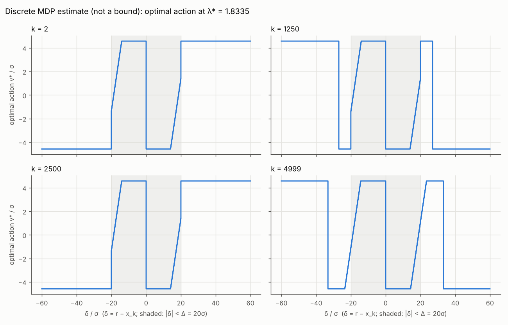
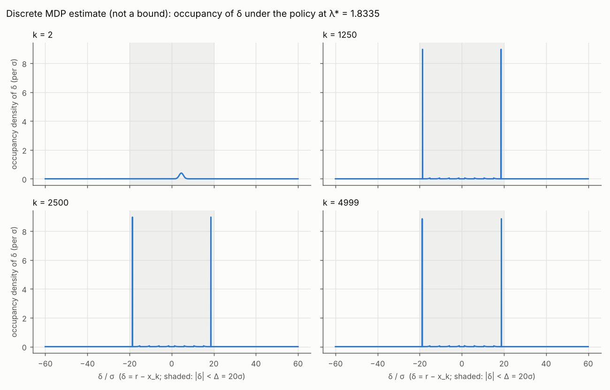

本报告只回答五件事：旧结论按数值判据是否成立；$S$ 的解析上界是多少、证明是否通过；离散 MDP 的对偶估算值是多少（不是界）及其策略的前向 $(S,\mathbb E[N])$；$\log\det J$ 的结论（按 B5 三种情况之一）；预测对照。方案为冻结的 `reports_CN/plan_recheck_bounds_CN.md` v4.2（`6863d7c`；预算按 8.3.6(g) 相对均匀输入，$B:=\mathbb E[N](u_{\rm unif})$）。单场景 $d=20$，不做 MC，不搜索新输入或新包络系数。每个数取自 `round2a/logs/` 下某个日志的一行。

# 0. 结论

1. **旧结论按数值判据成立。** 六个预算内候选（NM-none-P5514、NM-0.3-P4312、AB-0.5、NM-0.7-UNIF、NM-none-P5450、P5014）全部**按数值判据可行**：$\mathbb E[N]-B$ 在 $-0.309$ 到 $-3.505$ 之间，$\tau_N=0.04$；三个 $m_E$ 约束（0.3、0.5、0.7）都**按数值判据满足**（NM-0.7-UNIF 比 0.7 高 0.00168，$\tau_E=0.0003$）。无预算候选 U-L1657 **按数值判据不可行**（$\mathbb E[N]=423.973$）。六个有 R = 4000 配对 se 的候选，$(\text{rec}-\text{MC})/\text{se}$ 在 $-1.06$ 到 $+1.30$ 之间；U-L1657 该列**未定**。
2. **$S$ 的解析认证的上界（条件形式）。** 认证的是：对全体实数 $\delta$，$c(\delta)\le2.76253\,q(\delta)+0.094651$（三段；中段用 Arb 球算术，1000 段、4126 次二分、0 个未认证片段，最差片段上端 $-1.05\times10^{-10}$）。由此对真实预算 $B$，$S\le1+2.76253\,(B-1)+4999\cdot0.094651$（对 $\mathbb E[N]\le B$ 的任何输入）。在额外的、**未认证**的前提 $B\le317$ 下，这给出 $S\le1347.119829<1348$。$B=316.8921$ 是评价器的数值，$B\le317$ 没有证明。
3. **离散 MDP 对偶估算值 $\widetilde S_{\rm dual}=1210.956$**（$\lambda^\*=1.8335$）。这是离散模型上的估算值，**不是界**。该 $\lambda^\*$ 下的最优策略在同一离散模型上前向：$S=1210.798$，$\mathbb E[N]=316.806$（$\le B=316.892$；比 316 多 0.806）。一致性检查（B4）通过。
4. **$\log\det J$：B5 第 (2) 种情况。** 包络证明通过，但路 1 的证书上值未作浮点保守处理。认证的只有包络不等式及由它推出的 $S\le1+2.76253\,(B-1)+4999\cdot0.094651$。数值证书值 $U_{\rm cp}(1347.119829;u_{\rm unif})\approx207.928576$ 的报告未作浮点保守处理（数值证书，未作浮点保守处理）；不声称原模型满足该不等式；它所用的 $S$ 值 1347.119829 带有未认证的前提 $B\le317$。相对增益只有估算值：$U^{\rm upper}-197.197=10.732$ nat；离散 MDP 的对应估算 $U(1210.956)-197.197=9.781$ nat。
5. **预测**：R5、R6、B4、B5 对；B1 分两部分：包络认证通过，预算前提 $B\le317$ 未认证；R2、R3、R4 错；R1 可判定的六个对、U-L1657 未定；B3、B6 部分对；B2 本轮未检验。见第 6 节。

# 1. 依据与提交

| 内容 | 提交 |
|---|---|
| 方案 v4.1 与《思考》 | `aab99e6` |
| 预测 R1–R6、B1–B6（v4.1 文本，跑前） | **`2cfb3aa`** |
| A0：冻结 `config_recheck.json` | `cc214d6` |
| 方案 v4.2（用户在任何运行前更正预算定义：相对均匀输入） | `6863d7c` |
| 预测文件与 config 的跑前修订（v4.2 文本；注明是方案更正，不是预测结果） | **`809fb0d`** |
| A1–A2：七个候选复核与表 | `fe45de9` |
| B2：包络证明 | `73d0428` |
| B3/B4：离散 MDP 对偶估算值、一致性检查、策略图 | `db9e741` |
| B5：折算 | `579fe44` |
| 报告 | `92b2d18` |
| 审核后修订（无新运行，数值未变）：$S$ 结论改为条件形式（$B\le317$ 为未认证前提）、B1 分两部分判定、B5 第 (2) 种情况措辞、策略形状措辞、复现须用完整仓库；`envelope_proof.log` 的 VERDICT 行与 `b5_conversion.log` 的说明文字随脚本输出文字同步修改 | 本修订提交 |

**跑前的两项用户决定**（2026-10-20，方案未能按原文执行时询问所得）：(i) 七个候选取阶段 2 的最终候选（阶段 4 冻结池中的"7 stage-2 finalists"）去掉 UNIF、加上 U-L1657；UNIF 作参考行。原因：方案要求的"阶段 4 冻结池中的七个最终候选"不含 U-L1657，而阶段 4 的各档代表与之不同。(ii) U-L1657 没有 R = 4000 验证批，它的 $(\text{rec}-\text{MC})/\text{se}$ 列标"未定"（只附 R = 2000 的值作参考）。

**$\tau$**（来源 `evaluator/logs/analysis.log:197–213`，版本 B 的 STAB 行）：$\tau_N=$ 向上取一位有效数字 $(10\times0.003784)=0.04$；$\tau_E=$ 向上取一位有效数字 $(10\times2.967\times10^{-5})=0.0003$。$B=316.8921168493721$（`evaluator/logs/run_all.log:1021`；本轮 U 行逐位相同）。

# 2. 旧结论是否按数值判据成立（A 部分）

B = E[N](u_unif) = 316.8921（同评价器 B/n=24），τ_N = 0.04，τ_E = 0.0003；评价器 evaluator_fast.py（B，n = 24）。来源：logs/recheck7.log（A1、A2 行）。

| ID | 来源 | Δm_D（rec） | MC 值 ± 配对 se（R = 4000） | (rec − MC)/se | E[N] | 可行性（按数值判据，B ± τ_N） | m_E | λ0 判定（± τ_E） | S |
|---|---|---|---|---|---|---|---|---|---|
| NM-none-P5514 | stage2/final_batch1.json records[0] | +0.7013 | +0.6970 ± 0.0035 | +1.22 | 316.4725 | 按数值判据可行 | 0.0450 | 不适用（无 λ0 约束） | 486.694 |
| NM-0.3-P4312 | stage2/final_batch1.json records[1] | +0.4268 | +0.4275 ± 0.0061 | -0.12 | 316.5830 | 按数值判据可行 | 0.4203 | 按数值判据满足 λ0 = 0.3 | 479.222 |
| AB-0.5 | stage2/final_batch1.json records[2] | +0.3925 | +0.3972 ± 0.0045 | -1.06 | 316.4766 | 按数值判据可行 | 0.5309 | 按数值判据满足 λ0 = 0.5 | 478.660 |
| NM-0.7-UNIF | stage2/final_batch1.json records[3] | +0.0291 | +0.0225 ± 0.0051 | +1.30 | 316.5321 | 按数值判据可行 | 0.7017 | 按数值判据满足 λ0 = 0.7 | 469.140 |
| NM-none-P5450 | stage2/final_batch1.json records[5] | +0.6480 | +0.6503 ± 0.0047 | -0.49 | 315.9387 | 按数值判据可行 | 0.1205 | 不适用（无 λ0 约束） | 485.513 |
| P5014 | stage2/final_batch1.json records[6] | +0.5707 | +0.5655 ± 0.0044 | +1.17 | 313.3871 | 按数值判据可行 | 0.0451 | 不适用（无 λ0 约束） | 482.992 |
| U-L1657 | stage3/unconstrained.json records[0] | +2.1139 | +2.1013（R = 2000，无 R = 4000 配对 se） | 未定 | 423.9734 | 按数值判据不可行 | 0.1795 | 不适用（无 λ0 约束） | 607.856 |
| UNIF | reference (spec §A4) | +0.0000 | 0（定义） | — | 316.8921 | 按定义合格 | 1.0000 | — | 466.158 |

评价器为已验收的 `evaluator_fast.py`（B，$n=24$），未改；候选参数只加进评价器的内存输入表。NM-none-P5514 的 $\Delta m_D=+0.70127$ 与验收运行中同一输入（D）的值相同。可行性列是"按数值判据"：$\tau_N$ 是预先冻结的经验灰区，不是误差界。

# 3. $S$ 的解析认证的上界（B2，`logs/envelope_proof.log`）

**原理。** 若对全体 $\delta$ 有 $c(\delta)\le a\,q(\delta)+b$（$a\ge0$），则对 $\sum_{k\ge2}\mathbb E[q]=\mathbb E[N]-1\le B-1$ 的任何输入，$S\le1+a(B-1)+4999b$，$B$ 为真实预算。认证的是包络不等式（本节）；代入 $a=2.76253$、$b=0.094651$ 得 $S\le1+2.76253\,(B-1)+4999\cdot0.094651$。在额外的、**未认证**的前提 $B\le317$ 下，这给出 $S\le1+316a+4999b=1347119829/1000000=1347.119829<1348$。$B=316.8921168493721$ 是评价器的数值（`evaluator/logs/run_all.log:1021`），$B\le317$ 没有证明。

**证明**（以 $t=\delta/\sigma$ 记，$\alpha=t-20$、$\beta=t+20$；$c$、$q$ 关于 $\delta$ 偶对称，只看 $t\ge0$）：

| 段 | 方法 | 结果 |
|---|---|---|
| (i) $0\le t\le10$ | 解析：$c_{\rm ev}\le2\Phi(-10)+20\varphi(10)$，$P\ge\Phi(10)-\Phi(-10)$，$c_{\rm no}\le(2\varphi(10))^2/P$；常数用 Arb 求包围 | $c\le1.554\times10^{-21}<10^{-20}<b$，$g<0$ |
| (ii) $10\le t\le20$ | Arb（python-flint，256 位球算术，向外取整）对 $g=(1-a)q-\alpha\varphi(\alpha)+\beta\varphi(\beta)+(\varphi(\alpha)-\varphi(\beta))^2/P-b$ 直接区间求值；1000 段宽 0.01，上端 $\ge0$ 的段二分 | 4126 次二分，最深 13 层（片段宽 $1/819200=1.22\times10^{-6}\ge10^{-6}$），0 个未认证片段；最差片段上端 $-1.05263937285\times10^{-10}$，在 $[18.46,18.47]$；每段 $P>0.49$ 也在区间里验证 |
| (iii) $t\ge20$ | 解析：$q\ge\Phi(\alpha)\ge\frac12$，$c\le1$（Cauchy–Schwarz：$c=1-\mathbb E[u^2\mathbf 1_A]+\mathbb E[u\mathbf 1_A]^2/P(A)\le1$） | $a/2+b=1.475916>1\ge c$ |

**判定：包络认证通过**（$S\le1347.119829$ 另需上述未认证的前提 $B\le317$）。最差片段 $t\in[18.46,18.47]$ 在 $c-aq$ 的最大值点附近；$b$ 与那里的上确界很接近，所以相邻两段需要二分到最细一层（各 1789、1796 次）。总耗时 0.1 s。`mc83.cfun` 只在几个点上作对照（与 Arb 值在 $t\ge15$ 处的差 $\le4.4\times10^{-16}$），不进证书。

# 4. 离散 MDP 对偶估算值（B3/B4，`logs/mdp_estimate.log`，`logs/mdp_policy.log`）

**这不是界。** 动作离散、状态两端截断、条件高斯离散后归一化，三处都不保持上界方向（误差来源按方案原文写在 README）。

**一致性检查（B4，先于任何估算，通过）。** 均匀输入的真实增量取整到 $h$ 的整数倍，同一套离散转移上：前向 $S=466.3221825704343$、$\mathbb E[N]=317.00218223125427$；固定策略后向 $S=466.3221825704326$、$\mathbb E[N]=317.002182231255$；相对差 $3.7\times10^{-15}$、$2.3\times10^{-15}$（门槛 $10^{-10}$）。诊断（无通过线）：与评价器的均匀输入（$S=466.158$，$\mathbb E[N]=316.892$）相比，差 $+0.164$（相对 0.035%）和 $+0.110$（相对 0.035%）。

**估算值。** 黄金分割 $\lambda\in[0,20]$，23 次求值，最终区间 $[1.83323,1.83405]$：
$$\widetilde S_{\rm dual}=1+\min_\lambda\{\widetilde V_\lambda+315.892\lambda\}=1210.956,\qquad\lambda^\*=1.8335,\qquad\widetilde V_{\lambda^\*}=630.755 .$$
$\lambda$ 的精度只影响估算值（方案 B3：$\lambda$ 误差 $10^{-3}$ 对应估算值误差至多约 4.7）。

**该 $\lambda^\*$ 下的策略**（同一离散模型前向）：$S=1210.798$，$\mathbb E[N]=316.806$。按 v4.2 的预算 $B=316.892$ 满足；比 316 多 0.806（0.25%）。结论只限于离散模型。

**策略形状。** 在 $k=2,1250,2500$，$v^\*=0$ 只出现在 $\delta=\pm18.625\sigma$ 这一个节点上（$k=4999$ 为 $\pm18.917\sigma$）；策略具有向边缘内侧停驻点移动的形状；靠近停驻点时使用中间速度，到达后取零速度（$k=1250$ 时有 284 个节点满足 $0<|v^\*|<110h$，$110h=4.583\sigma$ 为最大速度；此数出自审核，可由 `results/mdp_policy.npz` 的 `pols[1250]` 直接数出，不在日志中）。$k=1250$、2500 时，占据分布有 74.7% 在 $18\le|\delta|/\sigma\le19$，最可能的位置是 $\delta=18.625\sigma$，每步发送概率 0.063。

# 5. $\log\det J$ 的结论（B5，`logs/b5_conversion.log`）

**路 1 证书的浮点处理。** 证书上值 $U^{\rm upper}=U_{\rm cp}=F(\tilde\xi)+\text{top\_sum}(d)-\tilde\xi^\top d$ 在 `bound/bound_common.py` 中用普通 float64 numpy 计算（Cholesky、三角求解、对角线取对数、排序求和），没有区间算术、向外取整或舍入误差项；`bound_report.md` 也没有这类说明。所以**未作浮点保守处理**。

**按 B5 表选第 (2) 行：** 包络证明通过、$U^{\rm upper}$ 未作浮点保守处理。认证的只有包络不等式及由它推出的 $S\le1+2.76253\,(B-1)+4999\cdot0.094651$（第 3 节）。数值证书值 $U_{\rm cp}(1347.119829;u_{\rm unif})\approx207.928576$（切平面间隙 $9.2\times10^{-11}$）的报告未作浮点保守处理（**数值证书，未作浮点保守处理**）；不声称原模型满足 $\log\det J_{\rm sod}(u)\le207.928576$；它所用的 $S$ 值 1347.119829 带有未认证的前提 $B\le317$。同一求解器在 $W=465.957628$ 处复现了 `bound/bound_inner.log:31` 的 $198.4234663321$（差 $3\times10^{-11}$）。

**估算（不是界）。** $\log\det J_C$ 没有认证下界，相对增益只作估算：$U^{\rm upper}-197.197=10.732$ nat；离散 MDP 的对应估算 $U(\widetilde S_{\rm dual}=1210.956;u_{\rm unif})-197.197=206.978-197.197=9.781$ nat。（197.197 按方案 B5；它是旧 R = 10000 权重的 $\log\det J_{\rm sod}(u_{\rm unif})$，评价器 B/$n=24$ 给 197.201。）

# 6. 预测对照

| 编号 | 预测（摘要，原文见 `predictions_recheck_bounds.md`） | 结果 | 判定 |
|---|---|---|---|
| R1 | 七个候选的 $\Delta m_D$ 都在 MC 值的 2 se 内 | 有 R = 4000 配对 se 的六个：$z$ 在 $-1.06$ 到 $+1.30$；U-L1657 无 R = 4000 se | 六个**对**；U-L1657 **未定** |
| R2 | $\tau_N$ 在 0.005–0.02 | $\tau_N=0.04$（$10\times0.003784$ 向上取整） | **错** |
| R3 | P5514 可行性为"边界未定" | $\mathbb E[N]-B=-0.420$，按数值判据可行 | **错** |
| R4 | 以 0.07%–0.09% 余量合格的两个候选也为"边界未定" | 余量 0.085% 与 0.070% 的是 AB-0.5 与 NM-0.7-UNIF（`stage2/stage2_report.md:228`，出自阶段 2 而非阶段 3）：$\mathbb E[N]-B=-0.415$、$-0.360$，按数值判据可行（第三个 NM-0.3-P4312 亦然） | **错** |
| R5 | U-L1657 不可行，$\mathbb E[N]\approx423$ | 按数值判据不可行，$\mathbb E[N]=423.973$ | 对 |
| R6 | 七个的 $S$ 在 $[460,500]$，U-L1657 更大 | 六个 469.140–486.694；U-L1657 607.856 | 对 |
| B1 | $(a,b)$ 通过三段全域验证；$\overline S=1347.119829<1348$ | 包络：通过，0 个未认证片段。$\overline S=1347.119829$ 依赖预算前提 $B\le317$，该前提未认证（$B=316.892$ 是评价器的数值） | **分两部分**：包络认证通过；预算前提未认证 |
| B2 | （不搜索新系数） | — | 本轮未检验 |
| B3 | $\widetilde S_{\rm dual}\in[700,1100]$；策略前向 $\mathbb E[N]$ 与 316 之差 $<5\%$ | $\widetilde S_{\rm dual}=1210.956$；$\mathbb E[N]=316.806$，差 0.25% | **部分对**：第一条错，第二条对 |
| B4 | 一致性检查通过；诊断差 $<3\%$ | $3.7\times10^{-15}$、$2.3\times10^{-15}$；诊断差 0.035% | 对 |
| B5 | 发送后把 $\delta$ 推到边缘内侧 1–2σ 处停住（$v=0$），$\lambda\in[0.5,3]$ | $v^\*=0$ 只在 $\pm18.625\sigma$；74.7% 的占据在 $18$–$19\sigma$；$\lambda^\*=1.8335$ | 对 |
| B6 | 绝对严格上界 $U^{\rm upper}(\overline S)$ 比 $U(466)=198.42$ 高约 9.6 nat | 高 9.505 nat；但 $U^{\rm upper}$ 未作浮点保守处理，只是数值证书（B5 第 (2) 种情况），且 $\overline S$ 带未认证的前提 $B\le317$ | **部分对**：量级对，"绝对严格"不成立 |

R3、R4 错的原因：按相对均匀输入的预算，这些候选比 $B$ 低 0.36–0.42 次发送，而 $\tau_N=0.04$；阶段 2 报告里 0.07%–0.09% 的"余量"是配对差减去两倍 MC 标准误后的余量，不是评价器上 $\mathbb E[N]$ 与 $B$ 的距离。B3 错在量级：离散 MDP 的对偶值比预测上限 1100 高。

# 7. 实现中的选择（供审核）

1. **区间库。** 本环境的 `mpmath.iv` 没有可用的 `erf/erfc/ncdf`（`NoConvergence`），改用 python-flint 的 Arb 球算术（方案允许"或等价"）。平方一律写成乘积（Arb 的 `**2` 对含 0 的球给 NaN）。
2. **中段的式子。** $g$ 按定义 $c_{\rm ev}+c_{\rm no}-aq-b$ 写，只把两处 $q$ 合并成 $(1-a)q$；其余逐项区间求值，没有用中心形式或导数。
3. **离散 MDP。** 发送分支的屏蔽和用左前缀和加右后缀和计算（与"总和减窗口"同一个量；后者在 $\delta\approx0$ 处因 $N_i\sim10^{-88}$ 在 float64 中相消为 0）；$P_i:=1-q_i$，$q_i=\Phi(\alpha_i)+\Phi(-\beta_i)$，$c_i$ 用 `mc83.cfun`；$\max_v$ 平局取 $|v|$ 最小者。
4. **七个候选与 U-L1657 的 $z$ 列**：见第 1 节的用户决定。
5. **197.197** 按方案 B5 原文使用。

# 8. 复现

复现需要完整的仓库检出（`lyl-715/SYS-ID`，分支 `claude/optimistic-newton-xv5jvl`），只有审核包 `review_round2a.zip` 不够。在 `code_8_3_stage2/stage2_pkg/evaluator/round2a/` 下（需 numpy、scipy、numba、python-flint）：

    python3 make_config_recheck.py && python3 recheck7.py && python3 envelope_proof.py
    nohup python3 mdp_estimate.py > logs/mdp.stdout 2>&1 &     # 约 10 分钟
    python3 mdp_policy_plots.py && python3 b5_conversion.py

所有数都是确定性的，应与 `logs/*.log` 逐数一致。
