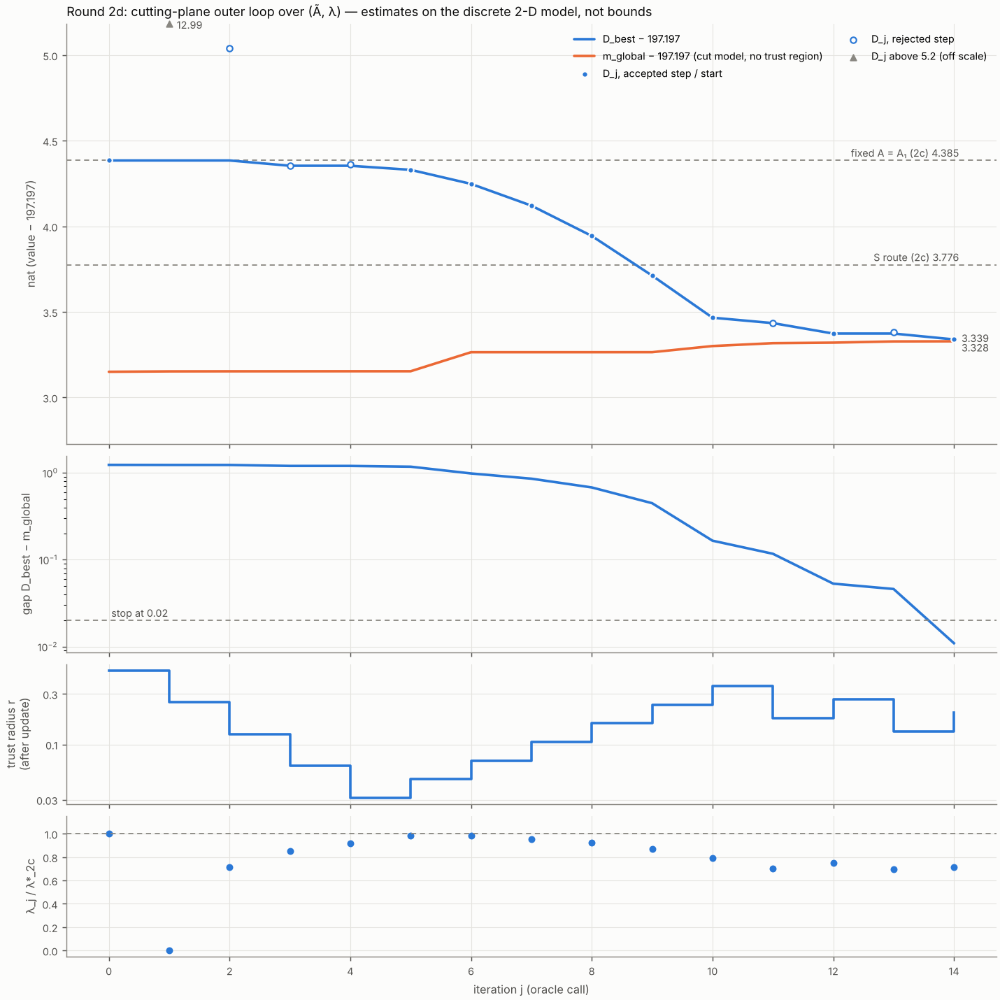

本报告只回答四件事：检查（第 2 节）；收敛曲线（第 3 节）；对照行（第 4 节）；预测 M1–M7 与结果对照，错的也列出（第 5 节）。方案为冻结的 `reports_CN/plan_round2d_CN.md`（`ac058c4`）。预测为 `predictions_round2d.md`（`a2c4050`），在任何运行之前提交。本轮所有数值都是**离散模型上的估算**，没有任何严格结果，也没有任何数被称为界。每个数都取自 `round2d/` 下某个日志的一行，标出文件和行号。方案没有规定的选择记在 `decisions_round2d.md`（DECISION 行）。没有因 STOPPED 而停下的部分。

# 0. 结论

1. **检查全部通过。** B1（回归）：$(\tilde A,\lambda)=(I,\lambda^\star_{2c})$ 处 $\mathcal D-197.197=4.385285228783914$，与 2c 轮逐位相同（相对差 0.0）。B2（支撑超平面）：8 个不等式的松弛量都 $\ge-10^{-9}$，最小为 $+6.92\times10^{-7}$。切平面有效性：最大违反量 $\max_{i,l\ne i}[\mathrm{cut}_l(x_i)-\widetilde V_i]=-9.21\times10^{-4}$，即没有违反。$m_{\rm global}$ 单调不减，只有一步下降 $8.76\times10^{-9}$，在 SCS 容差（$10^{-8}$）以内。
2. **收敛。** 外层迭代 15 次（15 次 oracle 调用）后，按 gap 判据停止。最终 gap $=\mathcal D_{\rm best}-m_{\rm global}=0.010971$ nat（$\le0.02$）。外层总耗时 2028.6 s（0.564 h）。
3. **估算值**：$\min\mathcal D-197.197=\mathbf{3.339266}$ nat（$\mathcal D_{\rm best}$；$m_{\rm global}-197.197=3.328295$）。比 $S$ 路线（3.776）低 **0.436** nat，比 2c 轮固定 $A$（4.385）低 1.046 nat，比真实已评估最优 P5514（+0.701）高 2.638 nat。
4. **最优点**：$\|\tilde A^\star-I\|_F=0.8757$；$\lambda^\star=0.014360$，$\lambda^\star/\lambda^\star_{2c}=0.7137$。该点单一 DP 策略的前向发送数 $n^\star=407.01$，比 $B-1=315.892$ 多 91.1，不在 $\pm5$ 内。
5. **预测**：M1、M2、M3、M4、M5、M7 对；**M6 错**。

# 1. 依据与提交

| 内容 | 提交 |
|---|---|
| 方案（冻结，原样解压，sha256 md `782040fb…`） | `ac058c4` |
| 预测 M1–M7（方案 §4 原文，跑前） | **`a2c4050`** |
| Part A：白化目标、oracle（带策略存储的 DP + 2c 前向），以及 Part C/D 的代码（当时未运行） | `fd0ca30` |
| Part B：检查 B1、B2 | `e7ca145` |
| Part C：外层循环、C4、C5、`fig_convergence.png` | `63e9c8e` |
| Part D：对照行 | `3cfd11c` |
| 本报告 | 本提交 |

运行环境：4 核，Python 3.13.16，numpy 2.5.3，scipy 1.18.1，numba 0.68.0（容器起始时缺 numba，按 `config_fast.json` 记录的版本安装），cvxpy 1.9.3，SCS 3.3.1，Clarabel 0.11.1。

**构造（DECISION A-1–A-5）。** $M_0=M(w(\hat u))$ 取 `round2c/results/M_A1.npy`，其 Cholesky 因子为 $M_0=LL^\top$。取 $g_k=\sigma^{-1}L^{-1}h_{U,k}$，由一次三角求解得到，不形成任何逆矩阵；$A=L^{-\top}\tilde AL^{-1}$。方案写的是对称平方根 $M_0^{-1/2}$。$L^{-1}=QM_0^{-1/2}$，其中 $Q$ 是正交阵，所以两种写法只差正交变量替换 $\tilde A\mapsto Q^\top\tilde AQ$。$\mathcal D$、Frobenius 信赖域和 $\|\tilde A-I\|_F$ 在这一替换下都不变。$\gamma_k(I)$ 与 2c 轮的 $\gamma^{(1)}$ 逐位相同（`logs/checks.log:3`）。

Oracle 由三步组成：
- 2c 轮的 $\gamma$ 加权二维 DP（同一组 kernel，同一顺序）；
- 每步用 2b 轮的 `_codes`/`_pack` 把策略存进内存（1.15 GiB），平局规则与 2a 轮相同；
- 用 2c 轮的 `forward2d_steps` 原样做前向，得到 $w_k$、$n$。

每次调用都检查策略存储是否失配：15 次调用的失配数都是 0。每次调用还比较前向值 $\sum_{k\ge2}\gamma_kw_k-\lambda n$ 与 $\widetilde V$，最大相对差为 $2.13\times10^{-14}$（`logs/oracle.log`，奇数行；`logs/final.log:23`）。

# 2. 检查

| 检查 | 结果 | 数值 | 来源 |
|---|---|---|---|
| 1. 回归（task B1）：$(I,\lambda^\star_{2c}=0.020120725733454057)$ 处 $\mathcal D-197.197$ 对比 2c 轮 4.385285228783914，相对差 $\le10^{-10}$ | **通过** | $\mathcal D-197.197=4.385285228783914$，相对差 0.0（逐位相同）；$\widetilde V=6.2948236330331815$ 逐位相同；常数项 188.93148530235845 与 2c 相同 | `logs/checks.log:4–5` |
| 2. 次梯度有效性（task B2）：3 个随机对称方向 $\Delta$（$\|\Delta\|_F=1$）× $\epsilon\in\{10^{-2},10^{-3}\}$，以及 $\lambda\pm10^{-4}$；判据 $\mathcal D(\cdot)\ge$ 线性化 $-10^{-9}$ | **通过** | 见下表；最小松弛量 $+6.918\times10^{-7}$ | `logs/checks.log:7–15` |
| 3. 切平面有效性（task C4）：每次主问题求解后，对所有已评价点 $i$ 检查 $\mathcal D_i\ge$ 模型值 | **通过** | 最大违反量 $\max_{i,l\ne i}[\mathrm{cut}_l(x_i)-\widetilde V_i]=-9.207560056507802\times10^{-4}<0$（出现在 $i=8,l=7$）；自身项 $\lvert\mathrm{cut}_i(x_i)-\widetilde V_i\rvert\le1.78\times10^{-15}$ | `logs/final.log:20`；逐次见 `logs/outer.log:5–19` |
| 4. $m_{\rm global}$ 单调不减（task C4） | **通过**（在求解器容差内） | 14 步中只有一步为负：$j=7\to8$，变化 $-8.76\times10^{-9}$，小于 SCS 的 eps $10^{-8}$。此时 $m_{\rm global}$ 在 3.264575 上平台不动，其余各步都不减。完整序列见 `logs/final.log:21` | `logs/final.log:20–21` |

B1 前向的附带数据（`logs/checks.log:6`）：$n=315.70778985454626$，$G_\lambda=0.18421$，$\|G_{\tilde A}\|_F=2.0015$。DP（带策略存储）41.9 s，前向 106.5 s。

**B2 明细**（`logs/checks.log:7–14`；随机方向用 `default_rng(20261022)` 生成，DECISION B-1）。松弛量 = 左边 − 右边。"log det 部分"为 $-\log\det(I+\epsilon\Delta)+\epsilon\,\mathrm{tr}\Delta$（$\approx\epsilon^2/2$）；"其余"为 $\gamma_1+\widetilde V$ 部分，由 $\widetilde V$ 的凸性应 $\ge0$。

| 测试 | $\epsilon$ | 松弛量 | log det 部分 | 其余 |
|---|---|---|---|---|
| 方向 1 | $10^{-2}$ | $1.376\times10^{-4}$ | $5.011\times10^{-5}$ | $8.748\times10^{-5}$ |
| 方向 1 | $10^{-3}$ | $1.714\times10^{-6}$ | $5.001\times10^{-7}$ | $1.214\times10^{-6}$ |
| 方向 2 | $10^{-2}$ | $8.594\times10^{-5}$ | $5.001\times10^{-5}$ | $3.593\times10^{-5}$ |
| 方向 2 | $10^{-3}$ | $1.211\times10^{-6}$ | $5.000\times10^{-7}$ | $7.106\times10^{-7}$ |
| 方向 3 | $10^{-2}$ | $6.510\times10^{-5}$ | $4.995\times10^{-5}$ | $1.515\times10^{-5}$ |
| 方向 3 | $10^{-3}$ | $6.918\times10^{-7}$ | $4.999\times10^{-7}$ | $1.918\times10^{-7}$ |
| $\lambda+10^{-4}$ | — | $3.243\times10^{-3}$ | — | — |
| $\lambda-10^{-4}$ | — | $2.647\times10^{-3}$ | — | — |

两个 $\lambda$ 方向的松弛量都比 $\tilde A$ 方向大一个量级以上，说明 $\lambda^\star_{2c}$ 处于 $\widetilde V$ 对 $\lambda$ 的折点附近。2c 轮的 $\lambda^\star_{2c}$ 本来就是 $\mathcal D(I,\cdot)$ 的最小点，这在意料之中。

# 3. 收敛曲线



`fig_convergence.png` 有四个面板，自上而下为：
- $\mathcal D_j-197.197$（实心点为接受或起点，空心点为拒绝；$j=1$ 处的 12.99 超出纵轴，标为三角），$\mathcal D_{\rm best}$，$m_{\rm global}$，以及 2c 的两个参考值；
- gap（对数轴）；
- 信赖域半径 $r$（更新后）；
- $\lambda_j/\lambda^\star_{2c}$。

图中的数都来自 `results/cuts.npz`；报告中没有一个数是从图上读的。

逐次迭代（`logs/outer.log:5–19`，一行一次；数值按日志全精度截短）：

| $j$ | $\mathcal D_j-197.197$ | $\lambda_j$ | $\|\tilde A_j-I\|_F$ | $n_j$ | 比值 | 判定 | $r$（更新后） | $\mathcal D_{\rm best}-197.197$ | $m_{\rm global}-197.197$ | gap |
|---|---|---|---|---|---|---|---|---|---|---|
| 0 | 4.385285 | 0.020121 | 0 | 315.71 | — | 起点 | 0.5 | 4.385285 | 3.150152 | 1.235133 |
| 1 | 12.993950 | $2.9\times10^{-16}$ | 0.5000 | 1007.73 | −10.120 | 拒绝 | 0.25 | 4.385285 | 3.152487 | 1.232798 |
| 2 | 5.039758 | 0.014341 | 0.2500 | 771.96 | −1.401 | 拒绝 | 0.125 | 4.385285 | 3.152895 | 1.232391 |
| 3 | 4.354373 | 0.017180 | 0.1250 | 515.86 | 0.127 | 拒绝 | 0.0625 | 4.354373 | 3.153021 | 1.201351 |
| 4 | 4.363738 | 0.018451 | 0.0625 | 396.20 | 0.175 | 拒绝 | 0.03125 | 4.354373 | 3.153199 | 1.201174 |
| 5 | 4.330514 | 0.019832 | 0.0313 | 381.96 | 0.882 | 接受 | 0.046875 | 4.330514 | 3.153237 | 1.177277 |
| 6 | 4.248408 | 0.019772 | 0.0781 | 251.98 | 0.833 | 接受 | 0.070313 | 4.248408 | 3.264575 | 0.983833 |
| 7 | 4.121313 | 0.019179 | 0.1461 | 296.10 | 0.964 | 接受 | 0.105469 | 4.121313 | 3.264575 | 0.856738 |
| 8 | 3.944126 | 0.018530 | 0.2487 | 316.10 | 0.995 | 接受 | 0.158203 | 3.944126 | 3.264575 | 0.679551 |
| 9 | 3.712372 | 0.017479 | 0.4067 | 330.04 | 0.990 | 接受 | 0.237305 | 3.712372 | 3.264706 | 0.447666 |
| 10 | 3.466392 | 0.015989 | 0.6427 | 350.82 | 0.896 | 接受 | 0.355957 | 3.466392 | 3.300584 | 0.165807 |
| 11 | 3.434689 | 0.014152 | 0.9513 | 329.55 | 0.191 | 拒绝 | 0.177979 | 3.434689 | 3.317426 | 0.117262 |
| 12 | 3.373666 | 0.015078 | 0.7892 | 177.84 | 0.768 | 接受 | 0.266968 | 3.373666 | 3.320532 | 0.053134 |
| 13 | 3.380137 | 0.013961 | 0.9151 | 567.80 | −0.122 | 拒绝 | 0.133484 | 3.373666 | 3.327558 | 0.046107 |
| 14 | 3.339266 | 0.014360 | 0.8757 | 407.01 | 0.766 | 接受 | 0.200226 | 3.339266 | 3.328295 | **0.010971** |

停止行：`logs/outer.log:20`。共接受 8 步、拒绝 6 步。29 次主问题求解都由 SCS 返回 'optimal'，Clarabel 一次也没用到（`logs/final.log:22`）。

**过程的读法。**
- $\lambda$ 不在信赖域内（方案原文，DECISION C-4）。第一步只有一条切平面，它对 $\lambda$ 是线性的，所以 $\lambda$ 跳到区间端点 0。$j=1$ 处 $\mathcal D$ 为 12.99，被拒绝。随后三步 $\lambda$ 由切平面逐步定位，但每次拒绝都把 $r$ 减半，到 $j=4$ 时 $r$ 降到 0.03125。
- $j=5$–10 连续接受，$r$ 每步乘 1.5，$\|\tilde A-I\|_F$ 从 0.03 增大到 0.64，$\mathcal D_{\rm best}$ 从 4.33 降到 3.47。
- $j=3$ 的点（4.354）比中心（4.385）好，但比值 0.127 < 0.25，按方案规则判为失败，中心不动；$\mathcal D_{\rm best}$ 照常取到它（DECISION C-1）。

**时间。** 每次 oracle：DP（带策略存储）30.8–39.8 s，前向 86.4–108.8 s（`logs/oracle.log` 奇数行）。每次迭代合计 118.5–145.6 s（`logs/outer.log:5–19` 末列）。方案估计每次约 35 s（25 s + 10 s），实际约为其 4 倍。主要原因是闭环策略下前向在每步都要搬运分布在很多速度列上的质量。迭代数远少于 300，所以总耗时仍短：外层 2028.6 s = 0.564 h（`logs/final.log:22`；与 `logs/outer.log:21` 的墙钟时间相同）。加上 Part B 的 343.5 s（`logs/checks.log:17`），合计 0.659 h。

**C5：最终点**（$\mathcal D$ 最小的已评价点，$j=14$；DECISION C-7；`logs/final.log:16–19`）：

| 量 | 值 |
|---|---|
| $\mathcal D-197.197$ | **3.339266431341514**（$\mathcal D=200.53626643134152$） |
| 最终 gap $\mathcal D_{\rm best}-m_{\rm global}$ | 0.010971104064026349（$\le0.02$） |
| $m_{\rm global}-197.197$ | 3.3282953272774876 |
| $\|\tilde A^\star-I\|_F$ | 0.8757401525546923；$\tilde A^\star$ 特征值 $\in[0.4790,\ 1.0837]$，$\log\det\tilde A^\star=-2.5023$ |
| $\lambda^\star$；$\lambda^\star/\lambda^\star_{2c}$ | 0.01436024046420818；0.7137039018593594 |
| 前向 $n^\star=\sum_{k\ge2}\mathbb E[q]$ | 407.0112555699785；$n^\star-(B-1)=91.119$；$\lvert n^\star-(B-1)\rvert\le5$：**否** |
| 迭代数；外层耗时 | 15；2028.6 s（0.564 h） |
| 存档 | `results/A_star.npy`（$\tilde A^\star$），`results/A_star_unwhitened.npy`（$A^\star=L^{-\top}\tilde A^\star L^{-1}$），`results/w_star.npy`（$w^\star$），`results/final.json`（$\lambda^\star$、$n^\star$），`results/cuts.npz`（全部切平面） |

**诊断（任务未要求，`logs/final.log:24–26`；DECISION C-10）。**
- 所有切平面的截距 $a_i=\widetilde V_i-\langle\widetilde M_i,\tilde A_i\rangle+\lambda_in_i$ 都在舍入量级（$\max|a_i|=4.8\times10^{-13}$）。这是因为 $\widetilde V$ 对 $(\tilde A,\lambda)$ 正齐次。因此不带信赖域的主问题，正好是下面问题的拉格朗日对偶："在已评价策略的随机混合上最大化 $\log\det M$"，外加一个来自 $\lambda\le0.5$ 的 $0.5\max(0,n-(B-1))$ 项。
- 实算这个混合问题：在 $\sum_i\theta_in_i\le B-1$ 下，最好的混合给出 $\log\det M-197.197=3.3282953281504604$，与 $m_{\rm global}$ 相差 $9\times10^{-10}$。混合的发送数为 $n=315.892$，恰好等于 $B-1$；主要权重落在 $j=12,13,7,14,11$ 上。
- 所以在离散模型上，$\min\mathcal D$ 落在 $[3.3283,\ 3.3393]$ 之内：上端是已评价的 $\mathcal D$，下端是一个由已评价闭环策略随机混合实际达到的 $\log\det M$。两端都是离散模型上的数，不是对连续问题的界。
- 最优点自身的单一策略：$\log\det M(w^\star)-197.197=4.4596$，但它的 $n^\star=407$ 超出预算，不可行。

# 4. 对照行（Part D）

`logs/part_d.log:3–9`：

| 量 | 值（nat，相对 197.197） | 性质 |
|---|---|---|
| 真实已评估最优（P5514，evaluator_fast B，$n=24$） | **+0.701**（$\Delta m_D=0.7012655$） | 评估值 |
| 本轮 $\min\mathcal D-197.197$（二维，对 $A$ 优化） | **3.339**（3.339266） | 估算 |
| $S$ 路线 $U(619.129)-197.197$（2c） | **3.776**（3.775601） | 估算 |
| 固定 $A=A_1$（二维，2c） | **4.385**（4.385285） | 估算 |

第一行的 +0.701 是相对评价器自己的 $\log\det J(u_{\rm unif})=197.20098$ 的 $\Delta m_D$；换到 −197.197 尺度为 0.70524。两者相差 0.0044，与 2c 轮 DECISION A-5 同源（`logs/part_d.log:8`；DECISION D-1）。

差值（`logs/part_d.log:9`）：

| 比较 | 差（nat） |
|---|---|
| 本轮 − $S$ 路线 | −0.436 |
| 本轮 − 固定 $A$ | −1.046 |
| 本轮 − 真实已评估最优 | +2.638（−197.197 尺度上为 +2.634） |

**按方案 §5 的读法。** 本轮 $\min\mathcal D$ 比 $S$ 路线低 0.436 nat，属于 §5 的第一种情况：动态对放置的限制确实值约 0.44 nat（离散模型估算），直接路线有用。2c 轮"直接路线不比 $S$ 路线紧"的结果，来自固定 $A$ 的线性化损失：对 $A$ 优化后，固定 $A$ 的值降了 1.046 nat。剩下的 2.638 nat（$\min\mathcal D-0.70$），按 §5 是"闭环能反应、开环不能"再加上离散化。

这一读法有三个前提：
- 本轮值、$S$ 路线值都是同一离散模型（$h=\sigma/30$，$L=137$）上的估算，离散化误差的方向仍未定；
- +0.701 来自另一个评价器（evaluator_fast），与离散 DP 模型不是同一模型；
- 本轮值依赖外层的停止容差，$\min\mathcal D$ 在离散模型上落在 $[3.3283,3.3393]$ 内（第 3 节诊断）。

# 5. 预测对照

| 编号 | 预测 | 结果 | 判定 |
|---|---|---|---|
| M1 | 检查 1–4 全过 | 回归逐位复现；8 个支撑超平面不等式全过（最小松弛 $+6.9\times10^{-7}$）；切平面最大违反 $-9.2\times10^{-4}$（无违反）；$m_{\rm global}$ 只有一步 $-8.8\times10^{-9}$，在 SCS 容差内（第 2 节） | **对**（检查 4 按"求解器容差内不减"判定，这是任务 C4 的原文判据） |
| M2 | $\min\mathcal D-197.197\in[2.5,3.5]$ | 3.339266 | **对** |
| M3 | 比 $S$ 路线的 3.776 低至少 0.3 nat | 低 0.436 | **对** |
| M4 | 终止时 gap $\le0.02$，迭代数 $\le200$ | gap 0.010971，15 次迭代 | **对** |
| M5 | $\|\tilde A^\star-I\|_F>0.2$；$\lambda^\star/\lambda^\star_{2c}\in[0.5,2]$ | 0.8757；0.7137 | **对** |
| M6 | 最优点处策略前向的 $n$ 落在 $B-1\pm5$ 内 | $n^\star=407.01$，比 $B-1$ 多 91.1 | **错** |
| M7 | 总耗时 $\le4$ h | 外层 0.564 h；加上检查 0.659 h | **对**（DECISION D-3；每次迭代约 135 s，是方案估计的 4 倍，但只用了 15 次迭代） |

关于 M6（DECISION D-2）。预测说的是"最优点处策略"，按字面判为最优点（$j=14$）处单一 DP 策略的 $n^\star$，结果是错。互补松弛在这里由策略的**随机混合**体现：达到 $m_{\rm global}$ 的那个混合的 $n$ 恰为 $B-1=315.892$（第 3 节诊断）。最优点落在 $\widetilde V$ 的折点上，单一策略的 $n$ 对 $\lambda$ 和 $\tilde A$ 很敏感。15 个迭代点的 $n_j$ 在 177.8 到 1007.7 之间。这一说明不改变判定。

来源：M1 见第 2 节；M2、M5、M6 见 `logs/final.log:17–19`；M3 见 `logs/part_d.log:9`；M4 见 `logs/outer.log:20` 与 `logs/final.log:16–17`；M7 见 `logs/final.log:22`、`logs/checks.log:17`。

# 6. 复现

在 `code_8_3_stage2/stage2_pkg/evaluator/round2d/` 下运行。需要完整仓库：复用 `round2c/logdet_dual.py`、`round2b/mdp2d_estimate.py`、`round2b/grid30.py`、`round2a/mdp_estimate.py`，以及 `round2c/results/` 的 $M_0$、$\gamma^{(1)}$ 和 2c 结果。

```
python3 checks.py --threads 4                    # Part B：写 results/checks.json（外层的门槛）
python3 logdet_outer.py outer --threads 4        # Part C：每次迭代后写检查点；被杀后重跑同一命令即从检查点续跑
python3 logdet_outer.py final                    # C5（以及诊断）
python3 logdet_outer.py table                    # Part D
python3 logdet_outer.py plot                     # fig_convergence.png
```

每次迭代的 $w_i$ 与每步 $\mathbb E[q]$ 写在 `results/w_iter/`，不提交（DECISION C-6）。`final` 需要其中最优点的那一个文件。
