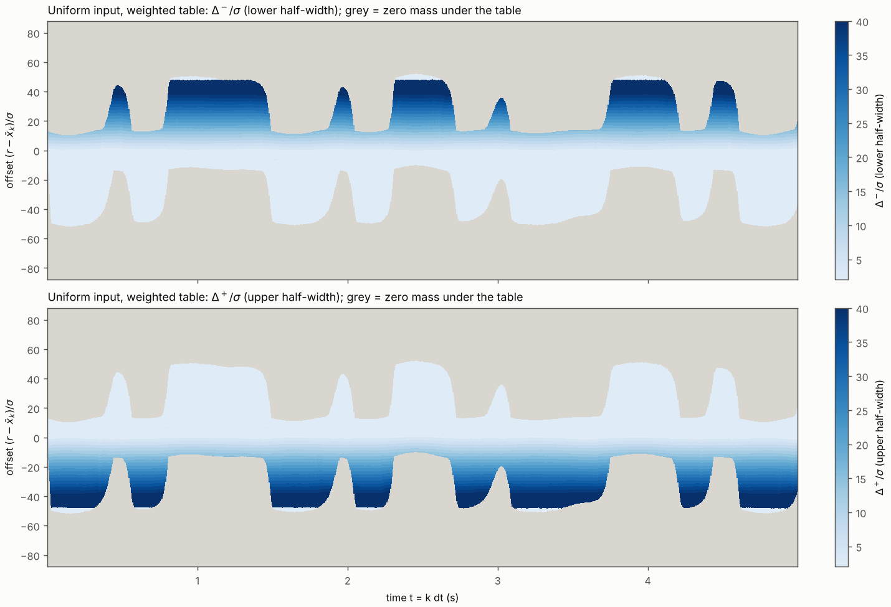
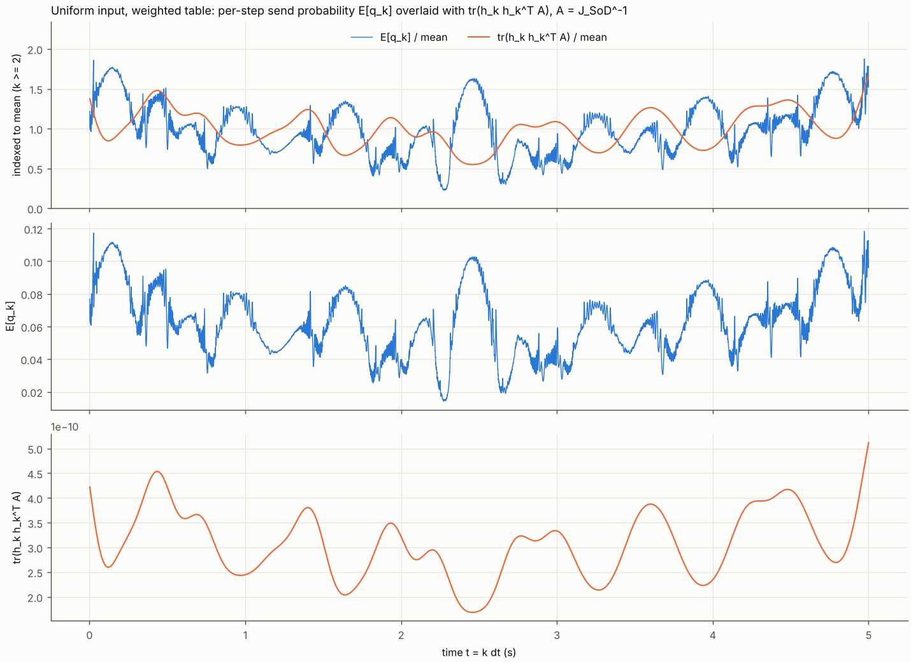

本报告只回答五件事：
- 六项检查（第 2 节）；
- 对照表（第 3 节）；
- 利用率（第 4 节）；
- $\sigma/48$ 复核，分别给出两个网格的预算判定（第 5 节）；
- 预测 V1–V8 与结果对照，错的也列出（第 6 节）。

方案为冻结的 `reports_CN/plan_round4_CN.md` v3.1（`d15ac2e`），预测为 `predictions_round4.md`（`0e885c5`），在任何代码和运行之前提交。

**范围。** 本轮改的是触发机制，超出任务书"触发固定"的约束，属于探索性计算，不进现有交付稿。结论只限于名义点 $\theta_0$，以及冻结的动作集 $M^\pm\in\{48,96,\dots,960\}$（$\Delta^\pm\in\{2,4,\dots,40\}\sigma$）。

**数值的性质。** 本报告的数是"给定离散方案下的确定性数值评价"：
- 参考值网格 $\sigma/24$，评价器是已验收算子的一般窗口推广；
- 对偶值只作参考，标为"已评估 λ 中的最小对偶值"；
- 设计结果一律称为"冻结动作集与名义模型下的可行确定性窗口策略"。

每个数都取自 `round4/` 下某个日志或结果文件的一行，标出文件和行号。方案没有规定的选择记在 `decisions_round4.md`（DECISION 行）。没有因 STOP 而停下的部分。

# 0. 结论

1. **六项检查全部通过。**
   - 检查 1：原算子复用路径逐位一致。一般窗口路径在 $(480,480)$ 上与原算子的最大相对差：$\mathbb E[N]$ $9.2\times10^{-14}$，$S$ $9.3\times10^{-14}$；$J$ 比值 $4.5\times10^{-14}$。
   - 检查 2：小网格显式矩阵的最大误差 $3.1\times10^{-15}$。
   - 检查 3：前向—后向的 $F$、$N$ 相对差都 $\le4.5\times10^{-15}$。
   - 检查 4：45 次 DP 中 $N(\pi_\lambda)$ 没有一次随 $\lambda$ 增大而增大。
   - 检查 5：四个最终策略都满足 $\mathbb E[N]\le B$。
   - 检查 6：质量偏差 $\le1.1\times10^{-12}$，$\min m=0$，断言 0 次触发。
2. **四个最终策略**（冻结动作集与名义模型下的可行确定性窗口策略，$\sigma/24$ 网格）。$\Delta m_D$ 相对同输入常数阈值 SoD：

   | 情况 | $\mathbb E[N]$ | $S$ | $\Delta m_D$ |
   |---|---|---|---|
   | 均匀/$S$ 表 | 316.7015 | 1064.10 | **+7.860** |
   | 均匀/加权表 | 316.6036 | 1037.26 | **+7.830** |
   | P5514/$S$ 表 | 316.6663 | 1087.76 | **+7.381** |
   | P5514/加权表 | 316.8664 | 1069.18 | **+7.418** |

   常数阈值时 $S$ 为 466.16（均匀）和 486.69（P5514）。
3. **利用率**：$B-\mathbb E[N]$ = 0.191、0.289、0.226、0.026，都 $\le0.5$。
4. **$\sigma/48$ 复核**：
   - 四个策略在两个网格上都判"可行"，没有翻转。
   - $\mathbb E[N]$ 在 $\sigma/48$ 上降 0.24–0.46 次（$>0.05$），四个都标 **"精度未定"**。
   - $\Delta m_D$ 降 0.007–0.012 nat。均匀输入的两个超过 0.01。
5. **表的形状。**
   - 远侧半宽几乎处处取下限 $2\sigma$。
   - 近侧（从参考值看名义输出所在一侧）半宽随 $|r-\bar x_k|$ 增大，使近侧窗边始终落在名义输出外约 $1.9\sigma$ 处（中位数；10–90% 分位 1.05–2.87$\sigma$）。
   - 不发送的步因此仍带删失信息，这是 $S$ 翻倍的来源。
   - **这一机制完全依赖名义模型 $\bar x_k=x_k(\theta_0)$ 在 $\sigma$ 的几分之一以内准确，也依赖高斯噪声和已知 $\sigma$。** 本轮不做鲁棒性（方案 §6），模型偏离下的表现未评估。
6. **预测**：V1、V7、V8 对；V2、V3、V5 错；V4、V6 部分对。

# 1. 依据与提交

| 内容 | 提交 |
|---|---|
| 方案 v3.1（冻结，zip 原样解压到仓库根；plan md sha256 `0f7b27a1…`） | `d15ac2e` |
| 预测 V1–V8（方案 §4 原文，`sed -n '95,106p'`，跑前） | **`0e885c5`** |
| Part A：`evaluator_window.py`，检查 1、2 | `c28a38d` |
| Part B：`trigger_dp.py`，四个 λ 扫描，B4 检查，最终表的打包副本 | `e6a3d60` |
| Part C：C1、C2、C3、图、MC 诊断；`evaluator_window.py` 加了只供作图用的记录选项（Part A 检查重跑，数值不变） | `afcc1a1` |
| 本报告 | 本提交 |

**勘误。** `e6a3d60` 的提交说明把 P5514/加权表的 $\lambda/\bar\gamma$ 写成 3.375。正确值是 3.26875（`results/scan_P5514_W.json`；`logs/scan_P5514_W.log:15`）。说明已推送，不改写历史，在此更正。

**运行环境。**
- 4 核；Python 3.13.17（`config_fast.json` 记录的是 3.13.16）；numpy 2.5.3，scipy 1.18.1。
- numba 0.68.0：容器起始时缺失，按 `config_fast.json` 的版本安装，与 2d 轮相同。

**构造要点。**
- 评价器（`evaluator_window.py`）沿用已验收参考值网格 $r_i=z_0+ih$，$h=\sigma/24$，以及核、`cfun`、记录和 $J$ 的组装。
- 一般窗口路径的支撑半宽 $R=88\sigma$，每步 4223–4224 个节点（`logs/partA_checks.log:4–5`）。
- 一般窗口路径的三项计算：
  - 发送概率 $\hat q$：左尾加右尾，由 $\hat g$ 的一次前缀和与一次后缀和取出；
  - 到达项 $T_j$：把 $m$ 按窗口两端点归集，做一次后缀和与一次前缀和；
  - 全程不出现"总和减窗内和"。
- DP（`trigger_dp.py`）中的 $\hat q$、$\hat P$ 与评价器用同一段代码、同一组数组，逐位相同。
- $c$ 按 `cfun` 的公式由逐步节点查表求得（DECISION B-3）。
- 每个 $\lambda$ 记一个诊断量：DP 自身的值 $\sum\hat g_1V_2$ 与所存表前向的 $F-\lambda N$ 之差。45 次中相对 $F$ 的最大值为 $1.8\times10^{-13}$（`results/scan_*.json` 的 `dp_minus_policy`）。

# 2. 六项检查

| 检查 | 结果 | 数值 | 来源 |
|---|---|---|---|
| 1. SoD 回归 (i) 原算子复用路径：动作全为 $(480,480)$ 时走 `evaluator_fast`，与其逐位一致 | **通过** | 均匀、P5514：$\mathbb E[N]$、$S$、$J$ 的 81 个元素之差均为 0 | `logs/partA_checks.log:12, 31` |
| 1. SoD 回归 (ii) 一般窗口路径在 $(480,480)$ 上，冻结容差 $10^{-12}$ | **通过** | 均匀：$\mathbb E[N]$ 相对 $6.15\times10^{-14}$，$S$ $6.13\times10^{-14}$，$J$ 比值 $3.28\times10^{-14}$。P5514：$9.18\times10^{-14}$，$9.33\times10^{-14}$，$4.50\times10^{-14}$ | `logs/partA_checks.log:13–15, 25, 32–34, 44` |
| 2. 小网格显式矩阵（$G=200$，$K=30$，表 a/b/c × $\gamma\equiv1$/随机 $\gamma$）：前向每步质量、$\mathbb E[N]$、$\sum\gamma_kw_k$，后向每步 $V^c$、$V^q$ 与两个标量 | **通过** | 42 个误差中最大为 $3.10\times10^{-15}$（表 b，每步质量）。三类表都有跨网格边界的窗口（1392、1650、1924 个节点·步）。每步发送概率最小 0.28，发送分支被用到 | `logs/partA_checks.log:46–127`；`results/partA_checks.json` |
| 3. 前向—后向一致：最终表，$\sum\gamma_kw_k$ 与 $N$ 分别比，相对 $\le10^{-10}$ | **通过** | $F$：$6.4\times10^{-16}$、$9.3\times10^{-16}$、$1.67\times10^{-15}$、$6.7\times10^{-16}$。$N$：$3.96\times10^{-15}$、$2.52\times10^{-15}$、$4.50\times10^{-15}$、$1.8\times10^{-16}$（均匀/S、均匀/加权、P5514/S、P5514/加权） | `logs/final_checks.log:7, 10, 30, 33, 54, 57, 77, 80` |
| 4. 单调性：$\lambda_2>\lambda_1\Rightarrow N(\pi_{\lambda_2})\le N(\pi_{\lambda_1})$，违反超过相对 $10^{-9}$ 即停 | **通过** | 四个情况共 45 次 DP，所有 $\lambda$ 对之间 $N$ 的最大相对增量为 0 | `results/scan_*.json`（`mono_worst`）；`logs/final_checks.log`（`mono_worst`） |
| 5. 预算：最终策略前向 $\mathbb E[N]\le B=316.8921168493721$ | **通过** | $B-\mathbb E[N]$ = 0.19064、0.28855、0.22586、0.02572 | `logs/final_checks.log:13–14, 36–37, 60–61, 83–84` |
| 6. 质量守恒、非负、支撑断言 | **通过** | 45 次扫描前向、4 次 C1、4 次 $\sigma/48$ 评价：每步 $\lvert\sum m-1\rvert$ 最大 $5.5\times10^{-13}$（$\sigma/24$）和 $1.12\times10^{-12}$（$\sigma/48$），$\min m=0$，支撑边缘断言 0 次触发。DP 中非有限值 0 个 | `results/scan_*.json`；`logs/part_c1.log`；`logs/part_c2.log` |

# 3. 对照表（C3）

`c3_table.md`；数值见 `logs/part_c1.log`，表行见 `logs/part_c3.log:2–7`。参考矩阵：
- $\Delta m_D$：同输入、同网格的常数阈值 SoD；
- $m_E$：均匀输入常数阈值 SoD 的 $J_C$。

| 输入 | 触发 | $\mathbb E[N]$ | $S$ | $\log\det J$ | $\Delta m_D$（相对同输入常数 $\Delta$） | $m_E$（相对均匀输入常数 $\Delta$） |
|---|---|---|---|---|---|---|
| 均匀 | 常数 $\Delta$ | 316.8921 | 466.158 | 197.20098 | +0.00000 | 1.00000 |
| 均匀 | $S$ 表 | 316.7015 | 1064.099 | 205.06091 | **+7.85993** | 1.58164 |
| 均匀 | 加权表 | 316.6036 | 1037.260 | 205.03141 | **+7.83044** | 1.30930 |
| P5514 | 常数 $\Delta$ | 316.4725 | 486.694 | 197.90224 | +0.00000 | 0.04502 |
| P5514 | $S$ 表 | 316.6663 | 1087.756 | 205.28318 | **+7.38094** | 0.09982 |
| P5514 | 加权表 | 316.8664 | 1069.183 | 205.32021 | **+7.41797** | 0.10868 |

**C1 补充：九个广义特征值。** $\lambda_i$ 由 $Jv=\lambda J_Cv$ 定义，由小到大排列（`logs/part_c1.log:59–67, 92–100, 125–133, 158–166`）：

| 情况 | $\lambda_1$ | $\lambda_2$ | $\lambda_3$ | $\lambda_4$ | $\lambda_5$ | $\lambda_6$ | $\lambda_7$ | $\lambda_8$ | $\lambda_9$ |
|---|---|---|---|---|---|---|---|---|---|
| 均匀/$S$ 表 | 1.582 | 2.017 | 2.066 | 2.194 | 2.281 | 2.427 | 2.528 | 3.391 | 3.776 |
| 均匀/加权表 | 1.309 | 1.942 | 1.974 | 2.033 | 2.252 | 2.438 | 2.637 | 3.840 | 4.439 |
| P5514/$S$ 表 | 0.0998 | 0.1163 | 2.000 | 2.215 | 2.450 | 2.965 | 3.711 | 45.61 | 51.18 |
| P5514/加权表 | 0.1087 | 0.1285 | 1.813 | 2.177 | 2.362 | 2.965 | 3.919 | 44.28 | 50.12 |

**对照均匀输入常数阈值的 $\Delta m_D$**（即与 2a 轮 P5514 的 +0.701 同口径）：P5514/$S$ 表 +8.082，P5514/加权表 +8.119（`logs/part_c1.log:141, 174`）。

**几点读法。**
- 四个表都把 $S$ 提高到常数阈值的 2.2–2.3 倍，发送数不变（都在预算内）。
- 均匀输入上，$S$ 表的 $\Delta m_D$ 比加权表高 0.029 nat。加权目标是 $\mathrm{tr}(J_{\rm SoD}^{-1}J)$ 的代理，不是 $\log\det$（方案 §1.3），这里代理没有换来更高的 $\log\det$。
- P5514 上相反，加权表高 0.037 nat。
- P5514 的两个弱方向（$\lambda_1,\lambda_2\approx0.05$）在常数阈值时就存在。窗口表把它们提高到约 2.2–2.4 倍，但仍远低于均匀输入。这是输入本身的性质，触发表不改变它。

**图。**
- `fig_window_heatmap.png`：均匀输入加权表在 $(k,(r-\bar x_k)/\sigma)$ 平面上的 $\Delta^-$、$\Delta^+$。灰色为该表下前向质量为 0 的节点，从不访问，所存动作无关紧要。
- `fig_sendprob_trA.png`：逐步发送概率 $\mathbb E[q_k]$ 与 $\mathrm{tr}(h_kh_k^\top A)$，$A=J_{\rm SoD}^{-1}$。上面板把两者各自按 $k\ge2$ 的均值归一后叠加；下两个面板分别是原值，各用一个纵轴。
- 两者的 Spearman 秩相关为 $-0.185$（`logs/part_c3.log:18`）：发送并没有集中到 $\mathrm{tr}(h_kh_k^\top A)$ 大的时段。





# 4. 利用率与 λ 扫描

可行性判据为 $\mathbb E[N]\le B$，$B=316.8921168493721$（DECISION B-8）。利用率目标 $B-\mathbb E[N]\le0.5$ 不计入通过。
- 四个情况的扫描都正常结束（status `done`），没有到限，没有出现冻结消息。
- 加权目标的 $\lambda$ 以 $\bar\gamma$ 计：均匀 $\bar\gamma=0.0215873$，P5514 $\bar\gamma=0.0192808$。
- 检查：$\sum_{k\ge1}\gamma_kw_k({\rm SoD})=9.00000000000002$ 和 $9.000000000000002$（`logs/scan_U_W.log:4–5`；`logs/scan_P5514_W.log:4–5`）。

| 情况 | 最终 run | $\lambda$（$\lambda/\bar\gamma$） | $\mathbb E[N]$ | $B-\mathbb E[N]$ | $\le0.5$？ | DP 次数 | 已评估 λ 中的最小对偶值 | 来源 |
|---|---|---|---|---|---|---|---|---|
| 均匀/$S$ 表 | 11 | 3.203125 | 316.70148 | 0.19064 | 是 | 11 | 1064.7100 | `logs/scan_U_S.log:15–17` |
| 均匀/加权表 | 5 | 0.0733968（3.4000） | 316.60357 | 0.28855 | 是 | 11 | 22.88339 | `logs/scan_U_W.log:10, 17–18` |
| P5514/$S$ 表 | 10 | 3.15 | 316.66626 | 0.22586 | 是 | 12 | 1088.4676 | `logs/scan_P5514_S.log:14, 17–18` |
| P5514/加权表 | 10 | 0.0630241（3.26875） | 316.86639 | 0.02572 | 是 | 11 | 21.10081 | `logs/scan_P5514_W.log:15, 17–18` |

**全部已评估的 λ**（每行取自对应扫描日志的一行；$\lambda$ 列为 $\lambda/\bar\gamma$，$S$ 目标下 $\bar\gamma=1$；"可"为 $\mathbb E[N]\le B$；★为最终策略）：

| 情况 | run | 阶段 | $\lambda/\bar\gamma$ | $\mathbb E[N]$ | $S$ | $F$ | 可行 | $\Delta m_D$ |
|---|---|---|---|---|---|---|---|---|
| 均匀/S | 1 | 起点 | 5.0 | 204.0916 | 625.115 | 624.115 | 可 | +2.868 |
| 均匀/S | 2 | 下扫 | 4.0 | 247.6784 | 818.634 | 817.634 | 可 | +5.436 |
| 均匀/S | 3 | 下扫 | 3.2 | 317.0871 | 1065.334 | 1064.334 | **否** | +7.870 |
| 均匀/S | 4 | 二分 | 3.6 | 276.4584 | 927.695 | 926.695 | 可 | +6.598 |
| 均匀/S | 5 | 二分 | 3.4 | 294.8929 | 992.163 | 991.163 | 可 | +7.218 |
| 均匀/S | 6 | 二分 | 3.3 | 305.4492 | 1027.520 | 1026.520 | 可 | +7.539 |
| 均匀/S | 7 | 二分 | 3.25 | 311.1404 | 1046.157 | 1045.157 | 可 | +7.704 |
| 均匀/S | 8 | 二分 | 3.225 | 314.0949 | 1055.722 | 1054.722 | 可 | +7.788 |
| 均匀/S | 9 | 二分 | 3.2125 | 315.5892 | 1060.532 | 1059.532 | 可 | +7.829 |
| 均匀/S | 10 | 二分 | 3.20625 | 316.3221 | 1062.884 | 1061.884 | 可 | +7.849 |
| 均匀/S | 11★ | 二分 | 3.203125 | 316.7015 | 1064.099 | 1063.099 | 可 | +7.860 |
| 均匀/加权 | 1 | 起点 | 5.0 | 213.2275 | 651.608 | 13.8102 | 可 | +3.606 |
| 均匀/加权 | 2 | 下扫 | 4.0 | 262.7986 | 854.595 | 18.5629 | 可 | +6.089 |
| 均匀/加权 | 3 | 下扫 | 3.2 | 341.5603 | 1113.413 | 24.6086 | **否** | +8.463 |
| 均匀/加权 | 4 | 二分 | 3.6 | 295.6459 | 969.517 | 21.2501 | 可 | +7.225 |
| 均匀/加权 | 5★ | 二分 | 3.4 | 316.6036 | 1037.260 | 22.8323 | 可 | +7.830 |
| 均匀/加权 | 6 | 二分 | 3.3 | 328.5471 | 1074.269 | 23.6959 | **否** | +8.144 |
| 均匀/加权 | 7 | 二分 | 3.35 | 322.4771 | 1055.575 | 23.2603 | **否** | +7.987 |
| 均匀/加权 | 8 | 二分 | 3.375 | 319.5483 | 1046.463 | 23.0477 | **否** | +7.909 |
| 均匀/加权 | 9 | 二分 | 3.3875 | 318.0625 | 1041.835 | 22.9392 | **否** | +7.870 |
| 均匀/加权 | 10 | 二分 | 3.39375 | 317.3300 | 1039.547 | 22.8856 | **否** | +7.850 |
| 均匀/加权 | 11 | 二分 | 3.396875 | 316.9654 | 1038.404 | 22.8589 | **否** | +7.840 |
| P5514/S | 1 | 起点 | 5.0 | 207.1136 | 665.722 | 664.722 | 可 | +2.854 |
| P5514/S | 2 | 下扫 | 4.0 | 246.6178 | 841.125 | 840.125 | 可 | +5.035 |
| P5514/S | 3 | 下扫 | 3.2 | 310.7903 | 1069.100 | 1068.100 | 可 | +7.224 |
| P5514/S | 4 | 下扫 | 2.56 | 415.3093 | 1366.347 | 1365.347 | **否** | +9.439 |
| P5514/S | 5 | 二分 | 2.88 | 354.2324 | 1200.779 | 1199.779 | **否** | +8.275 |
| P5514/S | 6 | 二分 | 3.04 | 330.6950 | 1131.162 | 1130.162 | **否** | +7.735 |
| P5514/S | 7 | 二分 | 3.12 | 320.3450 | 1099.289 | 1098.289 | **否** | +7.477 |
| P5514/S | 8 | 二分 | 3.16 | 315.4940 | 1084.058 | 1083.058 | 可 | +7.350 |
| P5514/S | 9 | 二分 | 3.14 | 317.8706 | 1091.544 | 1090.544 | **否** | +7.413 |
| P5514/S | 10★ | 二分 | 3.15 | 316.6663 | 1087.756 | 1086.756 | 可 | +7.381 |
| P5514/S | 11 | 二分 | 3.145 | 317.2581 | 1089.619 | 1088.619 | **否** | +7.396 |
| P5514/S | 12 | 二分 | 3.1475 | 316.9567 | 1088.671 | 1087.671 | **否** | +7.389 |
| P5514/加权 | 1 | 起点 | 5.0 | 213.1789 | 683.199 | 13.1875 | 可 | +3.358 |
| P5514/加权 | 2 | 下扫 | 4.0 | 255.7718 | 861.563 | 16.8354 | 可 | +5.474 |
| P5514/加权 | 3 | 下扫 | 3.2 | 324.9601 | 1094.050 | 21.5752 | **否** | +7.624 |
| P5514/加权 | 4 | 二分 | 3.6 | 284.2625 | 963.531 | 18.9168 | 可 | +6.483 |
| P5514/加权 | 5 | 二分 | 3.4 | 302.7505 | 1024.646 | 20.1633 | 可 | +7.036 |
| P5514/加权 | 6 | 二分 | 3.3 | 313.3390 | 1058.235 | 20.8471 | 可 | +7.326 |
| P5514/加权 | 7 | 二分 | 3.25 | 319.0321 | 1075.875 | 21.2066 | **否** | +7.474 |
| P5514/加权 | 8 | 二分 | 3.275 | 316.1445 | 1066.943 | 21.0249 | 可 | +7.399 |
| P5514/加权 | 9 | 二分 | 3.2625 | 317.5605 | 1071.335 | 21.1142 | **否** | +7.436 |
| P5514/加权 | 10★ | 二分 | 3.26875 | 316.8664 | 1069.183 | 21.0705 | 可 | +7.418 |
| P5514/加权 | 11 | 二分 | 3.265625 | 317.2154 | 1070.266 | 21.0925 | **否** | +7.427 |

来源：`logs/scan_U_S.log:5–15`，`logs/scan_U_W.log:6–16`，`logs/scan_P5514_S.log:5–16`，`logs/scan_P5514_W.log:6–16`（每行一个 $\lambda$，含对偶值与诊断）。

**说明。**
- 均匀/加权的最终策略是第 5 次 DP。其后 6 次二分都落在不可行侧，可行端停在 $\lambda/\bar\gamma=3.4$。二分只缩小区间，不保证利用率；本例 0.289 已在目标内。
- 四个情况中，$\lambda_0=5\bar\gamma$ 处的策略都可行，没有用到翻倍。
- 表中的 $\Delta m_D$ 只是记录，选取只按 $F$ 和可行性（DECISION B-10）。

# 5. $\sigma/48$ 复核（C2）

搬运规则：
- 最近粗节点，等距取索引较小者，超出存储范围取边界节点；
- 保留物理半宽（格数加倍），窗口以实际 $r$ 为中心。

两个网格严格嵌套：细节点 $2i$ 与粗节点 $i$ 逐位相同，所以细节点 $2i+1$ 在实数运算下与粗节点 $i$、$i+1$ 等距，按规则取 $i$（DECISION C-3，`logs/part_c2.log` 的 `nearest_rule_ok`、`even_nodes_bitwise`、`odd_tie_max_dev`）。$\sigma/48$ 的参考 SoD 由 `evaluator_fast.evaluate_fast(name, 48)` 给出（DECISION C-2）：
- 均匀：$\mathbb E[N]=316.89136$，$\log\det=197.20112$；
- P5514：$\mathbb E[N]=316.47152$，$\log\det=197.90237$；
- 一般窗口路径以常数 $(960,960)$ 在 $\sigma/48$ 上与它对照，$\mathbb E[N]$ 相对差 $1.4\times10^{-13}$、$1.5\times10^{-13}$（`logs/part_c2.log:2–5`）。

| 情况 | $\mathbb E[N]$（$\sigma/24$） | $\mathbb E[N]$（$\sigma/48$） | 变化 | $\Delta m_D$（$\sigma/24$） | $\Delta m_D$（$\sigma/48$） | 变化 | 预算判定 $\sigma/24$ | 预算判定 $\sigma/48$ | 标记 |
|---|---|---|---|---|---|---|---|---|---|
| 均匀/$S$ 表 | 316.70148 | 316.29913 | −0.40235 | +7.85993 | +7.84793 | −0.01201 | 可行（余 0.191） | 可行（余 0.593） | **精度未定** |
| 均匀/加权表 | 316.60357 | 316.14730 | −0.45627 | +7.83044 | +7.81816 | −0.01228 | 可行（余 0.289） | 可行（余 0.745） | **精度未定** |
| P5514/$S$ 表 | 316.66626 | 316.43101 | −0.23525 | +7.38094 | +7.37430 | −0.00664 | 可行（余 0.226） | 可行（余 0.461） | **精度未定** |
| P5514/加权表 | 316.86639 | 316.54129 | −0.32511 | +7.41797 | +7.41004 | −0.00793 | 可行（余 0.026） | 可行（余 0.351） | **精度未定** |

来源：`logs/part_c2.log:8–29, 32–53, 56–77, 80–101`。

**判定。** 没有一个预算判定翻转，所以不标"预算可行性对网格敏感／未定"。四个 $\mathbb E[N]$ 的变化都超过 0.05 次，均匀输入两个 $\Delta m_D$ 的变化超过 0.01 nat，按方案四个都标 **"精度未定"**。

作为对照，常数阈值 SoD 从 $\sigma/24$ 到 $\sigma/48$ 的 $\mathbb E[N]$ 只变 $-0.0008$（均匀）和 $-0.0009$（P5514）。窗口表上的变化大两个量级以上，这一变化有两个来源：
1. 近侧窗边贴在名义输出外约 $2\sigma$ 处，$\hat g$ 的离散化误差在这里不再被大半宽冲淡；
2. 搬运后，一半细节点用的是相邻粗节点的窗口，偏离中心 $h/2$，所以 $\sigma/48$ 上评价的已经是一个略有不同的策略。

本轮不区分两者。

**诊断：运行时查表规则的 Monte Carlo。** 方案未要求，记为 DECISION C-5。
- 设置：连续 $r$，取最近 $\sigma/24$ 节点的窗口（等距取较小索引，超出范围取边界节点），窗口以实际 $r$ 为中心；$R=10000$，分 20 批；$c$ 为模拟 $r$ 处的 `cfun`（`logs/part_mc.log`）。
- 结果：18 个比较中 $|z|$ 最大为 2.74。下表 $z$ 按（$\sigma/24$ 评价 − MC）/ se 计算。$\log\det$ 的 se 用批均值，是近似值。

| 行 | MC $\mathbb E[N]$ | $z$ | MC $S$ | $z$ | MC $\log\det$ | $z$ | 来源 |
|---|---|---|---|---|---|---|---|
| 均匀/常数 | 316.896 ± 0.023 | −0.19 | 466.29 ± 0.12 | −1.13 | 197.2047 ± 0.0032 | −1.16 | `part_mc.log:3–14` |
| P5514/常数 | 316.495 ± 0.018 | −1.23 | 486.91 ± 0.12 | −1.83 | 197.9062 ± 0.0022 | −1.77 | `part_mc.log:15–26` |
| 均匀/$S$ 表 | 316.614 ± 0.112 | +0.78 | 1064.13 ± 0.13 | −0.24 | 205.0609 ± 0.0015 | +0.04 | `part_mc.log:27–38` |
| 均匀/加权表 | 316.447 ± 0.114 | +1.38 | 1037.36 ± 0.14 | −0.73 | 205.0322 ± 0.0009 | −0.87 | `part_mc.log:39–50` |
| P5514/$S$ 表 | 316.668 ± 0.114 | −0.01 | 1087.83 ± 0.14 | −0.52 | 205.2837 ± 0.0012 | −0.43 | `part_mc.log:51–62` |
| P5514/加权表 | 316.907 ± 0.113 | −0.36 | 1068.85 ± 0.14 | +2.44 | 205.3175 ± 0.0010 | +2.74 | `part_mc.log:63–74` |

**MC 的读法。**
- 运行时规则下的 $\mathbb E[N]$ 与 $\sigma/24$ 评价相差不到 0.2 次。而 $\sigma/48$ 搬运给出的 $\mathbb E[N]$ 低 0.24–0.46 次；以均匀/$S$ 表为例，$(316.299-316.614)/0.112=-2.8$。
- 所以第 5 节的 $\mathbb E[N]$ 变化有相当一部分可能来自搬运规则对策略的改变，而不是离散化误差。
- 这只是诊断，不改变"精度未定"的判定。$S$ 和 $\Delta m_D$ 量级的结论（+7.4 至 +7.9 nat）不受这 0.4 次以内的差别影响。
- MC 第一次运行有一个错误：首步的 $w_1$ 被按 $1/R$ 计入，使所有 $\log\det$ 偏低约 0.026，$\mathbb E[N]$、$S$ 不受影响。已修正后重跑，上表为修正后的数。

# 6. 预测对照

| 编号 | 预测 | 结果 | 判定 |
|---|---|---|---|
| V1 | 检查 1–6 全过（5 的利用率目标不计入通过） | 六项全过（第 2 节） | **对** |
| V2 | 均匀/$S$ 目标：$S\in[520,600]$ | $S=1064.10$ | **错**（约为区间上端的 1.8 倍） |
| V3 | 均匀/加权：$\Delta m_D\in[+0.5,+1.5]$ | $+7.830$ | **错** |
| V4 | 表形状：$h_k$ 信息丰富的时段窗口窄，否则宽；参考值贴近窗边缘的节点窗口相对放宽 | 前半：均匀/加权表逐步平均全宽与 $\gamma_k$ 的 Spearman 秩相关 $-0.876$；$\gamma_k$ 最低四分之一的步平均全宽 $22.5\sigma$，最高四分之一 $10.4\sigma$。后半：近侧半宽随 $\lvert r-\bar x_k\rvert$ 增大，近侧窗边保持在名义输出外约 $1.9\sigma$；远侧半宽几乎处处是下限 $2\sigma$，"放宽"只发生在近侧 | **部分对**（前半对；后半只在近侧成立） |
| V5 | P5514：$\Delta m_D\in[+0.3,+1.0]$，小于均匀输入 | $+7.381$（$S$ 表）、$+7.418$（加权表）；均匀为 $+7.860$、$+7.830$ | **错**（区间错；"小于均匀输入"这一半成立） |
| V6 | 加权表的 $S$ 低于 $S$ 表，实算 $\Delta m_D$ 更高 | $S$：均匀 1037.26 < 1064.10，P5514 1069.18 < 1087.76，成立。$\Delta m_D$：P5514 7.418 > 7.381，成立；均匀 7.830 < 7.860，不成立 | **部分对** |
| V7 | 一个 $\lambda$ 的 DP $\le30$ min；总计 $\le16$ h | 每次 DP 14.8–16.7 s（45 次合计 679.6 s）；四个扫描墙钟合计 770.9 s；Part A 检查、B4、C1–C3、MC 各不到 1 min；含重跑在内总计约 0.3 h | **对** |
| V8 | 最终策略 $B-\mathbb E[N]\le0.5$ | 0.191、0.289、0.226、0.026 | **对** |

**依据。**
- V4 的数取自 `logs/part_c3.log:9–17`（均匀/加权），其他三个表在 `logs/part_c3.log:23–51`，同一图样：秩相关 $-0.74$、$-0.51$、$-0.80$；近侧窗边距名义输出的中位数 $1.88\sigma$、$1.85\sigma$、$1.88\sigma$。
- V7 的数取自 `results/scan_*.json`（`dp_s`）和 `logs/scan_*.log` 的 END 行。

**关于 V2、V3、V5 的量级。** 预测依据的是 $S$ 从 466 涨到 500 多这样的图景。实际的表利用了冻结动作集允许的 $2\sigma$ 小半宽：把近侧窗边一直放在名义输出外约 $2\sigma$ 处，使不发送的步也带删失信息。单步看，近侧窗边在名义输出外 $2\sigma$ 处时 $c=0.134$，发送概率 0.023。常数阈值下（均匀输入），按质量加权 82% 的（步，参考值）组合 $c<0.01$（`logs/part_c3.log:20–21`）。

这一机制依赖三个建模前提，任何一个不成立，数字都会变：
1. 名义输出 $\bar x_k=x_k(\theta_0)$ 已知到 $\sigma$ 的几分之一（$\sigma=1.19\times10^{-4}$，输出摆幅约 $0.14$）；
2. 噪声为已知 $\sigma$ 的独立高斯噪声；
3. 接收端知道整张表并用删失似然。

本轮不评估这三点（方案 §6 不做鲁棒性），所以 +7.4 至 +7.9 nat 只是名义点上的数。

# 7. 复现

在 `code_8_3_stage2/stage2_pkg/evaluator/round4/` 下运行。需要完整仓库：复用 `density_recursion_v1.py`、`evaluator_fast.py`、`round2a/config_recheck.json`。

```
python3 evaluator_window.py --check          # Part A：检查 1、2 -> logs/partA_checks.log
python3 trigger_dp.py scan                   # Part B：四个 λ 扫描，每次 DP 后写检查点；中断后重跑同一命令即续跑
python3 trigger_dp.py final                  # B4 检查，打包最终表 -> results/table_<case>.npz
python3 part_c.py c1 && python3 part_c.py c2 && python3 part_c.py c3 && python3 part_c.py mc
```

**存档。**
- 未提交（DECISION B-11、B-13）：所有已评估表的 `uint16` memmap（`results/tables/`，每个 42 MB）以及每次运行的 $w_k$、$\mathbb E[q_k]$、$J$（`results/runs/`）。
- 最终表的无损打包副本 `results/table_<case>.npz` 已提交，内含动作编号、各步支撑起始索引与宽度。`np.save('x.npy', np.load('results/table_U_S.npz')['codes'])` 可还原 memmap。
- 动作编号 $c=i_-\cdot20+i_+$，$(M^-,M^+)=(48(i_-+1),48(i_++1))$ 个 $\sigma/24$ 格。
