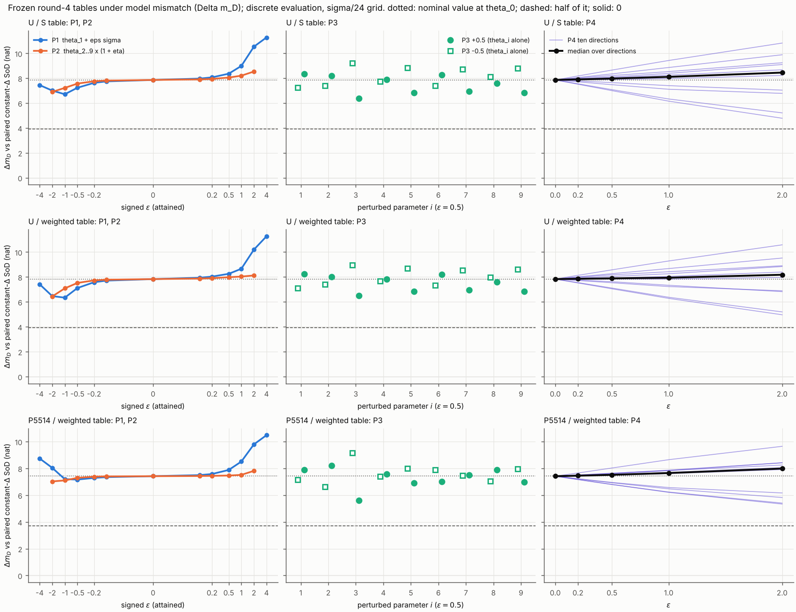

本报告只回答六件事：
- 检查（第 2 节）；
- $\varepsilon_{50}$ 与 $\varepsilon_B$，按方案 §4 的报告规则（第 3 节）；
- 名义点 $\theta_0$ 的 A、A′、B、D 四方案表（第 4 节）；
- P4 点的 A′ 与 B，含 B 两段的发送数、总数与预算判定（第 5 节）；
- 预测 R1–R6 与结果对照，错的也列出（第 6 节）；
- 第 4 轮两处修补的提交（第 1、2 节）。

方案为冻结的 `reports_CN/plan_round5_CN.md` v3.2（`c669511`），预测为 `predictions_round5.md`（`15fa912`），在任何代码和运行之前提交。

**范围与数的性质。**
- 本轮是**冻结表在失配模型下的离散数值评价**：第 4 轮的四张表（名义模型 $\theta_0$ 下设计）原样冻结，在真实参数 $\theta\ne\theta_0$ 下用同一离散评价器（$\sigma/24$ 参考值网格）重新评价。这里没有任何界或证明。
- 两段式只是**固定设计的两段式比较**：两张事先固定的表在同一真实 $\theta$ 下做两次独立实验，信息矩阵相加。真正的序贯自适应方案（第一段估计后再造表）不在本轮。
- 预算判定一律是离散评价器给出的 $\mathbb E[N]\le B$（或两段之和 $\le2B$），记为"离散方案下"，不据此确定连续模型下的预算可行性（第 7 节）。
- 每个数都取自 `round5/` 下某个日志或结果文件的一行，标出文件和行号。存档 `results/archive_partA.jsonl` 每次评价一行（第 $n$ 行对应 `logs/partA_sweep.log` 第 $54+n$ 行的文本表行）。方案没有规定的选择记在 `decisions_round5.md`（DECISION 行），计分口径（S-1 至 S-8）在 Part A 扫描和 Part B 运行之前写定。

# 0. 结论

1. **检查全部通过。** $\varepsilon=0$ 时四张表与第 4 轮逐位一致，两个常数 SoD 与 `evaluator_fast` 逐位一致；400 次失配评价没有一次断言触发；Part 0 的两处修补都已验证（第 2 节）。
2. **$\varepsilon_{50}$（U/加权表，头条）：测试至 $\varepsilon=2$ 未观察到跨越。**
   - $g_{\rm med}$ 在 $\varepsilon=0,0.2,0.5,1,2$ 依次为 7.830、7.855、7.885、7.942、8.179 nat。它没有下降，而是缓慢上升，从未接近名义值的一半（3.915）。
   - **单调上升，未观察到减半跨越**（`logs/partC_headline.log:12`）。（第 6 轮 Part 0a 更正：原文按口径 S-1 把"不是非增"的曲线标为"非单调"；S-1 的定义有误，单调不降的曲线是单调的。见 `decisions_round5.md` 的更正记录。）
   - U/$S$ 表与 P5514/加权表相同：**单调上升，未观察到减半跨越**（`logs/partC_headline.log:7, 17`）。
3. **$\varepsilon_B$（U/加权表，头条）：P1 最坏符号为"+"，$\varepsilon_B=0.1$（相邻采样点 0 与 0.1；离散方案下）。**
   - $\theta_1$ 只加 $0.1\sigma$，$\mathbb E[N]$ 就由 316.60 升到 321.54，超过 $B=316.892$。
   - "−"号先降后升（313.63、312.52，然后在 $\varepsilon=0.5$ 处升到 319.37），首次超出预算在 $\varepsilon=0.5$，非单调。
   - U/$S$ 表与 P5514/加权表的最坏符号也是"+"，$\varepsilon_B$ 同为 0.1。
4. **主要读法：增益没有掉，预算守不住。**
   - 冻结表相对同一 $\theta$ 下常数 SoD 的 $\Delta m_D$ 没有崩塌。三张表各自的最低值都出现在 P4 $\varepsilon=2$ 的方向 d1：U/$S$ 4.782、U/加权 4.965、P5514/加权 5.336 nat，为名义值的 61%、63%、72%。U/加权表在 $\varepsilon=2$ 的中位数为 8.179 nat。
   - 但表的发送数随失配迅速离开预算：P4 $\varepsilon=0.2$ 时三张表都只有 4/10 个方向 $\mathbb E[N]\le B$；P1 $\varepsilon=1$ 时 U/加权表两个符号分别为 461.1 和 361.9 次。
   - 常数 SoD 的发送数几乎不动：80 个扰动点上均匀输入 315.87–317.90 次；P1 下与名义值之差不超过 $1.2\times10^{-11}$。
   - 因此失配下的 $\Delta m_D$ **不再是等发送数的比较**，"保住的增益"有一部分是多发送换来的。本轮没有计算失配下等发送数的比较（方案未要求，DECISION C-3）。仅作量级参考（名义点、常数阈值）：常数 SoD 的发送数从 316.9 增到 605.0 次时，$\log\det$ 由 197.201 升到 203.218（+6.017 nat，方案 A 的曲线）。
5. **名义点四方案（固定设计的两段式比较）**：$\log\det$ 为 A 203.218、A′ 203.439、B 208.292、D 209.952。相对 A′：A −0.222，B +4.852，D +6.513。四个方案的总发送数都 $\le2B$（离散方案下），见第 4 节。
6. **P4 点（$\varepsilon\in\{0.2,0.5\}$）**：B 相对 A′ 的 $\Delta m_D$ 中位数为 +4.866（0.2）和 +4.882（0.5）。但 B 的两段总发送数 $\le2B$ 的方向在两个幅度下都只有 4/10，两段各 $\le B$ 的只有 2/10（第 5 节）。
7. **预测**：R6 对；R4、R5 部分对；R1、R2、R3 错（第 6 节）。
8. **R3 不成立**，所以本轮只说明：当前冻结表在所测扰动下不够稳健。失败的一方是预算（10 个方向中只有 4 个 $\mathbb E[N]\le B$）；增益条件在 10/10 个方向成立。这不推出"对辨识没有实际价值"，按先验分布造表的鲁棒设计仍是可选路线。

# 1. 依据与提交

| 内容 | 提交 |
|---|---|
| 方案 v3.2（冻结，zip 原样解压到仓库根；plan md sha256 `cc938d13…`） | `c669511` |
| 预测 R1–R6（方案 §3 原文，`sed -n '69,78p'`，跑前，Part 0 测试之前） | **`15fa912`** |
| Part 0：第 4 轮维护（`trigger_dp.py` 翻倍分支与单元测试；`part_c.py::load_table` 读 npz 并逐位复现 C1/C3；`report_round4_CN.md` 机制段落改为分支分解、删去 $\sigma/48$ "另一策略"的归因、注明 MC 无冻结验收阈值）；不重跑 DP，不重跑 MC | **`e47dca5`** |
| Part A：`robustness.py`，$\theta_0$ 回归，400 次失配评价存档，两张图，DECISION 与计分口径 | `511dfba` |
| Part B：`two_stage.py`，方案 A 的 241 点曲线，方案 D 的 $2B$ 预算 $\lambda$ 重扫，名义点与 P4 的组合 | `a62b469` |
| Part C：`headline.py` 与本报告 | 本提交 |

# 2. 检查

| 检查 | 结果 | 数值 | 来源 |
|---|---|---|---|
| Part 0a：`trigger_dp.py` 翻倍分支评价到上限 $100\bar\gamma$ | **通过** | 合成预言机 4 种情形 × $\bar\gamma\in\{1,0.0215873\}$ 全过，翻倍序列为 5、10、20、40、80、100 $\bar\gamma$，不评价上限以上的值。同一测试对修补前的版本 `7a837bd` 在情形 (a)–(c) 失败（停在 80 $\bar\gamma$），说明测试确实覆盖了上限 | `../round4/logs/test_trigger_dp.log:1–48`（修补后），`:49–96`（修补前） |
| Part 0b：`part_c.py::load_table` 直接读已提交的 `table_*.npz` | **通过** | 本地 memmap 目录为空（0 个文件），表只能来自 npz。C1、C3 由 npz 重跑后：`c1.json` 每个字段相同（墙钟 `eval_s` 除外），六个 `J_*.npy`、`c3_table.md`、四个 `shape_*.json` 逐字节相同（两张图也相同）；C3 表逐位复现。MC 未重跑 | `logs/part0_verify.log:2, 229–274` |
| Part 0c：`report_round4_CN.md` 的机制段落改为分支分解 | **完成** | 分解数复现：均匀输入发送分支（含强制首发）353.153 → 957.024（$S$ 表）/ 932.434（加权表），未发送分支 113.005 → 107.076 / 104.826；$(S-1)/(\mathbb E[N]-1)$ 3.367 / 3.283；平均发送概率 6.32% / 6.31%；单步示例 $c/q=5.878$（$\alpha=-2$，$\beta=30$）。$\sigma/48$ 一节的"另一策略"归因已删，MC 注明为无冻结验收阈值的诊断 | `logs/part0_verify.log:284–285, 295–296, 303–304, 306–307, 314–315, 358` |
| 1. $\varepsilon=0$ 时四张表的评价与第 4 轮逐位一致（同一评价器路径、同一绝对坐标） | **通过** | 经失配代码路径、$\theta=\theta_0$：$x(\theta_0)$ 与名义数组逐位相同；四张表的 $\mathbb E[N]$、$S$、$\log\det$、$\Delta m_D$ 与 `c1.json` 完全相等，$J$ 的 81 个元素与 `J_*.npy` 逐位相同，$w_k$、$\mathbb E[q_k]$ 与第 4 轮路径（`CodeTable`）当场重算的逐位相同 | `logs/partA_check.log:2, 4–13, 14, 16–25` |
| 2. 常数 SoD 在 $\varepsilon=0$ 时与 `evaluator_fast` 逐位一致 | **通过** | 均匀、P5514：$\mathbb E[N]$、$\mathbb E[N]_P$、$S$、$\log\det$、81 个 $J$ 元素、5000 个 $w_k$ 全部逐位相同，且等于第 4 轮 `c1.json` | `logs/partA_check.log:3, 15, 26` |
| 3. 守恒、非负、支撑断言 | **通过** | 400 次扰动评价全部完成，断言 0 次触发；每步 $\lvert\sum m-1\rvert$ 最大 $7.7\times10^{-13}$，$\min m=0$；$S$、$J$、$w$ 的不变量全真。实际达到的 $\varepsilon$ 与目标的最大相对差 $1.9\times10^{-11}$；扰动后 $\max_k\lvert x_{k+1}(\theta)-x_k(\theta)\rvert=4.0012\sigma$（支撑不变量按 $5\sigma$）。没有一次表评价用到"越界取边界"的查表（有质量的节点都在存储范围内） | `logs/partA_sweep.log:455–458` |
| 4. 方案 A：241 个点的 $\mathbb E[N_M]$ 曲线、所取 $M_A$ 及余量 | **完成** | 241 点全部评价，断言 0 次，质量偏差 $\le2.6\times10^{-13}$；$M_A=240$，$\mathbb E[N_{M_A}]=604.9989$，余量 28.785 次（$>5$，如实报告，不扩大区间）；曲线见第 4 节 | `logs/partB_schemeA.log:3–246` |
| 5. 第 4 轮遗留的两处工程修补 | **完成** | 见上两行；提交 `e47dca5` | — |
| 6. 精度说明 | 见第 7 节 | — | — |

# 3. $\varepsilon_{50}$ 与 $\varepsilon_B$（方案 §4 规则）

**构造。**
- 绝对坐标冻结：名义网格的 $z_0$、$h=\sigma/24$、每步表的起始节点与宽度、查表规则（本网格上最近节点即自身；越界取边界节点；物理半宽；窗口以实际 $r$ 为中心）全部沿用第 4 轮存档。
- 扰动后的均值 $x_k(\theta)=\bar x_k+h_k^\top(\theta-\theta_0)$ 一致用于测量核 $\hat g_{k,j}(\theta)$、初始分布 $m_2=\hat g_1(\theta)$ 和 $\alpha,\beta$；$\sigma$、$h_k$ 与表不变；$J(\theta)$ 在真实 $\theta$ 处组装（DECISION A-1）。
- 支撑窗口是计算手段，按第 4 轮公式以 $x_k(\theta)$ 为中心放在冻结网格上（DECISION A-2）。这是一个数值实现上的选择：它保证质量始终在窗口内。表的存储范围仍冻结；实际没有一次表评价在有质量的节点上用到越界查表（第 2 节），所以"越界取边界"这条规则没有影响本轮的数。窗口的另一种取法（以名义输出为中心）没有单独算过。
- 每个扰动按各输入自己的 $\max_k|h_k^\top u|$ 归一（`logs/partA_sweep.log:2–43`）。例如 P2 的归一常数：均匀 0.071107，P5514 0.067772。
- P4 的十个方向只是一般情形的敏感性扫描，**不是**第一段估计误差的分布。

**$g_{\rm med}(\varepsilon)$ 与 $\varepsilon_{50}$**（十个 P4 方向 $\Delta m_D$ 的中位数；括号内为十个方向的最小–最大值；来源 `logs/partC_headline.log:3–17`，名义值 `logs/partA_check.log:7, 12, 24`）：

| 表 | $\varepsilon=0$（名义） | 0.2 | 0.5 | 1 | 2 | $\varepsilon_{50}$（按 §4 规则） |
|---|---|---|---|---|---|---|
| U/加权（头条） | 7.830 | 7.855（7.519–8.131） | 7.885（7.050–8.574） | 7.942（6.281–9.284） | 8.179（4.965–10.581） | **单调上升，未观察到减半跨越**（测试至 $\varepsilon=2$；第 6 轮 Part 0a 更正，原按 S-1 误标"非单调"） |
| U/$S$ | 7.860 | 7.905（7.517–8.180） | 7.972（6.999–8.654） | 8.109（6.156–9.425） | 8.451（4.782–10.825） | 同上 |
| P5514/加权 | 7.418 | 7.454（7.163–7.656） | 7.520（6.795–8.029） | 7.653（6.210–8.649） | 7.987（5.336–9.648） | 同上 |

**$\varepsilon_B$**（P1 两个符号的 $\mathbb E[N]$，$B=316.892$；来源 `logs/partC_headline.log:18–26`）：

| 表 | 符号 | $\varepsilon=0$ | 0.1 | 0.2 | 0.5 | 1 | 2 | 4 | 首次 $>B$ |
|---|---|---|---|---|---|---|---|---|---|
| U/加权 | + | 316.60 | **321.54** | 328.49 | 361.77 | 461.09 | 791.96 | 1184.52 | 0.1 |
| U/加权 | − | 316.60 | 313.63 | 312.52 | **319.37** | 361.87 | 557.95 | 875.08 | 0.5（非单调） |
| U/$S$ | + | 316.70 | **321.56** | 329.27 | 369.91 | 496.05 | 871.75 | 1196.08 | 0.1 |
| U/$S$ | − | 316.70 | 314.62 | 315.23 | **332.30** | 407.41 | 663.60 | 898.60 | 0.5（非单调） |
| P5514/加权 | + | 316.87 | **321.20** | 328.70 | 370.20 | 497.43 | 855.29 | 1164.33 | 0.1 |
| P5514/加权 | − | 316.87 | 315.66 | **317.53** | 340.63 | 430.80 | 719.01 | 1009.06 | 0.2（非单调） |

- **头条：U/加权表的 P1 最坏符号为"+"，$\varepsilon_B=0.1$，相邻采样点为 0 和 0.1**（离散方案下；`logs/partC_headline.log:23`）。另两张表同为"+"号、0.1（`:20, 26`）。
- "−"号的曲线先降后升，按规则标"非单调"。每个符号只有一次跨越。
- 名义点上三张表距 $B$ 只有 0.026–0.289 次。这比第 4 轮 $\sigma/48$ 复核看到的网格差异（0.235–0.456 次）还小，所以 $\varepsilon_B=0.1$ 这一采样点本身也只在离散方案下成立（第 7 节）。
- **常数 SoD 对照。**
  - P1 是常数偏移，常数阈值 SoD 对它不变：12 个点上 $\mathbb E[N]$ 与名义值之差不超过 $1.2\times10^{-11}$（`logs/partC_headline.log:33–34`）。
  - $B$ 的定义就是均匀输入常数 SoD 的名义 $\mathbb E[N]$，所以均匀/SoD 恰在 $B$ 上，它的"$>B$"判定（12 个点中 8 个）完全由舍入决定，不是预算信号；不计入任何预测（DECISION C-2；`:27–29`）。
  - 均匀/SoD 在全部 80 个扰动点上 $\mathbb E[N]\in[315.87,317.90]$，$\log\det$ 的变化在 $\pm0.021$ 以内（`:116`）。

**U/加权表各扰动类的明细**（$\Delta m_D$ 相对同输入、同 $\theta$ 的常数 SoD；保持率 = $\Delta m_D(\theta)/\Delta m_D(\theta_0)$；来源 `logs/partC_headline.log:62–88`，逐次评价见 `results/archive_partA.jsonl`）：

| 类 | 有符号 $\varepsilon$ | $\mathbb E[N]$ | $\Delta m_D$ | 保持率 | $\mathbb E[N]\le B$ |
|---|---|---|---|---|---|
| P1 | +0.1 / −0.1 | 321.54 / 313.63 | 7.937 / 7.710 | 1.014 / 0.985 | 否 / 是 |
| P1 | +0.5 / −0.5 | 361.77 / 319.37 | 8.254 / 7.111 | 1.054 / 0.908 | 否 / 否 |
| P1 | +1 / −1 | 461.09 / 361.87 | 8.658 / 6.339 | 1.106 / 0.810 | 否 / 否 |
| P1 | +4 / −4 | 1184.52 / 875.08 | 11.264 / 7.415 | 1.438 / 0.947 | 否 / 否 |
| P2 | +0.1 / −0.1 | 318.72 / 315.04 | 7.872 / 7.782 | 1.005 / 0.994 | 否 / 是 |
| P2 | +0.5 / −0.5 | 332.92 / 313.98 | 7.981 / 7.521 | 1.019 / 0.960 | 否 / 是 |
| P2 | +2 / −2 | 454.64 / 376.69 | 8.123 / 6.437 | 1.037 / 0.822 | 否 / 否 |
| P3（18 点，$\varepsilon=0.5$） | — | 291.89–367.15 | 中位 7.745，最低 6.500（$\theta_3$ +） | — | 5/18 |
| P4 $\varepsilon=0.2$ | — | 307.09–327.68 | 中位 7.855 | — | 4/10 |
| P4 $\varepsilon=1$ | — | 283.75–395.82 | 中位 7.942 | — | 3/10 |
| P4 $\varepsilon=2$ | — | 273.90–546.01 | 中位 8.179 | — | 2/10 |

**读法。**
- 增益与发送数大体同向变化：发送多的扰动 $\Delta m_D$ 高，发送少的低。例如 P1 +4 发送 1184.5 次，$\Delta m_D=11.26$；三张表的最低增益点（P4 $\varepsilon=2$，方向 d1）发送 273–314 次，都低于 $B$（`results/archive_partA.jsonl:212, 213, 382`）。这不是严格的对应：P1 −4 发送 875.1 次，$\Delta m_D=7.415$，仍低于名义值。
- 所以失配下的 $\Delta m_D$ 混合了两件事：表的窗口放错了位置，以及发送数离开了预算。本轮的数不把两者分开。
- U/$S$ 与 P5514/加权表的同类汇总在 `logs/partC_headline.log:35–61, 89–115`，图样相同。



![E[N] 对 ε](fig_mismatch_EN.png)

两张图按扰动类分色：P1、P2 画在有符号 $\varepsilon$ 上，P3 按参数编号（实心为 +，空心为 −），P4 逐方向细线加中位数粗线。$\Delta m_D$ 图中点线为名义值，虚线为其一半；$\mathbb E[N]$ 图中红虚线为 $B$。

# 4. 名义点的四方案表（固定设计的两段式比较）

所有方案在同一真实 $\theta_0$ 处评价；总预算按两段之和判，$2B=633.7842336987442$；"每段各 $\le B$"另记（`logs/partB_combine.log:2–31`）。

| 方案 | 第一段发送 | 第二段发送 | 总发送 | 距 $2B$ 余量 | 总 $\le2B$（离散方案下） | 每段 $\le B$ | $\log\det J$ | 相对 A′ 的 $\Delta m_D$ |
|---|---|---|---|---|---|---|---|---|
| A：单段 5 s，常数 $\Delta_A=M_Ah=10\sigma$ | 604.9989 | — | 604.9989 | 28.7853 | 是 | 不适用（单段） | 203.21775 | −0.22155 |
| A′：SoD + SoD | 316.8921 | 316.8921 | 633.7842 | 0.0000 | 是（恰等于） | 是 | 203.43930 | 0 |
| B：SoD + 第 4 轮 U/加权表 | 316.8921 | 316.6036 | 633.4957 | 0.2886 | 是 | 是 | 208.29168 | +4.85238 |
| D：U/加权目标，预算 $2B$ | 633.5354 | — | 633.5354 | 0.2488 | 是 | 不适用（单段） | 209.95184 | +6.51254 |

- **复算检查（已知基准，不计命中）**：A′ = 203.439，B = 208.292，B − A′ = 4.852，三者都复现（`logs/partB_combine.log:31`）。
- A′ 的总数恰为 $2B$：$B$ 本就定义为均匀常数 SoD 的 $\mathbb E[N]$。
- A 只用一次 5 s 实验，比 A′ 少 28.8 次发送，$\log\det$ 低 0.222。
- D 比 B 高 1.660 nat：同样 $2B$ 次发送放在一张单段表里，比"SoD + 表"多 1.66 nat。

**方案 A 的 $\Delta_A$ 选择**（`logs/partB_schemeA.log`）：
- 241 个整数 $M=240,\dots,480$ 全部评价（$M<480$ 走一般窗口路径，$M=480$ 按第 4 轮的分派规则走已验收算子；DECISION B-1）。
- 本区间内 $\mathbb E[N_M]$ 实际单调不增，相邻点上升 0 次（`:244`）。这是观察结果，选择时没有假设它。
- 所有 241 个点都 $\le2B$，所以 $M_A=240$（$\Delta_A=10\sigma$），$\mathbb E[N_{M_A}]=604.9989$，余量 28.785 次，大于 5 次。按规则如实报告，**不扩大区间**（`:245`）。
- 曲线节选（$M$：$\mathbb E[N_M]$，$\log\det$）：240：604.999，203.218；270：543.617，202.249；300：493.988，201.340；330：452.560，200.516；360：416.949，199.778；390：386.671，199.057；420：360.404，198.399；450：337.263，197.793；480：316.892，197.201（`:3, 33, 63, 93, 123, 153, 183, 213, 243`）。
- 241 次前向 153.0 s（4 进程），每步质量偏差 $\le2.6\times10^{-13}$，断言 0 次（`:246`）。

**方案 D 的 $\lambda$ 重扫**（本轮唯一的重新设计；`logs/partB_schemeD.log:5–44`）：
- 沿用第 4 轮的 U/加权目标与固定权重：$\bar\gamma=0.021587304272182303$，与第 4 轮逐位相同（`:5`）。预算改为 $2B$，$\lambda$ 规则同第 4 轮（含 Part 0a 的翻倍上限）。
- 14 次 DP，$N(\lambda)$ 单调性的最大违反为 0。
- 最终取第 14 次：$\lambda/\bar\gamma=1.9728$，$\mathbb E[N]=633.5354$（余 0.2488），$S=1807.62$，$\log\det=209.95184$。
- 最终表无损打包为 `results/table_U_W_2B.npz`（往返相同）。已评估 $\lambda$ 中的最小对偶值为 40.348（`:23`）。

| run | 阶段 | $\lambda/\bar\gamma$ | $\mathbb E[N]$ | $S$ | $F$ | $\le2B$ | 相对单次 SoD 的 $\Delta m_D$ |
|---|---|---|---|---|---|---|---|
| 1 | 起点 | 5.0 | 213.2275 | 651.608 | 13.8102 | 是 | +3.606 |
| 2 | 下扫 | 4.0 | 262.7986 | 854.595 | 18.5629 | 是 | +6.089 |
| 3 | 下扫 | 3.2 | 341.5603 | 1113.413 | 24.6086 | 是 | +8.463 |
| 4 | 下扫 | 2.56 | 459.3713 | 1426.864 | 31.8559 | 是 | +10.667 |
| 5 | 下扫 | 2.048 | 607.6101 | 1755.568 | 39.1826 | 是 | +12.493 |
| 6 | 下扫 | 1.6384 | 766.4848 | 2052.231 | 45.4713 | **否** | +13.879 |
| 7 | 二分 | 1.8432 | 681.3856 | 1899.780 | 42.2779 | **否** | +13.191 |
| 8 | 二分 | 1.9456 | 643.4414 | 1827.027 | 40.7266 | **否** | +12.846 |
| 9 | 二分 | 1.9968 | 625.2822 | 1791.163 | 39.9540 | 是 | +12.670 |
| 10 | 二分 | 1.9712 | 634.0965 | 1808.730 | 40.3315 | **否** | +12.756 |
| 11 | 二分 | 1.984 | 629.6304 | 1799.841 | 40.1409 | 是 | +12.713 |
| 12 | 二分 | 1.9776 | 631.8807 | 1804.307 | 40.2371 | 是 | +12.735 |
| 13 | 二分 | 1.9744 | 633.0132 | 1806.562 | 40.2854 | 是 | +12.746 |
| 14★ | 二分 | 1.9728 | 633.5354 | 1807.617 | 40.3076 | 是 | +12.751 |

每行取自 `logs/partB_schemeD.log:8–21` 的一行；表中 $\Delta m_D$ 相对单次 SoD（$\log\det=197.201$），与上面相对 A′ 的口径不同。第 1 次与第 4 轮 U/加权的第 1 次（同一 $\lambda$）的 $\mathbb E[N]$ 相同（213.2275）。

# 5. P4 点的 A′ 与 B（固定设计的两段式比较）

用均匀输入的扰动参数，在同一真实 $\theta$ 下组合 Part A 存档中同一次的均匀/SoD 与 U/加权表评价（DECISION B-4）。A′ 总数为 $2\mathbb E[N_{\rm SoD}(\theta)]$，B 总数为 $\mathbb E[N_{\rm SoD}(\theta)]+\mathbb E[N_{\rm UW}(\theta)]$，都对 $2B$ 判定（离散方案下）。来源 `logs/partB_combine.log:33–54`，每行一个方向。

| $\varepsilon$ | 方向 | 第一段 SoD | 第二段 U/加权 | B 总数 | 余量 | B 总 $\le2B$ | B 每段 $\le B$ | A′ 总数 | A′ $\le2B$ | B 相对 A′ |
|---|---|---|---|---|---|---|---|---|---|---|
| 0.2 | d1 | 316.817 | 307.086 | 623.903 | +9.881 | 是 | 是 | 633.635 | 是 | +4.638 |
| 0.2 | d2 | 316.917 | 308.375 | 625.292 | +8.493 | 是 | 否 | 633.834 | 否 | +4.660 |
| 0.2 | d3 | 316.935 | 317.411 | 634.346 | −0.562 | 否 | 否 | 633.869 | 否 | +4.872 |
| 0.2 | d4 | 316.966 | 317.664 | 634.630 | −0.846 | 否 | 否 | 633.933 | 否 | +4.859 |
| 0.2 | d5 | 316.840 | 315.178 | 632.017 | +1.767 | 是 | 是 | 633.679 | 是 | +4.804 |
| 0.2 | d6 | 316.893 | 315.263 | 632.156 | +1.629 | 是 | 否 | 633.786 | 否 | +4.784 |
| 0.2 | d7 | 316.894 | 320.291 | 637.185 | −3.401 | 否 | 否 | 633.788 | 否 | +4.910 |
| 0.2 | d8 | 316.822 | 322.617 | 639.438 | −5.654 | 否 | 否 | 633.643 | 是 | +4.956 |
| 0.2 | d9 | 316.959 | 324.118 | 641.077 | −7.293 | 否 | 否 | 633.918 | 否 | +4.979 |
| 0.2 | d10 | 316.856 | 327.684 | 644.540 | −10.756 | 否 | 否 | 633.712 | 是 | +5.062 |
| 0.5 | d1 | 316.705 | 295.990 | 612.695 | +21.089 | 是 | 是 | 633.409 | 是 | +4.320 |
| 0.5 | d2 | 316.955 | 298.694 | 615.648 | +18.136 | 是 | 否 | 633.909 | 否 | +4.364 |
| 0.5 | d3 | 316.998 | 321.846 | 638.845 | −5.060 | 否 | 否 | 633.996 | 否 | +4.904 |
| 0.5 | d4 | 317.077 | 322.220 | 639.297 | −5.513 | 否 | 否 | 634.155 | 否 | +4.859 |
| 0.5 | d5 | 316.761 | 314.184 | 630.944 | +2.840 | 是 | 是 | 633.521 | 是 | +4.710 |
| 0.5 | d6 | 316.894 | 316.084 | 632.978 | +0.806 | 是 | 否 | 633.788 | 否 | +4.674 |
| 0.5 | d7 | 316.896 | 330.403 | 647.299 | −13.515 | 否 | 否 | 633.793 | 否 | +4.998 |
| 0.5 | d8 | 316.716 | 335.673 | 652.389 | −18.605 | 否 | 否 | 633.431 | 是 | +5.092 |
| 0.5 | d9 | 317.059 | 340.555 | 657.614 | −23.830 | 否 | 否 | 634.118 | 否 | +5.162 |
| 0.5 | d10 | 316.802 | 348.378 | 665.179 | −31.395 | 否 | 否 | 633.603 | 是 | +5.376 |

**汇总**（`logs/partB_combine.log:53–54`）：

| $\varepsilon$ | B 相对 A′ 中位数（最小–最大） | B 总 $\le2B$ | B 每段 $\le B$ | A′ 总 $\le2B$ |
|---|---|---|---|---|
| 0.2 | +4.866（+4.638 – +5.062） | 4/10 | 2/10 | 4/10 |
| 0.5 | +4.882（+4.320 – +5.376） | 4/10 | 2/10 | 4/10 |

**读法。**
- B 的增益来自第二段那张表，它在 6/10 个方向上多发送。B 超出 $2B$ 的幅度为 0.56–10.76 次（0.2）和 5.06–31.40 次（0.5）。
- A′ 的超出至多 0.37 次。A′ 在名义点恰好等于 $2B$，第一段常数 SoD 的发送数在扰动下有 $\pm0.2$ 次以内的真实变化（DECISION C-2）。
- 同发送数下 B 相对 A′ 的增益是多少，本轮没有评价。

# 6. 预测对照

计分口径为 DECISION S-1 至 S-8（在 Part A 扫描与 Part B 运行之前写定）。

| 编号 | 预测 | 结果 | 判定 |
|---|---|---|---|
| R1 | U/加权表 $g_{\rm med}(0.5)$ 低于名义值一半；$g_{\rm med}(2)\le0$ | $g_{\rm med}(0.5)=7.885$（名义值的 1.007 倍），$g_{\rm med}(2)=8.179$。两条都不成立（`logs/partC_headline.log:118`） | **错** |
| R2 | P1 一个符号在 $\varepsilon\le1$ 时 $\mathbb E[N]>B$，另一符号 $\mathbb E[N]<200$ | 前半成立："+"号三张表都在 $\varepsilon=0.1$ 超出 $B$。后半不成立："−"号最低 312.52（U/加权，$\varepsilon=0.2$），从未低于 200，到 $\varepsilon\le0.5$ 两个符号都超出 $B$。三张表 0/3（`:119–134`） | **错** |
| R3 | P4 $\varepsilon=0.2$：至少 8/10 个方向增益保持 $\ge70\%$ 且 $\mathbb E[N]\le B$ | 增益条件 10/10，预算条件 4/10，两者同时 4/10（d1、d2、d5、d6）。三张表相同（`:135–138`） | **错** |
| R4 | 名义点 B 比 A 高 $\ge3$；D 比 B 高 $\le1$；P4 $\varepsilon=0.2$ B 相对 A′ 中位数 $\ge3$ 且总数 $\le2B$ 的方向 $\ge8$ | (i) B − A = 5.074，成立；(ii) D − B = 1.660，不成立；(iii) 中位数 4.866，成立；(iv) 4/10，不成立（`:139`）。B − A′ = 4.852 只作复算检查（`:140`） | **部分对**（2/4） |
| R5 | 同一 $\varepsilon$ 下 P5514 表的增益保持率低于 U 表 | 27 个同幅度比较（P1 12、P2 10、P3 中位数 1、P4 中位数 4）中 P5514/加权更低的有 7 个：P1 +0.1、+0.2、+4，P2 +0.1、+0.2、+0.5、+1。P3 中位数与四个 P4 中位数都是 P5514 更高。逐点补充 34/80（`:141–168`） | **部分对**（多数不成立） |
| R6 | 全部（约 400 次扰动前向 + 241 次方案 A 前向 + 1 次 $\lambda$ 扫描）$\le1.5$ h | 286.0 s + 153.0 s + 379.8 s = 818.9 s = 0.227 h（`:169`） | **对** |

**依据与说明。**
- R1、R3 依据的图景是"窗口放错位置，增益很快丢失"。实际是增益基本保住，发送数先失控。R3 因预算失败，不是因增益失败。
- R2 前半与 $\varepsilon_B$ 一致。后半预期的"另一符号少发很多"没有出现：两个符号最终都多发。
- R4 的 (ii) 失败：把 $2B$ 次发送放进一张单段表（D），比"SoD + 表"（B）多 1.660 nat。
- 按方案 §4，R3 不成立只说明当前冻结表在所测扰动下不够稳健（预算一侧），不推出"对辨识没有实际价值"。按先验分布造表的鲁棒设计仍是可选路线。本轮也不据此对两段式方案下结论。

**运行时间。** Part 0 验证 136.7 s（`logs/part0_verify.log:361`），$\theta_0$ 检查 34.2 s（`logs/partA_check.log:27`），扫描 286.7 s，作图 2.1 s，方案 A 153.0 s，方案 D 382.2 s（含预热），组合与计分各不到 1 s。合计约 0.28 h 计算，全部在 4 核上。另有一次被丢弃的运行：Part 0 验证脚本第一次运行（约 2.5 min）时，屏蔽未发送分支的函数误用了已被替换的 `cfun`，未发送分支得 0；改正后重跑，提交的是第二次的日志。

# 7. 精度说明

- 第 4 轮的 $\sigma/48$ 复核标"精度未定"。疑似来源是查表分界处的求积：细网格的奇数节点恰在粗单元分界，连续模型中参考值落在分界上的概率为零，离散求积却给这些节点正质量。本轮**不**解决它。
- 第 4 轮把 0.05 次作为发送数的网格稳定性判定阈值。四张表实际的 $\sigma/24\to\sigma/48$ 差异约为 0.235–0.456 次（`../round4/report_round4_CN.md` 第 5 节），所以四张表都标了"精度未定"。
- 0.05 次和这些观察到的差异都**不是**连续模型误差的认证界。
- 本轮的预算判定与 R3 一律按离散评价器的值计分（"离散方案下"），不据此判断连续模型下的预算可行性。名义点上四张表距 $B$ 的余量是 0.026–0.289 次，比上述网格差异还小；所以名义点"可行"本身也只在离散方案下成立。

# 8. 复现

在 `code_8_3_stage2/stage2_pkg/evaluator/round5/` 下运行，需要完整仓库（复用 `density_recursion_v1.py`、`evaluator_fast.py`、`round4/evaluator_window.py`、`round4/trigger_dp.py`、`round4/results/` 的四张表与 `c1.json`、`J_*.npy`、`round2a/config_recheck.json`）。

```
python3 part0_verify.py                 # Part 0b/0c：C1、C3 由 npz 重跑并逐位比对；分支分解 -> logs/part0_verify.log
python3 ../round4/test_trigger_dp.py    # Part 0a：翻倍分支上限的合成预言机单元测试 -> ../round4/logs/test_trigger_dp.log
python3 robustness.py check             # θ0 回归 -> logs/partA_check.log
python3 robustness.py sweep             # 400 次评价，4 进程 -> results/archive_partA.jsonl, results/J_partA.npz
python3 robustness.py figs              # fig_mismatch_dmD.png, fig_mismatch_EN.png
python3 two_stage.py schemeA            # 241 次前向 -> results/schemeA.json
python3 two_stage.py schemeD-redesign   # 2B 预算的 λ 重扫，须从空检查点开始 -> results/scan_U_W_2B.json, results/table_U_W_2B.npz
python3 two_stage.py schemeD-load       # 只读已提交的 table_U_W_2B.npz，前向复算最终数并逐位比对（第 6 轮 Part 0b 拆分，原单一入口 schemeD）
python3 two_stage.py combine            # 名义点四方案表与 P4 表 -> results/partB.json
python3 headline.py                     # ε_50、ε_B、R1–R6 -> logs/partC_headline.log
```

**运行环境。** 4 核；Python 3.13.17，numpy 2.5.3，scipy 1.18.1，numba 0.68.0（容器起始时缺失，按 `config_fast.json` 的版本安装，与第 4 轮相同），matplotlib 3.11.2。
