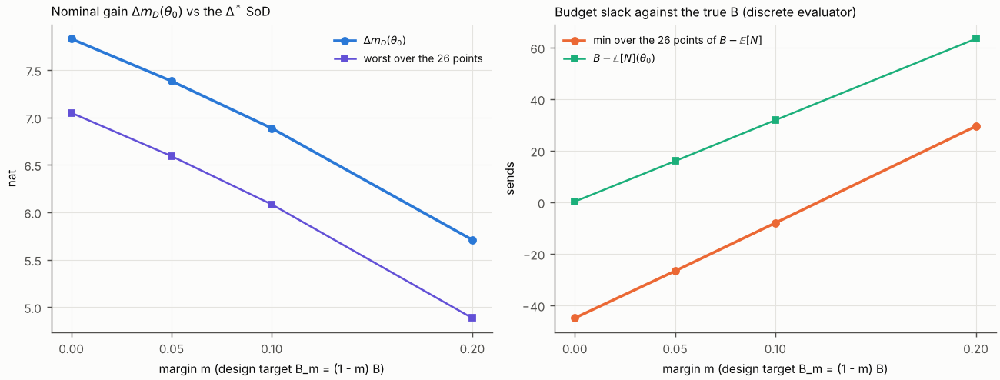
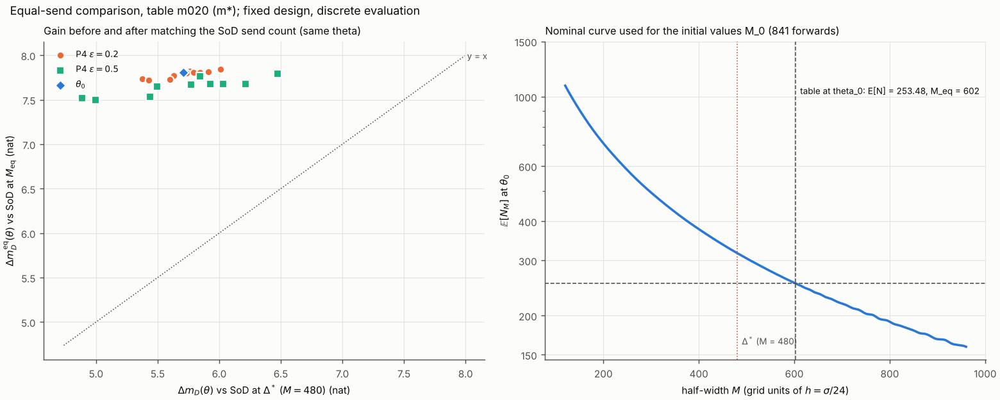

**方案。** `reports_CN/plan_round6_CN.md` v3.2（冻结，提交 a973aa6）。预测 M1–M7 在任何运行之前提交（8363cc9，`predictions_round6.md`）。

**口径。** 固定设计、离散方案下。只做均匀输入的加权表（$A=J_{\rm SoD}(u_{\rm unif})^{-1}$），不做序贯估计。本轮所有数都是离散评价器给出的数值，不是界。预算判定一律对真实预算 $B=316.8921168493721$（不是 $B_m$）。

**来源。** 每个数都取自 `round6/` 下某个日志或结果文件的一行，标出文件和行号。

- 存档 `results/archive_partA.jsonl` 每次评价一行，第 $n$ 行对应 `logs/partA_sweep.log` 第 $6+n$ 行。
- 存档 `results/archive_partC.jsonl` 每次前向一行，共 1661 行。
- 方案没有规定的选择记在 `decisions_round6.md`（DECISION 行）。M1–M7 的计分口径（S-1 至 S-7）在 Part A 运行之前写定。Part B、C 的口径（B-1 至 B-3、C-1 至 C-5）在各自运行之前写定，并随 Part A 提交。

# 0. 结论

1. **判定（§6）：受测档位未找到低代价方案**（`logs/verdict.log:13`）。
   - 只有 $m=0.20$ 在 26 点筛选集上全部守住预算，所以 $m^\star=0.20$（`logs/partA_summary.log:136–137`）。
   - 它的名义代价 $\Delta m_D(0;\theta_0)-\Delta m_D(m^\star;\theta_0)=7.8304-5.7106=2.120$ nat，超过 2 nat（`logs/verdict.log:8`）。
   - 按 §6 第 1 条，Parts B、C 照报，但不作推进依据。
2. **其余三项判据如果单独看：**
   - (a) $\rho_{26}=0.856$，信息保持；
   - (b) 三个主要复核点**全部"精度未定"**：没有一个翻转，但 $|N_{48}-N_{24}|$ 分别为 0.275、1.256、0.065 次，都超过 0.05；
   - (c) 20 个 P4 点全部匹配成功；
   - (d) $\Delta m_D^{\rm eq}$ 的中位数为 7.730 nat。
   
   即使不触发第 1 条，(b) 也会使结论落到"未定"（`logs/verdict.log:9–12`）。
3. **等发送数对照的方向与预期相反。** 表在名义点只发 253.48 次，按规定搜索得到的匹配阈值为 $M_{\rm eq}=602$（$\Delta=25.08\sigma$）。这个 SoD 发送更少，信息也更少。
   - 同一点匹配前后比较，增益由 $\Delta m_D=5.711$ 升到 $\Delta m_D^{\rm eq}=7.806$ nat。
   - 20 个 P4 点上 $\Delta m_D-\Delta m_D^{\rm eq}$ 的中位数为 $-2.039$ nat（`logs/partC_equal_send.log:579–580`）。
   - 补充读法"比较优势明显缩小"的条件（中位数 $>2$）不成立。
4. **名义代价的含义（第 7 轮 Part 0 更正）。** §6 第 1 条的名义代价 2.12 nat 是两张表名义信息的实际差：$\Delta m_D(0;\theta_0)-\Delta m_D(m^\star;\theta_0)=\log\det J_{m=0}(\theta_0)-\log\det J_{m=0.20}(\theta_0)$，两项共同的固定 $\Delta^*$ SoD 基准相消。$m=0.20$ 表在名义点的 $\Delta m_D^{\rm eq}$（7.806，对照是发送数与它匹配的 SoD）与 $m=0$ 表的名义增益（7.830，对照是固定 $\Delta^*$ 的 SoD，其发送数与该表几乎相同），只说明各自发送水平下相对各自对照的优势相近；它不表示余量只花 0.024 nat。两个数来自不同的对照，这里只作并列，不改变按冻结规则得到的判定。
   - 更正记录：原句写"名义代价以固定 $\Delta^*$ 的 SoD 为基准……少发 63 次本身就计为代价"和"只差 0.024 nat"，前者把 2.12 说成依赖基准，后者可被读作余量的代价。第 7 轮 Part 0 按 `reports_CN/plan_round7_CN.md` v3.1 §3 第 4 项改正，数值不变；见 `decisions_round6.md` 末尾。

# 1. 四项检查（方案 §4）

| 检查 | 结果 | 来源 |
|---|---|---|
| 1. $m=0$ 表在 $\varepsilon=0$ 处与第 5 轮逐位一致 | **通过**。$\mathbb E[N]=316.6035659260541$，$S=1037.2604257322414$，$\log\det J=205.03141309913676$，$\Delta m_D=7.830436416895992$，81 个 $J$ 元素与 `round4/results/J_U_W.npy` 逐位相同；SoD 同样逐位相同。附加回归：$m=0$ 表与 SoD 在全部 80 个扰动点上与第 5 轮存档逐位相同（160/160） | `logs/partA_sweep.log:415–425` |
| 2. 新表名义点 $\mathbb E[N]\le B_m$；余量 $B_m-\mathbb E[N]$ | **三张都满足**。余量 0.1379（$m=0.05$）、0.1651（0.10）、0.0368（0.20），都 $\le0.5$（利用率目标，不作通过条件） | `logs/partA1_final.log:127–129`，`logs/verdict.log:3–5` |
| 3. 守恒、非负、支撑断言 | **全部通过**。Part A 405 次评价无断言触发，$\max\lvert\sum m-1\rvert=7.46\times10^{-13}$，$\min m=0$，不变量 $S$、$J$、$w$ 全部成立，没有一次用到带质量的边界查表；Part B 12 次 $\sigma/48$ 评价无断言触发；Part C 1661 次前向无断言触发 | `logs/partA_sweep.log:412–414`，`logs/partB_refine.log:4`，`logs/verdict.log:6` |
| 4. 第 5 轮两处修正先做 | **完成**（第 7 节，提交 66bf8f1） | `logs/verdict.log:7` |

前向–后向一致性（第 4 轮 B4 检查）对三张新表也做了：相对差 $F$ 不超过 $1.0\times10^{-15}$，$N$ 不超过 $2.9\times10^{-15}$（`logs/partA1_final.log:46–48, 78–80, 110–112`）。

# 2. 四档表

**设计（A1）。** `trigger_dp.py` 不改，只把可行性目标换成 $B_m=(1-m)B$。三次扫描都在 $\lambda_0=5\bar g$ 可行（$\mathbb E[N]=213.23$），没有翻倍；运行次数 11、11、10；没有到限，没有单调性违例。来源：`logs/partA1_final.log:126–129`，$\lambda$ 扫描逐次见 `logs/scan_U_W_m{005,010,020}.log`。

| $m$ | $B_m$ | 最终运行／总数 | $\lambda/\bar g$ | $\mathbb E[N](\theta_0)$ | $B_m-\mathbb E[N]$ | $B-\mathbb E[N]$ | $\log\det J$ | $\Delta m_D(\theta_0)$ |
|---|---|---|---|---|---|---|---|---|
| 0（第 4 轮） | 316.8921 | 5／11 | 3.400000 | 316.6036 | 0.2886 | 0.2886 | 205.03141 | **7.83044** |
| 0.05 | 301.0475 | 11／11 | 3.546875 | 300.9096 | 0.1379 | 15.98 | 204.58531 | **7.38433** |
| 0.10 | 285.2029 | 11／11 | 3.715625 | 285.0378 | 0.1651 | 31.85 | 204.08784 | **6.88686** |
| 0.20 | 253.5137 | 8／10 | 4.140625 | 253.4769 | 0.0368 | 63.42 | 202.91159 | **5.71062** |

**失配评价（A2–A5）。** 每档在第 5 轮的 80 个扰动点上评价，预算对真实 $B$，离散方案下。来源：`logs/partA_summary.log:130–141`，逐项数值见同一日志第 2–129 行（`A5` 行）。

| $m$ | $\Delta m_D(\theta_0)$ | 26 点守预算 | 26 点最差增益（位置） | $\rho_{26}$ | 80 点最差增益（位置） | 80 点最大 $\mathbb E[N]$（位置） | 26 点最小余量 | 80 点最小余量 | 80 点守预算 |
|---|---|---|---|---|---|---|---|---|---|
| 0 | 7.830 | 10/26 | 7.050（P4 d1 0.5） | 0.900 | 4.965（P4 d1 2） | 1184.5（P1 +4） | −44.88 | −867.6 | 23/80 |
| 0.05 | 7.384 | 22/26 | 6.593（P4 d1 0.5） | 0.893 | 4.528（P4 d1 2） | 1181.6（P1 +4） | −26.65 | −864.7 | 46/80 |
| 0.10 | 6.887 | 25/26 | 6.084（P4 d1 0.5） | 0.883 | 4.046（P4 d1 2） | 1177.9（P1 +4） | −8.02 | −861.0 | 54/80 |
| **0.20** | 5.711 | **26/26** | 4.886（P4 d1 0.5） | **0.856** | 2.949（P4 d1 2） | 1168.5（P1 +4） | **+29.48** | −851.6 | 67/80 |

- **26 点中越线的点**（`logs/partA_summary.log`，`over26` 行）：
  - $m=0$：16 点；
  - $m=0.05$：P1 $+0.5$（343.54）和 P4 $\varepsilon=0.5$ 的 d8、d9、d10（318.34、323.48、330.22），共 4 点；
  - $m=0.10$：只有 P1 $+0.5$（324.91）；
  - $m=0.20$：无。26 点中最大的 $\mathbb E[N]$ 为 287.42（P1 $+0.5$）。
- **"最小余量"** 按 DECISION A-7 报两种：26 点上的 $\min(B-\mathbb E[N])$，以及 80 点上的（$=B-\max_{80}\mathbb E[N]$）。
- **P2、P3 只报不筛**。守预算的个数，P2 依次为 3、6、7、8/10，P3 为 5、11、13、18/18（$m=0,0.05,0.10,0.20$）。
- **$g_{\rm med}(\varepsilon)$**：十个 P4 方向 $\Delta m_D$ 的中位数，$\varepsilon=0,0.2,0.5,1,2$。四档都单调上升（第 6 轮 Part 0a 的数学定义）。

| $m$ | 0 | 0.2 | 0.5 | 1 | 2 |
|---|---|---|---|---|---|
| 0 | 7.8304 | 7.8552 | 7.8846 | 7.9422 | 8.1786 |
| 0.05 | 7.3843 | 7.4110 | 7.4460 | 7.5216 | 7.8157 |
| 0.10 | 6.8869 | 6.9160 | 6.9575 | 7.0533 | 7.4128 |
| 0.20 | 5.7106 | 5.7477 | 5.8084 | 5.9583 | 6.4786 |

**选中表。** $m^\star=0.20$（候选为三档余量表；$m=0$ 只报不选，26 点中 10 点守预算）。$\rho_{26}=0.8555$，记"信息保持"，最差点为 P4 d1 $\varepsilon=0.5$。来源：`logs/partA_summary.log:135–137, 141`。

![E[N] 与 Δm_D 对 ε，按 m 分色](fig_margin_EN_dmD.png)



# 3. 网格复核（只对 $m^\star=0.20$）

- 同一张冻结的连续策略（`FineTable`：最近粗节点、并列取小、物理半宽、以实际 $r$ 为中心）在 $\sigma/48$ 网格上评价，不重新设计。
- 失配约定按第 5 轮搬到细网格：名义输出的冻结细网格；支撑窗以 $x(\theta)$ 为中心；$\sigma/48$ SoD 的网格同样钉在名义网格上（DECISION B-1）。
- 两网格逐位嵌套，已核对（`logs/partB_refine.log:3`）。
- 路径回归：$m=0$ 表与 SoD 在 $\theta_0$ 处经此路径的结果，与第 4 轮 C2 的 $\mathbb E[N]_{48}$、$S_{48}$、$\log\det_{48}$ 逐位相同（`logs/partB_refine.log:5`）。

来源：`logs/partB_refine.log:151–157`。

| 点 | 角色 | $\mathbb E[N]_{24}$ | $\mathbb E[N]_{48}$ | $N_{48}-N_{24}$ | $\Delta m_D$（24） | $\Delta m_D$（48） | 判定（24／48） | 标记 |
|---|---|---|---|---|---|---|---|---|
| $\theta_0$ | 主要 | 253.4769 | 253.2019 | −0.2749 | 5.7106 | 5.6991 | 守／守 | **精度未定**（$\lvert\Delta N\rvert>0.05$） |
| P1 $+0.5$ | 主要：26 点中 $\mathbb E[N]$ 最大 | 287.4150 | 286.1590 | −1.2561 | 6.2537 | 6.2400 | 守／守 | **精度未定**（$\lvert\Delta N\rvert>0.05$） |
| P4 d1 $\varepsilon=0.5$ | 主要：26 点中增益最低 | 239.1965 | 239.1314 | −0.0652 | 4.8856 | 4.8757 | 守／守 | **精度未定**（$\lvert\Delta N\rvert>0.05$） |
| P1 $+4$ | 补充：80 点中 $\mathbb E[N]$ 最大 | 1168.4623 | 1167.6664 | −0.7960 | 11.2431 | 11.2418 | 超／超 | 补充，不参与判定（按同一规则也会标精度未定） |
| P4 d1 $\varepsilon=2$ | 补充：80 点中增益最低 | 227.9016 | 228.1501 | +0.2485 | 2.9491 | 2.9507 | 守／守 | 补充，不参与判定（按同一规则也会标精度未定） |

- 三个主要点都没有翻转，也都不贴预算线：$\min\{|N_{24}-B|,|N_{48}-B|\}$ 最小的是 P1 $+0.5$ 的 29.48。
- 三点都因 $|N_{48}-N_{24}|>0.05$ 标"精度未定"。0.05 只是判定阈值，不是认证误差界。
- $\Delta m_D$ 的网格变化都在 0.014 nat 以内。

# 4. 等发送数对照（只对 $m^\star=0.20$）

- 名义曲线 $M=120,\dots,960$（841 次前向）在 $\theta_0$ 处严格单调下降（841 个值逐步减小，没有持平或上升）；$\mathbb E[N_M]$ 由 1084.24 降到 159.07。
- 曲线在 $M=240,\dots,480$ 段与第 5 轮方案 A 的 241 个值逐位相同；$M=480$ 与 Part A 的 SoD 相同（`logs/partC_equal_send.log:5–7`）。
- 21 点全部在局部窗口内匹配成功：没有一次落端点，没有一次全扫回退（`logs/partC_equal_send.log:9, 578`）。
- 结果称"按规定搜索得到的匹配阈值"。残差 = $\mathbb E[N_{M_{\rm eq}}]-\mathbb E[N]_{\rm table}$（有符号）。

来源：`logs/partC_equal_send.log:556–577`。

| 点 | $\mathbb E[N]_{\rm table}$ | $M_0$ | $M_{\rm eq}$ | $\Delta_{\rm eq}/\sigma$ | $\mathbb E[N_{M_{\rm eq}}]$ | 残差 | $\Delta m_D$ | $\Delta m_D^{\rm eq}$ | $\Delta m_D-\Delta m_D^{\rm eq}$ |
|---|---|---|---|---|---|---|---|---|---|
| $\theta_0$ | 253.4769 | 602 | 602 | 25.083 | 253.5730 | +0.0961 | 5.7106 | 7.8065 | −2.0959 |
| P4 d1 0.2 | 246.7726 | 619 | 619 | 25.792 | 246.5608 | −0.2117 | 5.3760 | 7.7330 | −2.3570 |
| P4 d2 0.2 | 248.1174 | 616 | 616 | 25.667 | 248.0918 | −0.0256 | 5.4268 | 7.7217 | −2.2949 |
| P4 d3 0.2 | 254.4085 | 600 | 600 | 25.000 | 254.4841 | +0.0756 | 5.7600 | 7.8227 | −2.0628 |
| P4 d4 0.2 | 254.5651 | 600 | 600 | 25.000 | 254.5128 | −0.0523 | 5.7355 | 7.7980 | −2.0625 |
| P4 d5 0.2 | 252.4210 | 605 | 605 | 25.208 | 252.2934 | −0.1276 | 5.6325 | 7.7741 | −2.1416 |
| P4 d6 0.2 | 252.5594 | 604 | 604 | 25.167 | 252.7350 | +0.1756 | 5.6007 | 7.7278 | −2.1271 |
| P4 d7 0.2 | 255.8106 | 597 | 597 | 24.875 | 255.7561 | −0.0545 | 5.7910 | 7.8059 | −2.0149 |
| P4 d8 0.2 | 256.9990 | 594 | 594 | 24.750 | 256.9821 | −0.0170 | 5.8426 | 7.8102 | −1.9676 |
| P4 d9 0.2 | 258.8707 | 590 | 590 | 24.583 | 258.8488 | −0.0219 | 5.9108 | 7.8106 | −1.8999 |
| P4 d10 0.2 | 260.6870 | 586 | 586 | 24.417 | 260.5662 | −0.1209 | 6.0126 | 7.8446 | −1.8320 |
| P4 d1 0.5 | 239.1965 | 638 | 638 | 26.583 | 239.2023 | +0.0058 | 4.8856 | 7.5175 | −2.6319 |
| P4 d2 0.5 | 242.1643 | 632 | 632 | 26.333 | 242.2238 | +0.0595 | 4.9954 | 7.4991 | −2.5037 |
| P4 d3 0.5 | 258.2894 | 591 | 591 | 24.625 | 258.4293 | +0.1399 | 5.8452 | 7.7628 | −1.9176 |
| P4 d4 0.5 | 258.7326 | 590 | 590 | 24.583 | 258.9505 | +0.2179 | 5.7716 | 7.6710 | −1.8994 |
| P4 d5 0.5 | 251.9300 | 606 | 606 | 25.250 | 251.8531 | −0.0769 | 5.4958 | 7.6508 | −2.1549 |
| P4 d6 0.5 | 253.5906 | 602 | 602 | 25.083 | 253.5773 | −0.0134 | 5.4393 | 7.5352 | −2.0959 |
| P4 d7 0.5 | 262.9897 | 580 | 580 | 24.167 | 263.1121 | +0.1224 | 5.9279 | 7.6742 | −1.7463 |
| P4 d8 0.5 | 265.6952 | 574 | 574 | 23.917 | 265.6992 | +0.0040 | 6.0317 | 7.6781 | −1.6465 |
| P4 d9 0.5 | 271.2069 | 562 | 563 | 23.458 | 271.0887 | −0.1183 | 6.2155 | 7.6805 | −1.4650 |
| P4 d10 0.5 | 274.7845 | 555 | 555 | 23.125 | 274.9245 | +0.1400 | 6.4713 | 7.7925 | −1.3212 |

- **匹配。** 21/21 匹配成功（P4 20/20）；全扫回退 0 次；有符号残差范围 $[-0.2117,\ +0.2179]$ 次。
- **未匹配清单：无。**
- **20 个 P4 点上的三个中位数：**
  - $\Delta m_D^{\rm eq}$：7.7304 nat（范围 7.499–7.845）；
  - $\Delta m_D$：5.7658 nat；
  - $\Delta m_D-\Delta m_D^{\rm eq}$：$-2.0387$ nat（`logs/partC_equal_send.log:578–581`）。
- **差的含义。** 差 $=\log\det J_{{\rm SoD},M_{\rm eq}}-\log\det J_{{\rm SoD},480}$，回答"把 SoD 调到相近发送成本后，表的比较优势还剩多少"，不是表自身增益的因果分解。这里差为负：表发得比 $B$ 少，匹配后的 SoD 半宽更大、信息更少，所以同一点上匹配后的增益更高。



# 5. 判定（方案 §6）

按顺序判（`logs/verdict.log:8–14`）：

1. **第 1 条成立：受测档位未找到低代价方案。** $m^\star=0.20$ 存在（26 点全守），但名义代价 $2.1198>2$ nat。Parts B、C 的结果照报（第 3、4 节），不作推进依据。
2. 第 2 条不检查（互斥）。逐项记录如下：
   - (a) $\rho_{26}=0.856\ge0.8$，满足；
   - (b) 三个主要复核点均为"精度未定"，不满足；
   - (c) 20/20 匹配，满足；
   - (d) 中位数 $7.730\ge5$，满足。
3. **补充读法。** 20 个 P4 点全部匹配成功，$\Delta m_D-\Delta m_D^{\rm eq}$ 的中位数为 $-2.039$ nat，不超过 2 nat，所以不写"比较优势明显缩小"。这是同一失配点匹配前后的比较，不与名义增益比。

# 6. 预测对照

计分口径见 DECISION S-1 至 S-7（跑前写定）。来源：`logs/verdict.log:15–40`。

| 编号 | 预测 | 结果 | 判定 |
|---|---|---|---|
| M1 | 三张新表 $B_m-\mathbb E[N]\le0.5$ | 0.1379、0.1651、0.0368 | **对** |
| M2 | $m^\star=0.10$；$m=0.05$ 在 26 点中至少 2 点越线（P4 $\varepsilon=0.5$ 或 P1 $+0.5$）；$m=0.10$ 全守；$m=0.20$ 全守且 P4 $\varepsilon=1$ 与 P1 $\pm1$ 也守 | $m^\star=0.20$，错。$m=0.05$ 越线 4 点，都在所说位置，对。$m=0.10$ 只有 25/26（P1 $+0.5$ 为 324.91），错。$m=0.20$ 26/26，但 P1 $+1$ 为 375.74 超预算（11/12），错 | **部分对** |
| M3 | $\Delta m_D(m;\theta_0)\ge7.5304,\ 7.2304,\ 6.6304$ | 7.3843、6.8869、5.7106，三档都低于预测。代价 0.446、0.944、2.120 nat，约为 $8.9m$、$9.4m$、$10.6m$，不是 $6m$ | **错** |
| M4 | 四张表 $\rho_{26}\ge0.8$；$g_{\rm med}$ 对每个 $m$ 单调不降 | $\rho_{26}$ = 0.900、0.893、0.883、0.856；$g_{\rm med}$ 四档都单调上升 | **对** |
| M5 | 选中表三点 $\lvert\Delta\mathbb E[N]\rvert\le0.5$，判定不翻转 | 不翻转。$\lvert\Delta\mathbb E[N]\rvert$ 为 0.275、**1.256**、0.065，P1 $+0.5$ 超过 0.5 | **部分对** |
| M6 | 21 点全部匹配；P4 上 $\Delta m_D^{\rm eq}$ 中位数 $\ge6.0$；$\Delta m_D-\Delta m_D^{\rm eq}$ 中位数 $\le1.5$ | 21/21；7.730；$-2.039$ | **对**（见下注） |
| M7 | 总耗时 $\le2.5$ h | 记录的计算墙钟合计 1578.4 s = 0.438 h | **对** |

- **M6 注。** 按口径 S-6，第三项 $-2.039\le1.5$ 成立，所以记"对"。但预测隐含的方向（匹配后优势缩小、差为正）与结果相反：差为负，匹配后同一点的增益更高。这一项"对"只在字面意义上成立。
- **M3 注。** 预测的"每 0.05 余量约 0.3 nat"低估了代价。

# 7. 第 5 轮修正的提交

**提交 66bf8f1**（"round 6 Part 0"），不重新设计，不跑 MC。

- **0a `headline.py`。** "非单调"改为数学定义：采样值既不单调不降也不单调不增。
  - 重跑后只有三行变化，即 U/$S$、U/加权、P5514/加权的 $g_{\rm med}$ 陈述（`round5/logs/partC_headline.log:7, 12, 17`），现在都是"单调上升，未观察到减半跨越（测试至 ε=2）"。
  - $g_{\rm med}$ 数值、$\varepsilon_B$ 各行与 R1–R6 判定不变。
  - `round5/decisions_round5.md` 末尾加了更正记录：S-1 的定义有误。`report_round5_CN.md` 的三处陈述同步更正并标注。
- **0b `two_stage.py`。** 拆成两个入口。
  - `schemeD-redesign`：从空检查点重新设计。检查点非空即在任何 DP 之前停止，已验证（`round5/logs/partB_schemeD-redesign.log`）。
  - `schemeD-load`：只读已提交的 `table_U_W_2B.npz`、扫描记录、`schemeD.json`、`J_schemeD.npy`，逐个用 `git ls-files` 核对，再复算最终数。
  - 前向复算的 $\mathbb E[N]=633.5354472080885$、$S$、$F$、$\log\det J=209.95184335174855$ 与 81 个 $J$ 元素逐位相同。验证在没有 `results/tables/`、`results/runs/` 的克隆中进行（`round5/logs/partB_schemeD-load.log:2–17`）。

# 8. 提交、运行时间、复现

**提交顺序：**

| 提交 | 内容 |
|---|---|
| a973aa6 | 方案 |
| 8363cc9 | 预测 |
| 66bf8f1 | Part 0 |
| 296eb51 | Part A |
| cee2694 | Part B |
| f2dbfd1 | Part C |

本报告与 `verdict_round6.py` 在其后一次提交中。

**运行时间（M7 口径：各计算日志记录的墙钟合计 1578.4 s = 0.438 h）：**

| 步骤 | 墙钟 |
|---|---|
| 三次 $\lambda$ 扫描 | 591.0 s |
| 最终检查 | 23.5 s |
| Part A 405 次评价（4 进程） | 212.1 s |
| Part B | 13.4 s |
| Part C 1661 次前向（4 进程） | 723.4 s |
| 图 | 1.4 s |
| Part 0 复算 | 13.6 s |

由预测提交（20:32:11）到 Part C 提交（21:13:08）共 41 min。

**环境。** 4 核；Python 3.13.17，numpy 2.5.3，scipy 1.18.1，numba 0.68.0（容器起始时缺失，按第 5 轮记录的版本安装），matplotlib 3.11.2。

**复现**（在 `round6/` 下）：

```
python3 margin_design.py scan        # 三档 λ 扫描（检查点，可续跑）-> results/scan_U_W_m*.json, logs/scan_U_W_m*.log
python3 margin_design.py pack        # 第 6 轮原 final：读未提交的扫描 memmap，打包 -> results/table_U_W_m*.npz, results/margin_final.json（已有 npz 时拒绝运行）
python3 margin_design.py final       # 第 7 轮 Part 0：只从已提交的 npz 复算报告行并与 margin_final.json 逐项比较 -> results/margin_final_npz.json
python3 robustness_margin.py sweep   # 405 次评价 + 回归（逐点增量 checkpoint，可续跑）-> results/archive_partA.jsonl, results/J_partA.npz
python3 robustness_margin.py summary # A3–A5 -> results/partA_summary.json
python3 robustness_margin.py figs    # fig_margin_EN_dmD.png, fig_margin_cost_slack.png
python3 refine_check.py              # Part B（逐次增量 checkpoint，可续跑）-> results/partB_refine.json
python3 equal_send.py run            # Part C（逐次写存档，可续跑）-> results/archive_partC.jsonl, results/partC_equal_send.json
python3 equal_send.py figs           # fig_equal_send.png
python3 verdict_round6.py            # §6 判定与 M1–M7 -> logs/verdict.log
```

DECISION 清单见 `decisions_round6.md`（Part 0：0-1 至 0-3；Part A：A-1 至 A-8；计分：S-1 至 S-7；Part B：B-1 至 B-3；Part C：C-1 至 C-5）。
