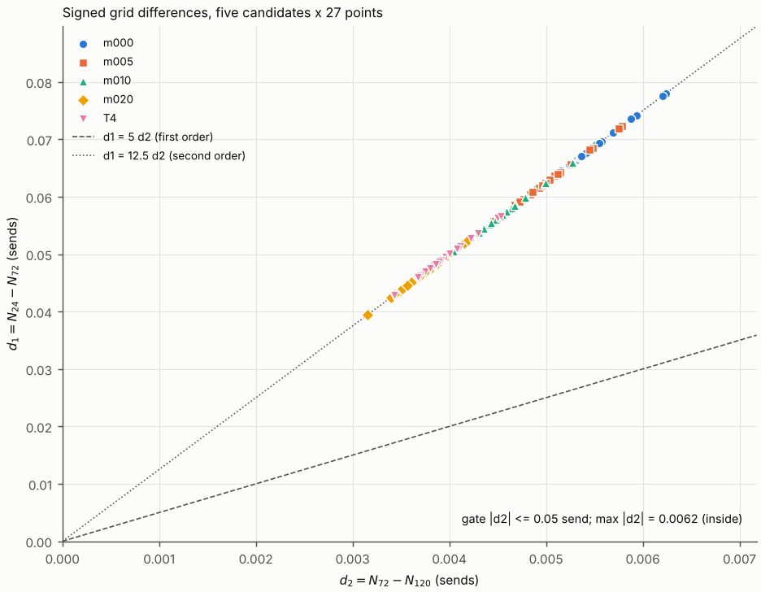
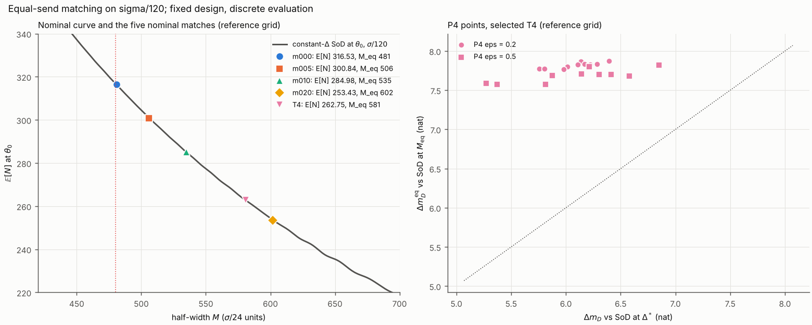

**方案。** `reports_CN/plan_round7_CN.md` v3.1（冻结，提交 9a75f5c）。预测 G1–G6 在任何运行之前提交（b884695，`predictions_round7.md`），包括 Part 0 的验证和 T4 的 DP 重跑。

**口径。** 固定设计、离散方案下。本轮所有数都是离散评价器给出的数值，不是界。预算判定一律对真实预算 $B=316.8921168493721$。$M$ 始终以 $\sigma/24$ 网格单位定义；加密倍数 $f$ 的网格上用 $fM$ 个网格步，物理阈值不变。第 6 轮的判定（情形 1）成立，本轮不重议。

**来源。** 每个数都取自 `round7/` 下某个日志或结果文件的一行，标出文件和行号。

- 评价存档每次评价一行、完成即追加（逐点增量 checkpoint）：Part B `results/partB_diagnose.jsonl`（3 行），Part C `results/archive_regrade.jsonl`（486 行，含 81 个 $J$ 元素），Part D `results/archive_match.jsonl`（1661 行）。
- 方案没有规定的选择记在 `decisions_round7.md`（DECISION 行）。G1–G6 的计分口径（S-1 至 S-6）以及 Part B、C、D 的口径（B-1、C-1 至 C-5、D-1 至 D-3）在 Part A 运行之前写定，随 Part 0 提交（a0ce957）。

# 0. 结论

1. **判定（方案 §2.4）：情形 3，支持进一步做序贯验证；选中策略 T4 = U_W_m020_r02**（第 6 轮 $m=0.20$ 扫描第 2 次运行，$\lambda/\bar g=4$）（`logs/verdict.log:5–9`）。
   - 情形 1 不成立：网格门槛通过，$\max|d_2|=0.0062\le0.05$ 次。
   - 情形 2 不成立：参考网格 $\sigma/120$ 上守住 26 点预算的是 m020 与 T4；守住者中名义代价最小的是 T4，$c=1.7412\le2$ nat。
   - 情形 3 的四项全部满足：$\rho_{26}=0.8655\ge0.8$；三个主要复核点（$\theta_0$、P1 $+0.5$、P4 d1 0.5）均未标精度未定；20 个 P4 点全部匹配；$\Delta m_D^{\rm eq}$ 的完整中位数 7.772 nat $\ge5$。
   - 这是固定设计、离散方案下的判定。两套网格接近不证明已接近连续模型；等发送数对照的阈值是按规定搜索得到的匹配阈值。
2. **诊断：支持分界取值影响的解释**（诊断项）。冻结点上原 $\sigma/48$ 与 $\sigma/72$ 差 $-1.204$ 次，平移半步的 $\sigma/48$ 与 $\sigma/72$ 只差 $+0.008$ 次。一次诊断不排除其他误差来源（第 2 节）。
3. **收敛。** 五候选 × 27 点：$\max|d_1|=0.0780$，$\max|d_2|=0.0062$ 次；$d_1/d_2$ 全部在 [12.4999, 12.5020]（中位 12.5006），符号 135/135 一致，与二阶一致（第 3 节）。
4. **参考网格上的五个候选**（第 4 节）：
   - m000、m005、m010 分别有 16、4、1 点实际越线（不是精度未定）；
   - m020 与 T4 26 点全守，最小余量 29.53 与 18.45 次；
   - 名义代价 $c$：m005 0.446，m010 0.943，m020 2.120，T4 1.741 nat；
   - $\rho_{26}$：m020 0.856，T4 0.866；
   - 从 $\sigma/72$ 到 $\sigma/120$，$\log\det$、$c$、$\rho_{26}$ 的变化都不超过 $3.3\times10^{-5}$。
5. **SoD 参照分解（描述性）。** 五张表的名义匹配都成功（残差 $|\cdot|\le0.26$）。T4：$1.7412=1.7429+(-0.0017)$；m020：$2.1196=2.0787+0.0409$。各表名义代价的绝大部分落在第一项（SoD 参照的信息变化），第二项（相对等发送数 SoD 优势的变化）在 $\pm0.05$ nat 以内（第 5 节）。
6. **T4 的 P4 等发送数对照：** 20/20 在局部窗口内匹配，无全扫回退，有符号残差 $[-0.227,+0.197]$；$\Delta m_D^{\rm eq}$ 中位数 7.772 nat，$\Delta m_D$ 中位数 6.137 nat（第 6 节）。
7. **预测：** G1、G2、G4、G5、G6 对；G3 部分对（m010 在 P1 $+0.5$ 超 $B$ 7.95 次，按"约 7 次"取整读法不算对）（第 9 节）。

# 1. 四项检查（方案 §3）

| 检查 | 结果 | 来源 |
|---|---|---|
| 1. 回归（分路径） | **全部通过**，见下表 | `logs/partA_checks.log` |
| 2. 诊断项 | 三个数与两组差已报，读法为"支持分界取值影响的解释"（诊断项，不判通过） | `logs/partB_diagnose.log:3–10` |
| 3. 守恒、非负、支撑断言 | **通过**。Part A 15 次评价器调用加 A3 小网格运行：$\max|\sum m-1|=1.12\times10^{-12}$，$\min m=0$，无断言触发，不变量 $S$、$J$、$w$ 全部成立。Parts B–D 共 3 + 486 + 1661 次评价：$\max|\sum m-1|=2.48\times10^{-12}$，$\min m=0$，无断言触发、无断言停止，不变量全部成立。支撑节点数随 $f$ 放大（$\sigma/120$ 上约 21000 个），支撑断言照旧 | `logs/partA_checks.log:286`，`logs/verdict.log:2` |
| 4. 第 6 轮工程收尾 | **完成**，数值不变（第 10 节，提交 a0ce957） | `logs/part0_verify.log:27` |

**检查 1 的各项**（`logs/partA_checks.log`）：

| 项 | 内容 | 结果 | 行 |
|---|---|---|---|
| 单元查表 | 生产网格 $f=1,3,5$：节点到单元分界的最小距离 0.5、1/6、0.1 个单元宽（期望值，差 $<10^{-9}$）；物理坐标查表与整数规则 $(j+(f-1)/2)\,//\,f$ 逐点相同；平移 $\sigma/48$ 网格最小距离 0.25；未平移 $\sigma/48$ 网格（奇数节点在分界上）断言按设计触发 | 通过 | 3–8 |
| (a) 复用路径 | $(M^-,M^+)=(480f,480f)$ 分派到已验收评价器（$n=24f$，$\Delta^*$ 固定）。均匀输入、$\theta_0$、$f=1,3,5$：$\mathbb E[N]$、$S$、81 个 $J$ 元素（另 $\mathbb E[N]_P$、$\log\det$、5000 个 $w_k$）与直接调用 `evaluator_fast.evaluate_fast` **以及** 全网格 `density_recursion_v1.evaluate('B', 'U', 24f)` 都逐位相同 | 通过 | 9–12、23–26、37–40 |
| (b) 一般路径 | 其他常数窗口 $(fM,fM)$（$M=120,479,481,602,960$，$f=1,3,5$）全部分派到一般路径，细化窗口逐步为 $(fM,fM)$；$f=1$、$M=602$ 在 $\theta_0$ 与第 6 轮等发送数存档逐位相同（$\mathbb E[N]=253.5729860093734$） | 通过 | 51–67 |
| (c) 同一 $M=480$ 两路径 | $f=1$：$\mathbb E[N]$ 相对差 $6.2\times10^{-14}$，$S$ $6.1\times10^{-14}$，$J$ 比值 $3.3\times10^{-14}$；$f=3$：$3.4\times10^{-13}$、$3.4\times10^{-13}$、$1.7\times10^{-13}$；$f=5$：$3.5\times10^{-13}$、$7.2\times10^{-13}$、$3.6\times10^{-13}$（门槛均为 $10^{-12}$） | 通过 | 13–15、27–29、41–43 |
| 旧 24 回归 | 第 4 轮 `regression_check`（U、P5514：分派逐位，一般路径在容差内） | 通过 | 68–106 |
| 旧 48 回归 | $\sigma/48$ SoD（复用路径）与 $m=0$ 表（第 4 轮 FineTable）与 `round4/results/c2.json` 逐位相同；一般 $(960,960)$ 对复用的相对差 $1.39\times10^{-13}$，与 c2 记录相同 | 通过 | 107–108 |
| $f=1$ 恒等 | 新评价器在 $f=1$ 对四张旧表与 SoD 在 $\theta_0$ 与第 6 轮存档逐位相同（另见 Part C：27 点 × 5 共 135 次全部逐位相同，`logs/partC_summary.log:2`） | 通过 | 109–114 |
| 小网格显式矩阵 | $f=3,5$，沿用第 4 轮配置（粗网格 $G=200$、$K=30$、同一合成 $x_k$、三类窗口表、冻结随机数），细网格 $G=200f$。显式矩阵一端的窗口**直接由粗表的物理坐标构造**（按物理距离暴力找最近粗节点、物理半宽、物理偏移定端点权重），不调用新的查表函数。全部误差（每步 $m_k$、前向 $\mathbb E[N]$ 与 $F$、每步 $V^c_k$ 与 $V^q_k$、后向 $\mathbb E[N]$ 与 $F$；$\infty$ 范数比）最大 $4.4\times10^{-15}$（门槛 $10^{-12}$）；查表与显式最近节点 12/12 组逐点一致 | 通过 | 115–285 |

**T4 的恢复（DECISION A-5）。** 第 6 轮 $m=0.20$ 扫描的 T4 表没有保存在仓库里（memmap 未提交）。按方案的退路，在扫描记录的同一 $\lambda=0.08634921708872922$（$=0.8\times5\bar g$，与记录逐位相同）重跑一次 DP（24.6 s）。恢复的策略与扫描记录第 2 次运行的 $\mathbb E[N]=262.7986258567231$、$S$、$F$、$\log\det$、$\Delta m_D=6.08902421731716$、对偶值、质量、最小 $m$ 全部逐位相同，与第 4 轮同一 $\lambda$ 的运行也逐位相同；前向–后向相对差 $1.9\times10^{-16}$、$4.3\times10^{-16}$（`logs/partA0_tables.log:7–25`）。表打包为 `results/table_T4.npz`；五个候选的绝对坐标（$z_0$、$h_{24}$、各步支撑起点与宽度）和 sha256 记在 `results/tables_round7.json`。

**策略 ID。** m000 = U_W_r05（第 4 轮，$\lambda/\bar g=3.4$）；m005 = U_W_m005_r11；m010 = U_W_m010_r11；m020 = U_W_m020_r08（$\lambda/\bar g=4.140625$）；T4 = U_W_m020_r02（$\lambda/\bar g=4$）。

# 2. 求积诊断（方案 §1.2；诊断项，不是通过／不通过的检查）

冻结点 P1 $+0.5$，$m=0.20$ 表（`logs/partB_diagnose.log:3–10`）：

| 求积 | $\mathbb E[N]$ | 与 (iii) 之差 |
|---|---|---|
| (i) 原 $\sigma/48$（第 6 轮 Part B 的路径：FineTable，奇数节点在单元分界上，并列取小；与第 6 轮记录逐位相同） | 286.1589816132073 | $-1.2041$ |
| (ii) $\sigma/48$ 节点整体平移 $h_{48}/2$（粗表原点、单元分界、物理策略不动） | 287.37120521758766 | $+0.0081$ |
| (iii) $\sigma/72$ | 287.36308703867985 | — |
| 参照：$\sigma/24$（第 6 轮存档，不参与读法） | 287.4150474836405 | $+0.0520$ |

- $|(\mathrm i)-(\mathrm{iii})|=1.204>1$ 次，$|(\mathrm{ii})-(\mathrm{iii})|=0.008<0.1$ 次。
- **读法：支持分界取值影响的解释。** 一次诊断不排除其他误差来源。
- 这只说明第 6 轮 $\sigma/48$ 复核的 1.26 次变化与"分界上的节点统一取一侧"相符；第 6 轮的判定本轮不重议。

# 3. 收敛表与门槛（方案 §1.3）

五个候选与固定 $M=480$ 的 SoD，在 27 点、三套网格上评价（`results/archive_regrade.jsonl`）。$d_1=N_{24}-N_{72}$，$d_2=N_{72}-N_{120}$，带符号。逐点数值见 `logs/partC_summary.log:888–1022`（C3-TAB）。

| 候选 | $N_{24}(\theta_0)$ | $N_{72}(\theta_0)$ | $N_{120}(\theta_0)$ | $d_1(\theta_0)$ | $d_2(\theta_0)$ | 27 点 $d_1$ 范围 | 27 点 $d_2$ 范围 | $d_1/d_2$ 范围 | 符号一致 |
|---|---|---|---|---|---|---|---|---|---|
| m000 | 316.6036 | 316.5365 | 316.5312 | +0.0670 | +0.00536 | [0.0605, 0.0780] | [0.00484, 0.00624] | [12.5005, 12.5020] | 27/27 |
| m005 | 300.9096 | 300.8478 | 300.8429 | +0.0618 | +0.00495 | [0.0556, 0.0723] | [0.00445, 0.00578] | [12.5004, 12.5019] | 27/27 |
| m010 | 285.0378 | 284.9815 | 284.9769 | +0.0564 | +0.00451 | [0.0505, 0.0660] | [0.00404, 0.00528] | [12.5003, 12.5018] | 27/27 |
| m020 | 253.4769 | 253.4321 | 253.4285 | +0.0447 | +0.00358 | [0.0394, 0.0525] | [0.00315, 0.00420] | [12.4999, 12.5013] | 27/27 |
| T4 | 262.7986 | 262.7503 | 262.7464 | +0.0483 | +0.00387 | [0.0428, 0.0567] | [0.00343, 0.00453] | [12.5000, 12.5015] | 27/27 |
| SoD（对照，不进门槛） | 316.8921 | 316.8912 | 316.8912 | +0.00089 | +0.00007 | [0.00089, 0.00090] | [0.00007, 0.00007] | [12.4989, 12.4990] | 27/27 |

来源：`logs/partC_summary.log:652–661`，$\theta_0$ 行见 C3-TAB。

- **门槛（唯一判定条件）：** 五候选 × 27 点 $\max|d_2|=0.00624$ 次（m000，P1 $+0.5$）$\le0.05$，**通过**，$\sigma/120$ 为参考网格（`:661`）。
- $\max|d_1|=0.0780$ 次（同一点，`:652`）。
- 比值（诊断）：135 对的中位数 12.5006，范围 [12.4999, 12.5020]，符号 135/135 一致，"阶数未定" 0 对（`:654`）。与二阶的 12.5 一致。
- **两套网格接近不证明已接近连续模型。** 这里只说明 $\sigma/72$ 与 $\sigma/120$ 在 0.05 次的判定阈值内一致；0.05 是判定阈值，不是认证误差界。

![E[N] 与 log det 对网格](fig_grid_EN_logdet.png)



# 4. 参考网格上的五个候选（方案 §2.2 第 3 条）

$\sigma/120$ 上（`logs/partC_summary.log:1024–1039`，C4-TAB；越线清单见同一日志的 `C4 <cand> f=5 over26` 行）：

| 候选 | 策略 ID | $\mathbb E[N](\theta_0)$ | $\log\det J(\theta_0)$ | $c=L_0-L$ | 26 点守 $B$ | 26 点最大 $\mathbb E[N]$（位置） | 最小余量 | $\rho_{26}$（最差点） | $\Delta m_D(\theta_0)$ |
|---|---|---|---|---|---|---|---|---|---|
| m000 | U_W_r05 | 316.5312 | 205.031076 | 0 | 10/26 | 361.6878（P1 $+0.5$） | −44.80 | 0.9003（P4 d1 0.5） | 7.82992 |
| m005 | U_W_m005_r11 | 300.8429 | 204.585014 | 0.44606 | 22/26 | 343.4592（P1 $+0.5$） | −26.57 | 0.8928（P4 d1 0.5） | 7.38386 |
| m010 | U_W_m010_r11 | 284.9769 | 204.087590 | 0.94349 | 25/26 | 324.8383（P1 $+0.5$） | −7.95 | 0.8834（P4 d1 0.5） | 6.88643 |
| m020 | U_W_m020_r08 | 253.4285 | 202.911471 | 2.11960 | **26/26** | 287.3589（P1 $+0.5$） | +29.53 | 0.8555（P4 d1 0.5） | 5.71031 |
| **T4** | U_W_m020_r02 | 262.7464 | 203.289835 | **1.74124** | **26/26** | 298.4386（P1 $+0.5$） | +18.45 | 0.8655（P4 d1 0.5） | 6.08868 |

- 越线的点：m000 16 点；m005 4 点（P1 $+0.5$、P4 $\varepsilon=0.5$ 的 d8、d9、d10）；m010 只有 P1 $+0.5$（324.84，超 7.95 次）；m020、T4 无。与第 6 轮 $\sigma/24$ 的越线清单相同。
- **精度未定（C5）：** 五个候选的 27 点都没有标"精度未定"：没有一点在 $\sigma/72$ 与 $\sigma/120$ 间翻转，$|d_2|$ 全部 $\le0.05$，各候选 27 点上 $\min\{|N_{72}-B|,|N_{120}-B|\}$ 的最小值为 m000 0.356（$\theta_0$）、m005 1.378（P4 d8 0.5）、m010 5.191（P4 d10 0.5）、m020 29.53、T4 18.45（P1 $+0.5$），都大于 0.05（`:878–882`；数值由 `results/partC_regrade.json` 的 N 字段算出）。"精度未定"与"实际越过预算"是两回事：m000、m005、m010 是**实际越线**，不是精度不够。
- $c$ 是两张表名义信息的实际差（共同的固定 SoD 基准相消）；T4 的 $c$ 在参考网格上重新计算，为 1.74124，不沿用粗网格的 1.741。

**两套细网格之间的变化（$f=3\to5$）**（`:872–877`）：

| 候选 | $\log\det J(\theta_0)$ 变化 | $c$ 变化 | $\rho_{26}$ 变化 | 27 点 $\max|\log\det_{120}-\log\det_{72}|$ |
|---|---|---|---|---|
| m000 | $-2.50\times10^{-5}$ | 0 | $-2.2\times10^{-7}$ | $3.32\times10^{-5}$ |
| m005 | $-2.19\times10^{-5}$ | $-3.1\times10^{-6}$ | $-2.2\times10^{-7}$ | $3.04\times10^{-5}$ |
| m010 | $-1.84\times10^{-5}$ | $-6.6\times10^{-6}$ | $-2.0\times10^{-7}$ | $2.71\times10^{-5}$ |
| m020 | $-9.07\times10^{-6}$ | $-1.59\times10^{-5}$ | $+4.6\times10^{-8}$ | $1.79\times10^{-5}$ |
| T4 | $-1.23\times10^{-5}$ | $-1.27\times10^{-5}$ | $-7.2\times10^{-8}$ | $2.12\times10^{-5}$ |

- 六个配置（含 SoD）× 27 点的 $|\log\det_{120}-\log\det_{72}|$ 最大 $3.32\times10^{-5}$ nat（`:877`）。发送数稳定本身不推出信息判据稳定；这里两者都单独报了，都在各自的量级上稳定。

# 5. 以常数 SoD 为参照的差值分解（方案 §2.3；描述性，无因果解释）

参考网格 $\sigma/120$ 上的名义 SoD 曲线 $M=120,\dots,960$（841 次前向）在 $\theta_0$ 处严格单调下降（没有一步上升），$\mathbb E[N]$ 由 1084.23 降到 159.07；$M=480$ 与 Part C 的 SoD 逐位相同（`logs/partD_match.log:19–20`）。名义匹配：曲线上最接近表在参考网格上实际发送数的点（并列取较大 $M$），残差 $|\cdot|\le1$ 次接受。$Q_0$ 匹配的是 m000 在参考网格上重新算出的发送数 316.5312（不默认 $M=480$）。

来源：`logs/partD_match.log:862–901`（D1-NOM）、`:902–956`（D2）、`:1437–1442`（D2-TAB）。

| 表 | $\mathbb E[N]_{\rm table}(\theta_0)$ | $M_{\rm eq}$ | $\Delta_{\rm eq}/\sigma$ | 匹配 SoD 的 $\mathbb E[N]$ | 有符号残差 | $L_m$ | $Q_m$ | $L_0-L_m$ | 第一项 $Q_0-Q_m$ | 第二项 $(L_0-Q_0)-(L_m-Q_m)$ | 恒等式残差 |
|---|---|---|---|---|---|---|---|---|---|---|---|
| m000 | 316.5312 | 481 | 20.042 | 316.2698 | -0.2614 | 205.03108 | 197.18398 | 0.0000 | 0.0000 | +0.0000 | 0.0e+00 |
| m005 | 300.8429 | 506 | 21.083 | 300.9860 | +0.1432 | 204.58501 | 196.71462 | 0.4461 | 0.4694 | -0.0233 | 0.0e+00 |
| m010 | 284.9769 | 535 | 22.292 | 285.0173 | +0.0404 | 204.08759 | 196.20864 | 0.9435 | 0.9753 | -0.0318 | 0.0e+00 |
| m020 | 253.4285 | 602 | 25.083 | 253.5723 | +0.1438 | 202.91147 | 195.10529 | 2.1196 | 2.0787 | +0.0409 | 0.0e+00 |
| T4 | 262.7464 | 581 | 24.208 | 262.6969 | -0.0496 | 203.28984 | 195.44106 | 1.7412 | 1.7429 | -0.0017 | 0.0e+00 |

- 五张表的名义匹配全部成功，所以五行都有分解；没有一行是"未定"。
- 相对各自等发送数 SoD 的名义优势 $L_m-Q_m$：m000 7.8471，m005 7.8704，m010 7.8789，m020 7.8062，T4 7.8488 nat。
- 第二项可为负：m005、m010、T4 为负，m020 为正；绝对值都不超过 0.041 nat。名义代价 $L_0-L_m$ 的绝大部分落在第一项。
- 这是一个恒等的描述性拆分：第一项是"以常数 SoD 为参照的信息变化"，第二项是"相对 SoD 优势的变化"，两项都依赖于用常数 SoD 作参照这一建模选择；不据此作因果解释。两个 $Q$ 各带自己的匹配残差（$Q_0$：$-0.261$ 次；$Q_m$：见表），残差在 1 次以内，但不是 0。

# 6. 匹配表（选中策略 T4 的 20 个 P4 点，参考网格）

规则（方案 §2.2 第 5 条）：初值 $M_0$ 取名义曲线上最接近该点表发送数者；在真实 $\theta$ 处于 $[M_0-20,M_0+20]\cap[120,960]$ 逐点评价（41 次），残差 $\le1$ 次且不在窗口端点则接受，否则全扫。结果称"按规定搜索得到的匹配阈值"，残差 $=\mathbb E[N_{M_{\rm eq}}]-\mathbb E[N]_{\rm table}$（有符号）。来源：`logs/partD_match.log:973–974, 1415–1436`。

| 点 | $\mathbb E[N]_{\rm table}$ | $M_0$ | $M_{\rm eq}$ | $\Delta_{\rm eq}/\sigma$ | $\mathbb E[N_{M_{\rm eq}}]$ | 残差 | 方式 | $\Delta m_D$ | $\Delta m_D^{\rm eq}$ | $\Delta m_D-\Delta m_D^{\rm eq}$ |
|---|---|---|---|---|---|---|---|---|---|---|
| P4 d1 0.2 | 255.6001 | 597 | 597 | 24.875 | 255.6937 | +0.0936 | 局部窗口 | 5.7577 | 7.7727 | -2.0150 |
| P4 d2 0.2 | 256.9460 | 594 | 594 | 24.750 | 257.0637 | +0.1177 | 局部窗口 | 5.8043 | 7.7714 | -1.9670 |
| P4 d3 0.2 | 263.6516 | 579 | 579 | 24.125 | 263.5632 | -0.0884 | 局部窗口 | 6.1353 | 7.8670 | -1.7317 |
| P4 d4 0.2 | 263.8313 | 578 | 578 | 24.083 | 264.0196 | +0.1883 | 局部窗口 | 6.1106 | 7.8271 | -1.7165 |
| P4 d5 0.2 | 261.6369 | 584 | 583 | 24.292 | 261.8334 | +0.1965 | 局部窗口 | 6.0114 | 7.7990 | -1.7875 |
| P4 d6 0.2 | 261.7761 | 583 | 583 | 24.292 | 261.8773 | +0.1013 | 局部窗口 | 5.9786 | 7.7661 | -1.7875 |
| P4 d7 0.2 | 265.2710 | 575 | 575 | 23.958 | 265.3567 | +0.0858 | 局部窗口 | 6.1696 | 7.8344 | -1.6648 |
| P4 d8 0.2 | 266.6355 | 572 | 572 | 23.833 | 266.8227 | +0.1872 | 局部窗口 | 6.2240 | 7.8301 | -1.6062 |
| P4 d9 0.2 | 268.4709 | 569 | 569 | 23.708 | 268.4300 | -0.0409 | 局部窗口 | 6.2853 | 7.8366 | -1.5512 |
| P4 d10 0.2 | 270.5482 | 564 | 564 | 23.500 | 270.4898 | -0.0585 | 局部窗口 | 6.3912 | 7.8711 | -1.4799 |
| P4 d1 0.5 | 247.4766 | 617 | 617 | 25.708 | 247.4278 | -0.0488 | 局部窗口 | 5.2698 | 7.5862 | -2.3164 |
| P4 d2 0.5 | 250.4234 | 610 | 610 | 25.417 | 250.5594 | +0.1361 | 局部窗口 | 5.3699 | 7.5747 | -2.2048 |
| P4 d3 0.5 | 267.6156 | 571 | 571 | 23.792 | 267.4866 | -0.1290 | 局部窗口 | 6.2145 | 7.8011 | -1.5866 |
| P4 d4 0.5 | 268.0767 | 570 | 570 | 23.750 | 268.0596 | -0.0171 | 局部窗口 | 6.1393 | 7.7071 | -1.5678 |
| P4 d5 0.5 | 261.0806 | 585 | 585 | 24.375 | 260.9223 | -0.1583 | 局部窗口 | 5.8738 | 7.6904 | -1.8166 |
| P4 d6 0.5 | 262.7965 | 581 | 581 | 24.208 | 262.6902 | -0.1063 | 局部窗口 | 5.8131 | 7.5739 | -1.7608 |
| P4 d7 0.5 | 272.9016 | 559 | 559 | 23.292 | 272.8681 | -0.0335 | 局部窗口 | 6.3040 | 7.7009 | -1.3970 |
| P4 d8 0.5 | 275.9725 | 553 | 553 | 23.042 | 275.8594 | -0.1131 | 局部窗口 | 6.4128 | 7.7007 | -1.2879 |
| P4 d9 0.5 | 281.4749 | 542 | 542 | 22.583 | 281.6349 | +0.1599 | 局部窗口 | 6.5812 | 7.6820 | -1.1008 |
| P4 d10 0.5 | 285.6670 | 534 | 534 | 22.250 | 285.4404 | -0.2267 | 局部窗口 | 6.8477 | 7.8235 | -0.9758 |

- **匹配：** 20/20 在局部窗口内匹配成功，没有一次落在窗口端点，**全扫回退 0 次**；有符号残差范围 $[-0.2267,\ +0.1965]$ 次。
- **未匹配清单：无。**
- **20 个 P4 点上的中位数（20 点全部匹配，用完整中位数）：** $\Delta m_D^{\rm eq}$ 7.7720 nat（范围 7.574–7.871）；$\Delta m_D$ 6.1373 nat；$\Delta m_D-\Delta m_D^{\rm eq}$ -1.6907 nat（`:1415`）。
- 差为负：T4 在这些点上发得比 $B$ 少，匹配后的 SoD 半宽更大、信息更少，所以同一点匹配后的增益更高。这是同一失配点匹配前后的比较，不与名义增益比。



# 7. 判定（方案 §2.4，互斥，按顺序）

按顺序判（`logs/verdict.log:4–9`）：

1. **网格未收敛：不成立。** $\max|d_2|=0.00624\le0.05$（最差点 m000 P1 $+0.5$）。
2. **受测候选未找到低代价方案：不成立。** 参考网格上 26 点全守 $B$ 的候选为 m020、T4；其中名义代价最小的 T4，$c=1.74124\le2$ nat（m020 的 $c=2.11960>2$）。
3. **支持进一步做序贯验证：成立。** 选中策略 = 守住 26 点且 $c\le2$ 中 $c$ 最小者 = **T4（U_W_m020_r02）**（无并列）。逐项：
   - $\rho_{26}=0.8655\ge0.8$（最差点 P4 d1 0.5）：满足；
   - 三个主要复核点（参考网格上 26 点中选）均未标精度未定：满足，见下表；
   - 20 个 P4 点全部匹配：满足（20/20）；
   - $\Delta m_D^{\rm eq}$ 中位数 7.772 nat $\ge5$：满足。
4. 第 4 条（未定）不检查（互斥）。

T4 的三个主要复核点（`logs/partC_summary.log:884–886`）：

| 点 | 角色 | $\mathbb E[N]_{72}$ | $\mathbb E[N]_{120}$ | $d_2$ | 翻转 | $\min\{|N_{72}-B|,|N_{120}-B|\}$ | 标记 |
|---|---|---|---|---|---|---|---|
| theta_0 | 名义点 | 262.7503 | 262.7464 | +0.00387 | 否 | 54.14 | 未标精度未定 |
| P1 theta1 +0.5 | 26 点中发送数最大 | 298.4431 | 298.4386 | +0.00450 | 否 | 18.45 | 未标精度未定 |
| P4 d1 0.5 | 26 点中增益最低 | 247.4800 | 247.4766 | +0.00343 | 否 | 69.41 | 未标精度未定 |

**读法上的限定。** 情形 3 只说明：在固定设计、离散方案下，按本轮冻结的规则，T4 在参考网格上守住 26 点预算、名义代价不超过 2 nat、信息保持率与等发送数对照的中位增益都过线，值得进一步做序贯验证；它只是进入下一步验证的依据，不是对失配稳健性或序贯估计本身的结论。T4 不是按某个余量 $m$ 设计的表（它在第 6 轮扫描里因名义发送数 262.80 超过 $B_{0.20}=253.51$ 而未被选），这里只按策略 ID 称呼。

# 8. 不适用的分支

- 情形 1（网格未收敛）的分支：门槛通过，未进入；"D1–D3 不适用"不发生。
- 情形 2 无选中候选时 D3 不适用：未进入。
- 名义匹配失败（残差 $>1$）时该表分解"未定"、$Q_m$ 不赋等发送数含义：五张表都匹配成功，未进入。
- D3 的全扫回退：20 点都在局部窗口内接受，**不适用**（0 次）；全扫后仍超限的"未匹配"：不适用。
- $m=0.20$ 可先复核第 6 轮 $M_{\rm eq}$ 的捷径：选中的是 T4，**不适用**（DECISION D-4）。
- 中位数"未定"（未全部匹配）：不适用。

# 9. 预测对照

计分口径见 DECISION S-1 至 S-6（Part A 运行之前写定，随 Part 0 提交 a0ce957）。来源：`logs/verdict.log:10–15`。

| 编号 | 预测 | 结果 | 判定 |
|---|---|---|---|
| G1 | 冻结点原 $\sigma/48$ 与 $\sigma/72$ 差 $>1$ 次，平移 $\sigma/48$ 与 $\sigma/72$ 差 $<0.1$ 次（支持分界取值解释） | $(\mathrm i)-(\mathrm{iii})=-1.204$，$(\mathrm{ii})-(\mathrm{iii})=+0.008$；读法"支持分界取值影响的解释" | **对** |
| G2 | 五候选 × 27 点 $\max\lvert d_1\rvert\le0.3$、$\max\lvert d_2\rvert\le0.05$；$d_1/d_2$ 中位在 $[8,20]$，符号一致 | 0.0780；0.00624；中位 12.5006；135/135 一致 | **对** |
| G3 | 参考网格：$m=0.10$ 在 P1 $+0.5$ 仍超 $B$（约 7 次）；T4 26 点全守；$\log\det$ 在两细网格间变化 $\le0.01$ nat | m010 在 P1 $+0.5$ 为 324.84，仍超 $B$，但超出 **7.95** 次，按 S-3 的取整读法（$[6.5,7.5)$）不算"约 7"，**错**；T4 26/26，对；$\log\det$ 最大变化 $3.3\times10^{-5}$，对 | **部分对** |
| G4 | 分解（$m=0.20$）$\lvert$第二项$\rvert\le0.1$；T4 的 $c\in[1.6,1.9]$ | 第二项 $+0.0409$；$c=1.7412$ | **对** |
| G5 | 判定情形 3，选中 T4 | 情形 3；选中 T4 | **对** |
| G6 | 工作量：T4 的 27 点；$f=3,5$ 各 162 次（$\sigma/120$ 约 10 s）；名义曲线 841 次（约 2.3 h）；局部匹配约 $20\times41$ 次（约 2.3 h）；总 $\le6$ h | 次数都如所列（另有 135 次 $f=1$ 回归前向，见 DECISION C-7）；全扫 0 次。$\sigma/120$ 单次前向中位 18.5 s（Part C，4 进程并发）、15.4 s（Part D）；两段的串行等价时间（单次耗时之和）3.55 h、3.63 h，4 进程墙钟 0.89 h、0.91 h；全部计算墙钟 2.39 h | **对**（见下注） |

- **G3 注。** 预测的"约 7 次"大概是以为细网格会把第 6 轮 $\sigma/24$ 的 8.02 次超出减少约 1 次（$\sigma/48$ 复核曾给出 $-1.26$ 次的变化）。实际 $\sigma/24\to\sigma/120$ 只少 0.07 次；第 2 节的诊断把那 1.26 次归于分界取值。
- **G6 注。** 按 S-6 的因子 2 读法记"对"；但单次前向时间是预测的 1.5–1.85 倍，两段的串行等价时间是预测的 1.5–1.6 倍，预测偏低。总墙钟因 4 进程并行远低于 6 h。
- 没有一条预测记"错"；G3 有一个子项错。

# 10. Part 0 的提交（第 6 轮工程收尾）

**提交 a0ce957**（"round 7 Part 0"），数值不变。

- `round6/margin_design.py final`：只从已提交的 npz（三张余量表、第 4 轮的 `table_U_W.npz`）、扫描记录、`margin_final.json` 与第 4 轮记录复算，读之前逐个用 `git ls-files` 和对 HEAD 的差异核对。复算的每个字段与已提交的 `margin_final.json` 逐项相同（24/24、28/28、28/28、28/28，墙钟字段除外；`logs/part0_verify.log:3–7`）。原来读未提交 memmap 的打包步骤保留为 `pack`，已有 npz 时拒绝运行。
- 逐点增量 checkpoint：`robustness_margin.py sweep` 每完成一点追加一行（含精确的 $J$），`refine_check.py` 每完成一次评价追加一行；重跑时续跑。验证：sweep 在 20 点后人为中断再续跑，组装出的 405 行存档与已提交存档逐行相同（非墙钟字段），405 个 $J$ 逐位相同；`refine_check.py` 在 5 次后中断再续跑，记录相同（`logs/part0_verify.log:8–25`）。
- `report_round6_CN.md` §0 第 4 条改正：删"2.12 依赖固定基准"，改为"2.12 是两张表名义信息的实际差（共同基准相消）"；"7.806 与 7.830 只差 0.024"限定为"各自发送水平下相对各自对照的优势相近"，不表示余量只花 0.024 nat。旧措辞在更正记录里引用；`decisions_round6.md` 末尾加了更正记录。

# 11. 提交、运行时间、复现

**提交顺序：**

| 提交 | 内容 |
|---|---|
| 9a75f5c | 方案（v3.1，冻结） |
| b884695 | 预测 G1–G6（逐字，跑前） |
| a0ce957 | Part 0（第 6 轮工程收尾、报告两句改正；DECISION 与计分口径） |
| f7fd1d3 | Part A（评价器加密与单元查表、T4 恢复、检查 A2–A4） |
| 1b2786b | Part B（求积诊断） |
| c9b2da5 | Part C（细网格重判、收敛门槛、参考网格重判；`verdict_round7.py`） |
| 68b44f6 | Part D（名义曲线、名义匹配、分解、T4 的 P4 匹配） |

本报告、`logs/verdict.log`、`results/verdict.json` 在其后一次提交中。

**运行时间（各计算日志记录的墙钟，`logs/verdict.log:16–25`）：**

| 步骤 | 墙钟 |
|---|---|
| Part 0 验证（含一次中断与续跑） | 487.6 s |
| T4 恢复（一次 DP + 回归） | 48.4 s |
| Part A 检查（含 $n=24,72,120$ 全网格回归与小网格显式矩阵） | 267.0 s |
| Part B 诊断（3 次评价） | 11.2 s |
| Part C 486 次评价（4 进程） | 1317.6 s |
| Part C 汇总与图 | 1.8 s |
| Part D 1661 次前向（4 进程） | 6481.0 s |
| Part D 图 | 0.9 s |
| **合计** | **8615.5 s = 2.39 h** |

由预测提交（09:21:11）到 Part D 提交（11:54:21）共 2 h 33 min。

**环境。** 4 核；Python 3.13.17，numpy 2.5.3，scipy 1.18.1，numba 0.68.0（容器起始时缺失，按第 6 轮记录的版本安装），matplotlib 3.11.2。

**复现**（在 `round7/` 下）：

```
python3 part0_verify.py           # Part 0 验证 -> logs/part0_verify.log, results/part0_verify.json
python3 tables.py                 # T4 恢复与清单 -> results/table_T4.npz, results/tables_round7.json
python3 checks.py                 # 检查 A2–A4 -> logs/partA_checks.log, results/partA_checks.json
python3 diagnose.py               # Part B（逐次 checkpoint）-> results/partB_diagnose.json
python3 regrade.py run            # Part C 486 次评价（逐次 checkpoint，可续跑）-> results/archive_regrade.jsonl
python3 regrade.py summary        # C3–C5 与选取 -> results/partC_regrade.json
python3 regrade.py figs           # fig_grid_EN_logdet.png, fig_d1_d2.png
python3 match.py run              # Part D（逐次 checkpoint，可续跑）-> results/archive_match.jsonl, results/partD_match.json
python3 match.py figs             # fig_match.png
python3 verdict_round7.py         # 判定与 G1–G6 -> logs/verdict.log, results/verdict.json
```

**DECISION 清单**见 `decisions_round7.md`：Part 0：0-1 至 0-4；Part A：A-1 至 A-10；计分：S-1 至 S-6；Part B：B-1；Part C：C-1 至 C-7；Part D：D-1 至 D-5。
