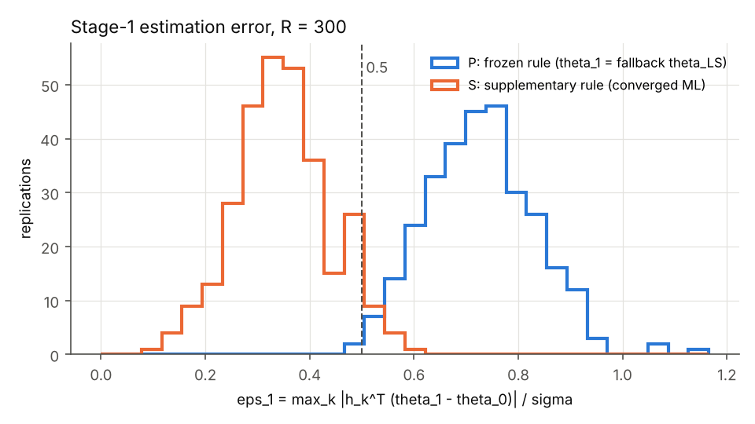
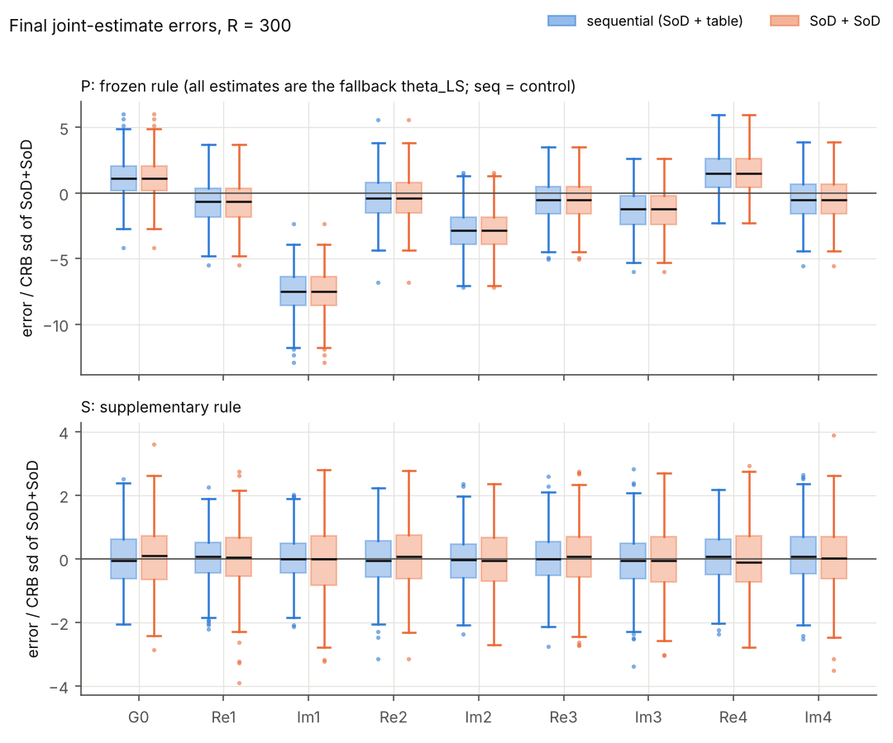

**方案。** `reports_CN/plan_round8_CN.md` v3.1（冻结，提交 f06a994）。预测 Q1–Q7 在任何运行之前提交（d73f995，`predictions_round8.md`，逐字取自方案 §4）。

**口径。** 本报告所有结果都是本场景、固定设计规则下的序贯仿真结果（单场景 $d=20$，均匀输入，两段各 5 s，$\lambda=4\bar\gamma$，$R=300$）。预算一律对冻结常数 $B=316.8921168493721$ 判，总预算对 $2B=633.7842336987442$ 判。真值 $\theta_0$ 只进入仿真器（`truth_r8.py`）和事后评价（`posthoc_r8.py`）。

**来源。** 每个数都取自 `round8/` 下的日志或结果文件，并标出行号：
- Part A 检查：`logs/partA_checks.log`
- 逐重复运行：`logs/partB_pipeline.log`，`results/archive_round8.jsonl`（300 行）
- 统计：`logs/partC_stats.log`，`results/stats_round8.json`
- 判定与预测计分：`logs/verdict.log`

方案没有规定的选择、以及方案无法照字面执行的地方，都记在 `decisions_round8.md`（DECISION 行）。

# 0. 结论

1. **判定（方案 §5，冻结规则，主分析 P）：情形 1，流程未验证**（`logs/verdict.log:2`）。触发条件有两个，根源是同一个：
   - 第一段估计失败率 100%（300/300），超过 10%（`logs/partC_stats.log:5`）；
   - 正确性检查 1 未过：A3-1(b) 在冻结规则下不通过（`logs/partA_checks.log:72, 87`）。

   **根源（DECISION E-1）。** 方案 §1.2 的收敛验收要求求和形式负对数似然在 $\vartheta$ 空间的梯度无穷范数 $\le10^{-8}$。在双精度下这一条件达不到：
   - 本场景 $\vartheta$ 空间的 Hessian 特征值为 $3.5\times10^{8}$–$1.35\times10^{11}$；
   - 把 $\theta_1$ 改动一个末位单位，原始梯度就变化 $1.4\times10^{-5}$，即门槛的 1400 倍（`logs/partA_checks.log:82–84`）；
   - 全部 3000 次优化器调用（第一段 600 次、联合 2400 次）的终止梯度无穷范数最小为 $1.66\times10^{-4}$，中位 $1.2\times10^{-2}$，没有一次达到 $10^{-8}$；
   - 同一批调用的 Newton 减量中位只有 $1.1\times10^{-7}$ 个标准误。也就是说，优化器在统计意义上已经停在极大似然点上，只是冻结的数值门槛无法满足。

   于是冻结规则下每次估计都走退路：$\hat\theta_1:=\hat\theta^{\rm LS}$，$\hat\theta_{\rm final}:=\hat\theta_1$。两方案的最终估计逐位相同，$\Delta D\equiv0$。按方案 §5，情形 1 之后不再判达标与否。
2. **补充分析 S（非冻结规则，不作判定）。** 同一套噪声、同一批优化器调用、同一设计规则，只把上述梯度门槛换成 Newton 减量 $\le10^{-5}$ 个标准误。门槛在跑前用与本轮不相交的探针种子定下，未使用真值误差。按 §5 规则读，结果是情形 2 的读数：
   - 三项指标全部"支持达标"；
   - 失败率：设计 0、第一段 0、联合（序贯）0.33%、联合（对照）1.0%；
   - 两方案各参数 $|$偏差$|$/RMSE 最大 0.091（`logs/partC_stats.log:31–55`）。

   按方案的结论句式（标明为补充分析）："在本场景、固定设计规则下（补充分析，收敛验收换为 Newton 减量，非冻结规则），两段式事件触发实验在同时长同总预算下比纯 SoD 的经验 D 量高 **X = 3.571 nat**（95% 区间 [2.948, 4.170]），第一段估计误差中位 **Y = 0.346**，生成的表在条件期望上超预算的比例 **Z = 0**（95% 区间 [0, 0]）。"这不是本轮的判定。
3. **两项统计诊断都没有偏离。**
   - Hessian–FIM 白化残差：P 0.0068，S 0.0047，元素 $|z|$ 最大 2.72 / 1.99，无 $|z|>4$；
   - 发送数配对残差：P $\bar d=-1.06\pm0.50$，S $-0.42\pm0.55$，都在 $3s_d/\sqrt R$ 以内（`logs/partC_stats.log:24–26, 51–53`）。
4. **预测（按冻结规则的主分析计分）：** Q3 对；Q2、Q6、Q7 部分对；Q1、Q4、Q5 错。补充分析的读数：Q1–Q6 对、Q7 部分对，不计分（第 8 节）。

# 1. 四项正确性检查与两项统计诊断

## 1.1 正确性检查（方案 §3 第 1–4 条；`logs/partA_checks.log`，提交 0d19c8e）

| 检查 | 结果 | 内容 | 行 |
|---|---|---|---|
| 1. 估计器 | **未过**（冻结规则） | (a) 完整数据：返回值与 LS 的差 $\max_i|\Delta\theta_i|/s_i=0$。在冻结规则下这是退路 $\hat\theta^{\rm LS}$ 本身，标"未收敛"；两次优化器调用的终止点与 LS 差 $2\times10^{-16}$、$2\times10^{-12}$。按 DECISION A-8 判过。(b) §8.4 存档 ML（`stage2/final_theta_mle.npz` UNIF 第 0 行；记录身份由 LS 与存档 UNIF_ls 逐位相同确认）：冻结规则返回退路，距存档 ML **8.64 个标准误**，**未过**；优化器两次调用的终止点距存档 ML $1.0\times10^{-7}$、$3.2\times10^{-8}$ 个标准误。补充规则下返回值距存档 $1.0\times10^{-7}$ 个标准误，读作通过。(c) 非对称、随 $(k,r)$ 变的随机窗口表（95.5% 的窗口 $M^-\ne M^+$，400 种窗口都出现）下联合似然的解析梯度与数值梯度，三个随机 $\theta$ 的相对差 $1.7\times10^{-12}$、$1.7\times10^{-12}$、$2.9\times10^{-12}$（门槛 $10^{-6}$），通过 | 58–87 |
| 2. 设计链回归 | **通过** | 以 $\theta_0$ 作"估计"（测试模式，不设哨兵）：码表、支撑起点、宽度、$\lambda$ 与第 7 轮 T4（`round7/results/table_T4.npz`）逐位相同；网格原点、步长、节点数与第 7 轮冻结网格相同；设计者 $\sigma/24$ 期望 262.7986258567231 与 T4 相同；$\hat J_{\rm SoD}$ 与 evaluator_fast 逐位相同；$\bar\gamma$ 与第 6 轮扫描记录相同。设计 34.5 s（4 线程） | 18–37 |
| 3. 真值隔离 | **通过** | 静态导入图：design_r8 只到达 {declared, r8k_dr, r8k_ef, r8k_ew, r8k_td}，无禁用名，第三方只有 numpy/scipy/numba/os/sys/time。新解释器（`python3 -I`）导入 design_r8 后不加载任何禁用模块。哨兵正对照：7 次故意访问全部抛出并记录。一次带哨兵的设计结束时访问记录为空。**运行中**：600 次设计全部在哨兵下进行，访问记录全部为空（管线遇访问即停，运行完成即证明） | 88–104 |
| 4. 守恒、非负、支撑断言 | **通过** | 检查中 6 次评价器调用：$\max|\sum m-1|=1.76\times10^{-12}$，$\min m=0$，无断言触发。运行中 1800 次评价器调用（600 张表 × 设计侧 2 次 + $\sigma/120$ 事后 1 次）：$\max|\sum m-1|=2.03\times10^{-12}$，$\min m=0$，断言失败 0，不变量 $S$、$J$、$w$ 全部成立；$\sigma/120$ 节点到单元分界的最小距离 0.1 个单元宽 | 105–109；`results/archive_round8.jsonl` |

**支撑性回归**（不在四项之内，全部通过；`logs/partA_checks.log:1–57, 79–80`）：
- 声明知识与冻结源逐位相同（$K,t,\omega,a_0,\Delta^*,\sigma,B,H$；`x_polar`$(\theta_0)$ = 第 4 轮名义输出）；
- 57 个逐字复制块与冻结源字节相同；
- 后验评价器在 $\theta_0$ 处对 T4 与 SoD 逐位复现第 7 轮 $\sigma/120$ 存档（$\mathbb E[N]=262.7464450212968$、$b_1=316.8911511745014$、$J$ 81 元）；
- 常数 (480, 480) 表的仿真器与 mc83.sod 在 100 条轨迹上逐位相同；
- 查表与第 7 轮 cell_index + 第 5 轮 LookupTable 在 20000 次查找上相同；
- 扩展似然在 SoD 记录上与 mc84.py 的 nll_grad_hess 相对差 $\le8\times10^{-15}$。

**检查 1 的读法。** 未过的只有 1(b)。原因是冻结收敛门槛在双精度下不可达，估计器返回的是退路值，不是似然算错。估计器本身的数值部分（似然、梯度、与存档 ML 的一致）全部通过。按方案，这仍是"正确性检查未过"，记入情形 1。

## 1.2 统计诊断（方案 §3 第 5–6 条；报告并调查，不是门槛）

| 诊断 | P（冻结规则） | S（补充规则） | 对照第二段（额外，对 $J_1$、$b_1$） |
|---|---|---|---|
| Hessian–FIM 白化残差 $\|J^{-1/2}\bar DJ^{-1/2}\|_2$ | 0.00682 | 0.00468 | 0.00656 |
| 元素 $\max|z|$；$|z|>4$ 的元素 | 2.72；无 | 1.99；无 | 2.62；无 |
| $\bar d=\overline{N_2-\mathbb E[N_2\mid T,\theta_0]}$，$s_d/\sqrt R$ | −1.055，0.496 | −0.422，0.547 | −0.054，0.130 |
| $|\bar d|>3s_d/\sqrt R$ | 否 | 否 | 否 |

来源：`logs/partC_stats.log:24–26, 51–53`。观测信息的平均与 $J_{\rm table}$ 一致，仿真发送数与评价器的条件期望一致，未发现需要调查的偏离。

# 2. 第一段统计

| 量 | P（冻结规则：$\hat\theta_1$ = 退路 $\hat\theta^{\rm LS}$） | S（补充规则：收敛的 ML） |
|---|---|---|
| $\varepsilon_1$ 中位 / 90% / 99% | 0.724 / 0.865 / 0.959 | **0.346 / 0.477 / 0.558** |
| $\varepsilon_1>0.5$ 的比例 | 99.3% | 5.7% |
| 第一段估计失败率 | **100%**（300 次全部走退路 $\hat\theta^{\rm LS}$；LS 300 次全部可用，秩 9） | 0% |
| $-\log\det\widehat M_1$；$\log\det J_1$ | 190.948；197.201 | 196.944；197.201 |
| $|{-\log\det\widehat M_1}-\log\det J_1|$（诊断） | 6.253 | 0.257 |
| 各参数 $|$偏差$|$/RMSE 最大 | 0.978（Im1） | 0.082 |

来源：`logs/partC_stats.log:4–5, 21, 23, 31–32, 48, 50`；图 `fig_eps1_hist.png`。

退路 $\hat\theta^{\rm LS}$ 是把发送样本当完整观测的最小二乘。它在本场景有明显偏差：Im1 偏差约为其 RMSE 的 0.98 倍，箱线图中约为 −7.5 个对照 CRB 标准差。这是冻结退路规则的直接后果，不是似然估计的性质。



# 3. 发送数统计

$b_1:=\mathbb E_{\theta_0}[N_{\rm SoD}]$ 是参考网格 $\sigma/120$ 上的评价器数值（常数 $\Delta^*$，同一首发规则），为 316.8911511745014；$2b_1=633.7823$，$2B=633.7842$。$b_1$ 是数值基准，不等于 $B$，也没有用样本均值 $\bar N_1=316.837$ 代替（`logs/partC_stats.log:6, 33`）。

| 量 | P | S |
|---|---|---|
| 生成的表在条件期望上超预算的比例 $\Pr\{\mathbb E[N_2\mid T,\theta_0]>B\}$ | **0**（95% 区间 [0, 0]） | **0**（[0, 0]） |
| 实际实验超预算的比例 $\Pr\{N_2>B\}$ | **0**（[0, 0]） | **0**（[0, 0]） |
| 总期望发送 $\hat b_{\rm seq}=b_1+\frac1R\sum_r\mathbb E[N_2\mid T^{(r)},\theta_0]$ | **557.776**（[557.378, 558.161]） | **581.243**（[580.744, 581.792]） |
| 对照 SoD+SoD 的总期望发送 $2b_1$ | 633.782 | 633.782 |
| 两者对 $2B=633.784$ | 都不超 | 都不超 |
| $\mathbb E[N_2\mid T,\theta_0]$ 范围（均值，标准差） | 232.6–251.5（240.9，3.49） | 251.8–278.0（264.4，4.73） |
| 设计者的预期 $\hat{\mathbb E}[N_2\mid T,\hat\theta_1]$（$\sigma/24$） | 262.77–263.00（262.87） | 262.70–262.93（262.81） |
| $\hat{\mathbb E}-\mathbb E$ 中位（范围） | +22.2（+11.3 至 +30.3） | −1.18（−15.2 至 +11.1） |
| $N_1$ 均值（范围） | 316.84（309–324） | 同左（同一 $Y_1$） |
| $N_2$ 序贯 均值（范围） | 239.8（215–265） | 263.9（236–295） |
| $N_2$ 对照 均值（范围）；$\Pr\{N_{2,\rm SoD}>B\}$ | 316.84（311–323）；58.7% | 同左（同一记录） |
| $N_1+N_2$ 序贯 / 对照 均值 | 556.7 / 633.7 | 580.8 / 633.7 |

来源：`logs/partC_stats.log:6–15, 27, 33–42, 54`；图 `fig_EN2_vs_eps1.png`。

- 设计者在 $\hat\theta_1$ 下的预期几乎不随估计变化（标准差 0.03–0.04 次）。真实条件期望则随 $\hat\theta_1$ 变化（标准差 3.5–4.7 次），但两个分析中没有一张表超过 $B$：最大值 251.5（P）、278.0（S），离 $B$ 还有 39 次以上。
- P 的表在真实系统上比设计时少发约 22 次。这是描述性的，不作因果解释。
- 对照第二段是常数 $\Delta^*$ 的 SoD，其期望恰为 $b_1\approx B$，所以单次实验超 $B$ 的比例约一半（58.7%）。这不是对照方案的缺陷，因为方案以期望发送数判预算。

![E[N_2|T,θ_0] 对 ε_1](fig_EN2_vs_eps1.png)

# 4. 最终精度与信息参考差异

## 4.1 全体 $R=300$ 次（主分析口径）

| 量 | P 序贯 | P 对照 | S 序贯 | S 对照 |
|---|---|---|---|---|
| $D=-\log\det\widehat M$（经验 D 量，含偏差） | 190.948 | 190.948 | **206.854** | **203.283** |
| $-\log\det\hat C$ | 194.844 | 194.844 | 206.840 | 203.267 |
| $\Delta D=D_{\rm seq}-D_{\rm SoD+SoD}$ | **0**（两方案逐位相同） | | **+3.571** | |
| $\Delta(-\log\det\hat C)$ | 0 | | +3.573 | |
| 各参数 $|$偏差$|$/RMSE 最大 | 0.978 | 0.978 | 0.091 | 0.069 |
| 信息参考 $\log\det J$（$J_{\rm seq}=J_1+\overline{J_{\rm table}}$；$J_{\rm SoD+SoD}=2J_1$） | 206.173 | 203.439 | 207.076 | 203.439 |
| 经验精度与信息参考的差异 $|{-\log\det\widehat M}-\log\det J|$ | 15.226 | 12.492 | **0.222** | **0.157** |

来源：`logs/partC_stats.log:16–23, 43–50`；完整的 $\widehat M$、$\hat C$、偏差向量见 `results/stats_round8.json`（`acc_all`）。

**各参数**（S，全体；单位 $\theta$；`logs/partC_stats.log:44, 46`）：

| 参数 | 序贯 偏差 | 序贯 RMSE | 对照 偏差 | 对照 RMSE |
|---|---|---|---|---|
| G0 | +3.1e-08 | 3.45e-06 | +2.2e-07 | 4.29e-06 |
| Re1 | +3.5e-07 | 1.02e-05 | +1.8e-07 | 1.34e-05 |
| Im1 | +2.5e-07 | 9.29e-06 | −6.8e-08 | 1.32e-05 |
| Re2 | −3.0e-07 | 9.90e-06 | +8.2e-07 | 1.19e-05 |
| Im2 | −5.2e-07 | 9.79e-06 | −6.8e-07 | 1.13e-05 |
| Re3 | +5.6e-07 | 2.20e-05 | +1.2e-06 | 2.66e-05 |
| Im3 | −2.1e-06 | 2.35e-05 | +1.2e-08 | 2.70e-05 |
| Re4 | +1.3e-06 | 2.14e-05 | −7.9e-07 | 2.60e-05 |
| Im4 | +2.2e-06 | 2.43e-05 | +9.0e-07 | 2.85e-05 |

P 的两方案各参数偏差 / RMSE 相同（均为退路 $\hat\theta^{\rm LS}$）：

| | G0 | Re1 | Im1 | Re2 | Im2 | Re3 | Im3 | Re4 | Im4 |
|---|---|---|---|---|---|---|---|---|---|
| 偏差 | +4.3e-6 | −8.4e-6 | −9.3e-5 | −3.5e-6 | −3.3e-5 | −1.4e-5 | −3.4e-5 | +4.0e-5 | −1.2e-5 |
| RMSE | 7.7e-6 | 2.4e-5 | 9.5e-5 | 2.0e-5 | 3.8e-5 | 4.4e-5 | 5.2e-5 | 5.7e-5 | 4.6e-5 |

（`logs/partC_stats.log:17`）

- 补充分析 S 中，经验 D 量比信息参考低 0.22 / 0.16 nat（带符号为负），第一段低 0.26 nat：经验精度略低于信息参考。这是诊断量，不解释为估计器错误，也不称为界。
- 主分析 P 的差异达 12–15 nat，来自退路 LS 的偏差与低效。

## 4.2 条件于"双方成功"子集（补充口径，标明）

子集定义（冻结）：第一段估计成功、造表成功、两方案联合估计都成功、未用任何退路。子集矩阵按子集样本数归一化。这里不涉及"成功条件下的 CRB"。

| | P | S |
|---|---|---|
| 子集大小 | **0**（无一次估计按冻结规则收敛） | 296 |
| $D_{\rm seq}$ / $D_{\rm SoD+SoD}$ | 不可计算 | 206.890 / 203.400 |
| $\Delta D$（子集） | 不可计算 | **+3.490**（95% 区间 [2.896, 4.069]） |
| $-\log\det\hat C$ 序贯 / 对照 | 不可计算 | 206.876 / 203.384 |
| 子集各参数 $|$偏差$|$/RMSE 最大 | — | 0.102（序贯），0.071（对照） |

来源：`logs/partC_stats.log:22, 27, 49, 54`；`results/stats_round8.json`（`acc_subset`）。



# 5. 失败率

| 失败 | P（冻结规则） | S（补充规则） |
|---|---|---|
| 设计失败（§1.7 所列，走 SoD 退路） | 0（0/300） | 0（0/300） |
| 第一段估计失败 | **100%**（300/300） | 0（0/300） |
| 联合估计失败（序贯） | **100%**（300/300） | 0.33%（1/300：r = 134） |
| 联合估计失败（对照 SoD+SoD） | **100%**（300/300） | 1.0%（3/300：r = 98、176、228） |

来源：`logs/partC_stats.log:5, 32`。
- S 的 4 次联合失败，两次调用都是线搜索异常终止（result.success 为假），Newton 减量只有 $10^{-7}$–$10^{-6}$ 个标准误。按冻结的"优化器报告成功"一条走退路 $\hat\theta_1$（DECISION R-2）。
- 没有哨兵访问、断言停止或设计失败，600 次设计全部成功。

# 6. 配对 bootstrap

按重复编号配对重采样（$B_{\rm boot}=2000$，`default_rng(20281028)`，每次 `integers(0, R, R)`，两方案同取），95% 分位区间（`logs/partC_stats.log:27, 54`；逐次值见 `results/bootstrap_round8_{P,S}.npz`）：

| 指标 | P 点估计 | P 95% 区间 | S 点估计 | S 95% 区间 |
|---|---|---|---|---|
| $\Delta D$（全体） | 0 | [0, 0]；不可计算 0 次 | +3.571 | [+2.948, +4.170]；不可计算 0 次 |
| $\hat b_{\rm seq}$（$b_1$ 固定） | 557.776 | [557.378, 558.161] | 581.243 | [580.744, 581.792] |
| $\Pr\{\mathbb E[N_2\mid T,\theta_0]>B\}$ | 0 | [0, 0] | 0 | [0, 0] |
| $\Pr\{N_2>B\}$ | 0 | [0, 0] | 0 | [0, 0] |
| $\Delta D$（双方成功子集） | 不可计算 | **不可计算 2000/2000 次**（子集为空） | +3.490 | [+2.896, +4.069]；不可计算 0 次（子集大小 288–300） |

# 7. 判定（方案 §5，互斥，按顺序）

**主分析 P（冻结规则，作判定）**（`logs/verdict.log:2`）：
1. **流程未验证：成立。**
   - 第一段估计失败率 100% > 10%；
   - 正确性检查 1 未过（A3-1(b)）；检查 2–4 通过。
   - 按顺序判，情形 2–4 不再检查。
   - 供参考的三项指标读数（不参与本次判定）：$\Delta D$ 明确未达（区间 [0, 0]）、总期望发送支持达标、超预算比例支持达标。
   - 情形 1 只说明流程在冻结规则下没有被验证。它不说明设计规则、估计方法或第一段长度的好坏，因为冻结规则下没有一次估计被接受，所有最终估计都是同一个退路值。

**补充分析 S（非冻结规则，按 §5 读数，不作判定）**（`logs/verdict.log:3`）：
- 情形 1 不成立：第一段失败率 0；按补充规则 A3-1(b) 读作通过（距存档 ML $1.0\times10^{-7}$ 个标准误），检查 2–4 通过。
- 情形 2 的条件全部满足：

| 指标 | 点估计 | 95% 区间 | 读数 |
|---|---|---|---|
| $\Delta D$ | +3.571 | [+2.948, +4.170]，下端 $\ge+2$ | 支持达标 |
| 总期望发送 $\hat b_{\rm seq}$ | 581.24 | 上端 581.79 $\le2B$ | 支持达标 |
| $\Pr\{\mathbb E[N_2\mid T,\theta_0]>B\}$ | 0 | 上端 0 $\le20\%$ | 支持达标 |
| 设计 / 第一段 / 联合（序贯）/ 联合（对照）失败率 | 0 / 0 / 0.33% / 1.0% | 各 $\le5\%$ | 满足 |
| 两方案各参数 $|$偏差$|$/RMSE | 最大 0.091 | $\le0.3$ | 满足 |

- 结论句（补充分析，不作判定）："在本场景、固定设计规则下，两段式事件触发实验在同时长同总预算下比纯 SoD 的经验 D 量高 X = 3.571 nat（95% 区间 [2.948, 4.170]），第一段估计误差中位 Y = 0.346，生成的表在条件期望上超预算的比例 Z = 0。"X、Y、Z 出自本轮同一套 300 次重复，收敛验收为 DECISION E-1 的补充规则。

**下一步候选（不归因）。** 冻结规则的问题在收敛验收的数值门槛本身。若要让判定落在冻结规则上，候选做法有：
- 把门槛改为与目标尺度无关的量（如 Newton 减量，或除以观测数后的梯度）；
- 或保留梯度门槛但改用相对于观测信息的标准化梯度。

这需要修订方案后另跑一轮，本轮不重判。

# 8. 预测对照

计分口径见 DECISION S-0 至 S-7（在 Part B 运行之前写定，随 Part A 提交 0d19c8e）。按主分析 P 计分；S 列只是读数，不计分（`logs/verdict.log:5–18`）。

| 编号 | 预测 | P 结果 | 计分 | S 读数（不计分） |
|---|---|---|---|---|
| Q1 | $\varepsilon_1$ 中位 $\in[0.2,0.4]$，90% 分位 $\le0.6$，$>0.5$ 的比例 $\le15\%$；第一段估计失败率 $\le2\%$ | 中位 0.724、90% 0.865、$>0.5$ 99.3%、失败率 100%：四项全错 | **错** | 0.346、0.477、5.7%、0：对 |
| Q2 | $|{-\log\det\widehat M_1}-\log\det J_1|\le0.5$；Hessian–FIM 白化残差 $\le0.05$ | 6.253（错）；0.0068（对） | **部分对** | 0.257、0.0047：对 |
| Q3 | $\Pr\{\mathbb E[N_2\mid T,\theta_0]>B\}\le10\%$；$\Pr\{N_2>B\}\le25\%$；总期望发送 $\le2B$ | 0、0、557.78 $\le$ 633.78 | **对** | 0、0、581.24：对 |
| Q4 | 全体 $\Delta D\in[+2.5,+4]$，区间下端 $\ge+1.5$ | $\Delta D=0$，区间 [0, 0] | **错** | +3.571，下端 +2.948：对 |
| Q5 | 两方案 $|{-\log\det\widehat M}-\log\det J|\le0.5$ | 15.23、12.49 | **错** | 0.222、0.157：对 |
| Q6 | 设计失败率 $\le2\%$、估计失败率 $\le2\%$；两方案各参数 $|$偏差$|/{\rm RMSE}\le0.2$ | 设计 0（对）；估计 100%（错）；最大 0.978（错） | **部分对** | 0；最大 1.0%；最大 0.091：对 |
| Q7 | 每次重复 $\le60$ s，总 $\le6$ h（含 bootstrap） | 主分析工作每次中位 89.7 s、最大 104.2 s（错）；Part B + C 墙钟 3.783 h（对） | **部分对** | 同左：部分对 |

- **Q1、Q2、Q4–Q6 的错误项全部来自 DECISION E-1。** 冻结规则下没有一次估计被接受，所有 $\hat\theta$ 都是退路 LS。预测针对的是收敛的似然估计；补充分析给出的正是那种估计，各项读数都落在预测范围内。
- **Q7 注。** 每次重复的瓶颈是单线程 DP（中位 70.1 s）加 $\sigma/120$ 事后评价（中位 12.0 s），预测偏低约 1.5 倍。实际运行同时做了 P 与 S 两套设计，每次重复整体中位 180.8 s；只做主分析的估计墙钟约 1.88 h。

# 9. 提交、运行时间、复现

**提交顺序：**

| 提交 | 内容 |
|---|---|
| f06a994 | 方案（v3.1，冻结） |
| d73f995 | 预测 Q1–Q7（逐字，跑前） |
| 0d19c8e | Part A（估计器、真值隔离的设计模块与逐字镜像、仿真器、事后评价器、检查 A3；DECISION P/E/A/B/C/S） |
| 88e223a | Part B/C 代码（运行中提交，无结果；DECISION R-1） |
| 3f32991 | Part B 结果（300 行存档、600 张打包表、种子、$b_1$/$J_1$） |
| 9c7b1b0 | Part C（统计、bootstrap、判定、图） |

本报告与 `decisions_round8.md` 的 R 节在其后一次提交中。

**运行时间：**

| 步骤 | 墙钟 |
|---|---|
| Part A 检查（4 线程） | 87.6 s |
| 探针冒烟测试（4 次重复，种子不相交，不提交） | 181 s |
| Part B（300 次重复 × P、S 两套，4 进程，每进程 1 个 numba 线程） | 13618.5 s = 3.783 h |
| Part C（统计、2000 次 × 2 bootstrap、图） | 1.6 s |

每次重复的工作量：设计中位 77.0 s（其中 DP 70.1 s），事后评价 12.0 s，估计与仿真 < 1 s。600 张打包表共 47 MB（每张约 80 KB）。

**环境。** 4 核；Python 3.13.17，numpy 2.5.3，scipy 1.18.1，numba 0.68.0（容器起始时缺失，按第 6/7 轮版本安装），matplotlib 3.11.2。

**复现**（在 `round8/` 下）：

```
python3 build_kernels.py          # 逐字镜像 r8k_*.py 与 kernels_manifest.json（已提交，重建结果相同）
python3 checks_r8.py              # Part A3 -> logs/partA_checks.log, results/partA_checks.json
python3 seq_pipeline.py run       # Part B（逐重复 checkpoint，可续跑）-> results/archive_round8.jsonl, results/tables_packed/
python3 stats_r8.py               # Part C -> results/stats_round8.json, bootstrap npz, 三张图
python3 verdict_round8.py         # 判定与 Q1–Q7 -> logs/verdict.log, results/verdict.json
```

**DECISION 清单**见 `decisions_round8.md`：P-1；E-1 至 E-7；A-1 至 A-8；B-1 至 B-6；C-1 至 C-5；S-0 至 S-7；R-1、R-2。
