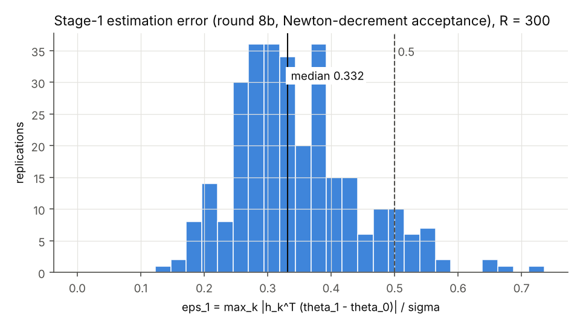
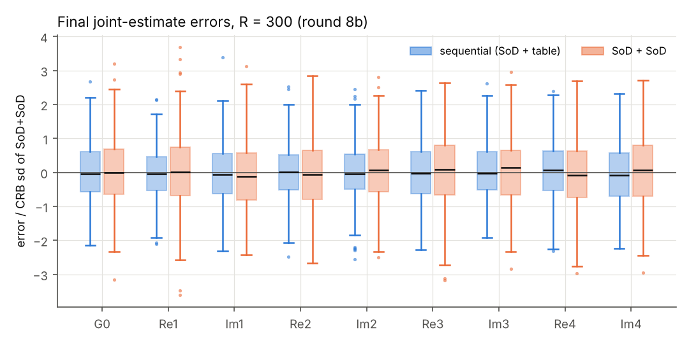

**方案。** `reports_CN/plan_round8b_CN.md` v2（冻结，提交 a9ea099），是第 8 轮方案 v3.1（`reports_CN/plan_round8_CN.md`）的补充。与 v3.1 相比只改两处：
- 收敛验收改为 Newton 减量；
- 种子全部换新。

预测 Q1–Q7 在任何数值运行之前提交（a1e6f3f，`predictions_round8b.md`；Q1–Q6 逐字取自 v3.1 §4，Q7 按本轮方案改写），工程测试的种子清单在同一提交里。按方案要求，预测文件开头声明："本轮预测在已看到第 8 轮补充分析的情况下提交，不是盲预测；判定仍按冻结规则。"

**口径。** 本报告所有结果都是本场景、固定设计规则下的序贯仿真结果：
- 单场景 $d=20$，均匀输入，两段各 5 s，$\lambda=4\bar\gamma$，$R=300$，只跑主分析。
- 预算对冻结常数 $B=316.8921168493721$ 判，总预算对 $2B=633.7842336987442$ 判。
- 真值 $\theta_0$ 只进入仿真器（`round8/truth_r8.py`）和事后评价（`round8/posthoc_r8.py`）。

**来源。** 每个数都取自 `round8b/` 下的日志或结果文件，并标出行号：
- Part A3：`logs/partA_checks_r8b.log`
- 工程测试：`logs/engineering_repro_S.log`（E2）、`logs/engineering_stats_E3.log`（E3）
- 逐重复运行：`logs/partB_pipeline.log`，`results/archive_round8b.jsonl`（300 行）
- 统计：`logs/partC_stats.log`，`results/stats_round8b.json`
- 判定与预测计分：`logs/verdict.log`

方案没有规定的选择都记在 `decisions_round8b.md`（DECISION 行）。

**本轮唯一的算法改动（冻结）。** 一次优化器调用被接受，当且仅当以下四条同时成立：
- `result.success == True`；
- 参数、目标、梯度均有限；
- 求和 NLL 在 $\vartheta$ 空间的解析 Hessian $H_\vartheta$ 的 Cholesky 分解成功；
- Newton 减量 $\eta=\sqrt{g_\vartheta^{\top}H_\vartheta^{-1}g_\vartheta}\le10^{-5}$。

`success == False` 的终止（含线搜索失败）一律不接受，按 v3.1 的重启与退路处理。没有额外 Newton 步；L-BFGS-B 选项、尺度 $s$、目标函数都不变。实现就是第 8 轮 `estimator_r8` 的 `accept['supp']`，也就是 dcc660b 补充分析 S 的规则，原样保留（DECISION A-3）。

**种子。**
- 第一段噪声 $50261028+r$，第二段噪声 $50271028+r$；
- 重启 $60261028+r$（第一段）、$70261028+r$（联合）；
- bootstrap $50281028$。

正式种子只用于 A3 全部通过之后的正式管线。工程测试只用第 8 轮的旧种子。

# 0. 结论

1. **判定（v3.1 §5，冻结规则）：情形 2，序贯有效（本场景、本固定设计规则）**（`logs/verdict.log:2`）。三项指标全部"支持达标"，失败率与偏差条件都满足：
   - $\Delta D$ 区间下端 3.141 $\ge+2$；
   - 总期望发送区间上端 581.706 $\le2B$；
   - 超预算比例的 bootstrap 区间上端 0 $\le20\%$；
   - 失败率：设计 0、第一段 0.67%、联合（序贯）0.33%、联合（对照）1.33%，各 $\le5\%$；
   - 两方案 18 个参数的 $|$偏差$|$/RMSE 最大 0.086 $\le0.3$。

   结论句："在本场景、固定设计规则下，两段式事件触发实验在同时长同总预算下比纯 SoD 的经验 D 量高 **X = 3.672 nat**（95% 区间 [3.141, 4.222]），第一段估计误差中位 **Y = 0.332**，生成的表在条件期望上超预算的比例 **Z = 0**（300 次中未观察到超预算，0/300；bootstrap 95% 区间 [0, 0] 为退化区间；Clopper–Pearson 95% 区间 [0, 1.22%]）。"X、Y、Z 出自本轮同一套 300 次重复。CP 区间只作补充，不替换冻结判据。
2. **A3 四项正确性检查在新验收规则下全部通过**（`logs/partA_checks_r8b.log:116`）。另有两项工程测试，只用第 8 轮种子：
   - E2：本轮管线在 $r\in\{1,2,98,134\}$ 上逐位复现第 8 轮补充分析 S，其中包括两次联合退路；
   - E3：本轮统计代码逐数复现第 8 轮 S 的全部统计量。
3. **两项统计诊断都没有偏离。**
   - Hessian–FIM 白化残差 0.0042，元素 $|z|$ 最大 1.76；
   - 发送数配对残差 $\bar d=0.32\pm0.54$（`logs/partC_stats.log:24, 26`）。
4. **预测 Q1–Q7 全部对**（`logs/verdict.log:5–11`）。这不是盲预测：Q1–Q6 是第 8 轮的原文，提交时已看到第 8 轮补充分析的读数。
5. **与第 8 轮补充分析 S 对照（同规则、不同种子，只作参照）。**
   - $\Delta D$：本轮 3.672 [3.141, 4.222]，S 为 3.571 [2.948, 4.170]；
   - 总期望发送：本轮 581.14，S 为 581.24；
   - 第一段 $\varepsilon_1$ 中位：本轮 0.332，S 为 0.346。

   本轮第一段有 2 次估计失败，S 为 0 次，失败机理见第 5 节。

# 1. A3 结果（新验收规则下重新执行；`logs/partA_checks_r8b.log`，提交 ccf3da6）

A3 只用第 8 轮 A3 的种子：92000000 + …、存档记录 20261014、估计器重启种子 30261028（即 $r=0$）（DECISION A-4）。

| 检查 | 结果 | 内容 | 行 |
|---|---|---|---|
| 1. 估计器 | **通过** | (a) 完整数据：返回值与 LS 的差 $\max_i|\Delta\theta_i|/s_i=2.2\times10^{-16}$（门槛 $10^{-8}$），且该次调用**被接受**（第 8 轮冻结规则下 (a) 只是退路值等于 LS 的空通过；本轮要求接受，DECISION A-5）。(b) §8.4 存档 ML（记录身份：LS 与存档 UNIF_ls 逐位相同）：返回估计距存档 ML $1.05\times10^{-7}$ 个标准误（门槛 $10^{-3}$），被接受。(c) 非对称、随 $(k,r)$ 变的随机窗口表（95.5% 的窗口 $M^-\ne M^+$）下联合似然的解析梯度与数值梯度，三个随机 $\theta$ 的相对差 $1.7\times10^{-12}$、$1.7\times10^{-12}$、$2.9\times10^{-12}$（门槛 $10^{-6}$） | 59–83 |
| 2. 设计链回归 | **通过** | 以 $\theta_0$ 作"估计"（测试模式）：码表、支撑起点、宽度、$\lambda$ 与第 7 轮 T4 逐位相同；$z_0$、$h$、$G$、设计者 $\sigma/24$ 期望 262.7986258567231、$\hat J_{\rm SoD}$、$\bar\gamma$ 也都相同。设计 35.4 s（4 线程） | 20–38 |
| 3. 真值隔离 | **通过** | design_r8 的静态导入图只到达 {declared, r8k_dr, r8k_ef, r8k_ew, r8k_td}，新解释器导入也不加载禁用模块；本轮新增的 estimator_r8b 同样通过两项检查。哨兵正对照 7/7 抛出并记录，带哨兵的设计访问记录为空。**正式运行中**：300 次设计全部在哨兵下进行，无一次访问（管线遇访问即停，运行完成即证明） | 90–110 |
| 4. 守恒、非负、支撑断言 | **通过** | 检查中 6 次评价器调用：$\max|\sum m-1|=1.76\times10^{-12}$，$\min m=0$，无断言失败。正式运行中：<br>• 300 次 $\sigma/120$ 事后评价 $\max|\sum m-1|=2.03\times10^{-12}$；<br>• 600 次设计侧评价 $6.1\times10^{-13}$；<br>• $\min m=0$，断言失败 0，不变量 $S$、$J$、$w$ 全部成立；<br>• $\sigma/120$ 节点到单元分界的最小距离 0.1 个单元宽 | 111–115；`results/archive_round8b.jsonl` |

**支撑性回归**（全部通过）：
- 声明知识逐位相同；
- 第 8 轮 57 个逐字镜像块重新提取后字节相同（本轮不新增任何复制，DECISION A-2）；
- 事后评价器逐位复现第 7 轮 $\sigma/120$ 存档；
- 常数表仿真器与 mc83.sod 在 100 条轨迹上逐位相同；
- 查表与第 7/5 轮一致；
- 扩展似然与 mc84.py 相对差 $\le8.3\times10^{-15}$（行 18、50、57、82）。

**工程测试（只用第 8 轮种子，正式运行之前）：**
- **E2**（`logs/engineering_repro_S.log`）：本轮管线用第 8 轮种子跑 $r=1,2,98,134$，与第 8 轮存档的补充分析 S 逐位相同。比较范围是第一段调用、设计、码表 sha256、第二段记录、事后评价、$H_r$、两方案联合估计，以及 $b_1$、$J_1$；其中 $r=134$ 是序贯联合退路，$r=98$ 是对照联合退路。比较函数经验证能检出一个末位单位的改动。
- **E3**（`logs/engineering_stats_E3.log`）：本轮统计代码在第 8 轮存档（分析 S，bootstrap 种子 20281028）上重算 29 项统计量，与第 8 轮 `stats_round8.json` 全部相同，包括 $\Delta D$ 及区间、子集、$\hat b_{\rm seq}$、两个比例、失败率、诊断、判定。

# 2. 第一段统计

| 量 | 值 |
|---|---|
| $\varepsilon_1$ 中位 / 90% / 99% | **0.332 / 0.485 / 0.647** |
| $\varepsilon_1>0.5$ 的比例 | 8.67%（26/300） |
| 第一段估计失败率 | **0.67%**（2/300：$r=48$、232，退路 $\hat\theta^{\rm LS}$，$\varepsilon_1$ = 0.563、0.680）；Clopper–Pearson 95% [0.08%, 2.39%] |
| 重启被用到 | 1 次（$r=49$，重启调用被接受） |
| LS 可用（秩 9、有限） | 300/300 |
| $-\log\det\widehat M_1$；$\log\det J_1$ | 196.881；197.201 |
| $|{-\log\det\widehat M_1}-\log\det J_1|$（诊断） | 0.320（带符号为负：经验精度略低于信息参考） |
| 各参数 $|$偏差$|$/RMSE 最大 | 0.071 |

来源：`logs/partC_stats.log:4–5, 21, 23, 32–33`；图 `fig_eps1_hist.png`。



# 3. 发送数统计

$b_1:=\mathbb E_{\theta_0}[N_{\rm SoD}]$ 在参考网格 $\sigma/120$ 上由评价器算得（常数 $\Delta^*$，同一首发规则），为 316.8911511745014，与第 8 轮逐位相同（E2）。它是数值基准，不令 $b_1=B$，也不用 $\bar N_1=317.06$ 代替。

| 量 | 值 |
|---|---|
| 总期望发送 $\hat b_{\rm seq}=b_1+\frac1R\sum_r\mathbb E[N_2\mid T^{(r)},\theta_0]$ | **581.142**（bootstrap 95% [580.554, 581.706]） |
| 对照 SoD+SoD 的总期望发送 $2b_1$ | 633.782 |
| 两者对 $2B=633.784$ | 都不超；$\hat b_{\rm seq}$ 区间上端低于 $2B$ 52.1 次 |
| 生成的表在条件期望上超预算的比例 $\Pr\{\mathbb E[N_2\mid T,\theta_0]>B\}$ | **300 次中未观察到超预算（0/300）**；bootstrap 95% [0, 0]（**退化区间**）；Clopper–Pearson 95% [0, 1.22%] |
| 实际实验超预算的比例 $\Pr\{N_2>B\}$ | **300 次中未观察到超预算（0/300）**；bootstrap 95% [0, 0]（**退化区间**）；Clopper–Pearson 95% [0, 1.22%] |
| $\mathbb E[N_2\mid T,\theta_0]$ 范围（均值，标准差） | 239.3–277.4（264.25，5.13）；离 $B$ 最近仍差 39.5 次 |
| 设计者的预期 $\hat{\mathbb E}[N_2\mid T,\hat\theta_1]$（$\sigma/24$） | 262.73–262.92（262.81，标准差 0.03） |
| $\hat{\mathbb E}-\mathbb E$ 中位（范围） | −1.48（−14.6 至 +23.6） |
| $N_1$ 均值（范围） | 317.06（310–324） |
| $N_2$ 序贯 均值（范围） | 264.57（219–293） |
| $N_2$ 对照 均值（范围）；$\Pr\{N_{2,\rm SoD}>B\}$ | 316.94（311–323）；59.7%（179/300，CP [53.9%, 65.3%]） |
| $N_1+N_2$ 序贯 / 对照 均值 | 581.6 / 634.0 |

来源：`logs/partC_stats.log:6–15, 27, 29–31`；图 `fig_EN2_vs_eps1.png`。

- 两个超预算比例都是 0/300，所以每次 bootstrap 重采样都是 0，分位区间 [0, 0] 只是退化区间，不表示真实比例为 0。按方案三者并报。冻结判据仍用 bootstrap 区间（读作"支持达标"）；CP 区间只是补充，不替换判据。
- 对照第二段是常数 $\Delta^*$ 的 SoD，期望恰为 $b_1\approx B$，单次实验超 $B$ 的比例约六成。方案以期望发送数判预算，这不算对照方案的缺陷。
- $\hat{\mathbb E}-\mathbb E$ 最大的两个值（+23.6、+19.1 次）正是两次第一段退路（$r=232$、48，$\hat\theta_1=\hat\theta^{\rm LS}$，$\varepsilon_1$ = 0.680、0.563），其余 298 次都在 +11.6 以内。$\varepsilon_1$ 最大的 $r=92$（0.722）不在其中。这两张表在真实系统上发得比设计者预期少，是描述性观察，不作因果解释。

![E[N_2|T,θ_0] 对 ε_1](fig_EN2_vs_eps1.png)

# 4. 最终精度与信息参考差异

## 4.1 全体 $R=300$ 次（主分析口径）

| 量 | 序贯 | 对照 SoD+SoD |
|---|---|---|
| $D=-\log\det\widehat M$（经验 D 量，含偏差） | **206.947** | **203.275** |
| $-\log\det\hat C$ | 206.949 | 203.268 |
| $\Delta D=D_{\rm seq}-D_{\rm SoD+SoD}$ | **+3.672**（bootstrap 95% [3.141, 4.222]，不可计算 0 次） | |
| $\Delta(-\log\det\hat C)$ | +3.681 | |
| 各参数 $|$偏差$|$/RMSE 最大 | 0.074（Im4） | 0.086（Im1） |
| 信息参考 $\log\det J$（$J_{\rm seq}=J_1+\overline{J_{\rm table}}$；$J_{\rm SoD+SoD}=2J_1$） | 207.071 | 203.439 |
| 经验精度与信息参考的差异 $|{-\log\det\widehat M}-\log\det J|$ | **0.124**（带符号为负） | **0.165**（带符号为负） |

**各参数**（全体；单位 $\theta$；`logs/partC_stats.log:17, 19`）：

| 参数 | 序贯 偏差 | 序贯 RMSE | 对照 偏差 | 对照 RMSE |
|---|---|---|---|---|
| G0 | −1.0e-07 | 3.28e-06 | −1.8e-08 | 4.06e-06 |
| Re1 | −4.7e-07 | 1.04e-05 | +7.7e-07 | 1.45e-05 |
| Im1 | −6.9e-07 | 1.05e-05 | −1.1e-06 | 1.29e-05 |
| Re2 | −1.9e-07 | 9.32e-06 | −7.5e-07 | 1.18e-05 |
| Im2 | −2.4e-07 | 9.52e-06 | +7.0e-07 | 1.11e-05 |
| Re3 | −6.1e-07 | 2.32e-05 | +1.8e-06 | 2.81e-05 |
| Im3 | +2.5e-07 | 2.16e-05 | +1.8e-07 | 2.44e-05 |
| Re4 | +1.3e-06 | 2.25e-05 | −1.2e-06 | 2.63e-05 |
| Im4 | −1.7e-06 | 2.35e-05 | +1.1e-06 | 2.87e-05 |

来源：`logs/partC_stats.log:16–23`。完整的 $\widehat M$、$\hat C$、偏差向量在 `results/stats_round8b.json` 的 `acc_all` 中。

- 两方案的经验 D 量都比信息参考低 0.12 / 0.16 nat，第一段低 0.32 nat。这是诊断量，不解释为估计器错误，也不称为界。
- 两方案的 $\widehat M$ 与 $\hat C$ 只差 0.002 / 0.007 nat，偏差对 D 量几乎没有贡献。

## 4.2 条件于"双方成功"子集（补充口径，标明）

子集按冻结定义取：第一段估计成功、造表成功、两方案联合估计都成功、未用任何退路。子集矩阵按子集样本数归一化。这里不涉及"成功条件下的 CRB"。

| 量 | 序贯 | 对照 |
|---|---|---|
| 子集大小 | 293 | 293 |
| $D=-\log\det\widehat M$ | 207.061 | 203.292 |
| $-\log\det\hat C$ | 207.061 | 203.283 |
| $\Delta D$（子集） | **+3.769**（bootstrap 95% [3.233, 4.292]；不可计算 0 次，子集大小 283–300） | |
| 各参数 $|$偏差$|$/RMSE 最大 | 0.078 | 0.079 |

来源：`logs/partC_stats.log:22, 27, 34–35`；`results/stats_round8b.json`（`acc_subset`）。子集排除的 7 次重复（每次都含一次退路估计）见第 5 节。子集 $\Delta D$ 比全体高 0.10 nat；它是同一批重复的子集读数，不是独立证据。



# 5. 失败率

| 失败 | 次数 | 比例（Clopper–Pearson 95%） | 重复 |
|---|---|---|---|
| 设计失败（§1.7 所列，走 SoD 退路） | 0/300 | 0（[0, 1.22%]） | — |
| 第一段估计失败 | 2/300 | 0.67%（[0.08%, 2.39%]） | 48、232 |
| 联合估计失败（序贯） | 1/300 | 0.33%（[0.01%, 1.84%]） | 106 |
| 联合估计失败（对照 SoD+SoD） | 4/300 | 1.33%（[0.36%, 3.38%]） | 33、189、221、239 |

来源：`logs/partC_stats.log:5, 32`；DECISION R-2、R-3。

- **失败机理。** 7 次失败都是同一种：两次调用都以 `ABNORMAL_TERMINATION_IN_LNSRCH`（result.success 为假）结束，而 Newton 减量只有 $4.2\times10^{-8}$–$1.1\times10^{-6}$。按冻结规则这些估计不被接受，走退路：
  - 第一段退路是 $\hat\theta^{\rm LS}$，之后仍用它造表（§1.7）；
  - 联合退路是 $\hat\theta_1$。

  这与第 8 轮补充分析 S 的 4 次联合失败（其 DECISION R-2）同一机理。
- **优化器诊断**（DECISION R-3）。全部 1800 次调用中：
  - 1368 次 success，全部被接受（没有 success 但 $\eta>10^{-5}$ 或 Cholesky 失败的情况）；
  - 432 次线搜索异常终止，其中首次调用 12 次，重启调用 420 次。重启调用每次估计都跑，但只在首次调用不被接受时才用（第 8 轮 DECISION E-4）。12 次被用到的重启中，5 次被接受，7 次走退路；
  - 结果被采用的 893 次调用：$\eta$ 中位 $1.44\times10^{-7}$，最大 $1.46\times10^{-6}$，离门槛 $10^{-5}$ 约 7 倍；
  - 被接受的调用中 $\eta$ 最大为 $5.03\times10^{-6}$，那是一次未被采用的重启。
- 没有哨兵访问、断言停止或设计失败，300 次设计全部成功。

# 6. 统计诊断（v3.1 §3 第 5–6 条；报告并调查，不是门槛）

| 诊断 | 序贯第二段 | 对照第二段（额外，对 $J_1$、$b_1$） |
|---|---|---|
| Hessian–FIM 白化残差 $\|J^{-1/2}\bar DJ^{-1/2}\|_2$ | 0.00424 | 0.00818 |
| 元素 $\max|z|$；$|z|>4$ 的元素 | 1.76；无 | 2.66；无 |
| $\bar d=\overline{N_2-\mathbb E[N_2\mid T,\theta_0]}$，$s_d/\sqrt R$ | +0.323，0.541 | +0.052，0.137 |
| $|\bar d|>3s_d/\sqrt R$ | 否 | 否 |

来源：`logs/partC_stats.log:24–26`。观测信息的平均与 $J_{\rm table}$ 一致，仿真发送数与评价器的条件期望一致，没有需要调查的偏离。

# 7. 配对 bootstrap

按重复编号配对重采样：$B_{\rm boot}=2000$，`default_rng(50281028)`，每次 `integers(0, R, R)`，两方案同取。区间为 95% 分位区间（`logs/partC_stats.log:27`；逐次值见 `results/bootstrap_round8b.npz`）。

| 指标 | 点估计 | 95% 区间 | 补充 |
|---|---|---|---|
| $\Delta D$（全体） | +3.672 | [+3.141, +4.222]；不可计算 0 次 | |
| $\hat b_{\rm seq}$（$b_1$ 固定） | 581.142 | [580.554, 581.706] | |
| $\Pr\{\mathbb E[N_2\mid T,\theta_0]>B\}$ | 0（0/300 观察到） | [0, 0]（退化） | CP [0, 1.22%] |
| $\Pr\{N_2>B\}$ | 0（0/300 观察到） | [0, 0]（退化） | CP [0, 1.22%] |
| $\Delta D$（双方成功子集） | +3.769 | [+3.233, +4.292]；不可计算 0 次 | 子集大小 283–300 |

# 8. 判定（v3.1 §5，互斥，按顺序；`logs/verdict.log:1–3`）

1. **流程未验证：不成立。** 第一段估计失败率 0.67% $\le10\%$；正确性检查 1–4 全部通过。
2. **序贯有效（本场景、本固定设计规则）：成立。**

| 条件 | 点估计 | 95% 区间 | 读数 |
|---|---|---|---|
| $\Delta D$ | +3.672 | [+3.141, +4.222]，下端 $\ge+2$ | 支持达标 |
| 总期望发送 $\hat b_{\rm seq}$ | 581.14 | 上端 581.71 $\le2B=633.78$ | 支持达标 |
| $\Pr\{\mathbb E[N_2\mid T,\theta_0]>B\}$ | 0（0/300 观察到） | bootstrap 上端 0 $\le20\%$（退化区间）；CP [0, 1.22%] | 支持达标 |
| 设计 / 第一段 / 联合（序贯）/ 联合（对照）失败率 | 0 / 0.67% / 0.33% / 1.33% | 各 $\le5\%$ | 满足 |
| 两方案各参数 $|$偏差$|$/RMSE | 最大 0.086 | $\le0.3$ | 满足 |

情形 2 成立后，情形 3、4 不再检查。

**结论句（冻结句式）：** "在本场景、固定设计规则下，两段式事件触发实验在同时长同总预算下比纯 SoD 的经验 D 量高 X = 3.672 nat（95% 区间 [3.141, 4.222]），第一段估计误差中位 Y = 0.332，生成的表在条件期望上超预算的比例 Z = 0（300 次中未观察到超预算；bootstrap 区间 [0, 0] 为退化区间；Clopper–Pearson 95% 区间 [0, 1.22%]）。"X、Y、Z 出自本轮同一套 300 次重复。

**依赖于建模选择的地方（不作为已定结论）：**
- 结果只针对单场景（$d=20$、均匀输入、两段各 5 s）和固定设计规则 $\lambda=4\bar\gamma$，不外推到其他场景、规则或输入。
- 验收门槛 $\eta\le10^{-5}$ 是第 8 轮在探针种子上定的，本轮按冻结值使用。由存档可知：被采用的 893 次调用中 $\eta$ 最大 $1.46\times10^{-6}$，且没有 success 为真却 $\eta>10^{-5}$ 的调用，所以门槛取 $[1.5\times10^{-6},\,\infty)$ 内任何值，接受与否、进而全部估计都不变；7 次失败由 success 条件决定，与门槛无关。门槛低于 $1.46\times10^{-6}$ 时结果会变，本轮没有试算。
- 判据对"超预算比例"使用 bootstrap 区间。观测为 0/300 时该区间退化，CP 区间 [0, 1.22%] 给出了这 300 次重复所能支持的范围。

# 9. 预测对照

计分口径见 DECISION S-0 至 S-7，在任何运行之前随预测提交（a1e6f3f）。Q1–Q6 的子项与第 8 轮 S-1 至 S-6 相同。这不是盲预测（见文首声明）。

| 编号 | 预测 | 结果 | 计分 |
|---|---|---|---|
| Q1 | $\varepsilon_1$ 中位 $\in[0.2,0.4]$，90% 分位 $\le0.6$，$>0.5$ 的比例 $\le15\%$；第一段估计失败率 $\le2\%$ | 0.332、0.485、8.67%、0.67% | **对** |
| Q2 | $|{-\log\det\widehat M_1}-\log\det J_1|\le0.5$；Hessian–FIM 白化残差 $\le0.05$ | 0.320、0.0042 | **对** |
| Q3 | $\Pr\{\mathbb E[N_2\mid T,\theta_0]>B\}\le10\%$；$\Pr\{N_2>B\}\le25\%$；总期望发送 $\le2B$ | 0/300、0/300（CP 上端 1.22%）、581.14 $\le$ 633.78 | **对** |
| Q4 | 全体 $\Delta D\in[+2.5,+4]$，区间下端 $\ge+1.5$ | +3.672，下端 +3.141 | **对** |
| Q5 | 两方案 $|{-\log\det\widehat M}-\log\det J|\le0.5$ | 0.124、0.165 | **对** |
| Q6 | 设计失败率 $\le2\%$、估计失败率 $\le2\%$；两方案各参数 $|$偏差$|/{\rm RMSE}\le0.2$ | 设计 0；第一段 0.67%、联合 0.33% / 1.33%；最大 0.086 | **对** |
| Q7 | 每次重复主工作中位 $\le110$ s，总 $\le3$ h（单跑主分析） | 中位 87.1 s（最大 95.0 s）；Part B + C 墙钟 1.839 h | **对** |

- 没有错的预测。最接近边界的子项：
  - Q6 的对照联合估计失败率 1.33%（门槛 2%，CP 区间上端 3.38%，跨过门槛）；
  - Q4 的 $\Delta D$ 点估计 3.672（区间 [2.5, 4]，bootstrap 区间上端 4.222 超出 4）；
  - Q1 的 $\varepsilon_1$ 99% 分位 0.647（Q1 不约束 99% 分位）。
- 预测对，不等于本轮结论比第 8 轮更有力。Q1–Q6 与第 8 轮补充分析的读数相近；本轮的作用是：在冻结的新验收规则下，用未参与任何调试的种子，确认那组读数。

# 10. Part 0：第 8 轮报告的修正

与本轮方案同一次提交（**a9ea099**），没有重算任何数值，第 8 轮情形 1 的判定不变：
1. `round8/report_round8_CN.md` 把"双精度下无法达到"改为"冻结实现的全部 3000 次调用均未达到"，并补记审核方的额外 Newton 步诊断：$r=9$、25，居中目标上梯度降到约 $4\times10^{-10}$，回写普通参数后约 $10^{-5}$。该诊断不属于冻结算法，不改变情形 1。`decisions_round8.md` 的 E-1 标题同步改写。
2. 全部 3000 次调用的中位数改为：梯度无穷范数 $2.019\times10^{-2}$，Newton 减量 $2.509\times10^{-7}$。预测提交后用第 8 轮存档只读核对，与方案给出的值一致；最小值 $1.658\times10^{-4}$，无一次 $\le10^{-8}$（DECISION A-1）。
3. 删去"预测在任何运行之前提交"，改为："预测内容保持原文，但预测提交前进行了使用八个正式第一段种子的工程试跑，偏离了禁止任何提前运行的规定。"
4. 超预算比例写"300 次中未观察到超预算"，补 Clopper–Pearson 95% 区间 [0, 1.22%]，bootstrap 的 [0, 0] 标为退化区间。

# 11. 提交、运行时间、复现

**提交顺序：**

| 提交 | 内容 |
|---|---|
| a9ea099 | 方案 v2（冻结）＋第 8 轮报告的 Part 0 修正 |
| a1e6f3f | 预测 Q1–Q7、工程测试种子清单、计分口径 S-0 至 S-7（任何数值运行之前） |
| ccf3da6 | Part A3（estimator_r8b、checks_r8b，四项全过；DECISION A） |
| f3da524 | Part B/C 代码（正式运行之前）＋工程测试 E2、E3（第 8 轮种子；DECISION B、C） |
| bb34d5a | Part B 正式运行结果（300 行存档、300 张打包表、种子、$b_1$/$J_1$、日志） |
| f66441b | Part C（统计、bootstrap、判定、图、计分；DECISION R） |

本报告在其后一次提交中。

**运行时间：**

| 步骤 | 墙钟 |
|---|---|
| A3 检查（4 线程） | 104.3 s |
| E2（4 次重复，第 8 轮种子） | 98.2 s |
| E3（第 8 轮存档 + E2 输出） | 约 2 s |
| Part B（300 次重复，4 进程，每进程 1 个 numba 线程） | 6620.5 s = 1.839 h |
| Part C（统计、2000 次 bootstrap、图） | 1.0 s |

每次重复的主工作：中位 87.1 s、最大 95.0 s。其中设计中位 74.7 s（DP 68.2 s），事后评价 11.7 s，估计与仿真不到 1 s。300 张打包表共 24 MB。

**环境。** 4 核；Python 3.13.17，numpy 2.5.3，scipy 1.18.1，numba 0.68.0（容器起始时缺失，按第 6–8 轮版本安装），matplotlib 3.11.2。

**复现**（在 `round8b/` 下；所有第 8 轮模块从 `../round8` 原样导入）：

```
python3 checks_r8b.py                                  # A3 -> logs/partA_checks_r8b.log, results/partA_checks.json
python3 seq_pipeline_r8b.py repro --reps 1,2,98,134    # E2（第 8 轮种子）-> logs/engineering_repro_S.log
python3 stats_r8b.py --e3                              # E3 -> logs/engineering_stats_E3.log
python3 seq_pipeline_r8b.py run                        # Part B（A3 与 E2 通过才启动；可续跑）-> results/archive_round8b.jsonl
python3 stats_r8b.py                                   # Part C -> results/stats_round8b.json, bootstrap, 三张图
python3 verdict_round8b.py                             # 判定与 Q1–Q7 -> logs/verdict.log, results/verdict.json
```

**DECISION 清单**见 `decisions_round8b.md`：P-1、P-2；S-0 至 S-7；A-1 至 A-5；B-1 至 B-4；C-1 至 C-5；R-1 至 R-4。
