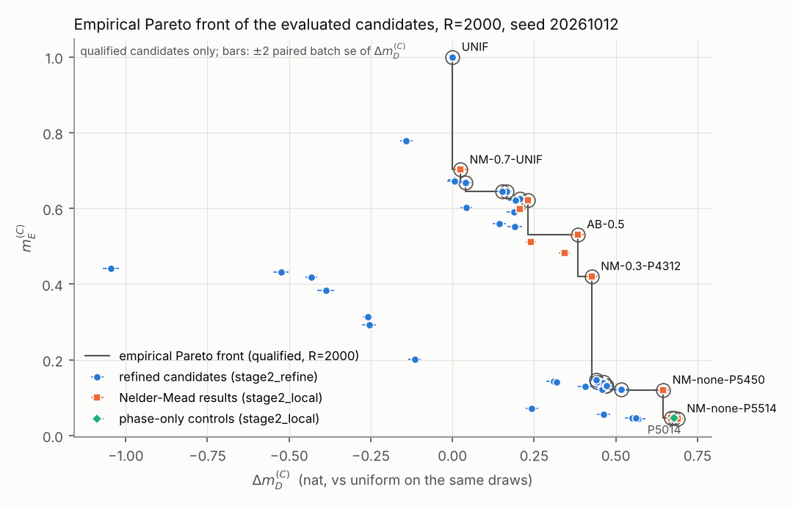
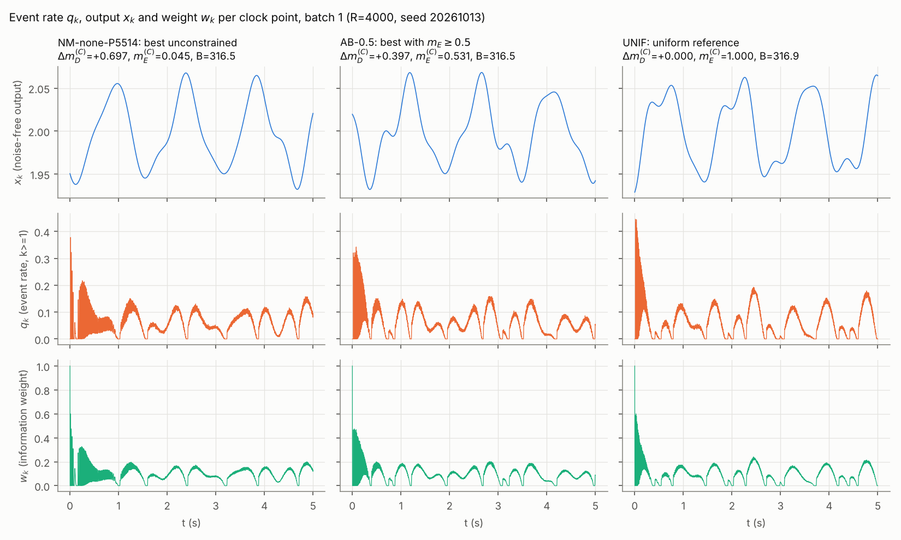
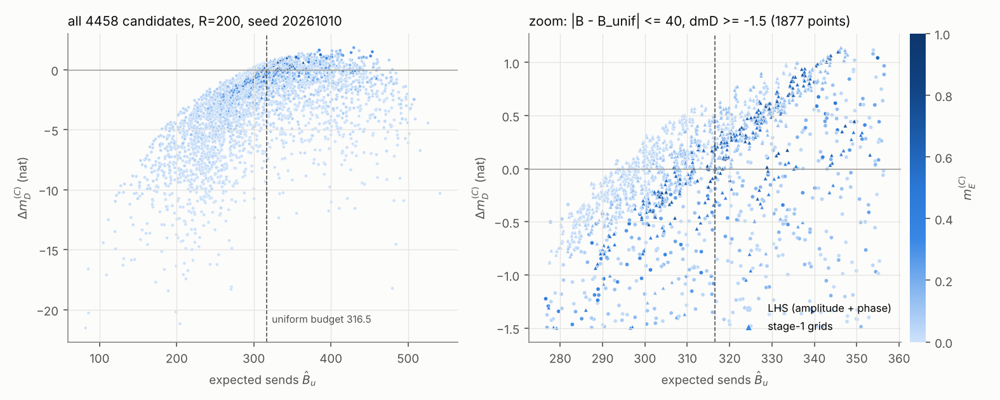

# §8.5 stage 2: joint amplitude/phase search: report

Date 2026-10-10. Protocol: `mc85_stage2_protocol.md`, followed as written; deviations and choices it leaves open are listed in §7.
Single scenario: Δ\* = 0.002384694482635785 (README, `mc84.py`), σ = Δ\*/20, T = 5 s, Δt = 1 ms (K = 5000 clock points).
Reference (C) is the uniform input (p = 1/4, χ = 0), evaluated on the same draws as each candidate.
Δm_D^(C) = log det J_u − log det J_C, and m_E^(C) is the smallest of the nine generalized eigenvalues of (J_u, J_C).
The budget decision follows 8.3.6(g) as implemented in `mc85_post.py::qual`: ok / over / undec, and the uniform reference qualifies by definition.

**Wording.** Every front below is *the empirical Pareto front of the evaluated candidates*.
Nothing here is a global optimum: the search evaluated 4458 screening points and 54 points at R = 2000.

**Traceability.** Every number in this report is copied from a script output line in `stage2/`:
`stage2_post.log`, `stage2_refine.log`, `stage2_local.log`, `stage2_final.log`, `stage2_figs.log` and `runtime.log`.
Each table names its source table, its R and its seed.
Numbers are rounded as printed in the logs; the full-precision values are in the JSON files next to them.

## 0. Setup, checks, seeds, runtime

**Trigger.** The trigger is `mc83.sod` and the information coefficient is `mc83.cfun`, both unmodified.
For speed, a numba version `sod_batch` (`stage2_common.py`) runs the same comparisons in the same order.
Every script first proves it reproduces `sod()` bitwise (event flags, pre-update reference, overshoots) on 100 trajectories.
The log line is: `trigger check: sod_batch == mc83.sod (eps, r, overshoots, bitwise) on 100/100 trajectories (31827 events)`.

**End-to-end check.** The stage-2 evaluation `evaluate_crn` re-computed 5 stored stage-1/LHS candidates at R = 200, seed 20261010.
It reproduced the stored values with `max |diff| = 0.0e+00` (`stage2_post.log`).

**Reused code.** The following are reused verbatim, by `exec` of their source:
- the setup block of `mc83.py` (via `mc85_scan.py`: `regressors`, `output`);
- `qual` from `mc85_post.py`;
- `nll_grad_hess`, `mle` and `report` from `mc84.py`.

| draws | seed | R | used for |
|---|---|---|---|
| stage-1 / LHS screening | 20261010 | 200 | stored stage-1 and LHS results (§1) |
| LHS design | 20261011 | (3000 points) | regenerated exactly, max mismatch 0.0e+00 |
| refinement and every ranking | 20261012 | 2000 | §2, §3 (all R = 2000 numbers, same draws for all candidates and reference) |
| Nelder–Mead search | 20261010 (extended) | 500 | inside the search only (§3); never used for ranking |
| final batch 1 | 20261013 | 4000 | J, D, Δm_D, eigenvalues, worst combination, q_k, gaps, powers (§4) |
| final batch 2 | 20261014 | 4000 | ML covariance check (§4) |
| follow-up batch 3 | 20261015 | 4000 | independent re-run of the paired budget decision (§8.1) |
| follow-up batch 4 | 20261016 | 4000 | independent ML bias check (§8.2) |
| Wishart benchmark | 1 | 5000 draws | as in `mc84.py` |

Runtime per stage (`runtime.log`; 4 workers). No stage came near the 2-hour limit.

| stage | elapsed |
|---|---|
| stage2_post | 5.3 s |
| stage2_refine | 23.5 s |
| stage2_local | 232.2 s (3.87 min) |
| stage2_final | 127.8 s (2.13 min) |
| stage2_figs | 2.0 s |
| stage2_followup | 51.7 s |

## 1. Merge and screening: R = 200, seed 20261010 (`stage2_post.py`)

**Merge.** 1465 stage-1 candidates (84 amp, 1296 phase, 85 amp20) plus 3000 LHS candidates gave 4465.
After deduplication 4458 remain. Seven groups were duplicates with identical stored values:
- six amp/amp20 coincidences, e.g. A2233 = Q4466;
- P0000 = Q5555 = the uniform reference.

**Table 1** (source: Table 1, `stage2_post.log`; R = 200, seed 20261010)

| set | n | ok | over | undec | Δm_D^(C) range | m_E^(C) range | B range | corr(B,Δm_D) | Spearman |
|---|---|---|---|---|---|---|---|---|---|
| stage-1 amp | 84 | 49 | 35 | 0 | [−4.671, +0.610] | [0.099, 0.779] | [259.9, 458.9] | 0.757 | 0.871 |
| stage-1 amp20 | 78 | 39 | 36 | 3 | [−1.330, +0.448] | [0.295, 0.786] | [286.1, 353.1] | 0.900 | 0.919 |
| stage-1 phase | 1296 | 852 | 429 | 15 | [−0.885, +1.140] | [0.032, 1.000] | [275.2, 347.8] | 0.910 | 0.899 |
| LHS | 3000 | 1796 | 1191 | 13 | [−21.521, +1.842] | [0.000, 0.586] | [81.7, 541.5] | 0.554 | 0.635 |
| all merged | 4458 | 2736 | 1691 | 31 | [−21.521, +1.842] | [0.000, 1.000] | [81.7, 541.5] | 0.496 | 0.565 |

Over the qualified candidates only (n = 2736): Δm_D^(C) lies in [−21.521, +0.597], and corr(B, Δm_D) = 0.768.

**Front at R = 200.** The empirical Pareto front of the qualified candidates has 11 points (Table 2, `stage2_post.log`).
All 11 are stage-1 phase-grid points, from P5014 (+0.597, m_E 0.045) to UNIF (0, 1).
- **No LHS candidate is on it.** The best qualified LHS candidate is L0413: Δm_D^(C) = +0.259, m_E = 0.071, B = 312.5.
- **All high-D LHS points are over budget.** All 130 LHS candidates with Δm_D^(C) > +0.597 are over budget.

**Selection for refinement: 40 candidates** (Table 3, `stage2_post.log`). Overlaps are counted once.

| label | rule | count |
|---|---|---|
| F1 | the front: both ends, the middle, and the uniform reference | 11 |
| F2 | the second Pareto layer of the qualified candidates | 13 |
| FL | the front of the qualified LHS candidates (amplitude and phase both vary) | 8 |
| BB | budget-boundary: undecided (\|D\| ≤ 2 se) candidates in the first two Pareto layers of the qualified ∪ undecided set | 8 |

## 2. Refinement: R = 2000, seed 20261012 (`stage2_refine.py`)

**Reference.** B_u = 316.904 and log det J_C = 197.2109. The offset C − B is +3.0556.

**Decisions.** All 40 candidates qualify at R = 2000. The 8 budget-boundary candidates moved from undec to ok, with paired se 0.06–0.07 sends.

**Optimism at R = 200.** Over the 39 non-reference candidates, Δm_D^(C) at R = 2000 minus at R = 200 has mean −0.013 (sd 0.016, range [−0.047, +0.016]).
So R = 200 screening was mildly optimistic for the selected points.

**Front.** The R = 2000 front of the refined set has 16 points (Table 6), all with p = 1/4.

**Re-ranking (R = 2000 only).**
- **Unconstrained:** P5514 (+0.569 ± 0.011) and P5014 (+0.569 ± 0.010) tie: difference +0.0002, paired se 0.0078.
- **m_E ≥ 0.3 and m_E ≥ 0.5:** P3022 at +0.207 (m_E 0.625).
- **m_E ≥ 0.7:** only UNIF.

The stage-1 headline value of P5014 (+0.597 at R = 200) is +0.569 at R = 2000.

## 3. Local refinement: Nelder–Mead (`stage2_local.py`)

**Settings** (protocol, plus the choices in §7):
- **Parametrisation:** x = (z1, z2, z3, χ1..χ4), p = softmax(z1, z2, z3, 0), and χ continuous (reduced mod 2π only when forming the input or saving).
- **Objective:** f = −Δm_D^(C) + 1·max(0, D + 2se) + 20·max(0, λ0 − m_E^(C)), evaluated on R = 500 draws (seed 20261010).
- **Budget:** `maxfev = 150` per start; initial simplex x0 + 0.25·e_j.
- **Starts:** front regions A (m_E < 0.1), B (0.1 ≤ m_E < 0.3) and C (m_E ≥ 0.3). In each region the start is the R = 2000 front point with the smallest value of that target's penalised objective.
- **Starts used** (`stage2_local.log`):

| target | region A | region B | region C |
|---|---|---|---|
| none | P5514 | P5450 | P3022 |
| λ0 = 0.3 | P5014 | P4312 | P3022 |
| λ0 = 0.5 | P5014 | P4312 | P3022 |
| λ0 = 0.7 | P5014 | P4312 | UNIF |

**Runs.** 12 runs used 1800 evaluations at R = 500 (wall time 221 s).
- **Region A starts under λ0 ≥ 0.3:** these runs never reached feasibility (end m_E 0.047) and followed identical paths. The m_E penalty only shifts f by a constant there.
- **Run 0.7/P4312:** ended infeasible (m_E 0.623).

**New candidates.** 10 new distinct candidates (9 run results plus the archive-best for λ0 = 0.5) were re-evaluated at R = 2000 on the refinement draws.
All 10 qualify (Table 9).
- **Search optimism:** R = 2000 minus R = 500 for Δm_D^(C) has mean −0.0367, range [−0.0524, −0.0143].
- **Ranking:** only the R = 2000 values enter it.

**Table A. Prediction-1 control** (source: Table 9b, `stage2_local.log`; R = 2000, seed 20261012).
The projection keeps the same χ and sets p = 1/4. The amplitude part is the winner minus its projection; the phase part is the projection minus the start.
Brackets are paired batch se.

| search best | Δm_D^(C) | phase-only projection: Δm_D^(C), m_E, D ± se, decision | amplitude part | start | phase part |
|---|---|---|---|---|---|
| NM-none-P5514 | +0.689 | +0.678, 0.045, −1.40 ± 0.06, ok | +0.0112 (0.0069) | P5514 +0.569 | +0.1089 (0.0062) |
| NM-0.3-P4312 | +0.426 | +0.744, 0.437, +14.82 ± 0.07, **over** | −0.3182 (0.0074) | P4312 +0.440 | +0.3045 (0.0068) |
| AB-0.5 | +0.383 | +0.720, 0.580, +14.94 ± 0.07, **over** | −0.3374 (0.0056) | — | — |
| NM-0.7-UNIF | +0.024 | +0.035, 0.712, +0.24 ± 0.07, **over** | −0.0104 (0.0087) | UNIF 0.000 | +0.0348 (0.0102) |

**Table B. Empirical Pareto front of the evaluated candidates** (source: Table 11, `stage2_local.log`; R = 2000, seed 20261012).
The pool has 54 candidates: 40 refined, 10 new and 4 controls; 51 qualify. The front has 19 points.
Brackets are paired batch se (10 × 200).

| id | p | χ (mod 2π) | B | D ± se | Δm_D^(C) | m_E^(C) |
|---|---|---|---|---|---|---|
| NM-none-P5514 | (0.252,0.251,0.252,0.245) | (5.140,5.338,1.097,4.207) | 316.44 | −0.46 ± 0.06 | +0.689 (0.008) | 0.045 (0.0001) |
| PO-NM-none-P5514 | uniform | (5.140,5.338,1.097,4.207) | 315.50 | −1.40 ± 0.06 | +0.678 (0.008) | 0.045 (0.0000) |
| NM-0.3-P5014 | (0.250,0.246,0.257,0.246) | (5.319,6.159,1.063,4.254) | 316.33 | −0.58 ± 0.06 | +0.669 (0.008) | 0.047 (0.0000) |
| NM-none-P5450 | (0.252,0.240,0.250,0.258) | (5.272,4.471,5.216,0.045) | 315.95 | −0.95 ± 0.06 | +0.645 (0.009) | 0.121 (0.0001) |
| P5450 | uniform | (5.236,4.189,5.236,0.000) | 313.49 | −3.42 ± 0.06 | +0.517 (0.011) | 0.122 (0.0002) |
| P4534 | uniform | (4.189,5.236,3.142,4.189) | 316.39 | −0.51 ± 0.07 | +0.472 (0.009) | 0.131 (0.0001) |
| P1201 | uniform | (1.047,2.094,0.000,1.047) | 316.40 | −0.50 ± 0.07 | +0.470 (0.009) | 0.131 (0.0002) |
| P1001 | uniform | (1.047,0.000,0.000,1.047) | 315.43 | −1.47 ± 0.06 | +0.463 (0.008) | 0.141 (0.0001) |
| P1045 | uniform | (1.047,0.000,4.189,5.236) | 316.32 | −0.58 ± 0.06 | +0.442 (0.006) | 0.141 (0.0001) |
| P4312 | uniform | (4.189,3.142,1.047,2.094) | 316.39 | −0.52 ± 0.06 | +0.440 (0.010) | 0.146 (0.0002) |
| NM-0.3-P4312 | (0.212,0.262,0.260,0.266) | (4.018,3.487,1.391,1.743) | 316.59 | −0.31 ± 0.07 | +0.426 (0.009) | 0.421 (0.0004) |
| AB-0.5 | (0.209,0.265,0.254,0.272) | (4.069,3.520,1.460,1.583) | 316.39 | −0.52 ± 0.07 | +0.383 (0.011) | 0.531 (0.0004) |
| NM-0.7-P4312 | (0.233,0.270,0.230,0.266) | (4.294,3.924,1.516,1.559) | 313.91 | −2.99 ± 0.07 | +0.232 (0.006) | 0.622 (0.0005) |
| P3022 | uniform | (3.142,0.000,2.094,2.094) | 316.63 | −0.27 ± 0.07 | +0.207 (0.008) | 0.625 (0.0009) |
| P4111 | uniform | (4.189,1.047,1.047,1.047) | 315.88 | −1.03 ± 0.07 | +0.166 (0.008) | 0.645 (0.0007) |
| P1444 | uniform | (1.047,4.189,4.189,4.189) | 315.92 | −0.99 ± 0.06 | +0.152 (0.010) | 0.645 (0.0008) |
| P4055 | uniform | (4.189,0.000,5.236,5.236) | 309.49 | −7.41 ± 0.07 | +0.040 (0.009) | 0.668 (0.0007) |
| NM-0.7-UNIF | (0.246,0.264,0.243,0.246) | (0.284,6.220,0.001,6.282) | 316.54 | −0.36 ± 0.07 | +0.024 (0.010) | 0.702 (0.0013) |
| UNIF | uniform | (0.000,0.000,0.000,0.000) | 316.90 | +0.00 ± 0.00 | +0.000 (0.000) | 1.000 (0.0000) |

**Table C. Per target** (source: Table 12, `stage2_local.log`; R = 2000, seed 20261012).
For each target, the best qualified candidate in the pool with m_E^(C) ≥ λ0, against the best start.

| λ0 | best in pool | Δm_D^(C) (se) | m_E^(C) (se) | runner-up, difference (paired se) | best feasible start | gain over start (paired se) |
|---|---|---|---|---|---|---|
| none | NM-none-P5514 | +0.689 (0.008) | 0.045 (0.0001) | PO-NM-none-P5514, +0.0112 (0.0069) | P5514 +0.569 | +0.1201 (0.0071) |
| 0.3 | NM-0.3-P4312 | +0.426 (0.009) | 0.421 (0.0004) | AB-0.5, +0.0430 (0.0075) | P3022 +0.207 | +0.2192 (0.0103) |
| 0.5 | AB-0.5 | +0.383 (0.011) | 0.531 (0.0004) | NM-0.5-P4312, +0.1435 (0.0063) | P3022 +0.207 | +0.1762 (0.0081) |
| 0.7 | NM-0.7-UNIF | +0.024 (0.010) | 0.702 (0.0013) | UNIF, +0.0244 (0.0098) | UNIF 0.000 | +0.0244 (0.0098) |

Two of these results are not resolved by the data:
- **λ0 = 0.7 winner vs uniform:** NM-0.7-UNIF beats UNIF by 2.5 paired se, a small gain.
- **NM-0.7-UNIF vs its floor:** its m_E is 0.702 (se 0.0013), so the margin over 0.7 is less than 2 se. The constraint is met by the point estimate but not resolved.

## 4. Final validation (`stage2_final.py`)

**Final set: 7 candidates**, fixed by the rule in the script header (log: `final set (7)`).

| id | role |
|---|---|
| NM-none-P5514 | best unconstrained; front region A; best with non-uniform amplitudes |
| NM-0.3-P4312 | best with m_E ≥ 0.3; front region C |
| AB-0.5 | best with m_E ≥ 0.5 |
| NM-0.7-UNIF | best with m_E ≥ 0.7 |
| UNIF | uniform reference |
| NM-none-P5450 | front region B |
| P5014 | stage-1 phase-only best, for prediction 1 |

**Table D** (source: Table 13 and the paired differences vs P5014, `stage2_final.log`; margin column: Table F1a, `stage2_followup.log`; batch 1, R = 4000, seed 20261013).
D is the paired send-count difference vs uniform on the same draws. The se of Δm_D^(C) is the paired batch se (10 × 400).
Reference: B_u = 316.881 ± 0.036 and log det J_C = 197.2020.

| id | B | D ± se | dec | margin = −(D + 2se) (sends) | Δm_D^(C) (se) | Δm_D^(B) | m_E^(C) (se) | m_E^(B) | Δm_D − Δm_D(P5014) (paired se) |
|---|---|---|---|---|---|---|---|---|---|
| NM-none-P5514 | 316.466 | −0.414 ± 0.046 | ok | +0.323 | +0.697 (0.004) | +3.744 | 0.0450 (0.0000) | 0.067 | +0.1315 (0.0054) |
| NM-0.3-P4312 | 316.579 | −0.302 ± 0.049 | ok | +0.205 | +0.428 (0.006) | +3.474 | 0.4203 (0.0003) | 0.666 | −0.1380 (0.0057) |
| AB-0.5 | 316.513 | −0.368 ± 0.050 | ok | +0.268 | +0.397 (0.004) | +3.444 | 0.5313 (0.0002) | 0.821 | −0.1683 (0.0066) |
| NM-0.7-UNIF | 316.563 | −0.317 ± 0.048 | ok | +0.221 | +0.023 (0.005) | +3.069 | 0.7011 (0.0010) | 0.768 | −0.5430 (0.0046) |
| UNIF | 316.881 | 0 | ok | — (by definition) | 0 | +3.047 | 1.0000 | 0.765 | −0.5655 (0.0044) |
| NM-none-P5450 | 315.921 | −0.960 ± 0.045 | ok | +0.871 | +0.650 (0.005) | +3.697 | 0.1206 (0.0001) | 0.192 | +0.0848 (0.0039) |
| P5014 | 313.389 | −3.491 ± 0.043 | ok | +3.405 | +0.566 (0.004) | +3.612 | 0.0450 (0.0000) | 0.067 | — |

The R = 2000 estimates hold on the independent batch-1 draws to within about 0.015 nat; for example NM-none-P5514 goes from +0.689 to +0.697.
NM-0.7-UNIF has m_E = 0.7011 ± 0.0010 in batch 1. That is again above 0.7, but by about 1 se only.

**Budget margin.** The three m_E-constrained winners qualify by a thin margin (Table F1a, `stage2_followup.log`).
- NM-0.3-P4312, AB-0.5 and NM-0.7-UNIF have D = −0.302, −0.368 and −0.317 sends against 2se = 0.097, 0.099 and 0.096.
- So margin = −(D + 2se) is +0.205, +0.268 and +0.221 sends, which is 0.065%, 0.085% and 0.070% of B_u = 316.881.
- NM-none-P5514 has a margin of +0.323 sends (0.102%). NM-none-P5450 has +0.871 (0.275%) and P5014 has +3.405 (1.074%).

On an independent batch (seed 20261015, R = 4000) all three constrained winners stay qualified, with margins of +0.152, +0.148 and +0.209 sends (§8.1).

**Table E. Nine generalized eigenvalues vs (C)** (source: Table 14, `stage2_final.log`; batch 1, R = 4000, seed 20261013).

| id | λ1 | λ2 | λ3 | λ4 | λ5 | λ6 | λ7 | λ8 | λ9 |
|---|---|---|---|---|---|---|---|---|---|
| NM-none-P5514 | 0.045 | 0.053 | 0.858 | 1.041 | 1.100 | 1.251 | 1.474 | 20.830 | 22.388 |
| NM-0.3-P4312 | 0.420 | 0.461 | 0.757 | 0.934 | 1.014 | 1.179 | 1.369 | 2.444 | 2.795 |
| AB-0.5 | 0.531 | 0.638 | 0.748 | 0.902 | 1.019 | 1.206 | 1.356 | 1.796 | 2.176 |
| NM-0.7-UNIF | 0.701 | 0.885 | 0.901 | 0.947 | 1.014 | 1.055 | 1.149 | 1.179 | 1.331 |
| UNIF | 1 | 1 | 1 | 1 | 1 | 1 | 1 | 1 | 1 |
| NM-none-P5450 | 0.121 | 0.144 | 0.834 | 1.034 | 1.113 | 1.242 | 1.403 | 7.679 | 8.618 |
| P5014 | 0.045 | 0.050 | 0.904 | 0.983 | 1.087 | 1.265 | 1.388 | 20.832 | 22.291 |

**Table F. Worst combination** (source: Tables 15 and 15b, `stage2_final.log`; batch 1).
The combination is a = J_C v_min, normalised so that v_min^T J_C v_min = 1 (printed `vJv` = 1.000 for all), with sign chosen so the largest |a_i| > 0.
The CRLB variance of a^T θ is 1/λ_min times the reference's; the printed `check` equals 1/λ_min for all rows.
The table shows a/‖a‖ to read which parameters dominate.
The un-normalised a (entries of order 10^4) is in Table 15 and `final_batch1.json`.

| id | G0 | Re1 | Im1 | Re2 | Im2 | Re3 | Im3 | Re4 | Im4 | 1/λ_min |
|---|---|---|---|---|---|---|---|---|---|---|
| NM-none-P5514 | −0.342 | −0.189 | +0.268 | −0.049 | +0.068 | −0.345 | +0.519 | +0.085 | +0.611 | 22.21 |
| NM-0.3-P4312 | −0.216 | −0.282 | +0.521 | −0.195 | +0.073 | +0.304 | +0.401 | +0.475 | +0.281 | 2.38 |
| AB-0.5 | −0.335 | −0.403 | +0.642 | −0.226 | +0.140 | +0.045 | +0.267 | +0.224 | +0.345 | 1.88 |
| NM-0.7-UNIF | −0.552 | +0.602 | −0.355 | −0.012 | +0.064 | −0.050 | −0.219 | −0.342 | −0.185 | 1.43 |
| NM-none-P5450 | −0.307 | −0.251 | +0.249 | −0.107 | +0.117 | −0.398 | +0.464 | −0.077 | +0.613 | 8.29 |
| P5014 | −0.317 | −0.197 | +0.247 | −0.078 | +0.068 | −0.442 | +0.448 | −0.035 | +0.626 | 22.21 |

UNIF is omitted because all its eigenvalues equal 1, so v_min is arbitrary (the printed row is one such vector).
- **High-D end** (NM-none-P5514, P5014, NM-none-P5450): the weakest combination is dominated by tones 3–4 (Im4, Im3, Re3) together with G0.
- **Constrained winners:** it moves towards tone 1 (Im1, Re1).

**Table G. Gaps, event rate and window AC power** (source: Table 16, `stage2_final.log`; batch 1, R = 4000, seed 20261013).
Gaps are in clock steps, pooled over runs. q_k is the event rate per clock point: the mean is over all k; p99 and max are over k ≥ 1, because k = 0 is always an event.
P_in and P_out are the window mean AC powers of input and output.

| id | mean gap | min | q05 | q25 | q50 | q75 | q95 | q99 | max | mean q_k | q_k p99 | q_k max | P_in | P_out |
|---|---|---|---|---|---|---|---|---|---|---|---|---|---|---|
| NM-none-P5514 | 15.83 | 5 | 8 | 9 | 12 | 18 | 33 | 92 | 166 | 0.0633 | 0.158 | 0.378 | 0.3668 | 1.529e-03 |
| NM-0.3-P4312 | 15.68 | 5 | 7 | 8 | 11 | 16 | 33 | 105 | 253 | 0.0633 | 0.204 | 0.334 | 0.6364 | 1.338e-03 |
| AB-0.5 | 15.69 | 5 | 7 | 8 | 11 | 16 | 37 | 102 | 189 | 0.0633 | 0.201 | 0.342 | 0.6753 | 1.332e-03 |
| NM-0.7-UNIF | 15.67 | 4 | 6 | 7 | 9 | 15 | 46 | 117 | 247 | 0.0633 | 0.211 | 0.427 | 0.7033 | 1.510e-03 |
| UNIF | 15.67 | 4 | 6 | 7 | 9 | 14 | 42 | 126 | 254 | 0.0634 | 0.216 | 0.446 | 0.7051 | 1.514e-03 |
| NM-none-P5450 | 15.86 | 6 | 8 | 9 | 12 | 17 | 34 | 94 | 160 | 0.0632 | 0.160 | 0.534 | 0.4308 | 1.523e-03 |
| P5014 | 15.98 | 4 | 7 | 10 | 12 | 17 | 35 | 91 | 210 | 0.0627 | 0.155 | 0.253 | 0.3558 | 1.491e-03 |

All candidates send at the budget rate, but they distribute the sends differently.
- **High-D candidates:** fewer very short gaps (q05 = 7–8 vs 6) and shorter long gaps (q99 91–94 vs 126; max 160–210 vs 254). The event rate is flatter (q_k p99 0.155–0.160 vs 0.216).
- **Window input power:** P_in is about half the uniform value (0.36–0.43 vs 0.705). The window is short relative to the close pair ω3 = 12, ω4 = 12.3: the beat period 2π/0.3 ≈ 21 s is longer than T = 5 s. With χ3 − χ4 ≈ π the two tones cancel over the window.
- **Output power** barely changes, because tone 1 dominates the output.

**Window input power vs long-run power** (source: Table F3, `stage2_followup.log`; deterministic, no draws).
P_in = (1/T)∫u_ac² over the T = 5 s window, as in Table G. The long-run power is Σ a_m²/2. P_out is the window mean AC output power.

| id | P_in (window) | long-run Σ a_m²/2 | P_in / long-run | P_in / P_in(UNIF) | P_out (window) |
|---|---|---|---|---|---|
| NM-none-P5514 | 0.3668 | 0.5000 | 0.734 | 0.520 | 1.5286e-03 |
| NM-0.3-P4312 | 0.6364 | 0.5000 | 1.273 | 0.903 | 1.3376e-03 |
| AB-0.5 | 0.6753 | 0.5000 | 1.351 | 0.958 | 1.3315e-03 |
| NM-0.7-UNIF | 0.7033 | 0.5000 | 1.407 | 0.998 | 1.5100e-03 |
| UNIF | 0.7051 | 0.5000 | 1.410 | 1.000 | 1.5137e-03 |
| NM-none-P5450 | 0.4308 | 0.5000 | 0.862 | 0.611 | 1.5226e-03 |
| P5014 | 0.3558 | 0.5000 | 0.712 | 0.505 | 1.4910e-03 |

The high-D candidates (NM-none-P5514, NM-none-P5450, P5014) obtain more information than the uniform reference with about half its window input energy.
- Their P_in is 0.3558–0.4308 against 0.7051, i.e. 0.505–0.611 of the uniform value.
- Measured against the long-run power, which is 0.5 for every candidate by the normalisation, their window ratio is 0.712–0.862; the uniform reference's is 1.410.
- The budget constraint is on sends, not on input energy.
- This is a consequence of normalising the long-run power rather than the window energy, as noted in §8.1.6 of the main document.

**Figure: q_k, x_k and w_k.** The figure below plots q_k, x_k and w_k for three representatives (`final_qxw.npz` holds all 7 and the reference).
- **Steady state:** q_k follows the output slope, with zeros at the turning points of x_k.
- **First ~0.3–1 s:** q_k shows a comb-like transient after the forced event at k = 0. This is visible in the figure; it is not analysed further here.

**Table H. ML covariance check** (source: Table 17 and the per-candidate `mc84.py` reports, `stage2_final.log`).
Batch 2 has R = 4000, seed 20261014; the CRLB is J^{-1} from batch 1 (R = 4000, seed 20261013).
The Wishart benchmark uses 5000 draws, seed 1.

| id | converged | sd ratio min–max | max \|t\| (bias) | logdet(Σ_MC) − logdet(J^{-1}) | max \|λ−1\| (whitened) | Wishart tail prob. | Hotelling T² | p(T²) | LS-on-sent logdet diff |
|---|---|---|---|---|---|---|---|---|---|
| NM-none-P5514 | 4000/4000 | 0.989–1.020 | 2.40 | +0.082 | 0.0929 | 0.291 | 20.15 | 0.017 | +1.989 |
| NM-0.3-P4312 | 4000/4000 | 0.981–1.020 | 1.62 | −0.161 | 0.0883 | 0.419 | 9.84 | 0.366 | +1.837 |
| AB-0.5 | 4000/4000 | 0.984–1.014 | 3.15 | +0.009 | 0.0774 | 0.777 | 28.43 | 0.001 | +1.961 |
| NM-0.7-UNIF | 4000/4000 | 0.972–1.014 | 1.87 | −0.059 | 0.1075 | 0.055 | 14.87 | 0.096 | +1.862 |
| UNIF | 4000/4000 | 0.988–1.017 | 1.91 | +0.051 | 0.0858 | 0.507 | 7.66 | 0.571 | +1.930 |
| NM-none-P5450 | 4000/4000 | 0.991–1.014 | 2.84 | +0.001 | 0.0751 | 0.839 | 14.74 | 0.100 | +1.974 |
| P5014 | 4000/4000 | 0.986–1.006 | 3.00 | −0.082 | 0.0736 | 0.868 | 11.87 | 0.223 | +1.899 |

**Variance.** For all seven candidates, the censored-likelihood MLE reaches the CRLB within MC precision.
- Per-parameter sd ratios lie in 0.972–1.020, with batch se about 0.01.
- The spread of the whitened eigenvalues is consistent with the Wishart benchmark (tail probabilities 0.055–0.868).
- So the information gains in Tables D and E translate into estimator covariance, including the 22-fold weaker combination at the high-D end.

**Bias.** Hotelling T² rejects zero joint bias at 5% for NM-none-P5514 (p = 0.017) and AB-0.5 (p = 0.001).
- **Largest component:** Im1 in both, with bias/sd −0.038 and −0.050 (t = −2.4 and −3.1).
- **Shared sign:** Im1 bias/sd is negative for all seven candidates (−0.012 to −0.050). Batch 2 uses the same draws for every candidate, so these are not seven independent findings. An independent batch would be needed to separate a systematic small-sample bias from a shared noise realisation; §8.2 runs that check.
- **Size:** a bias of ≤ 0.05 sd changes the MSE by ≤ 0.25%.

**Naive control.** LS on sent samples only is far from the CRLB: logdet diff +1.837 to +1.989, and per-parameter biases up to 8.8 sd. This matches §8.4.

## 5. Predictions of the protocol, checked

**Prediction 1** says: the joint search finds qualified candidates above the stage-1 phase-only best (+0.60), but by less than 0.5 nat, and most of the gain comes from phases.

*Confirmed for the evaluated candidates, with one qualification about where the gain was found.*
- **Above the stage-1 best, by less than 0.5 nat.** On the same draws, NM-none-P5514 beats P5014 by +0.1203 (paired se 0.0039) at R = 2000, seed 20261012 (`stage2_local.log`, P1 line). On the independent batch 1 it beats P5014 by +0.1315 (0.0054) (R = 4000, seed 20261013). Against the stage-1 R = 200 headline +0.597 the margin is +0.09 to +0.10. All well below 0.5 nat.
- **Most of the gain comes from phases.** Table A: the phase part is +0.1089 (0.0062) and the amplitude part +0.0112 (0.0069), which is not resolved. The winner's p = (0.252, 0.251, 0.252, 0.245).
- **Where the amplitude freedom was used.** For the m_E-constrained targets, the same phases at uniform amplitudes give Δm_D^(C) of +0.744 and +0.720, but are **over budget** by about 15 sends. The searches cut p1 to about 0.21 and gave up about 0.32–0.34 nat to qualify. This is the stage-1 mechanism ("amplitude moves that raise log det also raise sends") seen from the other side.
- **Qualification: screening found nothing.** At the R = 200 screening stage the LHS cloud did not produce a single qualified candidate above +0.597; its best was +0.259. The gain was found only by the local search started from stage-1 phase points. So "the joint search finds" holds for the search as a whole, not for the random screen.

**Prediction 2** says: the maximal D is non-increasing in λ0; the front is steep near m_E ~ 1 and flat for m_E < 0.1.

- **Monotonicity: confirmed.** Max Δm_D^(C) over the pool for λ0 = none / 0.3 / 0.5 / 0.7 is +0.689 / +0.426 / +0.383 / +0.024, non-increasing (R = 2000, seed 20261012; `stage2_local.log`, P2 lines).
  - On a fixed set this holds automatically. The non-trivial check is that each target's *own* search delivered these values, also non-increasing: +0.689, +0.426, +0.383, +0.024.
  - So no constrained search found a point that beat the unconstrained search.
  - The grid version (λ0 = 0, 0.05, …, 1) is also non-increasing.
- **Shape: partly confirmed.** Steep near m_E = 1 holds. "Flat for m_E < 0.1" holds only in a weak sense, and the front is step-like rather than steep-then-flat.
  - **Steep near m_E = 1, confirmed:** the segment UNIF → NM-0.7-UNIF has slope −12.21 per nat. m_E drops from 1.000 to 0.702 for +0.024 nat.
  - **Flat for m_E < 0.1, only weakly:** only 3 front points have m_E < 0.1. They span 0.020 nat in Δm_D and 0.002 in m_E.
  - **Where the long flat stretch actually is:** at m_E ≈ 0.12–0.15, covering Δm_D from +0.440 to +0.645, with segment slopes −0.00 to −1.94 per nat.
  - **A second steep step** sits at Δm_D ≈ 0.43: P4312 → NM-0.3-P4312 has slope −20.11 per nat, with m_E going from 0.146 to 0.421.
  - Gaps on the front reflect where candidates were evaluated (§7).

**Prediction 3** was left open: whether χ3 − χ4 keeps its role, and whether power moves away from uniform. Read off:
- **χ3 − χ4.** At the high-D end the stage-1 pattern persists. The top unconstrained candidates have χ3 − χ4 ≈ π: 3.173 (NM-none-P5514), 3.092 (NM-0.3-P5014), and exactly π for the stage-1 points (`stage2_local.log`, P3 lines). The m_E-constrained winners sit near χ3 − χ4 ≈ 0: 5.931 rad (NM-0.3-P4312) and 6.160 rad (AB-0.5), which are −0.35 and −0.12 rad; NM-0.7-UNIF has 0.001 (Table 16b, `stage2_final.log`). The power descriptors ‖p − 1/4‖₁ of all final candidates are in the same table.
- **Within the LHS cloud** amplitudes dominate: η² of Δm_D on binned χ3 − χ4 is 0.014 (for B, 0.024), while η² on p1 is 0.342 and corr(p1, B) = 0.955 (`stage2_post.log`, P3 lines).
- **Power distribution.** The best unconstrained candidate keeps uniform power (‖p − 1/4‖₁ = 0.010). The constrained winners move power away from tone 1 (p1 = 0.212 and 0.209; ‖p − 1/4‖₁ = 0.077 and 0.082), for the budget reason given under prediction 1.

**Prediction 4** says: corr(B, Δm_D) stays strongly positive across the LHS cloud, with counter-examples.

*Sign confirmed, strength not.* Source: `stage2_post.log`, P4 lines; R = 200, seed 20261010.
- **Correlation:** across the 3000 LHS candidates, Pearson 0.554 and Spearman 0.635. Over qualified LHS only, 0.644 and 0.666. That is clearly positive but weaker than stage 1 (0.76 amplitude, 0.91 phase).
- **Counter-examples are common:**
  - Of the LHS pairs where one candidate sends ≥ 10 more, 22.5% have ≥ 0.3 nat *less* Δm_D^(C).
  - Among the non-degenerate pairs (both Δm_D ≥ −1) it is 24.7%.
  - The most pronounced: L1459 (B = 478.2, Δm_D = −0.919) vs L1657 (B = 384.9, +1.640).

## 6. Summary

1. **Unconstrained D.** The best evaluated candidate that meets the budget (8.3.6(g), paired R = 2000 decision) is NM-none-P5514.
   - Δm_D^(C) is +0.689 ± 0.008 at R = 2000 (seed 20261012) and +0.697 ± 0.004 on independent draws (R = 4000, seed 20261013).
   - That is +0.13 nat over the stage-1 phase-only best on the same draws.
   - Its amplitudes are uniform within 0.010 in ‖p − 1/4‖₁; the gain over its start is a phase effect.
   - Its m_E^(C) is 0.045: one fixed combination, dominated by tones 3–4 and G0, has 22.2 times the reference CRLB variance.
2. **D under an m_E floor.** The empirical Pareto front of the evaluated candidates trades D against m_E in steps.
   - About +0.43 nat is available at m_E ≥ 0.42, and +0.38 nat at m_E ≥ 0.53. Both require lowering tone-1 power to stay inside the budget.
   - Above m_E 0.7 essentially nothing is gained over uniform: +0.024, with the m_E floor itself not resolved at 2 se.
   - The three constrained winners qualify by margins of only 0.148–0.268 sends (at most 0.085% of the budget) on batches 1 and 3. None of them flips to undecided on the independent batch 3 (seed 20261015; §8.1).
3. **CRLB attainment.** For all seven final candidates the MLE covariance matches the CRLB within MC precision (batch 2, R = 4000, seed 20261014). A small joint bias (≤ 0.05 sd, mostly Im1) is detected for two of them. On independent draws (seed 20261016) the joint rejection reproduces for NM-none-P5514 but not for AB-0.5, and the negative Im1 bias reproduces for both (§8.2).
4. **Not established.** These are local improvements found with 12 × 150 evaluations from 3 starts per target. Points between the evaluated ones, or far from the stage-1 phase grid, were not explored at R = 2000.

## 7. Modelling choices and limitations (stated, not settled)

- **Refinement selection (§1):** the F1/F2/FL/BB rule is my choice within "front ends, middle, budget-boundary". BB uses the first two Pareto layers of qualified ∪ undecided.
- **Nelder–Mead settings:** search seed 20261010 extended to R = 500; penalty weights 1 nat/send and 20 nat per unit m_E; budget penalty on D + 2se rather than D; simplex step 0.25 in z and in χ; front regions A/B/C; and the start rule. None of these is fixed by the protocol.
- **New candidates entering the ranking:** each run's result plus the per-target best penalised point visited by any run. Points visited but not selected were not re-evaluated.
- **Phase-only controls (Table A)** are an addition for checking prediction 1. Each is a fully evaluated R = 2000 candidate and enters the pool. One of them (PO-NM-none-P5514) is on the front.
- **m_E se:** spread of per-batch λ_min(J_b, J_C,b) over 10 batches. The per-batch values are biased low (smaller samples); only their spread is used.
- **Counter-example thresholds (prediction 4):** ≥ 10 sends and ≥ 0.3 nat are my choice, not the protocol's.
- **Final set rule (§4):** fixed before batch 1 was run. P5014 was added as the prediction-1 baseline.
- **CRLB in batch 2:** from the batch-1 J at R = 4000, not R = 10000 as in `mc84.py`; its MC error is small relative to the sd-ratio se but not zero.
- **Common draws in batch 2:** batch 2 uses the same draws for every candidate, so cross-candidate patterns in the bias estimates are not independent.

## 8. Follow-up (`stage2_followup.py`)

All numbers in this section come from `stage2_followup.log`; runtime 51.7 s. Nothing above was re-run or changed.

### 8.1 Budget margin and an independent re-run of the paired decision

Batch-1 margins for all seven final candidates are in Table D (column "margin"; Table F1a).

**Table F1b** (source: Table F1b, `stage2_followup.log`; batch 3, R = 4000, seed 20261015).
The candidates and the reference use the same draws; the batch-3 reference has B_u = 316.813 ± 0.035.
Batch 1 is shown for comparison and is not pooled with batch 3.

| id | B | D | se | margin = −(D + 2se) | margin / B_u | decision (batch 3) | batch 1: D ± se, decision |
|---|---|---|---|---|---|---|---|
| NM-0.3-P4312 | 316.565 | −0.248 | 0.048 | +0.152 | +0.048% | ok | −0.302 ± 0.049, ok |
| AB-0.5 | 316.566 | −0.247 | 0.050 | +0.148 | +0.047% | ok | −0.368 ± 0.050, ok |
| NM-0.7-UNIF | 316.506 | −0.307 | 0.049 | +0.209 | +0.066% | ok | −0.317 ± 0.048, ok |
| UNIF | 316.813 | 0 | 0 | — | — | ok (by definition) | 0, ok |

- **All three stay qualified on batch 3; none flips to undecided.**
- For NM-0.3-P4312 and AB-0.5 the margin is smaller on batch 3 than on batch 1: +0.152 and +0.148 against +0.205 and +0.268 sends.
- Batch 3 also yields Δm_D^(C) of +0.436 (0.005), +0.400 (0.005) and +0.027 (0.006), and m_E^(C) of 0.4209, 0.5309 and 0.7015, for NM-0.3-P4312, AB-0.5 and NM-0.7-UNIF.

### 8.2 Independent check of the Im1 bias

This is the ML covariance check of `stage2_final.py`, with its batch-2 code exec'd verbatim (only the printed labels are renamed).
It was run for NM-none-P5514 and AB-0.5 on batch 4 (R = 4000, seed 20261016), with the CRLB from batch 1 (seed 20261013) as before.

**Table F2b** (source: Tables F2a and F2b, `stage2_followup.log`). Each batch is reported on its own; the two are not combined.

| id | batch (seed) | Hotelling T² | p | reject at 5% | Im1 bias/sd | Im1 t | sd ratio range |
|---|---|---|---|---|---|---|---|
| NM-none-P5514 | 2 (20261014) | 20.15 | 0.017 | yes | −0.038 | −2.40 | 0.989–1.020 |
| NM-none-P5514 | 4 (20261016) | 17.66 | 0.040 | yes | −0.043 | −2.75 | 0.986–1.017 |
| AB-0.5 | 2 (20261014) | 28.43 | 0.001 | yes | −0.050 | −3.15 | 0.984–1.014 |
| AB-0.5 | 4 (20261016) | 8.39 | 0.497 | no | −0.038 | −2.37 | 0.986–1.020 |

- **Joint bias:** the 5%-level rejection of zero joint bias reproduces on independent draws for NM-none-P5514 (p = 0.040), but not for AB-0.5 (p = 0.497).
- **Im1:** the bias reproduces for both candidates in sign and size: bias/sd −0.043 and −0.038, t = −2.75 and −2.37. Im1 was singled out on batch 2, so this is a check of a pre-specified parameter.
- **Two candidates, one replication:** within batch 4 the two candidates share draws. Their batch-4 results are each independent of batch 2, but not of each other, so this is one independent replication, not two.
- **Variance unchanged:** on batch 4 the sd ratios (0.986–1.017 and 0.986–1.020), the whitened-eigenvalue Wishart tail probabilities (0.700 and 0.705) and the log-det differences (+0.055 and +0.040) again show the CRLB attained (Table F2a).
- **Size:** the Im1 bias stays at about 0.04 sd.

### 8.3 Window input power

See "Window input power vs long-run power" in §4 (Table F3, `stage2_followup.log`).

## Reproduce

From `code_8_3_stage2/stage2_pkg/`, needing numpy, scipy, matplotlib and numba:

    python3 stage2_post.py && python3 stage2_refine.py && python3 stage2_local.py && python3 stage2_final.py && python3 stage2_figs.py && python3 stage2_followup.py

All stages are deterministic given the seeds above; re-runs reproduced the logged numbers exactly.
