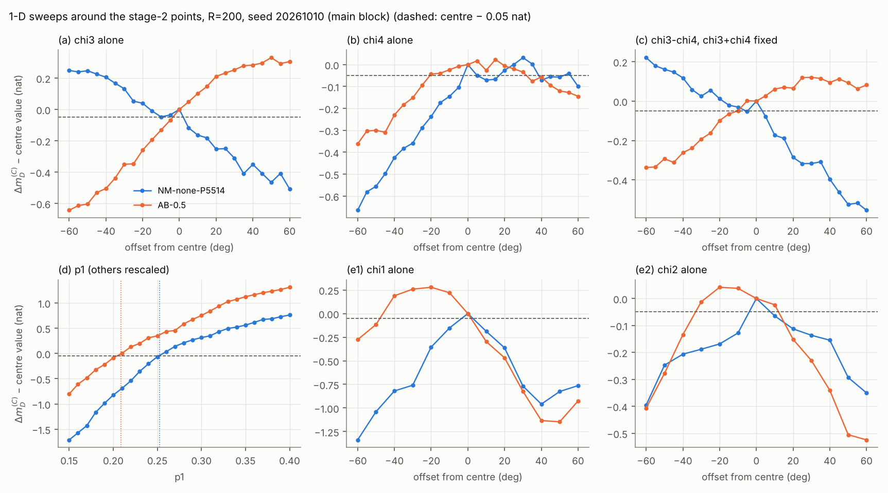
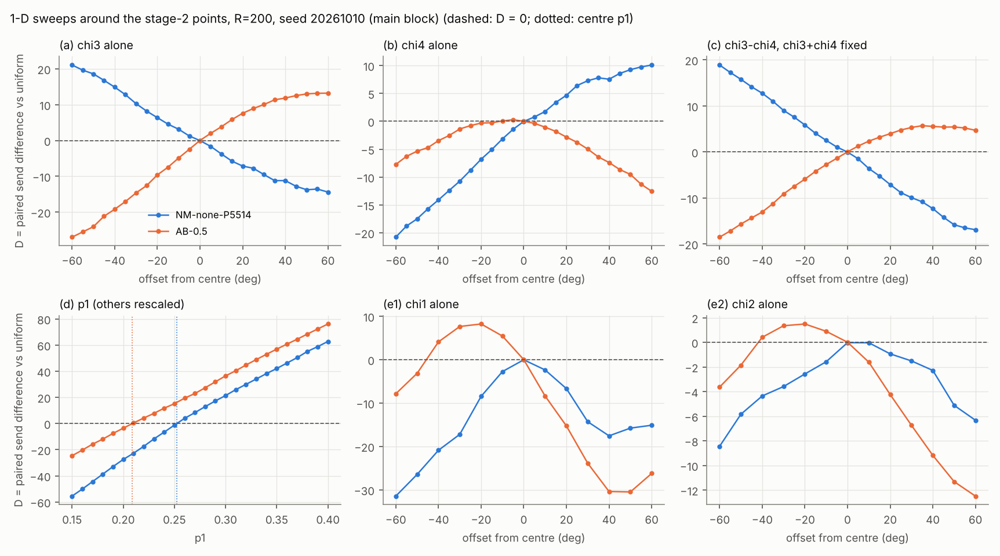
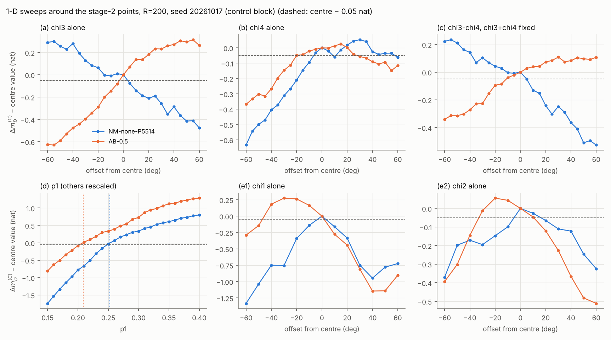
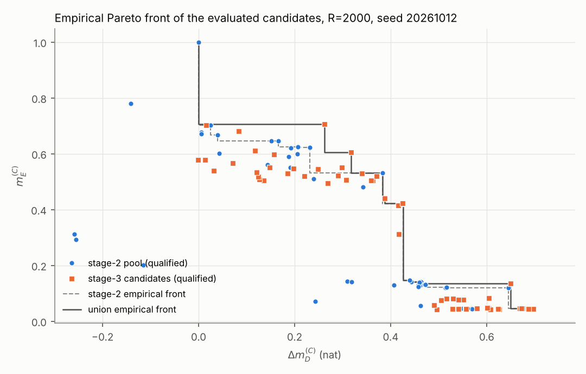

# §8.5 stage 3: resolution check and unconstrained search, report

**Date and setup.** 2026-10-10. Same scenario as stage 2: Δ\*, σ = Δ\*/20, T = 5 s, K = 5000.
- **Reference (C):** the uniform input on the same draws.
- **Budget decision:** 8.3.6(g) via `mc85_post.py::qual`.
- **Trigger:** the numba version, checked bitwise against `mc83.sod` on 100 trajectories at the start of every script (log line `trigger check: ... 100/100 trajectories (31827 events)`).
- **Isolation:** `stage2/` was only read.

**Wording.** Results are the *best evaluated* points and the *empirical Pareto front of the evaluated candidates*; nothing here is an optimum.

**Traceability.** Every number is copied from a line in `stage3/stage3_peak.log`, `stage3_unconstrained.log`, `stage3_dense.log` or `runtime.log`. Each table names its source table, R and seed.

**Predictions.** They were written before any stage-3 run and committed first (`stage3/predictions.md`, commit 19944cd). §4 checks them one by one.

| script | what | runtime (`runtime.log`) |
|---|---|---|
| `stage3_peak.py` | 1-D sweeps, 2 centres × 128 points × 2 draw blocks, R = 200 | 25.1 s |
| `stage3_unconstrained.py` | 10 Nelder–Mead runs, unbudgeted, maxfev 200; endpoints at R = 2000 | 236.5 s |
| `stage3_dense.py` | 2 × 625 grid points at R = 200; 18 Nelder–Mead runs; 56 candidates at R = 2000 | 439.3 s |

No script came near the 90-minute limit.

## 1. How sharp are the stage-2 points? (`stage3_peak.py`)

**Setup.** One-dimensional sweeps around NM-none-P5514 and AB-0.5 at R = 200, on the screening draws (seed 20261010), as requested.

**Half-width** is the distance from the centre to where Δm_D^(C) first falls 0.05 nat below its centre value, on each side, by linear interpolation. Each side is labelled with the budget decision of its first sweep point.

**Within-budget half-width** is the smaller half-width over the sides that do not start over budget. It is the relevant one: a direction that immediately leaves the budget is not a feasible move.

**Control block (an addition).** The seed-20261010 R = 200 block is the first 200 rows of the R = 500 block that the stage-2 Nelder–Mead searched on, so both centres are selection-biased on it.
- **Evidence:** on that block the NM-none-P5514 centre scores +0.744. On a fresh, previously unused block (seed 20261017, R = 200) it scores +0.683; its R = 2000 value (seed 20261012) is +0.689.
- **Consequence:** all sweeps were repeated on the control block. The requested results come first, and the control is reported alongside.

**Table 1. Half-widths** (source: Tables P-summary-main and P-summary-control, `stage3_peak.log`; R = 200; main block seed 20261010, control block seed 20261017).
Phase sweeps are in degrees (stage-1 step 60°); the p1 sweep is in p1 units (stage-1 steps 0.1 coarse / 0.05 near-uniform). [dec] is the decision of the first point on that side, and "none" means no crossing within ±60° (or within p1 ∈ [0.15, 0.40]).

| centre | sweep | main: left [dec] | main: right [dec] | main: within-budget | control: within-budget | within-budget / stage-1 step (main, control) |
|---|---|---|---|---|---|---|
| NM-none-P5514 | (a) χ3 | none [over] | 2.1 [ok] | 2.1° | 3.3° | 0.036, 0.055 |
| NM-none-P5514 | (b) χ4 | 2.4 [ok] | 5.2 [over] | 2.4° | 6.5° | 0.040, 0.108 |
| NM-none-P5514 | (c) χ3−χ4, sum fixed | 4.7 [over] | 3.2 [ok] | 3.2° | 5.0° | 0.054, 0.083 |
| NM-none-P5514 | (d) p1 | 0.0018 [ok] | none [over] | 0.0018 | 0.0038 | 0.018, 0.038 |
| NM-none-P5514 | (e) χ1 | 3.3 [ok] | 2.7 [ok] | 2.7° | 3.1° | 0.044, 0.051 |
| NM-none-P5514 | (e) χ2 | 3.9 [ok] | 7.7 [undec] | 3.9° | 5.0° | 0.065, 0.084 |
| AB-0.5 | (a) χ3 | 3.6 [ok] | none [over] | 3.6° | 3.0° | 0.060, 0.051 |
| AB-0.5 | (b) χ4 | 20.6 [undec] | 31.9 [undec] | 20.6° | 20.1° | 0.344, 0.334 |
| AB-0.5 | (c) χ3−χ4, sum fixed | 10.1 [ok] | none [over] | 10.1° | 11.2° | 0.168, 0.186 |
| AB-0.5 | (d) p1 | 0.0052 [ok] | none [undec] | 0.0052 | 0.0056 | 0.052, 0.056 |
| AB-0.5 | (e) χ1 | 47.8 [over] | 1.7 [ok] | 1.7° | 1.8° | 0.028, 0.030 |
| AB-0.5 | (e) χ2 | 33.1 [over] | 12.1 [ok] | 12.1° | 10.5° | 0.201, 0.175 |

**Finding 1: both points sit on the budget boundary, not at interior maxima of Δm_D.**
- **Along most directions, Δm_D keeps rising on one side, but that side is over budget.**
  - NM-none-P5514, χ3 at −60°: the sweep maximum is +0.249 nat above the centre, at D = +21.07 ± 0.20.
  - NM-none-P5514, p1 = 0.40: +0.761 above the centre, at D = +62.78 ± 0.22.
  - AB-0.5, χ1 at −20°: +0.278 above the centre, at D = +8.23 ± 0.22.
- **The send difference D crosses zero at the centre in every sweep** (`fig_peak_D.png`).
- **The exceptions:** for NM-none-P5514, χ1 and χ2 are the only directions where the centre is the sweep maximum (sweep max − centre +0.000). For AB-0.5, χ4 has a slightly higher qualified point: +0.023 at +15° on the main block, +0.025 on the control.

**Finding 2: the boundary point is sharp because information tracks sends.**
- **NM-none-P5514, χ3 sweep (Table P-main-NM-none-P5514-a):** B goes from 317.75 (−5°) through 316.48 (0°) to 314.86 (+5°), while Δm_D drops from +0.744 to +0.627 at +5°.
- **p1 sweep:** D goes from −1.23 at p1 = 0.25 to +3.98 at p1 = 0.26.
- So a 0.05-nat loss corresponds to a few degrees in phase, or a few thousandths in p1.

**Finding 3: the draw overlap narrows the half-widths but does not change the order of magnitude.**
- **NM-none-P5514:** within-budget phase half-widths are 2.1–3.9° on the main block and 3.1–6.5° on the control block. The p1 half-width is 0.0018 vs 0.0038.
- **AB-0.5:** 1.7–20.6° (main) and 1.8–20.1° (control); its χ4 and χ3−χ4 directions are much flatter than its χ1 and χ3 directions.

## 2. The unbudgeted (power-only) problem (`stage3_unconstrained.py`)

**Setup.** The constraint is Σ a_m² = 1 only: no send budget, no m_E floor. The method is Nelder–Mead on −Δm_D^(C), using the stage-2 `nm_run` with budget weight 0.
- **Search:** R = 500 inside (seed 20261010 extended), maxfev = 200, starting from the 10 highest-Δm_D candidates of `stage2/merged_R200.json`. All 10 starts were over budget.
- **Evaluation:** every endpoint re-evaluated at R = 2000 (seed 20261012), on the same draws and reference as the stage-2 pool.
- **Wall time:** 10 runs, 2000 evaluations, 229 s.

**Table 2. Endpoints** (source: Table U1, `stage3_unconstrained.log`; R = 2000, seed 20261012). The six best are shown.

| id | Δm_D^(C) (se) | m_E^(C) | B | D ± se | p | χ (mod 2π) |
|---|---|---|---|---|---|---|
| U-L1657 | +2.101 (0.011) | 0.180 | 423.96 | +107.06 ± 0.06 | (0.434,0.182,0.184,0.199) | (0.534,5.733,4.943,4.117) |
| U-L0492 | +2.095 (0.010) | 0.250 | 417.42 | +100.52 ± 0.07 | (0.419,0.181,0.206,0.194) | (4.397,3.905,3.683,3.119) |
| U-L1948 | +2.089 (0.011) | 0.211 | 426.69 | +109.79 ± 0.07 | (0.448,0.185,0.187,0.180) | (2.058,2.433,2.716,1.926) |
| U-L1819 | +2.082 (0.008) | 0.182 | 426.91 | +110.01 ± 0.06 | (0.445,0.190,0.187,0.178) | (5.764,0.359,1.229,0.375) |
| U-L0546 | +2.079 (0.008) | 0.210 | 419.70 | +102.80 ± 0.06 | (0.423,0.181,0.184,0.212) | (2.380,3.238,3.640,2.848) |
| U-L2069 | +2.062 (0.011) | 0.218 | 420.35 | +103.45 ± 0.06 | (0.427,0.196,0.201,0.176) | (0.625,5.697,5.254,4.577) |

**The best evaluated point of the unbudgeted problem (not an optimum) is U-L1657.**
- **Inputs:** p = (0.434, 0.182, 0.184, 0.199) and χ = (0.534, 5.733, 4.943, 4.117), with χ3 − χ4 = 0.827.
- **Value:** at R = 2000 (seed 20261012), B = 423.96 and D = +107.06 ± 0.06 (over budget). Δm_D^(C) = +2.101 (paired batch se 0.011), and m_E^(C) = 0.1796 (se 0.0003).
- **Nine generalized eigenvalues vs (C):** 0.180, 0.198, 0.900, 0.956, 1.374, 2.220, 2.707, 5.448, 5.939.
- **Against the budget-qualified best:** it beats NM-none-P5514 (+0.689) by +1.412 nat (paired se 0.008), for +107.5 sends.

**The six best endpoints lie within 0.04 nat of each other** (+2.062 to +2.101), so their order is not resolved.
- They share nearly the same power split: p1 = 0.419–0.448, and the other three powers 0.176–0.212.
- Their phases are very different.
- So for the unbudgeted problem, the power split matters and the phases matter much less, as far as these endpoints show.

**Table 3. SoD vs matched periodic sampling** (source: Table U2, `stage3_unconstrained.log`; R = 2000, seed 20261012).
The advantage is log det J_u − log det J_per(u, N), with J_per built from the candidate's own regressors at N = ⌊B_u⌋ equispaced times.

| id | B_u | N | advantage (nat) |
|---|---|---|---|
| U-L1657 | 423.96 | 423 | +3.124 |
| U-L0492 | 417.42 | 417 | +3.163 |
| U-L1948 | 426.69 | 426 | +3.132 |
| U-L1819 | 426.91 | 426 | +3.104 |
| U-L0546 | 419.70 | 419 | +3.132 |
| U-L2069 | 420.35 | 420 | +3.114 |
| UNIF (same definition) | 316.90 | 316 | +3.056 |

## 3. Denser budgeted search (`stage3_dense.py`)

**Grids** (source: Tables G-P5514 and G-AB05, `stage3_dense.log`; R = 200, seed 20261010). Each grid uses offsets {−60, −30, 0, 30, 60}° on all four phases, with powers fixed: 625 points per grid. The same draw-overlap caveat as §1 applies to these R = 200 values.
- **Around NM-none-P5514:** 504 ok, 115 over, 6 undec. No qualified point is more than 0.05 nat above the centre. The best qualified point, G-P5514(0,0,−30,−30), is 0.056 below the centre (+0.688 vs +0.744).
- **Around AB-0.5:** 525 ok, 92 over, 8 undec.
  - The best qualified point with m_E ≥ 0.5 is G-AB05(−60,−60,−60,−60), 0.038 below the centre.
  - The best qualified point regardless of m_E is 0.086 above the centre, but has m_E 0.266.
- **Grid steps vs half-widths:** the 30° grid step is several times the within-budget half-widths of §1, so the grids mostly sample the flanks.

**Nelder–Mead.** This is the stage-2 machinery (budget penalty on, weights 1 nat/send and 20 nat), with maxfev = 200 and R = 500. 18 runs used 3600 evaluations (wall time 365 s).
- **Grid starts (2):** G-P5514(0,0,−30,−30) for target none, and G-AB05(−60,−60,−60,−60) for target 0.5.
- **Front starts (4 per floor):** stage-2 front points excluding every stage-2 start and both grid centres. Per target, this is the best eligible point in each front region A/B/C by its R = 2000 penalised objective, plus the next best. The chosen starts are listed in `stage3_dense.log`.
- **Re-evaluation:** 56 new candidates at R = 2000 (seed 20261012), on the same draws and reference as the stage-2 pool. They are the run endpoints, the per-target archive-best points, and the 20 best of each grid by its R = 200 penalised objective.
- **Provenance:** `origin_run` and `selected_by` are recorded for each (Table N2; `dense_R2000.json`).

**Table 4. Stage-2 best vs stage-3 best per floor** (source: Table N4, `stage3_dense.log`; R = 2000, seed 20261012).
The union is the stage-2 pool (54) plus the stage-3 candidates (56). The paired batch se is 10 × 200 on the same draws.

| λ0 | stage-2 best | Δm_D^(C) | m_E^(C) | union best | Δm_D^(C) | m_E^(C) | margin −(D+2se) | difference (paired se) | diff/se |
|---|---|---|---|---|---|---|---|---|---|
| none | NM-none-P5514 | +0.689 | 0.045 | S3-none-G-P5514(0,0,−30,−30) | +0.697 | 0.045 | +0.482 | +0.0078 (0.0058) | 1.3 |
| 0.3 | NM-0.3-P4312 | +0.426 | 0.421 | NM-0.3-P4312 (unchanged) | +0.426 | 0.421 | +0.177 | 0 | — |
| 0.5 | AB-0.5 | +0.383 | 0.531 | AB-0.5 (unchanged) | +0.383 | 0.531 | +0.381 | 0 | — |
| 0.7 | NM-0.7-UNIF | +0.024 | 0.702 | S3-0.7-P4055 | +0.262 | 0.705 | +0.292 | +0.2373 (0.0078) | 30.5 |

**Did the front move?** Mostly not.
- **λ0 = none:** the best value rose by +0.0078. That is 1.3 paired se, so it is not resolved.
- **λ0 = 0.3 and 0.5:** no new candidate beat the stage-2 best. On the λ0 grid, the union maximum equals the stage-2 maximum for every floor from 0.15 to 0.50.
- **0.55 ≤ λ0 ≤ 0.70: clearly moved.**
  - λ0 = 0.55–0.60: +0.232 → +0.318 (G-AB05(30,30,60,60), m_E 0.605).
  - λ0 = 0.65: +0.040 → +0.262.
  - λ0 = 0.70: +0.024 → +0.262, i.e. +0.2373 ± 0.0078.
- **The new λ0 = 0.7 point.** S3-0.7-P4055 came from the run started at P4055 (m_E 0.668, infeasible for 0.7), origin evaluation 182.
  - Inputs: p = (0.261, 0.259, 0.229, 0.251) and χ = (4.256, 6.172, 5.267, 5.252).
  - Its m_E is 0.705 (se 0.0006): the floor is met by more than 2 se.
- **The union front** (Table N3) has 16 points, 8 of them new.

**Monotonicity.** Both sequences are non-increasing (Table N4 and the own-search lines, `stage3_dense.log`).
- **Union best per floor**, none / 0.3 / 0.5 / 0.7: +0.697 / +0.426 / +0.383 / +0.262.
- **Stage-3 own-search outcomes** (origin in that target's runs): +0.697 / +0.425 / +0.362 / +0.262.

## 4. Predictions against results

| # | prediction (`predictions.md`) | result | verdict |
|---|---|---|---|
| P1.1 | NM-none-P5514 phase half-widths: χ3/χ4/χ3−χ4 5°–20°, with χ3−χ4 the narrowest; χ1/χ2 10°–30°; all ≪ 60° (ratio 0.1–0.35) | within-budget 2.1–3.9° (main), 3.1–6.5° (control); ratio 0.036–0.108; χ3−χ4 not the narrowest | **Direction right, magnitude wrong:** all are far below 60°, but 2–10× narrower than predicted, and χ1/χ2 are as sharp as χ3/χ4 |
| P1.2 | p1: Δm_D increasing, no interior maximum, no upper crossing; lower crossing within 0.01–0.02; D +2 to +4 sends per 0.01; over budget just above the centre | increasing, no upper crossing; lower crossing 0.0018 (main) / 0.0038 (control); D −1.23 → +3.98 from p1 0.25 to 0.26; p1 0.26 over | **Shape confirmed;** the crossing is 3–10× closer than predicted, and the send slope (≈5 per 0.01) is above the range |
| P1.3 | AB-0.5: phase half-widths 10°–30°; p1 increasing and budget-limited | χ4 20.6°, χ3−χ4 10.1°, χ2 12.1° in range; χ3 3.6° and χ1 1.7° far below; p1 increasing, qualified up to 0.20 | **Partly:** 3 of 5 phase directions in range; p1 confirmed |
| P1.4 | stage-1 grid steps too coarse to resolve the peaks | every within-budget half-width ≤ 0.344 of the step, most ≤ 0.11 | **Confirmed** |
| P2.1 | unbudgeted best p1 in 0.40–0.55 (most likely 0.45–0.48); p1 > 0.5: no; others 0.15–0.22 | p1 = 0.434; others 0.182–0.199 | **Confirmed;** p1 slightly below the "most likely" band |
| P2.2 | Δm_D +1.8 to +2.6; B 380–460 (+20% to +45%); over budget | +2.101; B = 423.96; D = +107.06 ± 0.06, over | **Confirmed** |
| P2.3 | SoD advantage +2.0 to +3.3, similar to or smaller than uniform's +3.06 | +3.104 to +3.163, vs +3.056 for UNIF | **Range confirmed;** "smaller than uniform" is **wrong**: all six are slightly larger |
| P2.4 | eigenvalues mostly > 1; smallest < 0.5 | 5 of 9 above 1; smallest 0.180 | **Confirmed**, the "mostly" only narrowly |
| P3.1 | no grid point clearly better than its centre (within ±0.05 at R = 200) | best qualified −0.056 (NM-none-P5514 grid); −0.038 with m_E ≥ 0.5 (AB-0.5 grid) | **Confirmed** (−0.056 is at the edge of ±0.05) |
| P3.2 | λ0 = none: gain 0 to +0.06 (median +0.02); even odds of > 2 paired se | +0.0078 ± 0.0058 (1.3 se) | **Confirmed;** gain at the low end and not resolved |
| P3.3 | λ0 = 0.3/0.5: +0.02 to +0.15; λ0 = 0.7: ≤ +0.03, not resolved | 0.3/0.5: no change; 0.7: +0.2373 ± 0.0078 | **Wrong on both counts** |
| P3.4 | both sequences non-increasing in λ0 | union and own-search both non-increasing | **Confirmed** |
| P3.5 | new best points at the budget boundary, margin < 0.5 sends | margins +0.482 (none) and +0.292 (0.7) | **Confirmed** (+0.482 only just) |

## 5. Were the stage-1/2 grids too coarse?

Yes, measured by the half-widths.
- **The resolution needed.** Around the best budget-qualified point (NM-none-P5514), Δm_D falls 0.05 nat below the centre within 2.1–3.9° of any single phase, and within 0.0018 in p1 (main block). On the fresh control block these are 3.1–6.5° and 0.0038.
- **Stage 1 vs that resolution.**
  - Stage-1 steps were 60° in phase and 0.1 (coarse) or 0.05 (near-uniform) in p.
  - That is 10–30 times the phase half-widths, and 25–55 times the p1 half-width.
  - A grid point lands within a half-width of such a point only by chance.
- **Stage 3's 30° grids** are still 5–15 times too coarse. Consistently, no grid point beat its centre (§3); the gains came from Nelder–Mead.
- **AB-0.5** is flatter along χ4, χ3−χ4 and χ2 (10–21°), but as sharp as NM-none-P5514 along χ1 and χ3 (1.7–3.6°).
- **Why so sharp.** The sharpness is not a peak of Δm_D itself. The qualified points sit where a Δm_D surface that rises with the send count meets the budget (§1, Findings 1–2), so their sharpness is the steepness of the send count in that direction.

**What this means for the remaining searches.** Any further budgeted search needs steps of a few degrees and a few thousandths in p, or a local optimiser. One stage-3 result shows this:
- the λ0 = 0.7 front point moved by +0.237 nat, once Nelder–Mead started from a point that the stage-2 starts had not covered.
- So the floors 0.55–0.70 were under-explored in stage 2.
- Whether the other floors are similarly under-explored is not established by these 18 runs.

## 6. Choices made here (stated, not settled)

- **Control block (§1):** seed 20261017 is new. It was added because the requested sweep draws overlap the stage-2 search draws.
- **Within-budget half-width** excludes sides whose first point is over budget. The raw two-sided values are in Table 1 and the log.
- **Grid starts (§3):**
  - For the NM-none-P5514 grid, the best qualified point by Δm_D.
  - For the AB-0.5 grid, the best qualified point with m_E ≥ 0.5, since that grid serves the λ0 = 0.5 target.
- **"20 best grid points"** is read as 20 per grid, ranked by that grid's R = 200 penalised objective.
- **Additional starts:** per floor, the best eligible stage-2 front point in each region A/B/C plus the next best. Eligible means not a stage-2 start and not a grid centre.
- **Archive-best points:** per target, the best point over all stage-3 runs was re-evaluated, as in stage 2. Its provenance is recorded separately from the target's own runs.
- **Unbudgeted search (§2):** the stage-2 machinery with the budget weight set to 0. Only run endpoints were re-evaluated.
