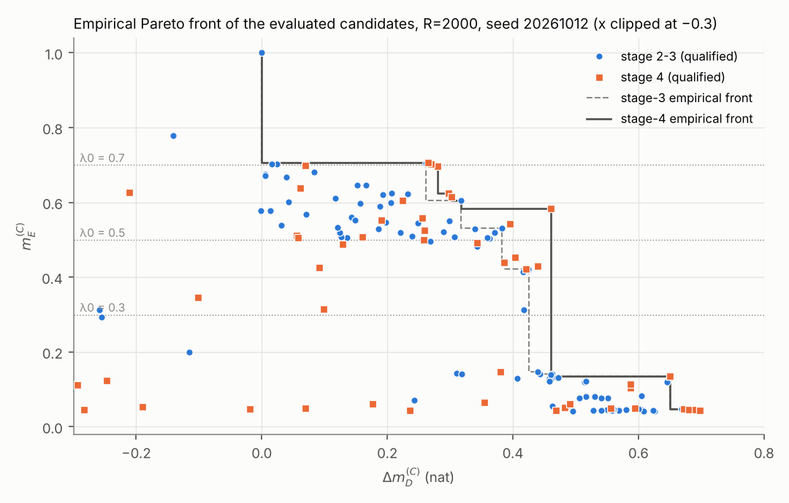
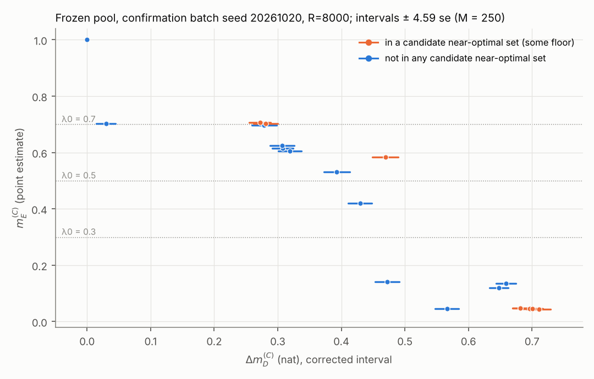
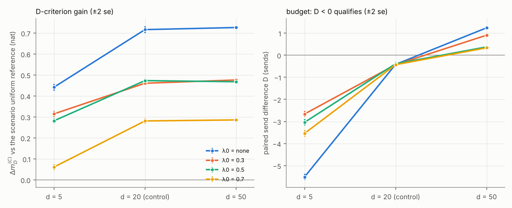

# §8.5 stage 4: search coverage, statistical confirmation, scenario robustness

**Date and setup.** 2026-10-13. Same scenario as stages 2–3: Δ\* = 0.002384694482635785, σ = Δ\*/20, T = 5 s, K = 5000. The space is the full 7-dimensional one: p = softmax(z1, z2, z3, 0) and four continuous phases, with no phase reduction.
- **Reference (C):** the uniform input on the same draws.
- **Reused code, unchanged:** `stage2_common.py`, which provides the trigger and its bitwise check, `evaluate_crn`, `summarize_s2`, `pareto_front` and `diff_se`. Also the stage-2 Nelder–Mead block (`nm_run`, `pen`, parametrisation) via `stage3_common.py`.
- **New code:** `stage4_common.py` only adds bookkeeping (pool loader, used-start keys, feasibility rule, representative rule).
- **Screening decisions** and all R = 2000 rankings and fronts use `mc85_post.py::qual` unchanged. Script 2 uses its own classifier.
- **Trigger check:** at the start of every script, and in Script 3 again at each σ_d. The log line is `trigger check: ... 100/100 trajectories` (31827 events at d = 20, 30392 at d = 5, 32143 at d = 50).

**Wording.** Results are the **best evaluated** candidates and the **empirical Pareto front of the evaluated candidates**. Script 2 states a **candidate near-optimal set within the frozen pool** at **approximate overall confidence** 0.95. Nothing here is an optimum, and nothing is claimed about unevaluated inputs.

**Traceability.** Every number is copied from `stage4/stage4_search.log`, `stage4_confirm_freeze.log`, `stage4_confirm.log`, `stage4_scenarios.log`, `stage4_figs.log` or `runtime.log`. Each table names its source table, R and seed.

**Order of work.**
1. `predictions.md` and `design.md` were committed before any stage-4 run (commit 0959dc3).
2. Each script was committed after it ran:

| commit | content |
|---|---|
| 7ba14dc | Script 1 |
| 25a8f06 | Script 2 freeze |
| 39fdd95 | Script 2 draw |
| 40b21a5 | Script 3 |

| script | what | runtime (`runtime.log`) |
|---|---|---|
| `stage4_search.py` | 48 budgeted + 10 unbudgeted NM runs, maxfev 300 (17 331 evaluations at R = 500); 90 new records at R = 2000 | 1846.3 s (30.77 min) |
| `stage4_confirm.py freeze` | frozen pool and family; no noise drawn | 0.0 s |
| `stage4_confirm.py draw` | 21 candidates + reference at R = 8000 | 45.2 s (0.75 min) |
| `stage4_scenarios.py` | 5 inputs at d = 5 and 50, plus the d = 20 control, R = 4000 | 30.8 s (0.51 min) |

No script came near the 90-minute limit.

## 1. Predictions against results

Predictions are from `predictions.md`. Results are from the logs named in §§2–4; the derived checks for P1.3 and P1.4 are in `stage4_figs.log`.

| # | prediction | result | verdict |
|---|---|---|---|
| P1 none | +0.697 to +0.72, most likely +0.00 to +0.01; P(pt > 0.02) 0.15 | +0.0004 (se 0.0010) | **confirmed** |
| P1 0.3 | +0.426 to +0.52, median +0.44; P(pt) 0.35, P(lo) 0.25 | new best +0.460; diff +0.0343 (0.0083): point above 0.02, lower end not | **in range**; pt > 0.02 occurred |
| P1 0.5 | +0.383 to +0.45, median +0.39; P(pt) 0.35, P(lo) 0.20 | new best +0.460; diff +0.0773 (0.0033): both above 0.02 | **wrong:** above the predicted range |
| P1 0.7 | +0.262 to +0.36, median +0.28; P(pt) 0.50, P(lo) 0.35 | new best +0.270; diff +0.0084 (0.0050) | **in range**; neither flag |
| P1.1 | pt > 0.02 at ≥ 1 floor (75%); lo > 0.02 at most at one floor | pt at 0.3 and 0.5; lo at 0.5 only | **confirmed** |
| P1.2 | new front points in the m_E gap 0.15–0.42 (0.6) | none; the new λ0 = 0.3 best sits at m_E 0.584, so the gap is now 0.141–0.584 | **wrong** |
| P1.3 | most feasible floor-run endpoints within 0.03 of their floor | 4 of 16 (0.3: 1/8, 0.5: 2/7, 0.7: 1/1) | **wrong** |
| P1.4a | low-stratum starts under λ0 ≥ 0.3 never feasible; identical paths across floors | none of the 6 became feasible; 0.3 and 0.7 runs from two low starts ended at the same point | **confirmed** |
| P1.4b | feasible front starts change by ±0.03, median +0.005 | 10 of 13 within ±0.03, median +0.0084. The larger moves (+0.145, +0.122, +0.078) traded m_E away | **mostly confirmed** |
| P1.4c | R = 200 starts: floor violated for λ0 ≥ 0.3; inf → feas about 1/2 (0.3), 1/3 (0.5), ≤ 2/6 (0.7) | violated 18/18; inf → feas 4/6, 3/6, 0/6 | **confirmed in direction**; 0.3 and 0.5 better than predicted |
| P1.4d | feasible R = 200 starts gain +0.3 to +1.5; none reaches the front | gains +0.50 to +5.81; best end +0.588, not on the front | range **wrong** (the starts were worse than assumed); "not on the front" **confirmed** |
| P2.1 | best new unbudgeted endpoints +2.00 to +2.12, D +95 to +115, p1 0.40–0.46 | 7 of 10 in +2.016 to +2.105, others +1.789 to +1.965; D +90.4 to +109.3; p1 0.411–0.456 | **confirmed** for the best endpoints |
| P2.2 | unbudgeted best does not move by a resolved amount | +0.0038 (0.0057), interval [−0.0090, +0.0166] | **confirmed** |
| P3 pool | n ≈ 20–26, t ≈ 4.55–4.77 | n = 21, M = 250, t = 4.5899 | **confirmed** |
| P3.1 | 2–6 budget-undecided; 0–2 rejected | 0 undecided, 0 rejected (20/20 confirmed) | **wrong** (too pessimistic) |
| P3.2 | NM-0.7-UNIF undecided at 0.7 (0.85); 1–3 more floor-huggers undecided | NM-0.7-UNIF confirmed (m_E interval [0.7003, 0.7041]); no m_E-undecided pair | **wrong** |
| P3.3 | undecided feasibilities 4/3/2/2, total 11 (5–16) | 0/0/0/0, total 0 | **wrong** |
| P3.4 | incumbents confirmed feasible (P = 0.7 for none, 0.6 for 0.7); near-optimal set ≥ 3 at none, 1–3 at 0.7 | all four incumbents confirmed; set sizes 6 (none), 2 (0.7) | **confirmed** |
| P4 reps | m_E ≈ 0.045, 0.30–0.42, 0.50–0.53, 0.70–0.71 | 0.045, 0.430, 0.584, 0.703 | **confirmed** for none and 0.7; **wrong** for 0.3 and 0.5 |
| P4 Δm_D, d = 5 | positive, shrinks by 20–60% | positive; ratios d = 5 / d = 20 of 0.62, 0.68, 0.60, 0.22, i.e. shrinks by 38%, 32%, 40% and 78% | sign **confirmed**; 3 of 4 in range |
| P4 Δm_D, d = 50 | positive, grows by 10–40% | positive; ratios d = 50 / d = 20 of 1.01, 1.03, 0.99, 1.02 | sign **confirmed**; growth **wrong** (unchanged) |
| P4 1/m_E, d = 5 | smaller; high-D point 22 → 8–18 | ratios 1.02, 0.97, 0.97, 0.98; high-D point 22.41 → 22.86 | **wrong** (essentially unchanged; the high-D point moves up) |
| P4 1/m_E, d = 50 | larger; high-D point 22 → 25–40 | ratios 1.01–1.03; high-D point 22.54 | direction **confirmed**; size **wrong** |
| P4 m_E vs 1, order of 1/m_E | below 1; 10¹ for the high-D point, 10⁰ for the others | as predicted at both d | **confirmed** |
| P4 B̂_d | d = 5: 298–312; d = 50: 318–321 | 304.365; 319.165 | **confirmed** |
| P4 D shifts | opposite signs; \|D_5 − D_20\| > \|D_50 − D_20\| | opposite for all four (−2.23 to −5.09 vs +0.76 to +1.66); first larger for all four | **confirmed** |
| P4 budget | about 2/4 fail at d = 5; 1–2/4 fail at d = 50 | 0/4 fail at d = 5; 4/4 over at d = 50 | **wrong** |
| P4.1 | no representative over budget at both d (65%) | none is | **confirmed** |
| P4.3 | J_per rank 9; offset +4 to +7 (d = 5), +1 to +2.5 (d = 50) | rank 9 at both; +7.0698 and +1.1556 | rank **confirmed**; d = 5 offset just above the range |
| P4.4 | window input power equal to the d = 20 record | asserted equal for every input at every d | **confirmed** |

## 2. Script 1: search budget added vs improvement found (`stage4_search.py`)

**Starts** (Tables S1–S2). Per floor there were 12 starts not used as NM starts in stages 2–3.
- **Front starts (6 per floor):** from the stage-3 union front, by strata L/M/H (2 each), cyclically dealt from one permutation per stratum (seed 20261018).
  - 11 front points were eligible for 24 slots, so there were 13 re-uses across floors.
  - The excluded front points were PO-NM-none-P5514, P1001, P4312, NM-0.3-P4312 and UNIF.
- **R = 200 pool starts (6 per floor):** sampled without replacement from the 2729 eligible qualified R = 200 points.
- **Unbudgeted starts:** L0299, L1573, L2029, L0295, L2207, L2375, L1870, L0190, L2916 and L2066.

**Re-evaluation.**
- All 45 distinct starts were evaluated at R = 2000. The 11 with stored stage-2/3 records reproduced them exactly in every compared field.
- **Archive rule:** 98 kept points, 56 distinct after deduplication, all evaluated at R = 2000.
- 18 runs had no archived point satisfying their own constraints on the search draws, so only their endpoint was kept and the constraint was not relaxed. Their list is in the log. All are λ0 ≥ 0.3 runs; none of their archived points met the floor and the budget together on the search draws.
- **Search optimism**, R = 2000 minus R = 500, over the new kept points: mean −0.0417, range [−0.0617, −0.0177].

**Table 1. Per floor, previous vs new best evaluated** (source: Table S5, `stage4_search.log`; R = 2000, seed 20261012).
- The difference is new − previous, with paired batch se (10 × 200, same draws).
- The interval is ± t_{9,0.975}·se = ± 2.262 se.
- The margin is −(D + 2se) in sends.

| λ0 | previous best | Δm_D^(C) | m_E | new best | Δm_D^(C) | m_E | margin | difference (se) | interval | pt > 0.02 | lower > 0.02 |
|---|---|---|---|---|---|---|---|---|---|---|---|
| none | S3-none-G-P5514(0,0,−30,−30) | +0.697 | 0.045 | S4-0.5-S3-none-G-P5514(0,0,−30,−30) | +0.697 | 0.045 | +0.478 | +0.0004 (0.0010) | [−0.0019, +0.0027] | no | no |
| 0.3 | NM-0.3-P4312 | +0.426 | 0.421 | S4-0.5-S3-none-NM-none-P5450 | +0.460 | 0.584 | +0.293 | +0.0343 (0.0083) | [+0.0155, +0.0531] | yes | no |
| 0.5 | AB-0.5 | +0.383 | 0.531 | S4-0.5-S3-none-NM-none-P5450 | +0.460 | 0.584 | +0.293 | +0.0773 (0.0033) | [+0.0699, +0.0847] | yes | yes |
| 0.7 | S3-0.7-P4055 | +0.262 | 0.705 | S4-0.5-S3-0.7-P4055 | +0.270 | 0.703 | +0.312 | +0.0084 (0.0050) | [−0.0030, +0.0197] | no | no |
| unbudgeted (any decision) | U-L1657 | +2.101 | 0.180 | S4U-L1573 | +2.105 | 0.175 | (over: D = +104.63) | +0.0038 (0.0057) | [−0.0090, +0.0166] | no | no |

*Intervals in Script 1 are exploratory diagnostics: the same R=2000 draws are used for selection and ranking, so 'interval lower end above 0.02' there does not carry the approximate 95% overall confidence of Script 2.*

**The one clear move is a new point for floors 0.3 and 0.5.** S4-0.5-S3-none-NM-none-P5450 has p = (0.204, 0.274, 0.245, 0.277) and χ = (5.531, 4.552, 5.780, 5.849).
- It is the endpoint (evaluation 282) of the λ0 = 0.5 run started at S3-none-NM-none-P5450, a front point with m_E 0.135 and Δm_D +0.650.
- The run raised m_E to 0.584 and gave up 0.19 nat on the way.
- It dominates the earlier front points P1045, P4312, NM-0.3-P4312, S3-0.3-NM-0.3-P4312, S3-0.3-NM-0.7-P4312 and AB-0.5 (m_E 0.141–0.531). P1001 (+0.463, m_E 0.141) stays on the front.
- On the λ0 grid, the maximum for 0.15 ≤ λ0 ≤ 0.55 rises from +0.426/+0.383/+0.318 to +0.460.
- The other changes are small: λ0 = 0.65 goes from +0.262 to +0.280, and 0.70 from +0.262 to +0.270. All other grid floors are unchanged.

**The front was largely relabelled.** It has 15 points, 11 of them new (Table S4). The derived check in `stage4_figs.log` compares each new front point with the start of the run that produced it.
- **5 of the 11 are polishings** of stage-3 front points in the low-m_E cluster: max |Δp| ≤ 9.1e-4, max |Δχ| ≤ 2.1e-3 rad, Δm_D +0.0002 to +0.0057. One example is S4-0.5-S3-none-G-P5514(0,0,−30,−30) vs its start: 1.9e-5 in p, 1.8e-4 rad, +0.0004 nat.
- **3 are small moves of S3-0.7-P4055:** ≤ 3.7e-3 in p, ≤ 2.0e-2 rad, +0.0028 to +0.0185 nat, with m_E 0.697–0.706.
- **3 are genuinely new.** They come from floor-raising runs that moved by 0.02–0.05 in p and 0.18–0.57 rad in χ:
  - S4-0.5-S3-none-NM-none-P5450 (m_E 0.135 → 0.584);
  - S4-0.7-S3-0.3-NM-0.3-P4312 and S4-0.7-S3-0.3-NM-0.7-P4312 (m_E 0.42–0.44 → 0.614–0.625, Δm_D +0.30). The last two are the best evaluated points for m_E ≥ 0.61, where the stage-3 front had only S3-0.7-P4055 (+0.262).

**Search budget vs improvement** (source: Table S6, `stage4_search.log`; NM evaluations at R = 500).

| target | stage 2 runs/evals | stage 3 runs/evals | stage 4 runs/evals | improvement of the floor best (se) |
|---|---|---|---|---|
| none | 3 / 450 | 5 / 1000 | 12 / 3591 | +0.0004 (0.0010) |
| 0.3 | 3 / 450 | 4 / 800 | 12 / 3557 | +0.0343 (0.0083) |
| 0.5 | 3 / 450 | 5 / 1000 | 12 / 3583 | +0.0773 (0.0033) |
| 0.7 | 3 / 450 | 4 / 800 | 12 / 3600 | +0.0084 (0.0050) |
| unbudgeted | — | 10 / 2000 | 10 / 3000 | +0.0038 (0.0057) |

The added budget was 2.5–2.9 times the previous NM budget per floor (stages 2 and 3 together), and 1.5 times the stage-3 budget for the unbudgeted problem. It moved the floor best at 0.3 and 0.5, and not by a resolved amount at none, 0.7 or the unbudgeted problem. This is a statement about this added budget. **No saturation claim is made.**

**Start → endpoint.** Source: Table S7 and its summaries in `stage4_search.log`; R = 2000, seed 20261012; feasible means `qual` 'ok' and m_E ≥ λ0.

(i) **Starts feasible for their floor** (19 runs). All 19 endpoints are feasible.

| floor | n | change mean | median | range | > +2se | within ±2se |
|---|---|---|---|---|---|---|
| none | 12 | +1.7274 | +0.3235 | [−0.0007, +5.8116] | 9 | 3 |
| 0.3 | 4 | +0.0345 | +0.0102 | [−0.0040, +0.1216] | 2 | 2 |
| 0.5 | 2 | +0.0431 | +0.0431 | [+0.0084, +0.0778] | 1 | 1 |
| 0.7 | 1 | +0.0028 | +0.0028 | — | 0 | 1 |

- **Feasible front starts (13 runs):** median +0.0084, 10 of 13 within ±0.03.
- **The three larger moves all traded m_E down:**

  | run | Δm_D change | m_E start → end |
  |---|---|---|
  | none/P1045 | +0.1453 | 0.141 → 0.104 |
  | 0.3/G-AB05(30,30,60,60) | +0.1216 | 0.605 → 0.430 |
  | 0.5/G-AB05(30,30,60,60) | +0.0778 | 0.605 → 0.542 |

- **No feasible start lost Δm_D beyond 2 se.**

(ii) **Starts infeasible for their floor** (29 runs, all failing only m_E). Feasibility transitions:

| floor | infeasible starts | → feasible | → infeasible |
|---|---|---|---|
| 0.3 | 8 | 4 | 4 |
| 0.5 | 10 | 5 | 5 |
| 0.7 | 11 | 0 | 11 |

- **The 9 that became feasible:** at λ0 = 0.5, two front starts (S3-none-NM-none-P5450 → +0.460 @ 0.584, which is the new best, and P1045 → +0.255 @ 0.558) and three R = 200 starts. At λ0 = 0.3, four R = 200 starts (best +0.343 @ 0.492).
- **λ0 = 0.7:** no infeasible start reached the floor; the closest was L2033 → m_E 0.698.
- **Low-stratum starts:** no run from a start with m_E < 0.1 under λ0 ≥ 0.3 became feasible. The 0.3 and 0.7 runs from S3-0.3-NM-0.3-P5014 and from S3-none-PO-NM-none-P5514 ended at the same points, as did the none and 0.3 runs from AB-0.5 (the log line on identical endpoints).
- **By start source:** front starts gave 15 feasible endpoints out of 24, with best +0.697. R = 200 starts gave 13 out of 24, with best +0.588; none of them is on the front.

**Unbudgeted problem** (source: Table S8). All 10 endpoints are over budget, D = +90.40 to +109.28.
- 7 endpoints lie in +2.016 to +2.105 and share p1 = 0.411–0.442, with widely different phases. Over all 10 endpoints p1 is 0.411–0.456.
- The best evaluated point of the unbudgeted problem is now S4U-L1573 (+2.105), but its difference from U-L1657 (+2.101) is not resolved.
- The six highest Δm_D^(C) in the merged pool (+2.085 to +2.105) mix stage-3 and stage-4 endpoints.

**Representatives for Script 3** (design.md §3, strictest floor first; source: end of `stage4_search.log`).

| floor | representative | Δm_D^(C) | m_E | note |
|---|---|---|---|---|
| 0.7 | S4-0.5-S3-0.7-P4055 | +0.270 | 0.703 | |
| 0.5 | S4-0.5-S3-none-NM-none-P5450 | +0.460 | 0.584 | |
| 0.3 | S4-0.3-G-AB05(30,30,60,60) | +0.439 | 0.430 | replaced: the 0.3 floor best is the 0.5 representative |
| none | S4-0.5-S3-none-G-P5514(0,0,−30,−30) | +0.697 | 0.045 | |

## 3. Script 2: confirmation on a frozen pool (`stage4_confirm.py`)

**Frozen before any noise was drawn** (`stage4_confirm_freeze.log`, `confirm_frozen.json`, commit 25a8f06). The draw step refused to run unless that file was committed and unmodified; its log records the commit and the sha256.

| frozen item | value |
|---|---|
| pool | n = 21: the 15 Script-1 front points plus the 7 stage-2 finalists, deduplicated (UNIF is in both), no truncation |
| incumbents | none: S4-0.5-S3-none-G-P5514(0,0,−30,−30); 0.3 and 0.5: S4-0.5-S3-none-NM-none-P5450; 0.7: S4-0.5-S3-0.7-P4055 |
| δ | 0.02 nat |
| confidence | 0.95 |
| method | batch-mean t-intervals, 20 batches of 400, 19 df |
| stopping rule | this single batch (seed 20261020, R = 8000), no augmentation |
| family | 20 budget intervals vs UNIF + 20 m_E intervals + C(21, 2) = 210 pairwise Δm_D intervals; M = 250 |
| critical value | t_{19, 1−0.05/(2M)} = t_{19, 0.9999} = 4.5899 on every interval |

**Draw** (seed 20261020, R = 8000 CRN). Point estimates come from the full matrices; se from the 20 paired batch statistics.
- **Reference:** B_u = 316.899 ± 0.025, log det J_C = 197.2028.
- **UNIF self-check** (evaluated as a pool candidate): D = 0 and Δm_D = 0 exactly.
- **Nonlinearity diagnostic** (mean of batch statistics − full statistic; Table C1b; not a bias bound):
  - for Δm_D: between −0.00000 and +0.00002 nat, below 0.01 se in magnitude;
  - for m_E: between −0.000643 and −0.000001, always negative. It is largest for S4-0.7-S3-0.3-NM-0.7-P4312 (−1.89 se); elsewhere it is ≤ 0.55 se in magnitude. The cause was not investigated.

**Table 2. Classification and candidate near-optimal sets** (source: Tables C1 and C3, `stage4_confirm.log`; seed 20261020, R = 8000).
- Intervals are point ± 4.5899 se.
- The m_E columns give the status of m_E ≥ λ0 (c = confirmed, r = rejected).
- "Set" lists the floors at which the candidate is in the candidate near-optimal set.

| candidate | D (interval) | budget | Δm_D^(C) (interval) | m_E (interval) | 0.3 | 0.5 | 0.7 | set |
|---|---|---|---|---|---|---|---|---|
| S4-0.5-S3-none-G-P5514(0,0,−30,−30) | −0.426 [−0.583, −0.269] | confirmed | +0.711 [+0.692, +0.729] | 0.0446 [0.0445, 0.0447] | r | r | r | none |
| S4-0.5-NM-none-P5514 | −0.452 [−0.593, −0.310] | confirmed | +0.701 [+0.684, +0.717] | 0.0450 [0.0449, 0.0451] | r | r | r | none |
| NM-none-P5514 | −0.438 [−0.581, −0.295] | confirmed | +0.700 [+0.684, +0.717] | 0.0450 [0.0449, 0.0451] | r | r | r | none |
| S4-0.3-S3-none-PO-NM-none-P5514 | −1.226 [−1.393, −1.059] | confirmed | +0.696 [+0.683, +0.709] | 0.0458 [0.0457, 0.0459] | r | r | r | none |
| S3-0.3-NM-0.3-P5014 | −0.591 [−0.744, −0.438] | confirmed | +0.682 [+0.670, +0.694] | 0.0468 [0.0467, 0.0469] | r | r | r | none |
| S4-0.3-S3-0.3-NM-0.3-P5014 | −0.590 [−0.742, −0.437] | confirmed | +0.682 [+0.669, +0.694] | 0.0468 [0.0467, 0.0469] | r | r | r | none |
| S4-noneC-S3-none-NM-none-P5450 | −0.326 [−0.459, −0.194] | confirmed | +0.659 [+0.644, +0.674] | 0.1349 [0.1346, 0.1352] | r | r | r | — |
| NM-none-P5450 | −0.955 [−1.098, −0.811] | confirmed | +0.648 [+0.633, +0.662] | 0.1205 [0.1203, 0.1207] | r | r | r | — |
| P5014 | −3.500 [−3.643, −3.357] | confirmed | +0.566 [+0.548, +0.585] | 0.0450 [0.0449, 0.0451] | r | r | r | — |
| P1001 | −1.512 [−1.656, −1.369] | confirmed | +0.472 [+0.453, +0.491] | 0.1407 [0.1402, 0.1412] | r | r | r | — |
| S4-0.5-S3-none-NM-none-P5450 | −0.444 [−0.623, −0.266] | confirmed | +0.469 [+0.449, +0.490] | 0.5840 [0.5829, 0.5852] | c | c | r | 0.3, 0.5 |
| NM-0.3-P4312 | −0.315 [−0.475, −0.154] | confirmed | +0.429 [+0.411, +0.448] | 0.4203 [0.4195, 0.4211] | c | r | r | — |
| AB-0.5 | −0.465 [−0.645, −0.285] | confirmed | +0.393 [+0.373, +0.413] | 0.5307 [0.5294, 0.5321] | c | c | r | — |
| G-AB05(30,30,60,60) | −2.366 [−2.550, −2.181] | confirmed | +0.319 [+0.301, +0.337] | 0.6054 [0.6036, 0.6071] | c | c | r | — |
| S4-0.7-S3-0.3-NM-0.3-P4312 | −1.102 [−1.307, −0.897] | confirmed | +0.308 [+0.292, +0.324] | 0.6144 [0.6124, 0.6165] | c | c | r | — |
| S4-0.7-S3-0.3-NM-0.7-P4312 | −0.325 [−0.486, −0.164] | confirmed | +0.307 [+0.288, +0.326] | 0.6254 [0.6239, 0.6270] | c | c | r | — |
| S4-0.5-S3-0.7-P4055 | −0.481 [−0.645, −0.317] | confirmed | +0.281 [+0.262, +0.300] | 0.7033 [0.7007, 0.7059] | c | c | c | 0.7 |
| S4-none-S3-0.7-P4055 | −0.498 [−0.663, −0.334] | confirmed | +0.279 [+0.259, +0.298] | 0.6966 [0.6944, 0.6989] | c | c | r | — |
| S4-0.7-S3-0.7-P4055 | −0.450 [−0.595, −0.305] | confirmed | +0.272 [+0.255, +0.289] | 0.7061 [0.7043, 0.7079] | c | c | c | 0.7 |
| NM-0.7-UNIF | −0.334 [−0.478, −0.191] | confirmed | +0.030 [+0.014, +0.045] | 0.7022 [0.7003, 0.7041] | c | c | c | — |
| UNIF | 0 (definition) | confirmed (definition) | 0 | 1 (definition) | c | c | c | — |

**Status counts.** All 20 non-uniform budgets are confirmed; none is undecided or rejected. No m_E status is undecided. So no feasibility is undecided at any floor, and every feasibility-undecided group below is empty.

**Sets per floor** (Table C3; δ = 0.02 nat).
- **Challengers** are the candidates confirmed feasible for the floor.
- A candidate is **excluded** if some challenger b has the lower end of (Δm_D(b) − Δm_D(c)) above δ.

**λ0 = none** (21 challengers).

Within this frozen pool, at approximate overall confidence 0.95, the candidate near-optimal set at floor λ0 = none is:
- **confirmed-feasible:** S4-0.5-S3-none-G-P5514(0,0,−30,−30), S4-0.5-NM-none-P5514, NM-none-P5514, S4-0.3-S3-none-PO-NM-none-P5514, S3-0.3-NM-0.3-P5014 and S4-0.3-S3-0.3-NM-0.3-P5014;
- **feasibility-undecided:** none.

Detail:
- Against the incumbent, the members' intervals have lower ends ≤ 0.02. For example, the incumbent minus NM-none-P5514 is +0.0104 [−0.0067, +0.0274], and minus S3-0.3-NM-0.3-P5014 it is +0.0288 [+0.0126, +0.0450].
- The first excluded candidate is S4-noneC-S3-none-NM-none-P5450: +0.0517, lower end +0.0347.
- The incumbent is confirmed feasible and in the set.

**λ0 = 0.3** (11 challengers).

Within this frozen pool, at approximate overall confidence 0.95, the candidate near-optimal set at floor λ0 = 0.3 is:
- **confirmed-feasible:** S4-0.5-S3-none-NM-none-P5450;
- **feasibility-undecided:** none.

Detail:
- NM-0.3-P4312, the stage-2/3 best for this floor, is excluded by it: +0.0399 [+0.0228, +0.0569].
- The incumbent is confirmed feasible and in the set.

**λ0 = 0.5** (10 challengers).

Within this frozen pool, at approximate overall confidence 0.95, the candidate near-optimal set at floor λ0 = 0.5 is:
- **confirmed-feasible:** S4-0.5-S3-none-NM-none-P5450;
- **feasibility-undecided:** none.

Detail:
- AB-0.5 is excluded: +0.0764 [+0.0593, +0.0936].
- The incumbent is confirmed feasible and in the set.

**λ0 = 0.7** (4 challengers).

Within this frozen pool, at approximate overall confidence 0.95, the candidate near-optimal set at floor λ0 = 0.7 is:
- **confirmed-feasible:** S4-0.5-S3-0.7-P4055 and S4-0.7-S3-0.7-P4055;
- **feasibility-undecided:** none.

Detail:
- The two members differ by +0.0089 [−0.0017, +0.0194].
- NM-0.7-UNIF is excluded: +0.2512, lower end +0.2355.
- S4-none-S3-0.7-P4055 (m_E 0.6966 [0.6944, 0.6989]) is rejected for this floor.
- The incumbent is confirmed feasible and in the set.

**Caveats.**
- *Membership in the candidate near-optimal set means that the candidate has not been excluded; it does not certify that every member is feasible or within δ of the true best feasible candidate in the frozen pool.*
- The intervals are batch-mean approximations for a logdet-of-mean estimator, and their overall confidence is approximate. Nothing is claimed about unevaluated inputs.
- **Near-duplicates.** Several pool members are near-duplicates of each other (deduplication is by a 7-decimal key). Examples: S4-0.5-NM-none-P5514 vs NM-none-P5514 differ by +0.0003 (se 0.0008), and S3-0.3-NM-0.3-P5014 vs S4-0.3-S3-0.3-NM-0.3-P5014. So the λ0 = none set of 6 contains about 4 distinct input configurations.

## 4. Script 3: scenarios d = 5 and d = 50 (`stage4_scenarios.py`)

**Settings.** Seed 20261021, R = 4000. The same draws are used for d = 5, d = 50 and the d = 20 control: **CRN is shared across the scenarios, so they are not independent batches.**

**Rebinding per scenario.** σ_d was rebound in the global `s` (noise, c_k, J). `Jb`, `ldB`, `Hp`, `ti` and `Nper` were deleted, then rebuilt from the scenario's own uniform reference. The script asserts that Δm_D^(B) uses the rebuilt J_per, and that the window input power equals each input's d = 20 record (it does).

**Uniform reference per scenario.**

| d | B̂_d (se) | N_d | J_per(u_unif, N_d) | (C) − (B) offset |
|---|---|---|---|---|
| 5 | 304.365 (0.052) | 304 | rank 9/9, cond 9.8724e+01 | +7.0698 |
| 20 (control) | 316.894 (0.035) | 316 | rank 9/9, cond 9.8720e+01 | +3.0413 |
| 50 | 319.165 (0.029) | 319 | rank 9/9, cond 9.8719e+01 | +1.1556 |

**Table 3. Representatives across scenarios** (source: Tables Sc-5, Sc-50, Sc-20 and Sc-cmp, `stage4_scenarios.log`; seed 20261021, R = 4000).
- D is the paired send-count difference vs the scenario's uniform reference; "dec" is `qual` (8.3.6(g)).
- The Δm_D^(C) se is the paired batch se (10 × 400).
- Δm_D^(B) is relative to J_per(u_unif, N_d) at σ_d.
- P_in is identical across d for each input (asserted).

| floor | representative | d | B | D ± se | dec | Δm_D^(C) (se) | m_E | 1/m_E | Δm_D^(B) | P_in |
|---|---|---|---|---|---|---|---|---|---|---|
| none | S4-0.5-S3-none-G-P5514(0,0,−30,−30) | 5 | 298.855 | −5.510 ± 0.067 | ok | +0.442 (0.008) | 0.0438 | 22.86 | +7.512 | 0.35969 |
| | | 20 | 316.477 | −0.417 ± 0.045 | ok | +0.716 (0.008) | 0.0446 | 22.41 | +3.758 | |
| | | 50 | 320.403 | +1.238 ± 0.038 | **over** | +0.726 (0.003) | 0.0444 | 22.54 | +1.882 | |
| 0.3 | S4-0.3-G-AB05(30,30,60,60) | 5 | 301.702 | −2.663 ± 0.070 | ok | +0.315 (0.007) | 0.4424 | 2.26 | +7.384 | 0.65379 |
| | | 20 | 316.464 | −0.430 ± 0.047 | ok | +0.461 (0.005) | 0.4305 | 2.32 | +3.502 | |
| | | 50 | 320.069 | +0.904 ± 0.046 | **over** | +0.476 (0.004) | 0.4230 | 2.36 | +1.632 | |
| 0.5 | S4-0.5-S3-none-NM-none-P5450 | 5 | 301.325 | −3.039 ± 0.071 | ok | +0.282 (0.006) | 0.6033 | 1.66 | +7.351 | 0.66748 |
| | | 20 | 316.505 | −0.389 ± 0.049 | ok | +0.473 (0.005) | 0.5844 | 1.71 | +3.515 | |
| | | 50 | 319.539 | +0.374 ± 0.041 | **over** | +0.468 (0.004) | 0.5669 | 1.76 | +1.623 | |
| 0.7 | S4-0.5-S3-0.7-P4055 | 5 | 300.825 | −3.540 ± 0.070 | ok | +0.061 (0.007) | 0.7179 | 1.39 | +7.131 | 0.69115 |
| | | 20 | 316.463 | −0.431 ± 0.047 | ok | +0.281 (0.006) | 0.7037 | 1.42 | +3.322 | |
| | | 50 | 319.499 | +0.334 ± 0.039 | **over** | +0.286 (0.004) | 0.6892 | 1.45 | +1.441 | |
| ref | UNIF | 5 / 20 / 50 | 304.365 / 316.894 / 319.165 | 0 | ok | 0 | 1 | 1 | +7.070 / +3.041 / +1.156 | 0.70509 |

**Paired changes relative to the d = 20 control** (Table Sc-cmp; per-draw send differences, per-batch log det).
- **d = 5:**
  - D changes by −5.092 (0.079), −2.233 (0.082), −2.651 (0.084) and −3.109 (0.083);
  - Δm_D^(C) changes by −0.275 (0.009), −0.146 (0.007), −0.192 (0.007) and −0.220 (0.007).
- **d = 50:**
  - D changes by +1.656 (0.057), +1.334 (0.064), +0.763 (0.061) and +0.766 (0.060);
  - Δm_D^(C) changes by +0.010 (0.006), +0.016 (0.005), −0.005 (0.005) and +0.005 (0.006).

**Nine generalized eigenvalues vs the scenario's uniform reference** (same source, ascending).

| representative | d | λ1 … λ9 |
|---|---|---|
| none | 5 | 0.044 0.052 0.875 1.032 1.054 1.165 1.360 20.218 22.317 |
| none | 50 | 0.044 0.054 0.851 1.044 1.114 1.291 1.487 20.498 22.210 |
| 0.3 | 5 | 0.442 0.480 0.688 0.873 1.021 1.106 1.342 2.472 2.866 |
| 0.3 | 50 | 0.423 0.476 0.715 0.861 1.045 1.142 1.411 2.587 2.976 |
| 0.5 | 5 | 0.603 0.721 0.829 0.924 0.970 1.134 1.271 1.534 1.854 |
| 0.5 | 50 | 0.567 0.690 0.821 0.936 0.998 1.172 1.337 1.674 2.031 |
| 0.7 | 5 | 0.718 0.734 0.791 0.888 0.899 1.153 1.190 1.314 1.771 |
| 0.7 | 50 | 0.689 0.712 0.780 0.866 0.913 1.158 1.220 1.545 2.014 |

**One sentence per representative.** "Budget" is the `qual` decision; "D gain" is Δm_D^(C) vs the scenario's uniform reference.
- **none, S4-0.5-S3-none-G-P5514(0,0,−30,−30):** budget feasibility holds at d = 5 (D = −5.510 ± 0.067) but not at d = 50 (over, D = +1.238 ± 0.038). The D gain stays positive at both, shrinking to +0.442 at d = 5 and +0.726 at d = 50 (vs +0.716 at d = 20). m_E stays below 1 at both (0.0438, 0.0444), with 1/m_E of order 10¹ (22.86, 22.54).
- **0.3, S4-0.3-G-AB05(30,30,60,60):** budget holds at d = 5 (−2.663 ± 0.070) but not at d = 50 (over, +0.904 ± 0.046). The D gain stays positive (+0.315 and +0.476 vs +0.461). m_E stays below 1 (0.4424, 0.4230), with 1/m_E of order 10⁰ (2.26, 2.36).
- **0.5, S4-0.5-S3-none-NM-none-P5450:** budget holds at d = 5 (−3.039 ± 0.071) but not at d = 50 (over, +0.374 ± 0.041). The D gain stays positive (+0.282 and +0.468 vs +0.473). m_E stays below 1 (0.6033, 0.5669), with 1/m_E of order 10⁰ (1.66, 1.76).
- **0.7, S4-0.5-S3-0.7-P4055:** budget holds at d = 5 (−3.540 ± 0.070) but not at d = 50 (over, +0.334 ± 0.039). The D gain stays positive but nearly vanishes at d = 5 (+0.061 ± 0.007) and is +0.286 at d = 50 (vs +0.281). m_E stays below 1 (0.7179, 0.6892), with 1/m_E of order 10⁰ (1.39, 1.45).

**Reading.**
- On these draws the d = 20 paired differences are −0.39 to −0.43 sends. That is smaller than the scenario shift of the paired send difference: −2.2 to −5.1 sends at d = 5 and +0.8 to +1.7 at d = 50. So budget feasibility of these boundary points depends on the noise level, not on the input alone.
- The eigenvalue structure, i.e. which direction is weak and by how much, is nearly unchanged across d.
- The D gain is unchanged from d = 20 to 50 and shrinks at d = 5.

## 5. Choices beyond the prompt and `design.md`

1. **Dry runs before the real runs.** All three scripts were first run end to end on reduced settings to exercise the code paths: maxfev 10 for Script 1, R = 800 for Script 2, R = 400 for Script 3. Outputs went to a scratch directory and were not committed.
   - These dry runs used the real seeds, so they saw subsets of the real draws: the first 800 rows of seed 20261020 and the first 400 rows of seed 20261021.
   - Every frozen Script-2 item is rule-determined by the prompt and `design.md`: pool, incumbents, δ, method and family. No rule or parameter was changed after the dry runs.
   - The only code change afterwards was cosmetic: the stopping-rule string is now built from the constants, `stage4_confirm.py` before the freeze.
   - Using separate seeds for the dry runs would have been cleaner.
   - One early dry run had a faulty text substitution (it ran with maxfev 300). It was killed during the NM phase, and nothing from it was used.
2. **Freeze/draw split with a git check** (stated in `design.md` §2). The freeze file was committed as 25a8f06 before the draw.
3. **Separate figure script.** `stage4_figs.py` draws `fig_front.png`, `fig_confirm.png` and `fig_scenarios.png` from the JSON outputs, and logs the plotted values and the derived prediction checks (`stage4_figs.log`). `fig_front_stage4.png` is Script 1's own quick-look figure, left as produced.
4. **Extra diagnostics in Script 1** (logged, not used for decisions):
   - the top-4 feasible per floor;
   - the λ0-grid maxima;
   - own-search bests;
   - search optimism (R = 2000 − R = 500);
   - identical-endpoint detection across floors;
   - start-source summaries.
5. **The 0.3 representative is outside the frozen pool.** S4-0.3-G-AB05(30,30,60,60) entered by the replacement rule; it is not a front point, so it was not part of the frozen pool and has no Script-2 status.
6. **Near-duplicate points** were kept as separate candidates, because deduplication is by the 7-decimal key (`design.md` §0). They appear on the front and in the frozen pool, and their pairwise intervals are very narrow.
7. **Software.** numba 0.68.0 was installed in this session, with numpy 2.5.3 and scipy 1.18.1. Stage-2/3 numbers reproduce bitwise: the 11 previously evaluated starts matched their stored records exactly, and the R = 2000 reference log det matched the stored value exactly.
