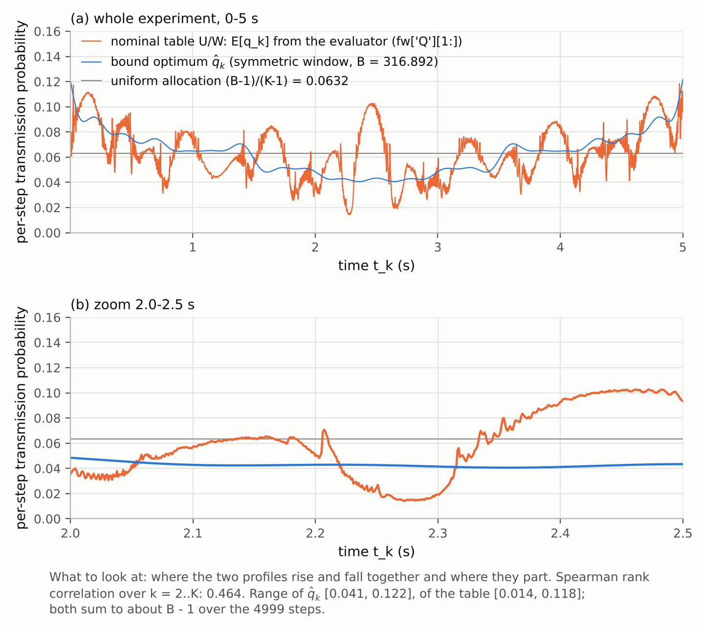

**方案。** `reports_CN/plan_round10_logdet_upper_bound_CN.md`（冻结，2026-11-08；英文版 `plan_round10_logdet_upper_bound_EN.md`）；执行 prompt `reports_CN/prompt_round10_claude_code_EN.md`（中文版 `prompt_round10_claude_code.md`），两者冲突以方案为准。分支 `round10-upper-bound` 自 `3314e7d` 开出：
- 方案与 prompt 入库：`8abbb23`；
- 预测 `round10/predictions_round10.md`：`053dcc4`，在任何计算之前提交，计分规则同时写定；
- 代码与结果：其后的提交。

**口径。**
- 上界 UB(B) 是窗口类 W 在名义真值 θ₀ 处的 log det J 最大值。W 的定义：第 k 步的区间窗口只依赖时刻与接收端已知的历史。
- 方案 §1 说明 UB 可由"以名义输出为中心的时变对称窗口"达到，因此它是 W 类的名义最优值，不只是松上界。本轮没有用仿真单独复核可达性（见第 8 节）。
- I_表 取冻结评价器在 σ/24 网格上的值；上界用 c_max 的闭式（精确 Gauss 积分）。两者的口径差别见第 2 节的 σ/120 敏感性。
- 结论依赖以下建模选择：名义真值 θ₀、iid Gauss 噪声、窗口类 W、逐步信息累加（命题 2）。

**来源。** 路径相对 `code_8_3_stage2/stage2_pkg/evaluator/`。
- `[L n]`：`round10/logs/run_round10.log` 第 n 行；`[J a.b]`：`round10/results/round10.json` 的字段 `a.b`。
- 代码：`round10/ub.py`（上界、证书、投影梯度、KKT 水填充；只用 numpy/scipy）；`round10/run_round10.py`（驱动；只读地 import round4、round7 的冻结代码）。
- 图：`round10/results/fig_send_profile.png`；q̂ 与表的发送分布：`round10/results/q_opt_B316.npy`、`q_opt_B263.npy`、`q_table_nominal.npy`。

## 1. 一句话结论

名义预算 B = 316.892 下，当前名义表（U/W，即相对常数 SoD 提高 7.83 nat 的那张）距窗口类 W 的名义最优 **[4.037, 4.041] nat**，D-efficiency **≥ 63.8 %**（认证区间 [63.83 %, 63.86 %]）。
来源：[L 65]；[J budgets.B316.g_L, g_U, deff_lower]；[J derived.deff_upper_B316]。

## 2. 结果表

单位 nat。来源：[L 145–146]；[J budgets.B316.\*, budgets.B263.\*]。

| | 名义预算 | T4 预算 |
|---|---:|---:|
| B（全精度） | 316.8921168493721 | 262.7986258567231 |
| 比较对象 | 名义表 U/W | T4（κ = 4） |
| I_表 | 205.031413 | 203.290001 |
| f(q̂)（UB 的认证下界） | 209.068540 | 207.937224 |
| U_cert（UB 的认证上界） | 209.072202 | 207.943130 |
| gap = U_cert − f(q̂) | 0.00366 | 0.00591 |
| g_L = f(q̂) − I_表 | 4.0371 | 4.6472 |
| g_U = U_cert − I_表 | 4.0408 | 4.6531 |
| D-efficiency 认证下界 e^{−g_U/9} | 63.83 % | 59.63 % |
| V₁：f(q̂_V1) | 207.315393 | 206.216501 |
| V₁：U_cert | 207.321169 | 206.224435 |
| V₁ − I_表 | +2.284 | +2.927 |
| 投影梯度迭代次数（UB / V₁） | 5 / 5 | 5 / 5 |
| KKT 水填充的 f | 209.068540 | 207.937225 |

I_表 的来源：
- 名义预算：`round4/results/mc.json["U/W"]["logdet_eval"]`；
- T4 预算：`round6/results/scan_U_W_m020.json["runs"][1]["logdet"]`。

派生量（只按方案 §7 的口径表述）：
- **ΔI_UB** = U_cert(B_nom) − log det J_SoD = 209.07220 − 197.20098 = **11.871 nat**。来源：[J derived.delta_I_UB]；log det J_SoD 取自 `mc.json["U/SoD"]["logdet_eval"]`。
- 当前表相对常数 SoD 的增益是 7.830 nat [J derived.delta_I_table]。7.830 / 11.871 = 0.660 [J derived.gain_fraction_table_over_UB]：这是"相对常数 SoD 的 log det 增益比例"，**不是**"达到上界的 66 %"。
- T4 预算：UB 相对等发送数常数 SoD（M = 581，σ/120）高 12.502 nat；T4 相对同一 SoD 高 7.849 nat。来源：[J derived.delta_I_UB_B263_vs_SoD_M581, delta_I_T4_vs_SoD_M581]。
- 全采样信息 log det(σ⁻² Σ h_k h_kᵀ) = 219.009，比 UB(B_nom) 高 9.936 nat。来源：[L 26]；[J derived.full_minus_UB316]。

补充区间（DECISION 10-6）：在 KKT 不动点处，证书间隙是 4.8e-13。按此收紧后：
- 名义预算 g_* = 4.0371272，D-efficiency 63.854 %；
- T4 预算 g_* = 4.6472242，D-efficiency 59.669 %。

来源：[J budgets.B316.tight_g_L, tight_g_U, tight_deff_lower]，B263 同名字段。主结果仍按方案的停止规则，报投影梯度的区间。

网格敏感性（DECISION 10-10）：把 I_表 换成第 7 轮在 σ/120 网格上算的同一张表的 log det（U/W 即 m000：205.031076；T4：203.289835），区间变为：
- 名义预算 [4.0375, 4.0411]；
- T4 预算 [4.6474, 4.6533]。

两者分别移动 +0.0003 和 +0.0002 nat，判定不变。来源：[L 134–140]；[J derived.g_L_sigma120_\*, g_U_sigma120_\*]；`round7/results/partD_match.json["nominal"]["m000"]["L"]`、`["T4"]["L"]`。

## 3. 判定（方案 §6）

| 预算 | 认证区间 | 落在方案 §6 的哪一行 | 结论 |
|---|---|---|---|
| 名义 | [4.0371, 4.0408] | g_L > 4 nat | 当前表距名义最优超过 4 nat（D-efficiency < 64 %），值得探索改进（Round 11：边参数化、迭代 A） |
| T4 | [4.6472, 4.6531] | g_L > 4 nat | 同上 |
| V₁ | 两档都高于比较表（+2.284、+2.927） | 只报位置 | 不用于判定差距来源 |

- 两档区间都不跨 2 或 4 nat 阈值。名义预算下 g_L 超出 4 nat 0.037 nat，约为求解间隙（0.0037）的 10 倍、网格敏感性（0.0003）的 100 倍。
- 但 0.037 nat 是相对一个约定阈值的小超出：D-efficiency 63.85 %，阈值约 64.1 %。"值得探索改进"是按冻结判定表得出的，并不说明 SoD 结构内能追回多少。
- W 类比 SoD 结构的窗口类大（W 允许窗口以名义输出为中心）。按方案 §6 末段，4 nat 的差距不归因于结构或设计；差距小也只能证明接近最优，不能说明剩余差距的原因。
- V₁：UB − V₁ = 1.753 nat（名义预算，[J derived.UB_minus_V1_B316]）。理想单边窗口与 SoD 窗口互不包含（方案 §3），所以 UB − V₁ 不是 SoD 结构代价，V₁ − I_表 也不是设计可追回的收益。
- 上界与 I_表 都在名义真值 θ₀ 处计算；失配下的情形不在本轮范围（第 8 节）。

## 4. 预测对照

计分规则在预测提交（`053dcc4`）里先写定，见 `round10/predictions_round10.md`。

| # | 预测 | 结果 | 判定 |
|---|---|---|---|
| 1 | ΔI_UB = U_cert(316.892…) − 197.20097668224076 ∈ [10, 14] | 11.871 [J derived.delta_I_UB] | 中 |
| 2a | g_* ∈ [2, 6]（认证区间整体落在其中） | [4.0371, 4.0408] [L 65] | 中 |
| 2b | D-efficiency 下界 ∈ [51 %, 80 %] | 63.83 % [L 65] | 中 |
| 3 | V₁ − 197.20097668224076 ∈ [8.5, 11] | 10.114（按 V₁ 的 U_cert 算是 10.120） [J derived.V1_minus_I_SoD, V1_ucert_minus_I_SoD] | 中 |
| 4 | q̂_k 不均匀，且与名义表的发送分布同向（Spearman > 0.5） | 不均匀：max/min = 3.00 > 1.5；Spearman 0.464 [L 103, 109] | **不中** |
| 5 | 两档预算的 gap 在 ≤ 200 次迭代内降到 0.01 | 5 次、5 次 [L 48, 75] | 中 |

第 4 条：不均匀成立，同向性 0.464 < 0.5，按计分规则判不中。

方案 §5 第四条的定性表述是"h_k 沿 J_SoD 薄弱方向的时刻拿到更多预算"。按预测文件写定的描述性伴随量（不计分）：
- q̂_k 与 σ⁻² h_kᵀ J_SoD⁻¹ h_k 的 Spearman 是 0.563；
- 名义表的发送分布与同一量的 Spearman 是 −0.185。

来源：[L 105–106]；J_SoD 取 `round4/results/J_U_SoD.npy`。

## 5. 检查

### 5.0 输入复现（prompt §1）

六个存档值都用冻结代码重算，不只是重读（DECISION 10-3）。全部**按位相同**（相对误差 0，门槛 1e-9）。

| 量 | 存档字段 | 重算方式 | 来源 |
|---|---|---|---|
| B_nom = 316.8921168493721 | `round4/results/mc.json["U/SoD"]["EN_eval"]` | `evaluate_table('U', ConstTable(480, 480))`（被接受的算子） | [L 14] |
| log det J_SoD = 197.20097668224076 | `mc.json["U/SoD"]["logdet_eval"]` | 同上；J 与 `J_U_SoD.npy` 也按位相同 | [L 15–16] |
| E[N_表] = 316.6035659260541 | `mc.json["U/W"]["EN_eval"]` | `part_c.table_fields('U/W')` 的前向 | [L 17] |
| I_表 = 205.03141309913676 | `mc.json["U/W"]["logdet_eval"]` | 同上，由 `fw['W']` 组装 J | [L 18] |
| B_T4 = 262.7986258567231 | `round6/results/scan_U_W_m020.json["runs"][1]["EN"]` | `round7/results/table_T4.npz` 经 `evaluate_table` | [L 20] |
| I_T4 = 203.29000089955792 | `scan_U_W_m020.json["runs"][1]["logdet"]` | 同上 | [L 21] |
| SoD@T4 = 195.4410611333331 | `round7/results/partD_match.json["nominal"]["T4"]["Q"]` | `evaluator_refine.evaluate(SodTable(581), 5, θ₀)` | [L 24] |
| E[N_SoD@T4] = 262.69687929169646 | `partD_match.json["nominal"]["T4"]["EN_SoD"]` | 同上 | [L 23] |

另外两项：
- 名义表的每步发送概率 `fw['Q'][1:]` 满足 1 + Σ = E[N]，相对误差 2.5e-15 [L 19]；
- 全采样信息 log det = 219.00850592919505（未存档，在此记录）[L 26]。

### 5.1 检查 1–6

| # | 检查 | 结果 | 判定 | 来源 |
|---|---|---|---|---|
| 1 | 按预算匹配：U_cert(B_nom) ≥ U/W、U/SoD；U_cert(B_T4) ≥ T4、SoD@T4 | 余量 +4.041、+11.871、+4.653、+12.502。四个策略的 E[N] 分别是 316.604、316.892、262.799、262.697，都不超过对应预算 | 通过 | [L 98–101] |
| 2 | q ≡ 1 时 f 等于全采样 log det | c_max 与 c_one 都得 219.00850592919502，与参照差 −2.8e-14（容差 1e-9） | 通过 | [L 28] |
| 3 | 标量版：S_sym = 1636.15048、S_one = 1346.81561（±0.001） | 1636.150882（+0.00040），1346.815932（+0.00032）；最优为均匀 q = 0.0631911，证书间隙 4.5e-13 | 通过 | [L 29] |
| 4 | 解析梯度对中心差分，20 个随机分量，相对误差 ≤ 1e-6 | 6 个检查点，最大相对误差 1.38e-7 | 通过 | [L 31–34, 95–97] |
| 5 | 引理 A：q ∈ {0.001, 0.01, 0.063, 0.2, 0.5}，各 2000 个 α 点，含理论对称点 | max c − c_max ≤ 1.1e-16；对称点处 \|c − c_max\| ≤ 1.1e-16；五个 q 的扫描最大值都在对称点 | 通过 | [L 35–39] |
| 6 | 两档 gap ≤ 0.01 | 0.00366、0.00591（各 5 次迭代）；V₁ 是 0.00578、0.00793 | 通过 | [L 102] |
| — | KKT 交叉核对：\|f_KKT − f_PGA\| ≤ 0.01 | +4.1e-7、+9.3e-7 | 通过 | [L 67, 94] |

各检查的细节：
- **检查 3 的残差。** 在取整预算 316.892 下，S_sym = 1636.150479、S_one = 1346.815609，与审稿值相差 < 1e-6 [L 30]。由此推断审稿值用的是取整预算（推断，未向审稿方核实）。这个口径包含 h₁ 的权重 1，即 S = 1 + Σ c（DECISION 10-5）。
- **检查 5 的独立性。** c 用冻结的 `mc83.cfun` 计算，与 `ub.c_max` 独立。
- **检查 5 的细网格。** 另做了 200 个 q 的细网格扫描，最坏超出 2.2e-16 [L 40]。
- **KKT 与投影梯度一致。** 乘子：名义预算 KKT λ = 0.0188159、投影梯度 λ̂ = 0.0188153；T4 预算 0.0233006 对 0.0232993。两种解的 q 最大差 4.7e-4、6.2e-4。来源：[J budgets.\*.kkt_lambda, lambda_hat, kkt_max_abs_q_diff]。
- **求解器行为。** 所有求解都没有触发阻尼、回溯或 t 缩小 [L 64, 91]。最优解全部是严格内点：q̂ ∈ [0.041, 0.122]（名义）、[0.033, 0.105]（T4）[J budgets.\*.q_min, q_max]。

## 6. 发送分布图

**题注。** 横轴是时间 t_k（s），纵轴是每步发送概率。
- 蓝线：上界最优发送率 q̂_k（对称窗，名义预算）；
- 橙线：名义表 U/W 的每步发送概率 E[q_k]，直接取评价器 `part_c.table_fields('U/W')` 返回的 `fw['Q'][1:]`；
- 灰线：均匀分配 (B−1)/(K−1) = 0.0632。

(a) 是全程，(b) 是 2.0–2.5 s 的放大。看点：两条曲线在哪些时段同升同降，在哪些时段分开。

**解读（只描述，不归因）。**
- **q̂_k。** 光滑，范围 [0.041, 0.122]，变异系数 0.255 [L 107–110]。按秒分段的均值依次为 0.078、0.058、0.043、0.058、0.078 [L 118]：两端高、2–3 s 最低，关于 t = 2.5 s 近似对称。
- **名义表。** 范围 [0.014, 0.118]，变异系数 0.329 [L 111–113]。分段均值依次为 0.075、0.056、0.053、0.059、0.074 [L 119]：也是两端高、中间低。中间一秒（2–3 s）的均值高于 q̂（0.053 对 0.043）。
- **短时起伏。** 在一秒以内，名义表有许多短时起伏，q̂ 没有。例如图 (b)：表在约 2.27 s 降到 0.015 左右，在约 2.45 s 升到 0.10 左右；同一时段 q̂ 一直在 0.04–0.05 之间（数值读自图）。
- **同向性。** 全程 Spearman 0.464 [L 103]。按秒分段的 Spearman 依次为 0.56、−0.08、0.04、0.19、0.67 [L 120]，同向性主要出现在第一秒和最后一秒。
- **逐步比较。** q̂ 高于表的步数占 57.2 %；两者之比超出 [1/2, 2] 的步数占 4.7 % [L 121–122]。
- **总和。** 两条曲线在 4999 步上的总和分别是 315.892 和 315.604，即 B − 1 和 E[N_表] − 1 [L 114–115]。

## 7. DECISION 列表

- **DECISION 10-1（KKT 水填充交叉核对；方案 §2 指定的编号）。**
  - 固定 J，求 γ_k = σ⁻² h_kᵀ J⁻¹ h_k。
  - 对称窗用闭式 q_k(λ) = 2Φ̄(√(λ/γ_k))。单边窗由 μ(α) − α = √(λ/γ_k) 对 α 二分；逆 Mills 比用 erfcx 的稳定形式。
  - λ 在 log λ ∈ [−60, 20] 上二分 100 次，使 Σq = B − 1；取二分区间上端，保证可行。
  - 阻尼更新 q ← ½q + ½q_new，max|Δq| ≤ 1e-13 时停止（两档都是 39 次）。
  - 判据：|f_KKT − f_PGA| ≤ 0.01。
  - 对 V₁ 也跑了一遍（附加，不计分）。
- **DECISION 10-2（投影梯度的步长与阻尼）。**
  - 试探步长 t 用 Barzilai–Borwein（BB1/BB2 交替，夹在 [1e-12, 1e12]），初值 t₀ = 0.1·mean(q)/mean|g|。
  - 方向 d = P_C(q + t g) − q。
  - 投影点严格在 (0, 1) 内时取 s = 1，否则取 s = 0.99。这是阻尼：新点是内点与 C 中一点的凸组合，所以严格内且可行。
  - Armijo 回溯：s ← s/2，直到 f(q + s d) ≥ f(q) + 1e-4·s·gᵀd 且 0 < q < 1。
  - 本轮阻尼、回溯、t 缩小都没有触发 [J budgets.\*.n_damped, n_backtrack, n_t_shrink]。
  - 证书里的线性最大化始终在原始 C 上做，不截断梯度，不缩小 C。
- **DECISION 10-3（输入复现方式）。** "复现"按"用冻结代码重算"执行，不只是重读存档：
  - U/SoD：`evaluate_table(ConstTable(480, 480))`；
  - U/W：`part_c.table_fields('U/W')`，这一步同时给出 `fw['Q']`；
  - T4：`round7/results/table_T4.npz` 经 `td.Design('U').table` 与 `evaluate_table`，与第 7 轮 `tables.py` 同一路径；
  - SoD@T4：`round7/evaluator_refine.evaluate(SodTable(581), 5, θ₀)`，θ₀ 取 `points27()` 的 `theta_0`，M 读自存档字段 `M`。
- **DECISION 10-4（λ̂）。** "未饱和分量"取 1e-8 < q_k < 1 − 1e-8。本轮全部 4999 个分量都满足，所以 λ̂ 就是全体梯度的中位数。
- **DECISION 10-5（标量检查的口径）。**
  - 取 S = 1 + Σ_{k≥2} c(q_k)：h₁ 恒发送、权重 1，与评价器的 S = Σ W_k（W_1 = 1）一致。不加 1 时与审稿值差约 1.0（−0.9996），加 1 后差 4e-4。
  - 最优点由凹性与对称性得出，为均匀 q，并用同一线性证书确认。
  - 残差的解释见 5.1。
- **DECISION 10-6（收紧区间）。** 主结果按方案的停止规则（gap ≤ 0.01）报投影梯度的区间。KKT 不动点同样是严格内的可行点，在它上面算的证书间隙是 4.8e-13；这个区间作为补充报出，不替代主结果。
- **DECISION 10-7（梯度检查）。**
  - 用二点中心差分，步长 h_k = 1e-3·q_k。在 f ≈ 209 处，双精度舍入使相对误差的下限约为 1e-7。探索性试算（未存档）：1e-4·q_k 时约 2e-7，1e-5·q_k 时约 2e-6。
  - 检查点：q₀；一个随机内点（q₀·exp(0.5ξ) 再缩放到 Σ = B − 1，种子 20261108）；名义预算的 q̂ 与 q̂_V1。c_max 与 c_one 都查。
  - 每个点按种子无放回抽 20 个分量。
- **DECISION 10-8（检查 2 的容差）。** prompt 没有给容差，取 |f(1) − log det_full| ≤ 1e-9。c_max 与 c_one 都查；c(1) = 1 显式处理。
- **DECISION 10-9（引理 A 的扫描）。**
  - α 用 u = Φ(α)/q 参数化，u = j/2000（j = 1..1999）。
  - β = Φ̄⁻¹(q − Φ(α))（`norm.isf`），使 Φ(β) − Φ(α) = 1 − q，误差 ≤ 3.3e-16。
  - 显式加入理论对称点 α = −`norm.isf(q/2)`，共 2000 点。
  - c 用冻结的 `mc83.cfun`（经 `dr.cfun` 调用）计算，与 `ub.c_max` 独立。
  - 按方案 §4.5"q 细网格"的措辞，另加 200 个对数间隔 q ∈ [1e-4, 0.99] 的描述性扫描。
- **DECISION 10-10（比较值的网格口径）。** I_表 按 prompt 取 σ/24 的存档值；上界是连续量；检查 1 里 T4 档的常数 SoD 参照来自 σ/120（第 7 轮 Part D）。作为敏感性，另报 I_表 换成第 7 轮 σ/120 值时的区间（第 2 节）。
- **DECISION 10-11（D-efficiency 的 p）。** p = 9，即 Hk 的列数，D-efficiency = exp(−g/9)。
- **DECISION 10-12（图）。** 加了 2.0–2.5 s 的放大面板，窗口在第一次出图之前就写进代码，不是看图后挑的。另加均匀分配参考线。颜色取 dataviz 参考调色板的槽位 1（蓝）和 2（橙）。
- **DECISION 10-13（独立脚本）。**
  - 方案 §8 要求的独立脚本就是 `ub.py`：命令行 `--H H.npy --sigma S --B B`，输出 f(q̂)、U_cert、gap、λ̂、q̂。
  - 为满足"只用 numpy/scipy"，分布图放在 `run_round10.py` 里，不放在 `ub.py`。
  - 用本场景的 Hk 试跑命令行，得到的 q̂ 与 `q_opt_B316.npy` 按位相同。
- **DECISION 10-14（环境）。** 容器里没有 numba，装了 0.68.0（第 6–8b 轮所用版本）。其余：numpy 2.5.3、scipy 1.18.1、matplotlib 3.11.2。
- **DECISION 10-15（只读目录）。** import `round4/trigger_dp.py` 时，模块顶层的 `os.makedirs` 会在 `round4/results/` 下建空目录 `tables/`、`runs/`；每次运行后都删掉了。round4–round8b 没有任何文件改动：对这些目录，`git diff 3314e7d` 为空。
- **DECISION 10-16（预测计分规则）。** 计分规则在预测提交里先写定，例如"不均匀"取 max/min > 1.5，g_* 要求认证区间整体落在 [2, 6] 内。见 `round10/predictions_round10.md`。
- **DECISION 10-17（名义表的每步发送概率）。** 取 `fw['Q'][1:]`，即评价器离散 q̂ 的期望，也就是方案中文版写的 Σ_i m_{k,i} q̂_{k,i}；没有用 `m_window` 重算。1 + Σ Q[1:] 与 E[N] 的相对差是 2.5e-15。

## 8. 本轮没做的事

照抄方案 §9：
- 失配模型下的上界（上界关于真模型，失配只影响表）。
- 非区间沉默集；依赖未发送测量的规则（见方案 §1 的适用范围）。
- 把差距归因到结构或设计（无依据，见方案 §3）。

另外两项：
- 可达性：方案 §1 用构造论证"以名义输出为中心的时变窗口恰好达到 UB"。本轮没有用评价器或仿真单独复核。
- 方案 §8 的论文文本（新附录、IV-E 段落、结论句）：仓库里没有论文源文件，下面附草稿。

**文献说明。** 本轮以预测中心窗口的相关研究（You–Xie–Song, IEEE TSP 2013；Han–You–Xie–Wu–Shi, IEEE TSP 2015）为背景，构造用于本文性能比较的 D 准则基准，不主张其理论新颖性。本文的贡献在 SoD 结构（窗口围绕上次发送值）一侧。两篇文献的完整书目信息不在仓库的 `lit/` 中，这里按方案原文引用。

## 附：论文文本草稿（方案 §8；数字取自上文）

- **结论句**（接在"7.83"之后）：……，距该窗口类的名义最优不超过 4.04 nat（D-efficiency ≥ 63.8 %）。
- **IV-E 段落**：
  > 为给出比较基准，考虑窗口类 W：第 k 步的区间窗口只依赖时刻与接收端已知的历史。它包含本文的窗口表，也包含以预测输出为中心的窗口 [You 2013; Han 2015]。
  >
  > 在 Σ_{k≥2} E[q_k] ≤ B − 1 下，W 中任何规则都满足 log det J ≤ UB(B) = max f(q̄)。其中 f(q̄) = log det(σ⁻²[h₁h₁ᵀ + Σ c_max(q̄_k) h_k h_kᵀ])，c_max(q) = q + 2aφ(a)，a = Φ⁻¹(1 − q/2)（新附录接附录 F，引理 A、B）。以名义输出为中心的时变对称窗口达到 UB，因此 UB 是 W 类的名义最优值。
  >
  > f 是凹函数。投影梯度上升加切平面证书给出名义预算下 UB ∈ [209.069, 209.072]。当前表的差距区间是 [4.037, 4.041] nat，D-efficiency ≥ 63.8 %；理想单边窗口的参照值 V₁ = 207.315。这个差距是到更大窗口类名义最优的距离，不归因于 SoD 结构或设计。
- **附录（引理 A、B）**：直接用方案 §1 的陈述与证明。
  - 引理 A：沿 Φ(β) − Φ(α) = 1 − q，dc/dα = φ(α)(β − α)[2μ_T − (α + β)]，且 (1 − q)(μ_T − m) = ∫₀^d t[φ(m + t) − φ(m − t)] dt；所以 c 在 α = −β 处取最大。
  - 引理 B：dc_max/dq = a²，随 q 递减。
  - 第三步：Jensen 不等式与 Loewner 序。
  - 数值复核见第 5 节检查 5。
