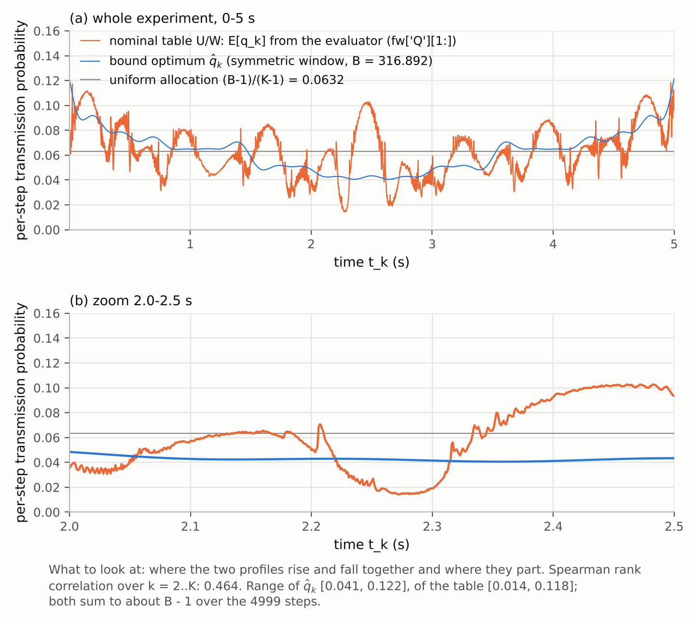

English copy of `report_round10_CN.md`. Where the two differ, the Chinese version is the report of record.

**Plan.** `reports_CN/plan_round10_logdet_upper_bound_EN.md` (frozen 2026-11-08; CN original `plan_round10_logdet_upper_bound_CN.md`). Execution prompt: `reports_CN/prompt_round10_claude_code_EN.md`; where the two conflict, the plan wins. Branch `round10-upper-bound`, created from `3314e7d`:
- plan and prompt committed in `8abbb23`;
- predictions `round10/predictions_round10.md` committed in `053dcc4`, before any computation, with the scoring rules;
- code and results in the commits after that.

**Scope.**
- UB(B) is the maximum of log det J over the window class W at the nominal truth θ₀. In W, the interval window at step k depends only on time and on the history known to the receiver.
- Plan §1 argues that UB is attained by a time-varying symmetric window centred on the nominal output. UB is therefore the nominal optimum of W, not merely a loose bound. This round did not check attainability separately by simulation (section 8).
- I_table is the frozen evaluator's value on the σ/24 grid. The bound uses the closed form of c_max (exact Gaussian integrals). Section 2 gives the sensitivity to σ/120.
- The conclusions depend on these modelling choices: the nominal truth θ₀, iid Gaussian noise, the window class W, and per-step accumulation of information (Proposition 2).

**Sources.** Paths are relative to `code_8_3_stage2/stage2_pkg/evaluator/`.
- `[L n]` is line n of `round10/logs/run_round10.log`; `[J a.b]` is field `a.b` of `round10/results/round10.json`.
- Code: `round10/ub.py` (bound, certificate, projected gradient, KKT water-filling; numpy/scipy only) and `round10/run_round10.py` (driver; imports the frozen round-4 and round-7 code read-only).

## 1. One-sentence conclusion

At the nominal budget B = 316.892, the current nominal table (U/W, the one that gains 7.83 nat over constant SoD) is **[4.037, 4.041] nat** from the nominal optimum of the window class W, with D-efficiency **≥ 63.8 %** (certified interval [63.83 %, 63.86 %]).
Sources: [L 65]; [J budgets.B316.g_L, g_U, deff_lower]; [J derived.deff_upper_B316].

## 2. Results

All values in nat. Sources: [L 145–146]; [J budgets.B316.\*, budgets.B263.\*].

| | nominal budget | T4 budget |
|---|---:|---:|
| B (full precision) | 316.8921168493721 | 262.7986258567231 |
| compared policy | nominal table U/W | T4 (κ = 4) |
| I_table | 205.031413 | 203.290001 |
| f(q̂) (certified lower bound on UB) | 209.068540 | 207.937224 |
| U_cert (certified upper bound on UB) | 209.072202 | 207.943130 |
| gap = U_cert − f(q̂) | 0.00366 | 0.00591 |
| g_L = f(q̂) − I_table | 4.0371 | 4.6472 |
| g_U = U_cert − I_table | 4.0408 | 4.6531 |
| certified D-efficiency lower bound e^{−g_U/9} | 63.83 % | 59.63 % |
| V₁: f(q̂_V1) | 207.315393 | 206.216501 |
| V₁: U_cert | 207.321169 | 206.224435 |
| V₁ − I_table | +2.284 | +2.927 |
| projected-gradient iterations (UB / V₁) | 5 / 5 | 5 / 5 |
| KKT water-filling f | 209.068540 | 207.937225 |

Sources of I_table:
- nominal budget: `round4/results/mc.json["U/W"]["logdet_eval"]`;
- T4 budget: `round6/results/scan_U_W_m020.json["runs"][1]["logdet"]`.

Derived quantities, worded only as plan §7 allows:
- **ΔI_UB** = U_cert(B_nom) − log det J_SoD = 209.07220 − 197.20098 = **11.871 nat** [J derived.delta_I_UB].
- The table's gain over constant SoD is 7.830 nat [J derived.delta_I_table]. 7.830 / 11.871 = 0.660 is the fraction of the log-det gain over constant SoD [J derived.gain_fraction_table_over_UB]. It is **not** "66 % of the bound attained".
- At the T4 budget, UB exceeds the equal-transmission constant SoD (M = 581, σ/120) by 12.502 nat; T4 exceeds the same SoD by 7.849 nat [J derived.delta_I_UB_B263_vs_SoD_M581, delta_I_T4_vs_SoD_M581].
- The full-data log det(σ⁻² Σ h_k h_kᵀ) is 219.009, which is 9.936 nat above UB(B_nom) [L 26; J derived.full_minus_UB316].

Supplementary tight interval (DECISION 10-6): at the KKT fixed point the certificate gap is 4.8e-13. With that point:
- nominal budget: g_* = 4.0371272, D-efficiency 63.854 %;
- T4 budget: g_* = 4.6472242, D-efficiency 59.669 %.

Sources: [J budgets.B316.tight_g_L, tight_g_U, tight_deff_lower] and the same fields under B263. The main result stays the projected-gradient interval, as the plan's stopping rule requires.

Grid sensitivity (DECISION 10-10): replacing I_table by round 7's σ/120 log det of the same tables (U/W = m000: 205.031076; T4: 203.289835) gives:
- nominal budget: [4.0375, 4.0411];
- T4 budget: [4.6474, 4.6533].

The shifts are +0.0003 and +0.0002 nat, and the verdict is unchanged. Sources: [L 134–140]; `round7/results/partD_match.json["nominal"]["m000"]["L"]` and `["T4"]["L"]`.

## 3. Verdict (plan §6)

| budget | certified interval | row of plan §6 | conclusion |
|---|---|---|---|
| nominal | [4.0371, 4.0408] | g_L > 4 nat | the current table is more than 4 nat from the nominal optimum (D-efficiency < 64 %); worth exploring improvements (Round 11: edge parametrisation, iteration of A) |
| T4 | [4.6472, 4.6531] | g_L > 4 nat | same |
| V₁ | above the compared table at both budgets (+2.284, +2.927) | position only | not used to attribute the gap |

- Neither interval straddles the 2-nat or 4-nat threshold. At the nominal budget g_L exceeds 4 nat by 0.037 nat. That is about 10× the solver gap (0.0037) and 100× the grid sensitivity (0.0003).
- It is still a small excess over a conventional threshold: D-efficiency is 63.85 % against about 64.1 %. "Worth exploring improvements" follows the frozen table; it does not say how much can be recovered within the SoD structure.
- W is larger than the SoD window class: W allows windows centred on the nominal output. As plan §6 states, the gap is not attributed to structure or to design. A small gap would prove closeness to the optimum, not the cause of the remainder.
- V₁: UB − V₁ = 1.753 nat at the nominal budget [J derived.UB_minus_V1_B316]. Ideal one-sided and SoD windows are not nested (plan §3). So UB − V₁ is not the cost of the SoD structure, and V₁ − I_table is not a recoverable design loss.
- Bound and I_table are both computed at the nominal truth θ₀. Mismatch is out of scope (section 8).

## 4. Predictions

The scoring rules were fixed in the predictions commit (`053dcc4`); see `round10/predictions_round10.md`.

| # | prediction | result | score |
|---|---|---|---|
| 1 | ΔI_UB = U_cert(316.892…) − 197.20097668224076 ∈ [10, 14] | 11.871 [J derived.delta_I_UB] | hit |
| 2a | g_* ∈ [2, 6] (certified interval inside) | [4.0371, 4.0408] [L 65] | hit |
| 2b | D-efficiency lower bound ∈ [51 %, 80 %] | 63.83 % [L 65] | hit |
| 3 | V₁ − 197.20097668224076 ∈ [8.5, 11] | 10.114 (10.120 with V₁'s U_cert) [J derived.V1_minus_I_SoD, V1_ucert_minus_I_SoD] | hit |
| 4 | q̂_k non-uniform and co-directional with the nominal table's profile (Spearman > 0.5) | non-uniform: max/min = 3.00 > 1.5; Spearman 0.464 [L 103, 109] | **miss** |
| 5 | gap reaches 0.01 within 200 iterations for both budgets | 5 and 5 [L 48, 75] | hit |

Line 4: non-uniformity holds, but the co-directionality of 0.464 is below 0.5, so the line is a miss under the scoring rule.

Plan §5's qualitative form of line 4 is "steps whose h_k points along weak directions of J_SoD receive more budget". The descriptive companion fixed in the predictions file (not scored):
- Spearman(q̂_k, σ⁻² h_kᵀ J_SoD⁻¹ h_k) = 0.563;
- the same correlation for the table's profile is −0.185.

Sources: [L 105–106]; J_SoD is `round4/results/J_U_SoD.npy`.

## 5. Checks

### 5.0 Reproduction of the inputs (prompt §1)

All six archived values were recomputed with the frozen code, not just re-read (DECISION 10-3). All are **bitwise equal** (relative error 0, threshold 1e-9).

| quantity | archived field | recomputed by | source |
|---|---|---|---|
| B_nom = 316.8921168493721 | `round4/results/mc.json["U/SoD"]["EN_eval"]` | `evaluate_table('U', ConstTable(480, 480))` (accepted operator) | [L 14] |
| log det J_SoD = 197.20097668224076 | `mc.json["U/SoD"]["logdet_eval"]` | same; J also bitwise equal to `J_U_SoD.npy` | [L 15–16] |
| E[N_table] = 316.6035659260541 | `mc.json["U/W"]["EN_eval"]` | forward of `part_c.table_fields('U/W')` | [L 17] |
| I_table = 205.03141309913676 | `mc.json["U/W"]["logdet_eval"]` | same, J assembled from `fw['W']` | [L 18] |
| B_T4 = 262.7986258567231 | `round6/results/scan_U_W_m020.json["runs"][1]["EN"]` | `round7/results/table_T4.npz` through `evaluate_table` | [L 20] |
| I_T4 = 203.29000089955792 | `scan_U_W_m020.json["runs"][1]["logdet"]` | same | [L 21] |
| SoD@T4 = 195.4410611333331 | `round7/results/partD_match.json["nominal"]["T4"]["Q"]` | `evaluator_refine.evaluate(SodTable(581), 5, θ₀)` | [L 24] |
| E[N_SoD@T4] = 262.69687929169646 | `partD_match.json["nominal"]["T4"]["EN_SoD"]` | same | [L 23] |

Two more items:
- the table's per-step transmission probability `fw['Q'][1:]` satisfies 1 + Σ = E[N] to a relative 2.5e-15 [L 19];
- the full-data log det is 219.00850592919505; it is not archived and is recorded here [L 26].

### 5.1 Checks 1–6

| # | check | result | verdict | source |
|---|---|---|---|---|
| 1 | per-budget matching: U_cert(B_nom) ≥ U/W, U/SoD; U_cert(B_T4) ≥ T4, SoD@T4 | margins +4.041, +11.871, +4.653, +12.502. The four policies' E[N] are 316.604, 316.892, 262.799 and 262.697, each within its budget | pass | [L 98–101] |
| 2 | f(q ≡ 1) equals the full-data log det | 219.00850592919502 for c_max and c_one; difference −2.8e-14 (tolerance 1e-9) | pass | [L 28] |
| 3 | scalar version: S_sym = 1636.15048, S_one = 1346.81561 (±0.001) | 1636.150882 (+0.00040), 1346.815932 (+0.00032); optimum at uniform q = 0.0631911, certificate gap 4.5e-13 | pass | [L 29] |
| 4 | analytic gradient vs central differences, 20 random components, relative error ≤ 1e-6 | 6 check points, worst 1.38e-7 | pass | [L 31–34, 95–97] |
| 5 | Lemma A: q ∈ {0.001, 0.01, 0.063, 0.2, 0.5}, 2000 α each, symmetric point included | max c − c_max ≤ 1.1e-16; \|c − c_max\| ≤ 1.1e-16 at the symmetric point; the scan maximum sits at the symmetric point for all five q | pass | [L 35–39] |
| 6 | gap ≤ 0.01 at both budgets | 0.00366 and 0.00591 (5 iterations each); V₁: 0.00578 and 0.00793 | pass | [L 102] |
| — | KKT cross-check: \|f_KKT − f_PGA\| ≤ 0.01 | +4.1e-7, +9.3e-7 | pass | [L 67, 94] |

Details:
- **Check 3 residuals.** At the rounded budget 316.892, S_sym = 1636.150479 and S_one = 1346.815609, which agree with the reviewer's values to < 1e-6 [L 30]. The likely reading is that the reviewer used the rounded budget; this is an inference and was not confirmed with the reviewer. The convention includes h₁ with weight 1, i.e. S = 1 + Σ c (DECISION 10-5).
- **Independence of check 5.** c is computed by the frozen `mc83.cfun`, independently of `ub.c_max`.
- **Fine grid for check 5.** An additional scan over 200 values of q found a worst excess of 2.2e-16 [L 40].
- **KKT and projected gradient agree.** Multipliers: KKT λ = 0.0188159 against λ̂ = 0.0188153 at the nominal budget, and 0.0233006 against 0.0232993 at the T4 budget. The largest difference between the two q vectors is 4.7e-4 and 6.2e-4. Sources: [J budgets.\*.kkt_lambda, lambda_hat, kkt_max_abs_q_diff].
- **Solver behaviour.** No damping, backtracking or step shrink was triggered in any solve [L 64, 91]. All optima are strictly interior: q̂ ∈ [0.041, 0.122] at the nominal budget and [0.033, 0.105] at the T4 budget [J budgets.\*.q_min, q_max].

## 6. Transmission profile

**Caption.** x-axis: time t_k (s); y-axis: per-step transmission probability.
- Blue: the bound's optimal transmission probability q̂_k (symmetric window, nominal budget).
- Orange: the nominal table U/W's per-step transmission probability E[q_k], taken directly from `fw['Q'][1:]` of `part_c.table_fields('U/W')`.
- Grey: uniform allocation (B−1)/(K−1) = 0.0632.

Panel (a) shows the whole run and panel (b) zooms on 2.0–2.5 s. What to look at: where the two curves rise and fall together, and where they part.

**Reading (description only, no attribution).**
- **q̂_k.** Smooth, range [0.041, 0.122], coefficient of variation 0.255 [L 107–110]. Per-second means: 0.078, 0.058, 0.043, 0.058, 0.078 [L 118]. It is high at both ends, lowest in 2–3 s, and roughly symmetric about t = 2.5 s.
- **Table.** Range [0.014, 0.118], coefficient of variation 0.329 [L 111–113]. Per-second means: 0.075, 0.056, 0.053, 0.059, 0.074 [L 119]. It is also high at the ends and low in the middle. In the middle second (2–3 s) its mean is above q̂ (0.053 against 0.043).
- **Short-time fluctuations.** Within a second, the table has many short excursions and q̂ has none. In panel (b), for example, the table falls to about 0.015 near 2.27 s and rises to about 0.10 near 2.45 s, while q̂ stays between 0.04 and 0.05 (values read from the figure).
- **Co-directionality.** Over the whole run, Spearman is 0.464 [L 103]. Per second it is 0.56, −0.08, 0.04, 0.19 and 0.67 [L 120], so the agreement comes mainly from the first and the last second.
- **Step by step.** q̂ is above the table at 57.2 % of steps. The ratio of the two lies outside [1/2, 2] at 4.7 % of steps [L 121–122].
- **Totals.** Over the 4999 steps the curves sum to 315.892 and 315.604, i.e. B − 1 and E[N_table] − 1 [L 114–115].

## 7. Decisions

- **DECISION 10-1 (KKT water-filling cross-check; numbered by plan §2).**
  - With J fixed, compute γ_k = σ⁻² h_kᵀ J⁻¹ h_k.
  - Symmetric window: closed form q_k(λ) = 2Φ̄(√(λ/γ_k)). One-sided window: bisection on α for μ(α) − α = √(λ/γ_k), with a stable inverse Mills ratio via erfcx.
  - λ by 100 bisection steps on log λ ∈ [−60, 20] so that Σq = B − 1, taking the upper end of the bracket so the result is feasible.
  - Damped update q ← ½q + ½q_new, stopping at max|Δq| ≤ 1e-13 (39 iterations at both budgets).
  - Pass criterion: |f_KKT − f_PGA| ≤ 0.01.
  - Also run for V₁ (extra, not scored).
- **DECISION 10-2 (projected-gradient step and damping).**
  - Trial step t by Barzilai–Borwein (alternating BB1/BB2, clipped to [1e-12, 1e12]), with initial t₀ = 0.1·mean(q)/mean|g|.
  - Direction d = P_C(q + t g) − q.
  - s = 1 if the projected point is strictly inside (0, 1), else s = 0.99. This is the damping: the new point is a convex combination of an interior point and a point of C, so it is strictly interior and feasible.
  - Armijo backtracking s ← s/2 until f(q + s d) ≥ f(q) + 1e-4·s·gᵀd and 0 < q < 1.
  - Damping, backtracking and step shrink were never triggered in this round [J budgets.\*.n_damped, n_backtrack, n_t_shrink].
  - The certificate's linear maximisation is always over the original C; the gradient is never truncated and C is never shrunk.
- **DECISION 10-3 (how the inputs were reproduced).** "Reproduce" was read as "recompute with the frozen code", not only re-read:
  - U/SoD: `evaluate_table(ConstTable(480, 480))`;
  - U/W: `part_c.table_fields('U/W')`, which also gives `fw['Q']`;
  - T4: `round7/results/table_T4.npz` through `td.Design('U').table` and `evaluate_table`, the same route as round 7's `tables.py`;
  - SoD@T4: `round7/evaluator_refine.evaluate(SodTable(581), 5, θ₀)`, with θ₀ = `points27()`'s `theta_0` and M read from the archived field `M`.
- **DECISION 10-4 (λ̂).** "Unsaturated" means 1e-8 < q_k < 1 − 1e-8. All 4999 components qualify in this round, so λ̂ is the median of all gradient components.
- **DECISION 10-5 (scalar-check convention).**
  - S = 1 + Σ_{k≥2} c(q_k): h₁ is always transmitted with weight 1, as in the evaluator's S = Σ W_k with W_1 = 1. Without the +1 the difference from the reviewer's value is about 1.0 (−0.9996); with it, 4e-4.
  - The optimum is the uniform q, by concavity and symmetry, confirmed with the same linear certificate.
  - The residuals are explained in 5.1.
- **DECISION 10-6 (tight interval).** The main result follows the plan's stopping rule (gap ≤ 0.01) at the projected-gradient point. The KKT fixed point is also a strictly interior feasible point; its certificate has gap 4.8e-13 and is reported as a supplement, not as a replacement.
- **DECISION 10-7 (gradient check).**
  - Two-point central difference with h_k = 1e-3·q_k. At f ≈ 209, double-precision roundoff puts the floor of the relative error near 1e-7. Exploratory runs (not archived) gave about 2e-7 at 1e-4·q_k and about 2e-6 at 1e-5·q_k.
  - Check points: q₀; a random interior point (q₀·exp(0.5ξ) rescaled to Σ = B − 1, seed 20261108); the nominal q̂; and q̂_V1. Both c_max and c_one are checked.
  - At each point, 20 components are drawn without replacement from the seeded generator.
- **DECISION 10-8 (check-2 tolerance).** The prompt gives none; |f(1) − log det_full| ≤ 1e-9 was used, for both c_max and c_one (c(1) = 1 handled explicitly).
- **DECISION 10-9 (Lemma A scan).**
  - α is parametrised by u = Φ(α)/q with u = j/2000 (j = 1..1999).
  - β = Φ̄⁻¹(q − Φ(α)) via `norm.isf`, so that Φ(β) − Φ(α) = 1 − q to within 3.3e-16.
  - The theoretical symmetric point α = −`norm.isf(q/2)` is added explicitly, for 2000 points in total.
  - c comes from the frozen `mc83.cfun` (through `dr.cfun`), independently of `ub.c_max`.
  - A descriptive scan over 200 log-spaced q ∈ [1e-4, 0.99] is added, following the plan's "fine grid of q" (§4.5).
- **DECISION 10-10 (grid of the compared values).** I_table is the archived σ/24 value, as the prompt specifies, while the bound is continuous. In check 1, the constant-SoD reference at the T4 budget comes from σ/120 (round 7 Part D). As a sensitivity, section 2 also reports the intervals with round 7's σ/120 table values.
- **DECISION 10-11 (p in the D-efficiency).** p = 9, the number of columns of Hk; D-efficiency = exp(−g/9).
- **DECISION 10-12 (figure).** The 2.0–2.5 s zoom window was written into the code before the first render, not picked after looking. A uniform-allocation reference line was added. Colours are slots 1 (blue) and 2 (orange) of the dataviz reference palette.
- **DECISION 10-13 (stand-alone script).**
  - The stand-alone script required by plan §8 is `ub.py`: `--H H.npy --sigma S --B B`, printing f(q̂), U_cert, gap and λ̂, and saving q̂.
  - The profile figure lives in `run_round10.py`, so that `ub.py` stays numpy/scipy only.
  - A CLI run on this scenario's Hk reproduces `q_opt_B316.npy` bitwise.
- **DECISION 10-14 (environment).** numba was missing from the container; version 0.68.0 was installed, as in rounds 6–8b. Otherwise numpy 2.5.3, scipy 1.18.1 and matplotlib 3.11.2.
- **DECISION 10-15 (read-only directories).** Importing `round4/trigger_dp.py` runs a module-level `os.makedirs` that creates empty `round4/results/tables/` and `runs/`; they were removed after every run. No file in round4–round8b changed: `git diff 3314e7d` is empty for those directories.
- **DECISION 10-16 (prediction scoring rules).** Fixed in the predictions commit, e.g. "non-uniform" means max/min > 1.5, and the g_* line requires the whole certified interval inside [2, 6]. See `round10/predictions_round10.md`.
- **DECISION 10-17 (the table's per-step transmission probability).** `fw['Q'][1:]` is used: the expectation of the evaluator's discrete q̂, i.e. the CN plan's Σ_i m_{k,i} q̂_{k,i}. It is not recomputed from `m_window`. 1 + Σ Q[1:] equals E[N] to a relative 2.5e-15.

## 8. Not done in this round

Copied from plan §9:
- Bounds under model mismatch (the bound concerns the true model; mismatch affects only the table).
- Non-interval silence sets; rules depending on untransmitted measurements (see plan §1).
- Attribution of the gap to structure or design (no basis; see plan §3).

Two further items:
- Attainability: plan §1 argues by construction that a time-varying window centred on the nominal output attains UB. This round did not check it separately with the evaluator or by simulation.
- The paper text of plan §8 (new appendix, §IV-E paragraph, conclusion sentence): the paper source is not in the repository. The CN report appends a draft.

**Literature note.** This round uses the prediction-centred-window literature (You–Xie–Song, IEEE TSP 2013; Han–You–Xie–Wu–Shi, IEEE TSP 2015) as background to construct a D-criterion benchmark for the comparison in this paper, without claiming theoretical novelty. The paper's contribution is on the SoD-structured side (window around the last transmitted value). Full bibliographic details of the two papers are not in the repository's `lit/`; they are cited as the plan cites them.
