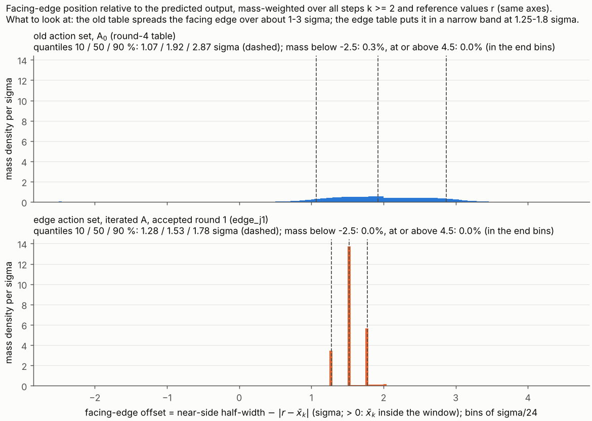

**方案。** `reports_CN/plan_round11_edge_actions_CN.md`（冻结，2026-11-09；英文版 `plan_round11_edge_actions_EN.md`）；执行 prompt `reports_CN/prompt_round11_claude_code_EN.md`，两者冲突以方案为准。分支 `round11-edge-actions` 自 `round10-upper-bound` 的 `2b1af1b`（第 10 轮报告提交）开出：
- 方案（中、英）与 prompt 入库：`2fa34ea`，即本轮第一个提交（两份方案文件均在 `reports_CN/` 下，无需另行补交）；
- 预测 `round11/predictions_round11.md`：`2ad6cd1`，在任何计算之前提交，计分规则同时写定；
- 代码与结果：其后的提交。

**口径。**
- 场景、预算 B = 316.8921168493721、σ、输入、网格步长与转移同第 4 轮。设计侧只改两样：动作集（边相对预测输出 x̄_k 取位置，取代半宽相对 r）与切点（A ← J(T)⁻¹，按真实 log det 验收）。
- 所有 I 为评价器在 σ/24 设计网格、名义真值 θ₀ 处的 log det J；σ/120 复核值并列给出；预算检查（检查 7）用 σ/120。
- U_cert = 209.07220154478713 为第 10 轮在 B 下对窗口类 W 的 log det J 认证上界（`round10/results/round10.json["budgets"]["B316"]["u_cert"]`）。g′ = U_cert − I(T)；D-efficiency 下界 = exp(−g′/9)。
- 结论依赖以下建模选择：名义真值 θ₀、iid Gauss 噪声、σ/24 离散模型、有限动作集、最多三轮 A 迭代。

**来源。** 路径相对 `code_8_3_stage2/stage2_pkg/evaluator/`。
- `[L n]`：`round11/logs/run_round11.log` 第 n 行；`[J a.b]`：`round11/results/round11.json` 的字段 `a.b`。
- 代码：`round11/eval11.py`（全网格前向/后向评价器、σ/120 入口、统计、Monte Carlo）；`round11/dp11.py`（全网格 DP、价格扫描）；`round11/run_round11.py`（驱动、分阶段）；`round11/post11.py`（逐表数值、检查、图、UB_SoD）。第 4–10 轮只读 import；每个阶段结束后 round4–round10 的 `git status` 均干净。
- 扫描记录：`round11/results/scan_<格>_j<轮>.json`；阶段状态：`round11/results/state_*.json`。

## 1. 一句话结论

新动作集加一轮被接受的 A 迭代（edge/迭代 格）相对第 4 轮名义表得到 **δI = I_最好 − I_原表 = +2.324 nat**（I = 207.355 对 205.031；相对常数 SoD 的 ΔI 为 10.154 对 7.830），距第 10 轮 U_cert **g′ = 1.717 nat**，即 **D-efficiency ≥ 82.6 %**；该表通过 σ/120 预算复核（E[N] = 316.516 ≤ B）与检查 1–7。
来源：[L 202, 230]；[J verdict.\*, cells.edge/iterated.\*]。

## 2. 四格表

I 单位 nat，σ/24。"主体发送占比" = 发送数 E[N] − 1 中落在 |r − x̄_k| ≥ 40σ 段的比例（DECISION 11-8）。来源：[L 199–202]；[J cells.\*, tables.\*]。

| 格 | 表 | ΔI = I − I_SoD | I | g′ = U_cert − I | D-eff ≥ | 主体发送占比 | E[N] σ/24 | E[N] σ/120 |
|---|---|---:|---:|---:|---:|---:|---:|---:|
| 旧 / A₀ | old_j0（= 第 4 轮表） | 7.830 | 205.0314 | 4.041 | 63.8 % | 18.3 % | 316.604 | 316.531 |
| 旧 / 迭代 | old_j1（第 1 轮被接受） | 7.946 | 205.1468 | 3.925 | 64.7 % | 14.3 % | 316.771 | 316.699 |
| 新 / A₀ | edge_j0 | 9.901 | 207.1020 | 1.970 | 80.3 % | 13.3 % | 316.610 | 316.413 |
| **新 / 迭代** | **edge_j1（第 1 轮被接受）** | **10.154** | **207.3552** | **1.717** | **82.6 %** | 16.0 % | 316.726 | 316.516 |

I_SoD = 197.20097668224076，I_原表 = 205.03141309913676，U_cert = 209.07220154478713（均已复现，见第 5 节）。

A 的迭代（DECISION 11-2：I(T_j) > I(T_{j−1}) + 0.05 nat 才接受，最多 3 轮）。来源：[L 91, 107, 126, 141]；[J iteration_log.\*]。

| 动作集 | 轮 | 切点 | λ/γ̄ | E[N] σ/24 | I(T_j) | 相对 T_{j−1} 的增益 | 接受 |
|---|---:|---|---:|---:|---:|---:|---|
| 旧 | 0 | A₀ = J_SoD⁻¹ | 3.400 | 316.604 | 205.03141 | — | （第 0 轮） |
| 旧 | 1 | J(T₀)⁻¹ | 3.225 | 316.771 | 205.14678 | +0.1154 | 是 |
| 旧 | 2 | J(T₁)⁻¹ | 3.269 | 316.593 | 205.15462 | +0.0078 | 否（停） |
| 新 | 0 | A₀ = J_SoD⁻¹ | 2.790 | 316.610 | 207.10198 | — | （第 0 轮） |
| 新 | 1 | J(T₀)⁻¹ | 2.785 | 316.726 | 207.35522 | +0.2532 | 是 |
| 新 | 2 | J(T₁)⁻¹ | 2.7825 | 316.563 | 207.38341 | +0.0282 | 否（停） |

两种动作集都未跑到第 3 轮。

切线高估量 E_j(T) = F_j(T) + γ_{1,j} − 9 − [I(T) − I(T_ref,j)]（DECISION 11-12）。来源：[J tables.\*.tangent_overestimate, tables.\*.E0]。

| 表 | 参考 T_ref,j | E_j | E₀（相对 A₀，供对照） |
|---|---|---:|---:|
| old_j0 | 常数 SoD | 6.032 | 6.032 |
| old_j1 | old_j0 | 0.058 | 5.480 |
| old_j2（未接受） | old_j1 | 0.009 | 5.712 |
| edge_j0 | 常数 SoD | 11.411 | 11.411 |
| edge_j1 | edge_j0 | 0.202 | 9.912 |
| edge_j2（未接受） | edge_j1 | 0.025 | 10.582 |

窗口形状（朝向输出的边 = 近侧半宽 − |r − x̄_k|，质量加权，σ 单位）与最后一个偏移段。来源：[L 156–197]；[J tables.\*.shape]。

| 表 | 近边 10 / 50 / 90 % | ≥ 40σ 段质量 | ≥ 40σ 段发送 | 该段每次发送信息（未加权 c） | 该段近边均值 |
|---|---|---:|---:|---:|---:|
| old_j0 | 1.07 / 1.92 / 2.87 | 1.35 % | 57.7（18.3 %） | 1.13 | −1.56 |
| old_j1 | 1.06 / 1.90 / 2.82 | 1.06 % | 45.1（14.3 %） | 1.13 | −1.54 |
| edge_j0 | 1.27 / 1.53 / 2.00 | 23.0 % | 42.0（13.3 %） | 4.94 | +1.84 |
| edge_j1 | 1.28 / 1.53 / 1.78 | 15.0 % | 50.4（16.0 %） | 4.11 | +1.52 |

描述性读法，不归因：旧动作集下 ≥ 40σ 段只有少量质量，其窗口够不到输出（近边 −1.56σ，即 x̄_k 在窗口外），每次发送约 1.1 单位 c，其他段约 3–4.6。新动作集下远离 x̄_k 的参考值会长期保留（质量支撑平均跨 1144σ 输出范围中的 1116σ，旧动作集为 86σ [J tables.\*.mean_support_width_sigma]）；窗口从 r 一直伸到 x̄_k 外约 1.5σ，该段每次发送携带的 c 与其他段相当（4.1–4.9）。因此这一段的占比已不再是第 4 轮意义上的"主体发送"；按定义照报。

### 2b. 补充：离散边参数化 SoD 类内的认证上界（不新跑）

取新动作集第 2 轮的扫描（切点 A₁ = J(T₁)⁻¹，T₁ = edge_j1，γ₁ = 0.009447863192807387），每个已评估的 λ 给出 UB(λ) = I(T₁) − p + γ₁ + V_λ + λ(B − 1)，V_λ = Σ_i ĝ_{1,i} V₂(i) 为该次 DP 的值；UB_SoD = 12 个 λ 上的最小值（DECISION 11-16）。来源：[L 211–229]；[J ub_sod.\*]。

| 上界 | 类 | 值 | 距 I(T₁) = 207.355217 | e^{−gap/9} |
|---|---|---:|---:|---:|
| UB_SoD（最小在第 12 次，λ = 0.0183397） | 新动作集的离散 SoD 类 | 207.414762 | 0.0595 | ≥ 99.34 % |
| U_cert（第 10 轮） | 窗口类 W | 209.072202 | 1.7170 | ≥ 82.63 % |

- UB_SoD 的类限定：对每个（步 k ≥ 2，σ/24 节点 r_i）从 100 个边动作中取一个（E²，边在网格节点上，距 r_i 至少 2σ）的表，在 θ₀ 处按 σ/24 离散模型评价，且 σ/24 E[N] ≤ B。依据：J(T₁) 处的引理 3、式 (12)、引理 1；V_λ 为浮点值（DP 与前向的舍入差约 1e-12，DECISION 11-15）。对此类之外的策略不作结论。
- UB_SoD ≥ I(T₁) 成立；三张 σ/24 E[N] ≤ B 的新动作集表（I = 207.102、207.355、207.383）都在其下 [J ub_sod.edge_tables_below]。
- 对照 [J ub_sod.supplementary_all_scans]：同样的构造用其他扫描得到 207.560（新第 1 轮）、218.530（新 / A₀）；旧动作集为 205.171（旧第 2 轮，切点 J(old_j1)⁻¹），即旧动作集离散类中任何 E[N] ≤ B 的表 log det ≤ 205.171，低于新动作集的表。

## 3. 判定（方案 §7）

δI = I_最好 − I_原表 = 207.35522 − 205.03141 = **2.324 nat ≥ 0.5**，最好一格为新 / 迭代，**g′ = 1.717 nat < 2** [L 230；J verdict]。

→ **第 2 条（δI ≥ 0.5 且 g′ < 2 nat）：进 Round 12**——用新动作集重做余量（T4 等价表）与两段确认实验，论文主结果换新。

- 换成 σ/120 判定不变：U_cert − I₁₂₀(edge_j1) = 209.07220 − 207.35308 = 1.719 nat；σ/120 预算成立（316.516）。
- 到条件边界的距离：g′ 比 2 低 0.283 nat；δI 比 0.5 高 1.82 nat。单看新 / A₀ 也落在第 2 条（δI = 2.071，g′ = 1.970，比 2 低 0.030）。

## 4. 预测对照

计分规则见 `round11/predictions_round11.md`（计算前提交）。来源：[L 231–240]；[J predictions]。

| # | 预测 | 实际 | 结果 |
|---|---|---|---|
| 1 | 新 / A₀ ΔI ∈ [8.5, 10.0] | 9.901 | **中** |
| 2 | 新 / A₀ 主体发送占比（≥ 40σ 段）< 5 % | 13.3 % | **未中** |
| 3 | 新 / A₀ 近边 10–90 % 范围落在 [1.5, 2.3]σ 内 | [1.266, 2.005] | **未中**（10 % 分位低于 1.5） |
| 4 | A 迭代，旧动作集：+0 至 +0.5 nat | +0.115 | **中** |
| 5 | A 迭代，新动作集：+0 至 +0.5 nat | +0.253 | **中** |
| 6 | 第 2 轮后不再接受 | 第 3 轮未跑 | **中** |
| 7 | 旧 / 迭代 ΔI ∈ [7.8, 8.3] | 7.946 | **中** |
| 8 | 最好一格 g′ ∈ [2.0, 3.4] nat | 1.717 | **未中**（偏低） |
| 9 | 最好一格 D-eff ∈ [69 %, 80 %] | 82.6 % | **未中**（偏高） |
| 10 | 新动作集下切线高估量 E₀ > 4 nat | 11.41 | **中** |

6 中 4 未中。按 prompt §6 的五行：第 1 行三项中一项命中；第 2 行全中（三项）；第 3 行中；第 4 行两项均未中；第 5 行中。

## 5. 检查 1–7

全部通过 [L 204–210；J checks, all_checks_pass]。

**输入复现（prompt §1）** [L 9–16；J inputs.reproduction]：B、I_SoD、E[N]_原表、I_原表 用冻结评价器复现，相对误差 0。eval11 在全网格上对第 4 轮表的结果与冻结一般路径（88σ 支撑）逐位相同（E[N]、w_k、S、J、log det）[L 13]。DP 的逐步数组在五个步上与完整 scipy 数组逐位相同 [L 15]。σ/120 入口对第 4 轮表给出 E[N] = 316.53115805249706、log det 205.03107573358153，与第 7 轮存档逐位相同（相对误差 0 ≤ 1e-9；澄清 1）[L 16]。

1. **回归门槛（阻断）**——通过 [L 38–50；J gate]。边编码路径 + 旧动作集 + A₀ 的名义扫描逐位复现 `round4/results/scan_U_W.json` 的全部 11 次运行（λ、E[N]、F、S、log det、可行性、对偶值）、最终运行（第 5 次，λ = 0.07339683452541984），以及 `round4/results/table_U_W.npz` 所存节点上的动作编码（4999 行中 0 个节点不同）；E[N] 差 0，I 相对差 0。澄清 3：编码比较只在存档所存节点上进行；旧动作集下新支撑节点（第 4 轮窗口之外）的质量为零，在门槛最终表与存档表的每一步断言（质量支撑距窗口端点最近 860 个节点）[L 74；`round11/results/state_gate_support.json`]，此后在每张旧动作集表的每次前向（旧迭代扫描与 post）中都断言。门槛扫描的其余 10 张非最终表未保留；它们的数值与第 4 轮记录相同。
2. **前向 = 后向**——通过 [J checks.2_forward_backward]。每张报告表的前向与固定策略后向递推：最差相对误差 F 5.2e-13、N 5.2e-13、F − λN 5.1e-13（≤ 1e-12）。诊断（DECISION 11-15）：DP 值对前向总分最差绝对差 1.1e-11；在第 4 轮表上相对 |F − λN| 为 1.2e-11（F − λN = −0.33 是两个约 23 的数之差），相对 F + λN 为 8e-14；与第 4 轮存档的 `dp_minus_policy` 逐位相同。
3. **守恒、非负、支撑**——通过 [J checks.3_conservation]。每次前向的每一步都断言（69 次 DP 运行的前向、6 次 σ/120 前向、检查与 MC 用表）：σ/24 上 max |Σm − 1| = 7.3e-13（≤ 1e-12），σ/120 上 1.9e-12（≤ 1e-10，DECISION 11-5），min m = 0，网格首末节点质量为零；没有断言触发。
4. **最好一表（edge_j1）的 Monte Carlo**——按 DECISION 11-7 通过 [L 203；J checks.4_monte_carlo]。10⁴ 条轨迹（20 × 500，种子 20261109）：E[N] 316.442 ± 0.170，S 1343.896 ± 0.023，log det 207.35311 ± 0.00016。对 σ/120 的 z：E[N] +0.44，S −0.24，log det −0.13。对 σ/24 的 z：E[N] +1.67，**S +14.0，log det +12.9**（σ/24 的 S 高 0.32、log det 高 0.0021 nat；这张表的 σ/24 求积与连续 r 过程之差大于 MC 误差，σ/120 则不然）。0.002 nat 相对 δI = 2.32 与 g′ 距 2 的 0.28 nat 都很小。
5. **边**——通过 [J checks.5_edges]。六张表在全网格每个 (k, i) 上 L、U ≥ 48；边为整数节点下标；对每个 k 与每个有限 e，以 x̄ 为基准的候选边都落在 x̄_k ∓ eσ 处或其外一个网格步以内（0 处违反）。
6. **I ≤ U_cert**（澄清 2：只对 σ/120 E[N] ≤ B 的表）——通过 [J checks.6_ucert]。六张报告表都适用；最大 I 为 207.383（edge_j2）< 209.072。供参考：39 个 σ/24 可行的扫描候选没有一个超过 U_cert，超预算的候选也没有；扫描候选从不导致停止。
7. **σ/120 E[N] ≤ B**——通过 [J checks.7_budget120]：余量 0.36（old_j0）、0.19（old_j1）、0.37（old_j2）、0.48（edge_j0）、0.38（edge_j1）、0.54（edge_j2）。旧动作集表的 σ/120 入口与实跑的 round7/evaluator_refine.evaluate 逐位相同 [J tables.old_\*.round7_f5]。

形状统计：第 4 轮表的近边分位数与 `round4/results/shape_U_W.json` 完全相同（最大差 0.0）[L 198；J shape_vs_round4]。

## 6. 图

`round11/results/fig_edge_positions.png` [L 249]：朝向输出的边相对 x̄_k 的偏移（近侧半宽 − |r − x̄_k|，σ/24 分箱）的质量加权分布，上为第 4 轮表，下为最好的新动作集表 edge_j1，同一坐标。旧动作集下近边分散在输出外约 0.5–3.5σ（10/50/90 %：1.07 / 1.92 / 2.87σ），另有少量质量（0.3 %）在 −2.5σ 以下，即 40σ 上限使输出落在窗口之外。新动作集下近边集中在三个几乎离散的位置 1.28、1.53、1.78σ（对应 e = 1.25、1.5、1.75，加上最多一个网格步的向外取整），10–90 % 范围从 1.80σ 缩到 0.50σ。

## 7. DECISION 清单

方案已定（不重新决定）：

- **DECISION 11-1（方案 §2）。** 新动作集：(e⁻, e⁺) ∈ E²，E = {1, 1.25, 1.5, 1.75, 2, 2.25, 2.5, 3, 4, ∞} σ，100 个动作。下边 = min(x̄_k − e⁻σ, r_i − 2σ)，上边 = max(x̄_k + e⁺σ, r_i + 2σ)；e = ∞ 只保留 r_i ∓ 2σ；两边向外取整到网格节点；L、U ≥ 48 格。1σ / 不设下限的备选未跑。
- **DECISION 11-2（方案 §3）。** A 的迭代：A₀ = J_SoD⁻¹；A_j = J(T_{j−1})⁻¹，γ_k、γ̄ 重算；I(T_j) > I(T_{j−1}) + 0.05 nat 才接受；最多 3 轮；格取最后一张被接受的表。
- **DECISION 11-3（方案 §2.1，审稿定）。** 参考值状态支撑 = 每一步整条设计网格（σ/24 上 G = 35146 个节点，σ/120 上 175724 个），DP 与前向都用；不按任何策略的质量裁剪；窗口边可落在补齐的下标范围 [−960, G − 1 + 960] 内任何位置（无 40σ 上限）。

本轮所作：

- **DECISION 11-4（边的下标算术）。** 记 u_k = (x̄_k − z₀)/h，fl_k = ⌊u_k⌋，cl_k = ⌈u_k⌉，n = 24e（E 中每个有限 e 都给出整数）：下边节点 min(fl_k − n⁻, i − 48)，上边节点 max(cl_k + n⁺, i + 48)，即 L = max(i − fl_k + n⁻, 48)，U = max(cl_k + n⁺ − i, 48)；e = ∞ 给出 48。旧动作集是同一公式取零斜率，(L, U) = (48(i⁻+1), 48(i⁺+1))。编码 = i⁻·N_hi + i⁺（e⁻ 外层、e⁺ 内层，按 E 的顺序）；并列（包括在某节点上重合的动作）取编码在前者（严格 >）。
- **DECISION 11-5（守恒容差）。** σ/24 上 |Σm − 1| ≤ 1e-12（prompt §2.1）；σ/120 上 ≤ 1e-10（冻结的第 4、7 轮水平）。方案写"断言照旧"；prompt 的 1e-12 在 σ/120 上不可能成立，因为第 4 轮表本身在 σ/120 上达到 1.88e-12（第 7 轮存档，已复现）。两种网格上每一步都断言非负与网格首末节点质量为零。
- **DECISION 11-6（DP 的逐步数组）。** u、ndtr(u)、ndtr(−u)、φ(u) 在冻结的第 4 轮缓存范围 [a_k − 960, b_k + 960]（|u| ≤ 128）上取 scipy/numpy 值，范围外取其精确极限（0、1、0）。已验证：每一步范围外第一个节点处 scipy 恰好给出这些极限；拼出的数组在五个步上与完整 scipy 数组逐位相同。第 k 步的核为冻结的 dr._kernel，在其 88σ 窗口上归一，断言窗口两端为精确零（测量核支撑，与状态支撑分开处理）。
- **DECISION 11-7（Monte Carlo）。** 10⁴ 条轨迹，20 批 × 500，种子 20261109 + 批号，4 个进程，运行时查表规则同 round4/part_c（最近节点，并列取小下标，窗口以连续 r 为中心，取该节点的半宽）。通过准则：E[N]、S、log det J 对同一张表 σ/120 值的 |z| ≤ 3（σ/120 是仿真所跑连续策略的更细求积）；对 σ/24 的 z 并列给出。此准则在正式 MC 之前定下，起因是一次开发用 MC（400 条轨迹，λ₀ 处的新动作集表）对其 σ/24 值给出 z_S = 2.6。
- **DECISION 11-8（分段统计）。** 每个 (k ≥ 2, i)：发送 m_{k,i} q̂_{k,i}（评价器的逐节点发送概率，Σ_i m q̂ = E[q_k]）；信息 m_{k,i} c_{k,i}（未加权；γ₀ 加权版本一并保存）。|r_i − x̄_k|/σ 分段：[0,2)、[2,5)、[5,10)、[10,20)、[20,40)、[40,∞)。主体发送占比 = [40,∞) 段发送 / (E[N] − 1)。近边 = 近侧半宽 − |r − x̄_k|（round4/part_c.shape），质量取 float64 做加权分位（第 4 轮用 float32；分位数完全一致）。方案所提的 `cap_cost_by_offset.py` 不在仓库中，改用此定义；它在第 4 轮表上给出方案所说的 18 %（18.3 %）。
- **DECISION 11-9（新表的 σ/120）。** 冻结的第 7 轮约定（粗格 i = ⌊(r − z₀)/h + ½⌋，物理半宽 5L、5U 个细步，窗口以细节点自身的 r 为中心，核在细网格的 88σ 窗口上）放在整条细网格（G = 175724）上，即 `eval11.evaluate_refined`。等价性：对第 4 轮表与第 7 轮 f = 5 存档值逐位相同，对本轮三张旧动作集表与实跑的 round7/evaluator_refine.evaluate 逐位相同。
- **DECISION 11-10（门槛范围）。** 除最终表（存档所存节点上编码逐位一致、E[N] 到 1e-12、I 到 1e-9）外，门槛扫描的每一次运行都与 round4/results/scan_U_W.json 比较（λ、E[N]、F、S、log det、可行性、对偶值）。
- **DECISION 11-11（最好一格）。** 在表通过 σ/120 预算复核及检查 2、5、6 的格中取 σ/24 上 I(T) 最大者；并列按 旧/A₀、旧/迭代、新/A₀、新/迭代 的顺序取前者。
- **DECISION 11-12（切线高估量）。** E_j(T) = F_j(T) + γ_{1,j} − 9 − [I(T) − I(T_ref,j)]，F_j 取 T 的 σ/24 前向，γ_j 取该轮切点；T_ref,0 = 常数 SoD，T_ref,j = T_{j−1}。每张表另报相对 A₀ 的 E₀。
- **DECISION 11-13（存储）。** 表存整条 σ/24 网格上的 uint16 编码 (K − 1) × G，压缩 npz，附动作数组、fl、cl、z₀、h 与说明（每个 < 1 MB）。所有 DP 运行的表放在仓库外的工作目录，只提交打包后的最终表。
- **DECISION 11-14（作业拆分）。** 因 2 小时作业上限，运行拆为 `inputs`、`gate edge`、`gatesupport`、`old`、`post`、`figure` 几次调用；一次中止的 `gate` 启动（一分钟后手动停止，未完成任何 DP）在日志中标出 [L 22]。
- **DECISION 11-15（检查 2 的规则）。** 检查 2 比较每张报告表的前向与同一张表的固定策略后向递推（F、N、F − λN，相对 ≤ 1e-12），同第 4 轮 B4 检查（彼处 1e-10）。DP 自身的值 V_λ 与其 argmax 表的 F − λN 之比只作诊断：DP 用逐节点数组 u_{i−L} 形成 c，前向用 cfun 在 (r − Lh − x̄)/σ 处计算，舍入路径不同；第 4 轮存档有逐位相同的差值。一次同时要求 DP 比较达到 1e-12 的 post 运行在第一张表后停止并重启 [L 153]。
- **DECISION 11-16（UB_SoD，post 补充，不新跑）。** 取新动作集第 2 轮扫描（切点 A₁ = J(T₁)⁻¹）：UB_SoD = 其各 λ 上 I(T₁) − 9 + γ₁ + V_λ + λ(B − 1) 的最小值，为离散边参数化 SoD 类内的认证上界（J(T₁) 处的引理 3、式 (12)、引理 1）；与 U_cert 并列报告；其他扫描的同样构造放在 json 中供对照。
- **DECISION 11-17（图）。** 图重画过一次（`run_round11.py figure`），以修正分位标注重叠；边统计从同样的表重算，并断言与 round11.json 相同 [L 249]。

运行中收到的澄清（在门槛与新 / A₀ 之后），未重跑门槛：(1) σ/120 经全网格 round11 入口，在第 4 轮表上验证——原已如此，确认；(2) 检查 6 只对 σ/120 E[N] ≤ B 的表——已实现；(3) 门槛编码比较只在所存节点上，另加新支撑节点零质量断言——确认 / 已实现（检查 1）。

**分支。**
- 第 11 轮工作自 round10-upper-bound（2b1af1b）开始。提交 2fa34ea..b6749fb 同时推送到 round11-edge-actions 与会话分支 claude/optimistic-newton-xv5jvl；后者在本会话开始本轮时已从 3314e7d 快进到 2b1af1b。
- 2026-11-07 约 14:10 UTC，应要求在任何重置之前检查 round10-upper-bound：远端头为 2b1af1b（第 10 轮报告提交），从未有第 11 轮提交推送到该分支，故未做重置（强推会是空操作）。
- 2026-11-07 14:12 UTC，应要求将 claude/optimistic-newton-xv5jvl（冻结基线，交接与各轮报告都引用它）重置到 3314e7d：`git push --force-with-lease=claude/optimistic-newton-xv5jvl:b6749fb origin 3314e7d:claude/optimistic-newton-xv5jvl`（强制更新 b6749fb...3314e7d）。无提交丢失：3314e7d 之上的 11 个提交都在 round11-edge-actions 上（第 10 轮的提交也在 round10-upper-bound 上）。
- 此后第 11 轮只推送到 round11-edge-actions；第 10 轮留在 round10-upper-bound 的 2b1af1b。合并到基线留待以后。

## 8. 本轮未做（方案 §9）

- 余量表与两段确认实验未重做（按判定进 Round 12）。
- Dozzi 场景（第 9 轮）未跑。
- 不把 g′ 的变化解释为"结构 vs 设计"；不对剩余到 U_cert 的差距作归因。
- DECISION 11-1 的备选（距 r 至少 1σ，或不设下限）未跑。
- 新动作集表只在名义真值 θ₀ 处评价（无失配扫描、无余量）。
- U_cert 的可达性未用仿真复核（第 10 轮 §8）。

**输出。** `round11/results/round11.json`（四格、逐表数值、迭代记录、检查、UB_SoD、预测、判定）；`round11/results/table_edge_A0.npz`、`table_edge_iter.npz`、`table_old_iter.npz`（全网格编码与动作数组，已做往返校验）[L 241–243]；`round11/results/fig_edge_positions.png`；扫描记录与阶段状态在 `round11/results/`；日志 `round11/logs/run_round11.log`。运行时间 [L 17–250]：门槛 36 分钟（11 次 DP，每次约 190 s），新动作集格 40 分钟（36 次 DP，每次约 44 s，另每次 σ/24 前向约 20 s），旧动作集迭代 75 分钟（22 次 DP，每次约 175–220 s），post 12 分钟。
