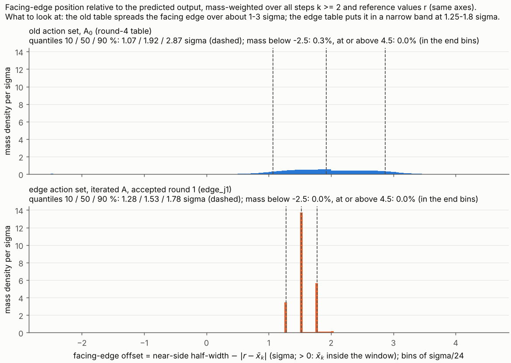

English copy of `report_round11_CN.md`. Where the two differ, the Chinese version is the report of record.

**Plan.** `reports_CN/plan_round11_edge_actions_EN.md` (frozen 2026-11-09; CN original `plan_round11_edge_actions_CN.md`). Execution prompt: `reports_CN/prompt_round11_claude_code_EN.md`; where the two conflict, the plan wins. Branch `round11-edge-actions`, created from `round10-upper-bound` at `2b1af1b` (the Round-10 report commit):
- plan (EN, CN) and prompt committed in `2fa34ea`, the first commit of the round (both plan files are under `reports_CN/`; no separate commit was needed);
- predictions `round11/predictions_round11.md` committed in `2ad6cd1`, before any computation, with the scoring rules;
- code and results in the commits after that.

**Scope.**
- Same scenario, budget B = 316.8921168493721, σ, input, grid step and transition as Round 4. Two design-side changes: the action set (edges relative to the predicted output x̄_k instead of half-widths relative to r) and the tangent point (A ← J(T)⁻¹, accepted on the true log det).
- All I values are the evaluator's log det J on the σ/24 design grid at the nominal truth θ₀. σ/120 re-evaluations are given alongside. The budget check (check 7) uses σ/120.
- U_cert = 209.07220154478713 is Round 10's certified upper bound on log det J over the window class W at B (`round10/results/round10.json["budgets"]["B316"]["u_cert"]`). g′ = U_cert − I(T); D-eff lower bound = exp(−g′/9).
- The conclusions depend on these modelling choices: the nominal truth θ₀, iid Gaussian noise, the discrete σ/24 model, the finite action sets, and at most three iterations of A.

**Sources.** Paths are relative to `code_8_3_stage2/stage2_pkg/evaluator/`.
- `[L n]` is line n of `round11/logs/run_round11.log`; `[J a.b]` is field `a.b` of `round11/results/round11.json`.
- Code: `round11/eval11.py` (full-grid forward/backward evaluator, σ/120 entry, statistics, Monte Carlo), `round11/dp11.py` (full-grid DP, price scan), `round11/run_round11.py` (driver, stages), `round11/post11.py` (per-table numbers, checks, figure, UB_SoD). Rounds 4–10 are imported read-only; `git status` on round4–round10 is clean after every stage.
- Scan records: `round11/results/scan_<cell>_j<round>.json`; states: `round11/results/state_*.json`.

## 1. One-sentence conclusion

The edge action set with one accepted iteration of A (cell edge/iterated) gives **δI = I_best − I_old = +2.324 nat** over the Round-4 nominal table (I = 207.355 vs 205.031; ΔI over constant SoD 10.154 vs 7.830), at **g′ = 1.717 nat** from Round 10's U_cert, i.e. **D-efficiency ≥ 82.6 %**; the table passes the σ/120 budget re-evaluation (E[N] = 316.516 ≤ B) and checks 1–7.
Sources: [L 202, 230]; [J verdict.\*, cells.edge/iterated.\*].

## 2. Four-cell table

All I in nat on σ/24. "Body share" = share of the transmissions E[N] − 1 in the |r − x̄_k| ≥ 40σ bin (DECISION 11-8). Sources: [L 199–202]; [J cells.\*, tables.\*].

| cell | table | ΔI = I − I_SoD | I | g′ = U_cert − I | D-eff ≥ | body share | E[N] σ/24 | E[N] σ/120 |
|---|---|---:|---:|---:|---:|---:|---:|---:|
| old / A₀ | old_j0 (= round-4 table) | 7.830 | 205.0314 | 4.041 | 63.8 % | 18.3 % | 316.604 | 316.531 |
| old / iterated | old_j1 (round 1 accepted) | 7.946 | 205.1468 | 3.925 | 64.7 % | 14.3 % | 316.771 | 316.699 |
| edge / A₀ | edge_j0 | 9.901 | 207.1020 | 1.970 | 80.3 % | 13.3 % | 316.610 | 316.413 |
| **edge / iterated** | **edge_j1 (round 1 accepted)** | **10.154** | **207.3552** | **1.717** | **82.6 %** | 16.0 % | 316.726 | 316.516 |

I_SoD = 197.20097668224076, I_old = 205.03141309913676, U_cert = 209.07220154478713 (each reproduced, §5).

Iteration of A (DECISION 11-2: accept iff I(T_j) > I(T_{j−1}) + 0.05 nat, at most 3 rounds). Sources: [L 91, 107, 126, 141]; [J iteration_log.\*].

| action set | round | tangent point | λ/γ̄ | E[N] σ/24 | I(T_j) | gain over T_{j−1} | accepted |
|---|---:|---|---:|---:|---:|---:|---|
| old | 0 | A₀ = J_SoD⁻¹ | 3.400 | 316.604 | 205.03141 | — | (round 0) |
| old | 1 | J(T₀)⁻¹ | 3.225 | 316.771 | 205.14678 | +0.1154 | yes |
| old | 2 | J(T₁)⁻¹ | 3.269 | 316.593 | 205.15462 | +0.0078 | no (stop) |
| edge | 0 | A₀ = J_SoD⁻¹ | 2.790 | 316.610 | 207.10198 | — | (round 0) |
| edge | 1 | J(T₀)⁻¹ | 2.785 | 316.726 | 207.35522 | +0.2532 | yes |
| edge | 2 | J(T₁)⁻¹ | 2.7825 | 316.563 | 207.38341 | +0.0282 | no (stop) |

Round 3 was never run in either action set.

Tangent overestimate E_j(T) = F_j(T) + γ_{1,j} − 9 − [I(T) − I(T_ref,j)] (DECISION 11-12). Sources: [J tables.\*.tangent_overestimate, tables.\*.E0].

| table | reference T_ref,j | E_j | E₀ (relative to A₀, for comparison) |
|---|---|---:|---:|
| old_j0 | constant SoD | 6.032 | 6.032 |
| old_j1 | old_j0 | 0.058 | 5.480 |
| old_j2 (rejected) | old_j1 | 0.009 | 5.712 |
| edge_j0 | constant SoD | 11.411 | 11.411 |
| edge_j1 | edge_j0 | 0.202 | 9.912 |
| edge_j2 (rejected) | edge_j1 | 0.025 | 10.582 |

Window shape (facing edge = near-side half-width − |r − x̄_k|, mass-weighted, σ units) and the last offset bin. Sources: [L 156–197]; [J tables.\*.shape].

| table | facing edge 10 / 50 / 90 % | mass in ≥ 40σ bin | sends in ≥ 40σ bin | info per send there (unweighted c) | facing edge in that bin (mean) |
|---|---|---:|---:|---:|---:|
| old_j0 | 1.07 / 1.92 / 2.87 | 1.35 % | 57.7 (18.3 %) | 1.13 | −1.56 |
| old_j1 | 1.06 / 1.90 / 2.82 | 1.06 % | 45.1 (14.3 %) | 1.13 | −1.54 |
| edge_j0 | 1.27 / 1.53 / 2.00 | 23.0 % | 42.0 (13.3 %) | 4.94 | +1.84 |
| edge_j1 | 1.28 / 1.53 / 1.78 | 15.0 % | 50.4 (16.0 %) | 4.11 | +1.52 |

Descriptive reading, no attribution: under the old set the ≥ 40σ bin holds a small mass whose window cannot reach the output (facing edge −1.56σ, i.e. x̄_k outside the window) and whose sends carry about 1.1 units of c each, against about 3–4.6 in the other bins. Under the edge set, reference values far from x̄_k persist (the mass support spans on average 1116σ of the 1144σ output range, against 86σ under the old set [J tables.\*.mean_support_width_sigma]); the window then reaches from r to about 1.5σ beyond x̄_k, and sends from that bin carry as much c per send as the other bins (4.1–4.9). The bin share therefore no longer measures "body transmissions" in the Round-4 sense; it is reported as defined.

### 2b. Addendum: certified bound within the discrete edge SoD class (no new run)

From the edge round-2 scan (tangent A₁ = J(T₁)⁻¹, T₁ = edge_j1, γ₁ = 0.009447863192807387), every evaluated λ gives UB(λ) = I(T₁) − p + γ₁ + V_λ + λ(B − 1) with V_λ = Σ_i ĝ_{1,i} V₂(i) the DP value of that scan; UB_SoD = min over the 12 λ (DECISION 11-16). Sources: [L 211–229]; [J ub_sod.\*].

| bound | class | value | gap to I(T₁) = 207.355217 | e^{−gap/9} |
|---|---|---:|---:|---:|
| UB_SoD (min at run 12, λ = 0.0183397) | discrete SoD class with the edge action set | 207.414762 | 0.0595 | ≥ 99.34 % |
| U_cert (Round 10) | window class W | 209.072202 | 1.7170 | ≥ 82.63 % |

- Class restriction of UB_SoD: tables that assign to every (step k ≥ 2, σ/24 node r_i) one of the 100 edge actions (E², edges on grid nodes, at least 2σ from r_i), evaluated by the σ/24 discrete model at θ₀ with σ/24 E[N] ≤ B. Basis: Lemma 3 at J(T₁), eq. (12), Lemma 1; V_λ in floating point (the DP-vs-forward rounding is about 1e-12, DECISION 11-15). It says nothing about policies outside this class.
- UB_SoD ≥ I(T₁) holds; the three edge tables with σ/24 E[N] ≤ B (I = 207.102, 207.355, 207.383) all lie below it [J ub_sod.edge_tables_below].
- For context [J ub_sod.supplementary_all_scans]: the same construction from the other scans gives 207.560 (edge round 1), 218.530 (edge/A₀); for the old action set 205.171 (old round 2, tangent J(old_j1)⁻¹), i.e. every table in the old-action discrete class with E[N] ≤ B has log det ≤ 205.171, below the edge tables.

## 3. Verdict (plan §7)

δI = I_best − I_old = 207.35522 − 205.03141 = **2.324 nat ≥ 0.5**, best cell edge/iterated, **g′ = 1.717 nat < 2** [L 230; J verdict].

→ **Case 2 (δI ≥ 0.5 and g′ < 2 nat): Round 12** — redo the margin design (T4 equivalent) and the two-stage confirmation with the new action set; the paper's main result is to be replaced.

- The case does not change under σ/120: U_cert − I₁₂₀(edge_j1) = 209.07220 − 207.35308 = 1.719 nat; the budget holds at σ/120 (316.516).
- Distance to the case boundaries: g′ is 0.283 nat below 2; δI exceeds 0.5 by 1.82 nat. edge/A₀ alone would also be case 2 (δI = 2.071, g′ = 1.970, 0.030 below 2).

## 4. Predictions (hit / miss)

Scoring rules as committed in `round11/predictions_round11.md`. Sources: [L 231–240]; [J predictions].

| # | prediction | value | result |
|---|---|---|---|
| 1 | edge/A₀ ΔI ∈ [8.5, 10.0] | 9.901 | **hit** |
| 2 | edge/A₀ body share (≥ 40σ bin) < 5 % | 13.3 % | **miss** |
| 3 | edge/A₀ facing-edge 10–90 % range within [1.5, 2.3]σ | [1.266, 2.005] | **miss** (10 % quantile below 1.5) |
| 4 | iteration of A, old set: +0 to +0.5 nat | +0.115 | **hit** |
| 5 | iteration of A, edge set: +0 to +0.5 nat | +0.253 | **hit** |
| 6 | no acceptance after round 2 | round 3 never run | **hit** |
| 7 | old/iterated ΔI ∈ [7.8, 8.3] | 7.946 | **hit** |
| 8 | best cell g′ ∈ [2.0, 3.4] nat | 1.717 | **miss** (below) |
| 9 | best cell D-eff ∈ [69 %, 80 %] | 82.6 % | **miss** (above) |
| 10 | tangent overestimate E₀ under edge > 4 nat | 11.41 | **hit** |

6 hits, 4 misses. By the five lines of prompt §6: line 1 one of three parts hit; line 2 hit (all three parts); line 3 hit; line 4 missed (both parts); line 5 hit.

## 5. Checks 1–7

All pass [L 204–210; J checks, all_checks_pass].

**Input reproduction (prompt §1)** [L 9–16; J inputs.reproduction]: B, I_SoD, E[N]_old, I_old reproduced by the frozen evaluator with relative error 0. eval11 on the round-4 table, on the full grid, equals the frozen general path (88σ support) bit for bit in E[N], w_k, S, J and log det [L 13]. The DP's per-step arrays equal full scipy arrays bit for bit at five steps [L 15]. The σ/120 entry gives E[N] = 316.53115805249706 and log det 205.03107573358153 on the round-4 table, bit for bit Round 7's archived values (relative error 0 ≤ 1e-9; clarification 1) [L 16].

1. **Regression gate (blocking)** — PASS [L 38–50; J gate]. The edge-code path with the old action set, A₀, nominal scan reproduces all 11 runs of `round4/results/scan_U_W.json` bit for bit (λ, E[N], F, S, log det, feasibility, dual), the final run (5, λ = 0.07339683452541984), and the codes on the nodes stored in `round4/results/table_U_W.npz` (0 differing nodes in 4999 rows); E[N] difference 0, I relative difference 0. Clarification 3: the code comparison covers only the stored nodes; zero mass on every new support node (outside the round-4 windows) is asserted at every step of the gate's final table and of the archived table (smallest distance of the mass support to the window ends 860 nodes) [L 74; `round11/results/state_gate_support.json`], and from then on in every forward of an old-action-set table (old iteration scans and post). The 10 non-final gate tables were not kept; their numbers equal the round-4 records.
2. **Forward = backward** — PASS [J checks.2_forward_backward]. Forward vs fixed-policy backward recursion for every reported table: worst relative errors F 5.2e-13, N 5.2e-13, F − λN 5.1e-13 (≤ 1e-12). Diagnostic (DECISION 11-15): DP value vs forward total, worst 1.1e-11 absolute; 1.2e-11 relative to |F − λN| on the round-4 table, where F − λN = −0.33 is a difference of two terms of size ≈ 23; 8e-14 relative to F + λN; identical bit for bit to round 4's archived `dp_minus_policy`.
3. **Conservation, non-negativity, support** — PASS [J checks.3_conservation]. Asserted at every step of every forward (69 DP-run forwards, 6 σ/120 forwards, check and MC tables): max |Σm − 1| = 7.3e-13 on σ/24 (≤ 1e-12), 1.9e-12 on σ/120 (≤ 1e-10, DECISION 11-5), min m = 0, zero mass at the first and last grid node; no assertion fired.
4. **Monte Carlo on the best table (edge_j1)** — PASS under DECISION 11-7 [L 203; J checks.4_monte_carlo]. 10⁴ trajectories (20 × 500, seed 20261109): E[N] 316.442 ± 0.170, S 1343.896 ± 0.023, log det 207.35311 ± 0.00016. z against σ/120: E[N] +0.44, S −0.24, log det −0.13. z against σ/24: E[N] +1.67, **S +14.0, log det +12.9** (σ/24 is 0.32 above in S and 0.0021 nat above in log det; the σ/24 quadrature of this table differs from the continuous-r process by more than the MC error, the σ/120 one does not). The 0.002 nat is small against δI = 2.32 and against the 0.28 nat distance of g′ to 2.
5. **Edges** — PASS [J checks.5_edges]. L, U ≥ 48 at every (k, i) of the full grid for all six tables; edges are integer node indices; the x̄-based candidate edges lie at or beyond x̄_k ∓ eσ within one grid step for every k and finite e (0 violations).
6. **I ≤ U_cert** (clarification 2: only for tables with σ/120 E[N] ≤ B) — PASS [J checks.6_ucert]. All six reported tables qualify; the largest I is 207.383 (edge_j2) < 209.072. For information: none of the 39 σ/24-feasible scan candidates exceeds U_cert, and no over-budget candidate does either; scan candidates never stop the run.
7. **σ/120 E[N] ≤ B** — PASS [J checks.7_budget120]: slack 0.36 (old_j0), 0.19 (old_j1), 0.37 (old_j2), 0.48 (edge_j0), 0.38 (edge_j1), 0.54 (edge_j2). For old-set tables the σ/120 entry equals the live round7/evaluator_refine.evaluate bit for bit [J tables.old_\*.round7_f5].

Shape statistics: the round-4 table's facing-edge quantiles equal `round4/results/shape_U_W.json` exactly (max difference 0.0) [L 198; J shape_vs_round4].

## 6. Figure

`round11/results/fig_edge_positions.png` [L 249]: mass-weighted distribution of the facing-edge offset (near-side half-width − |r − x̄_k|, σ/24 bins) for the round-4 table (top) and the best edge table edge_j1 (bottom), same axes. Under the old set the facing edge spreads over about 0.5–3.5σ beyond the output (10/50/90 %: 1.07 / 1.92 / 2.87σ), with a small mass (0.3 %) below −2.5σ where the 40σ cap leaves the output outside the window. Under the edge set it sits at three near-discrete levels, 1.28, 1.53 and 1.78σ (the actions e = 1.25, 1.5, 1.75 plus the outward rounding of up to one grid step), and the 10–90 % range shrinks from 1.80σ to 0.50σ.

## 7. DECISION list

Fixed by the plan (not re-decided):

- **DECISION 11-1 (plan §2).** Edge action set: (e⁻, e⁺) ∈ E², E = {1, 1.25, 1.5, 1.75, 2, 2.25, 2.5, 3, 4, ∞} σ, 100 actions. Lower edge = min(x̄_k − e⁻σ, r_i − 2σ), upper edge = max(x̄_k + e⁺σ, r_i + 2σ); e = ∞ keeps only r_i ∓ 2σ; both edges rounded outward to grid nodes; L, U ≥ 48 grid units. The 1σ / no-minimum alternatives were not run.
- **DECISION 11-2 (plan §3).** Iteration of A: A₀ = J_SoD⁻¹; A_j = J(T_{j−1})⁻¹ with γ_k, γ̄ recomputed; T_j accepted only if I(T_j) > I(T_{j−1}) + 0.05 nat; at most 3 rounds; the cell keeps its last accepted table.
- **DECISION 11-3 (plan §2.1, fixed by review).** Reference-state support = the whole design grid (G = 35146 nodes at σ/24, 175724 at σ/120) at every step, for the DP and the forward evaluation; no pruning by any policy's mass; window edges anywhere in the padded index range [−960, G − 1 + 960] (no 40σ cap).

Taken in this round:

- **DECISION 11-4 (edge index arithmetic).** With u_k = (x̄_k − z₀)/h, fl_k = ⌊u_k⌋, cl_k = ⌈u_k⌉ and n = 24e (an integer for every finite e in E): lower-edge node min(fl_k − n⁻, i − 48), upper-edge node max(cl_k + n⁺, i + 48), i.e. L = max(i − fl_k + n⁻, 48), U = max(cl_k + n⁺ − i, 48); e = ∞ gives 48. The old set is the same formula with zero slope, (L, U) = (48(i⁻+1), 48(i⁺+1)). Code = i⁻·N_hi + i⁺ (e⁻ outer, e⁺ inner, order of E); ties, including actions that coincide at a node, go to the first code (strict >).
- **DECISION 11-5 (conservation tolerance).** |Σm − 1| ≤ 1e-12 on σ/24 (prompt §2.1); ≤ 1e-10 on σ/120 (the frozen round-4 / round-7 level). The plan says "assertions as before"; the prompt's 1e-12 cannot hold at σ/120 because the round-4 table itself reaches 1.88e-12 there (round 7's archive, reproduced). Non-negativity and zero mass at the first and last grid node at every step on both grids.
- **DECISION 11-6 (per-step DP arrays).** u, ndtr(u), ndtr(−u), φ(u) are the scipy/numpy values on the frozen round-4 cache range [a_k − 960, b_k + 960] (|u| ≤ 128) and their exact limits (0, 1, 0) outside it. Verified: scipy returns exactly those limits at the first node outside the range at every step, and the assembled arrays equal full scipy arrays bit for bit at five steps. The kernel of step k is the frozen dr._kernel normalised on its 88σ window, asserted to end in exact zeros (the measurement-kernel support, handled separately from the state support).
- **DECISION 11-7 (Monte Carlo).** 10⁴ trajectories in 20 batches of 500, seeds 20261109 + batch, 4 workers, the runtime lookup of round4/part_c (nearest node, ties → smaller index, window centred at the continuous r, half-widths of that node). Pass criterion: |z| ≤ 3 for E[N], S and log det against the σ/120 values of the same table (the finer quadrature of the continuous policy the simulation runs); z-scores against σ/24 reported alongside. Fixed before the official MC, after a development MC (400 trajectories) on a λ₀ edge table gave z_S = 2.6 against its σ/24 value.
- **DECISION 11-8 (binned statistics).** Per (k ≥ 2, i): transmissions m_{k,i} q̂_{k,i} (the evaluator's per-node send probability, Σ_i m q̂ = E[q_k]); information m_{k,i} c_{k,i} (unweighted; γ₀-weighted also stored). Bins of |r_i − x̄_k|/σ: [0,2), [2,5), [5,10), [10,20), [20,40), [40,∞). Body share = transmissions in [40,∞) / (E[N] − 1). Facing edge = near-side half-width − |r − x̄_k| (round4/part_c.shape), mass-weighted quantiles with float64 masses (round 4 used float32; the quantiles agree exactly). `cap_cost_by_offset.py`, named in the plan, is not in the repository; this definition was used instead and gives the plan's 18 % on the round-4 table (18.3 %).
- **DECISION 11-9 (σ/120 for edge tables).** The frozen round-7 convention (coarse cell i = ⌊(r − z₀)/h + ½⌋, physical half-widths 5L, 5U fine steps, window centred at the fine node's own r, kernel on the 88σ window of the fine grid) on the full fine grid (G = 175724), in `eval11.evaluate_refined`. Equivalence: bit for bit round 7's archived f = 5 value of the round-4 table, and the live round7/evaluator_refine.evaluate on all three old-set tables of this round.
- **DECISION 11-10 (gate scope).** Besides the final table (codes bit for bit on the stored nodes, E[N] to 1e-12, I to 1e-9), every run of the gate scan is compared with round4/results/scan_U_W.json (λ, E[N], F, S, log det, feasibility, dual).
- **DECISION 11-11 (best cell).** Largest I(T) on σ/24 among the four cells whose table passes the σ/120 budget re-evaluation and checks 2, 5, 6; ties to the earlier cell in the order old/A₀, old/iterated, edge/A₀, edge/iterated.
- **DECISION 11-12 (tangent overestimate).** E_j(T) = F_j(T) + γ_{1,j} − 9 − [I(T) − I(T_ref,j)], F_j from the σ/24 forward of T, γ_j from the round's tangent point; T_ref,0 = constant SoD, T_ref,j = T_{j−1}. E₀ (relative to A₀) also reported for every table.
- **DECISION 11-13 (storage).** Tables on the full σ/24 grid, uint16 codes (K − 1) × G, compressed npz with the action arrays, fl, cl, z₀, h and a note (each < 1 MB). Tables of all DP runs live in a work directory outside the repository; only the packed final tables are committed.
- **DECISION 11-14 (job split).** The run is split into invocations `inputs`, `gate edge`, `gatesupport`, `old`, `post`, `figure` because of the 2 h job limit; one aborted `gate` start (stopped after one minute, no DP finished) is marked in the log [L 22].
- **DECISION 11-15 (check 2 rule).** Check 2 compares the forward evaluation of every reported table with the fixed-policy backward recursion of the same table (F, N and F − λN, relative ≤ 1e-12), as round 4's B4 check did (there at 1e-10). The DP's own value V_λ against F − λN of its argmax table is a diagnostic only: the DP forms c from the per-node arrays u_{i−L}, the forward from cfun at (r − Lh − x̄)/σ, a different rounding path; round 4's archive has the same values bit for bit. A first post run that also required the DP comparison at 1e-12 was stopped after one table and restarted [L 153].
- **DECISION 11-16 (UB_SoD, addendum, no new run).** From the edge round-2 scan (tangent A₁ = J(T₁)⁻¹): UB_SoD = min over its λ of I(T₁) − 9 + γ₁ + V_λ + λ(B − 1), a certified bound within the discrete edge SoD class (Lemma 3 at J(T₁), eq. (12), Lemma 1); reported side by side with U_cert; the same construction from every other scan is in the json for context.
- **DECISION 11-17 (figure).** The figure was redrawn once (`run_round11.py figure`) to fix overlapping quantile labels; the edge statistics are recomputed from the same tables and asserted equal to round11.json [L 249].

Clarifications received during the run (after the gate and edge/A₀), applied without restarting the gate: (1) σ/120 via the full-grid round11 entry, validated on the round-4 table — already so, confirmed; (2) check 6 only for tables with σ/120 E[N] ≤ B — implemented; (3) gate code comparison on stored nodes only, plus the zero-mass assertion on the new support nodes — confirmed / implemented (check 1).

**Branches.**
- Round-11 work started from round10-upper-bound (2b1af1b). Commits 2fa34ea..b6749fb were pushed both to round11-edge-actions and to the session branch claude/optimistic-newton-xv5jvl, which this session had fast-forwarded from 3314e7d to 2b1af1b to start the round.
- 2026-11-07 about 14:10 UTC, on request: round10-upper-bound was checked before any reset; its remote head was 2b1af1b (the Round-10 report commit) and no Round-11 commit had been pushed to it, so no reset was performed (a force-push would have been a no-op).
- 2026-11-07 14:12 UTC, on request: claude/optimistic-newton-xv5jvl (the frozen baseline, referenced by the handoff and every report) was reset to 3314e7d with `git push --force-with-lease=claude/optimistic-newton-xv5jvl:b6749fb origin 3314e7d:claude/optimistic-newton-xv5jvl` (forced update b6749fb...3314e7d). Nothing was lost: the 11 commits above 3314e7d are all on round11-edge-actions (Round 10's also on round10-upper-bound).
- From then on Round 11 is pushed only to round11-edge-actions; Round 10 stays on round10-upper-bound at 2b1af1b. Merging into the baseline is left for later.

## 8. Not done in this round (plan §9)

- The margin tables and the two-stage confirmation experiment were not redone (Round 12, per the verdict).
- The Dozzi scenario (Round 9) was not run.
- The change of g′ is not interpreted as "structure vs design"; no attribution of the remaining gap to U_cert is made.
- The alternatives of DECISION 11-1 (1σ minimum distance from r, or none) were not run.
- The edge tables were evaluated only at the nominal truth θ₀ (no mismatch sweep, no margin).
- Attainability of U_cert by simulation (Round 10 §8) was not checked.

**Outputs.** `round11/results/round11.json` (four cells, per-table numbers, iteration log, checks, UB_SoD, predictions, verdict); `round11/results/table_edge_A0.npz`, `table_edge_iter.npz`, `table_old_iter.npz` (full-grid codes and action arrays, round-trip checked) [L 241–243]; `round11/results/fig_edge_positions.png`; scan records and stage states in `round11/results/`; log `round11/logs/run_round11.log`. Runtime [L 17–250]: gate 36 min (11 DPs, ≈ 190 s each), edge cell 40 min (36 DPs, ≈ 44 s each, plus ≈ 20 s per σ/24 forward), old iteration 75 min (22 DPs, ≈ 175–220 s each), post 12 min.
