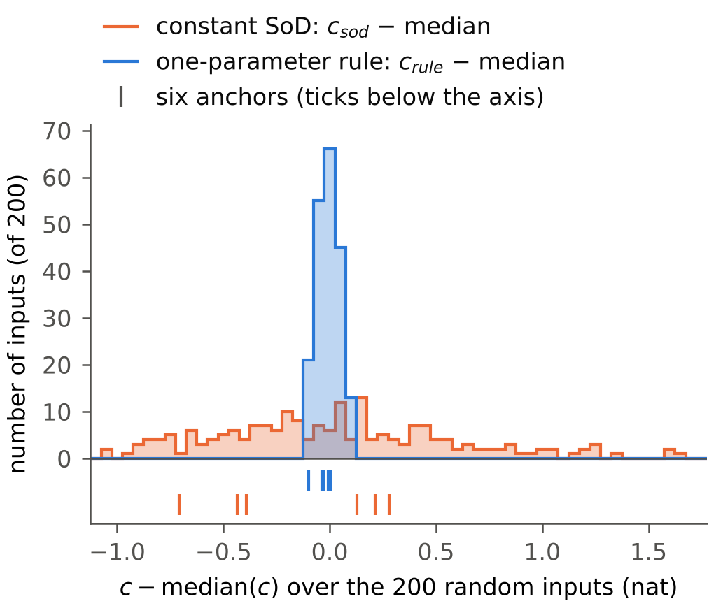

**结论。**
- 在 200 个随机输入上，单参数规则相对全采样的信息损失 c_rule 的标准差为 **0.053 nat**，5–95 % 区间宽度为 **0.172 nat**。
- 同预算常数 SoD 的对应值为 **0.561 nat** 与 **1.889 nat**。c_rule 的 5–95 % 区间宽度是 c_sod 的 0.091 倍。
- 规则参数 e_fit 落在 1.561–1.588 σ（5–95 %）。相对常数 SoD 的增益为 8.34–10.82 nat，200 个输入中 197 个 ≥ 8.5 nat。
- c_rule 并非常数。它与输出的总变差排序一致（Spearman −0.97），但其 5–95 % 区间宽度约为 c_sod 的十一分之一。
- 预测：6 中 2 失（Q2：区间宽度 1.889 > 1.8；Q6：U 位于 c_sod 的第 21.5 百分位，不在最低 10 % 内）。

**Prompt。** `reports_CN/prompt_round16_random_inputs_EN.md`。分支 `round16-random-inputs`，自 `round14-one-parameter-rule` 的头 **`6b79535`**（第 14 轮报告）开出。提交：
- `21497a9`：prompt（第一个提交）；
- `960ec97`：`round16/predictions_round16.md`，在任何计算之前（第二个提交）；
- `aff7b26`：代码（`random16.py`、`run_round16.py`）；
- `9824f30`：anchors 阶段（检查 1 通过）与序列脚本；
- `e8d2194`：汇总代码，在运行汇总之前；
- `290dae1`：random 阶段的中途检查点（DECISION 16-11）；
- `988ec47`、`945b989`、`7f38af7`：random、derived、floor 阶段；
- `6d3b7c0`、`2f2193d`：汇总，以及加入描述性背景行后重跑的汇总（没有任何数值改变）；
- 本报告：其后的提交。

**口径。**
- 系统、频率 `dr.w`、a₀ = 1、噪声 s、K = 5000 与 B = 316.8921168493721 同第 4–14 轮。
- 只用 Monte Carlo：不跑 DP，不用网格评价器。每次运行 R = 2000 条轨迹，所有运行、所有输入都用噪声种子 20261113（公共随机数）。
- I 为 θ₀ 处的 log det J。c = I − I_full 是相对全采样的信息损失；它为负，“更低”表示损失更多。
- 不对原因作任何断言。§4 只是描述。

**来源。** 路径相对 `code_8_3_stage2/stage2_pkg/evaluator/`。
- `[L X:n]`：`round16/logs/X.log` 第 n 行；`[J a.b]`：`round16/results/round16.json` 的字段 `a.b`。
- 代码：`round16/random16.py`（输入、Monte Carlo、拟合）、`round16/run_round16.py`（阶段 anchors、random、derived、floor、summary）、`round16/summary16.py`、`round16/run_round16_sequence.sh`。
- prompt 与代码的不一致之处：§12。

## 1. Q1–Q7 的回答

- **Q1 — c_rule 分布窄。** 标准差 **0.053 nat**；5–95 % 区间宽度 **0.172 nat**（−11.590 … −11.418）；最坏情形距中位数 **0.125 nat**（r049，−11.620）；最小–最大极差 0.247 nat [L summary:4, 54]。
- **Q2 — c_sod 分布宽。** 标准差 **0.561 nat**；5–95 % 区间宽度 **1.889 nat**（−22.192 … −20.303）；最坏情形距中位数 **1.641 nat**（r108，−19.727）；最小–最大极差 2.677 nat [L summary:5, 55]。
- **Q3 — 是。** 5–95 % 区间宽度之比 c_rule / c_sod 为 **0.091** ≤ 1/3 [L summary:56]。
- **Q4 — 是。** e_fit：P5 1.5611，中位数 **1.5761**，P95 1.5876 σ，即中位数 +0.0115 / −0.0150 σ（≤ 0.03）。最小 1.5570，最大 1.5912 [L summary:57]。
- **Q5 — 是。** 增益 ≥ 8.5 nat 的输入为 **197/200**（98.5 %）。最小 **8.336**（r108），中位数 9.875，最大 **10.816**（r051）。低于 8.5 的三个输入（r108、r113、r099）恰是随机集合中总变差最小的三个 [L summary:58–62]。
- **Q6 — 落在分布之内，但没有覆盖整个分布。**
  - 锚点的 c_rule 位于第 4.5–52 百分位（N 4.5、SCH 31、P5514 34、LO 34、U 44.5、HI 52），没有一个在上半部。
  - 锚点的 c_sod 位于第 9.5–70.5 百分位（LO 9.5、U 21.5、N 23、HI 59.5、SCH 67.5、P5514 70.5）。
  - 锚点的总变差位于随机集合的第 39.5–92 百分位。c_rule 与 c_sod 最高的输入都是小总变差输入，这一区域没有锚点 [L summary:46–52]。
- **Q7 — 在这几组集合中，主要随功率变化。** c_sod 的 5–95 % 区间宽度：
  - 仅相位集合（均匀功率，50 个相位向量）：**0.606 nat**（标准差 0.191）；
  - 仅功率集合（零相位，50 个功率向量）：**1.496 nat**（标准差 0.512）；
  - 完整随机集合：1.889 nat。

  c_rule 的对应值为 0.050、0.100 与 0.172 nat [L summary:63–66]。两个派生集合的参照点不同（均匀功率、零相位），所以它们不是随机集合分布宽度的分解。

## 2. 200 个随机输入上的分布

共抽 277 次，**拒绝 77 次**（min p < 0.02），接受 200 个 [L random:2]。c、增益单位 nat；e_fit、Δ_fit 单位 σ；每次传输的信息为 (S − 1)/(B − 1) [L summary:4–12]。

| 量 | 均值 | 标准差 | 最小 | P5 | 中位数 | P95 | 最大 | P95 − P5 |
|---|---:|---:|---:|---:|---:|---:|---:|---:|
| c_rule | −11.5014 | 0.0527 | −11.6201 | −11.5897 | −11.4954 | −11.4180 | −11.3731 | **0.1717** |
| c_sod | −21.3403 | 0.5611 | −22.4041 | −22.1917 | −21.3680 | −20.3025 | −19.7270 | **1.8892** |
| 增益 = I_rule − I_SoD | 9.8390 | 0.5165 | 8.3358 | 8.8736 | 9.8749 | 10.6114 | 10.8164 | 1.7378 |
| e_fit | 1.5754 | 0.0074 | 1.5570 | 1.5611 | 1.5761 | 1.5876 | 1.5912 | 0.0265 |
| Δ_fit / σ | 19.495 | 5.004 | 9.696 | 11.871 | 18.610 | 29.444 | 33.551 | 17.573 |
| 每次传输的信息，规则 | 4.4079 | 0.0256 | 4.3477 | 4.3612 | 4.4105 | 4.4496 | 4.4679 | 0.0883 |
| 每次传输的信息，SoD | 1.5365 | 0.0951 | 1.3528 | 1.3947 | 1.5287 | 1.7279 | 1.8245 | 0.3332 |
| c_rule − c_rule(U) | +0.0021 | 0.0527 | −0.1166 | −0.0862 | +0.0081 | +0.0855 | +0.1303 | 0.1717 |
| c_sod − c_sod(U) | +0.4637 | 0.5611 | −0.6000 | −0.3876 | +0.4360 | +1.5016 | +2.0771 | 1.8892 |

c_rule(U) = −11.5035，c_sod(U) = −21.8040（本轮，同一种子）[L anchors:3]。随机输入的输出幅度范围为 477–1737 σ，总变差 3470–11322 σ，最大单步变化 1.93–4.41 σ [J feature_ranges, max_step_sigma]。



**图（`round16/results/fig_round16.png`）。** 200 个随机输入相对全采样的信息损失，各自减去自身的中位数：单参数规则（蓝，c_rule − 中位数）与同预算常数 SoD（橙，c_sod − 中位数）。箱宽 0.05 nat。坐标轴下方的刻度为六个锚点（上一行：规则；下一行：SoD），减去同样的中位数。**请看两个直方图的宽度：** 蓝色跨 5 个箱（−0.125 … +0.125 nat），橙色跨 55 个箱（−1.04 … +1.64 nat）。

## 3. 极端输入

c_rule 与 c_sod 最低、最高的随机输入。括号内为另一个 c [L summary:13–32；J extremes]。

| | 输入 | c_rule | （c_sod） | p | χ | 幅度（σ） | TV（σ） |
|---|---|---:|---:|---|---|---:|---:|
| c_rule 最低 | r049 | −11.6201 | (−22.4041) | (0.833, 0.051, 0.045, 0.070) | (5.688, 6.033, 2.913, 0.731) | 1737.2 | 11321.8 |
| | r035 | −11.6158 | | (0.732, 0.058, 0.138, 0.072) | (4.355, 5.579, 3.636, 2.677) | 1716.1 | 10835.4 |
| | r131 | −11.6119 | | (0.547, 0.077, 0.102, 0.275) | (6.047, 5.040, 1.731, 1.879) | 1541.8 | 9850.2 |
| | r014 | −11.6117 | | (0.704, 0.175, 0.087, 0.034) | (2.891, 4.661, 0.081, 3.763) | 1687.9 | 10636.0 |
| | r058 | −11.6053 | | (0.632, 0.183, 0.024, 0.160) | (0.561, 0.358, 2.668, 4.833) | 1605.2 | 10000.9 |
| c_rule 最高 | r113 | −11.3731 | (−19.7907) | (0.024, 0.257, 0.413, 0.307) | (1.471, 3.946, 5.792, 2.489) | 494.6 | 3583.7 |
| | r108 | −11.3912 | (−19.7270) | (0.028, 0.030, 0.839, 0.103) | (0.239, 1.638, 4.697, 0.408) | 477.4 | 3470.1 |
| | r047 | −11.3977 | | (0.058, 0.044, 0.093, 0.805) | (5.099, 2.978, 2.908, 0.101) | 615.2 | 4062.6 |
| | r045 | −11.3985 | (−20.1144) | (0.027, 0.432, 0.374, 0.166) | (3.795, 5.309, 5.180, 1.844) | 524.9 | 3992.3 |
| | r027 | −11.4004 | | (0.049, 0.434, 0.332, 0.185) | (0.348, 3.225, 1.682, 3.986) | 641.1 | 4205.1 |

| | 输入 | c_sod | p | χ | 幅度（σ） | TV（σ） |
|---|---|---:|---|---|---:|---:|
| c_sod 最低 | r049 | −22.4041 | (0.833, 0.051, 0.045, 0.070) | (5.688, 6.033, 2.913, 0.731) | 1737.2 | 11321.8 |
| | r051 | −22.4024 | (0.698, 0.097, 0.044, 0.160) | (0.066, 2.115, 5.811, 4.941) | 1557.9 | 10046.1 |
| | r040 | −22.3163 | (0.749, 0.080, 0.045, 0.126) | (5.406, 0.840, 3.191, 4.661) | 1641.9 | 10460.4 |
| | r190 | −22.2746 | (0.677, 0.048, 0.078, 0.197) | (5.737, 3.235, 5.191, 5.184) | 1576.8 | 10008.2 |
| | r143 | −22.2504 | (0.570, 0.321, 0.070, 0.039) | (5.030, 1.255, 0.216, 3.323) | 1552.8 | 9168.0 |
| c_sod 最高 | r108 | −19.7270 | (0.028, 0.030, 0.839, 0.103) | (0.239, 1.638, 4.697, 0.408) | 477.4 | 3470.1 |
| | r099 | −19.7445 | (0.045, 0.214, 0.554, 0.187) | (0.004, 1.507, 1.328, 3.371) | 552.9 | 3742.0 |
| | r113 | −19.7907 | (0.024, 0.257, 0.413, 0.307) | (1.471, 3.946, 5.792, 2.489) | 494.6 | 3583.7 |
| | r015 | −20.0302 | (0.063, 0.087, 0.497, 0.353) | (0.331, 3.389, 1.381, 4.764) | 616.8 | 3989.7 |
| | r045 | −20.1144 | (0.027, 0.432, 0.374, 0.166) | (3.795, 5.309, 5.180, 1.844) | 524.9 | 3992.3 |

- c_rule 最低的输入（r049）同时也是 c_sod 最低的输入。
- c_rule 最高的五个输入中有三个（r113、r108、r045）也在 c_sod 最高的五个之中。
- c 最低的输入都有一个占主导的功率（p₁ = 0.55–0.83），TV 为 9168–11322 σ；c 最高的输入 TV 为 3470–4205 σ。

## 4. 分布宽度与什么同变（仅描述）

200 个随机输入上的 Spearman ρ [L summary:33–35]：

| | 总变差 | 输出幅度 | max p | min p | I_full |
|---|---:|---:|---:|---:|---:|
| c_rule | **−0.972** | −0.945 | +0.136 | −0.083 | −0.100 |
| c_sod | **−0.944** | −0.940 | +0.118 | −0.077 | −0.087 |

prompt 列表之外（描述性）：
- ρ(c_rule, c_sod) = +0.852；
- ρ(e_fit, TV) = −0.983；
- ρ(增益, TV) = +0.926；
- ρ(Δ_fit, 输出幅度) = +0.981。

两个 c 都与总变差和输出幅度排序紧密一致，而与 max p、min p、I_full 几乎无关。

## 5. 仅相位与仅功率集合（§4d）

(i) 仅相位：r000–r049 的 χ，p = (¼, ¼, ¼, ¼)；(ii) 仅功率：r000–r049 的 p，χ = 0。作为参照，同时给出 r000–r049 本身。单位 nat [L summary:36–45]。

| 集合 | 量 | 均值 | 标准差 | 最小 | P5 | 中位数 | P95 | 最大 | P95 − P5 |
|---|---|---:|---:|---:|---:|---:|---:|---:|---:|
| 仅相位 | c_rule | −11.5031 | 0.0155 | −11.5285 | −11.5250 | −11.5033 | −11.4748 | −11.4676 | **0.0503** |
| 仅相位 | c_sod | −21.4508 | 0.1909 | −21.9093 | −21.7659 | −21.4359 | −21.1603 | −21.0712 | **0.6057** |
| 仅功率 | c_rule | −11.5094 | 0.0290 | −11.6013 | −11.5853 | −11.5012 | −11.4852 | −11.4778 | **0.1001** |
| 仅功率 | c_sod | −21.6097 | 0.5118 | −22.5876 | −22.4648 | −21.5645 | −20.9692 | −20.8640 | **1.4956** |
| r000–r049 | c_rule | −11.4979 | 0.0568 | −11.6201 | −11.6048 | −11.4882 | −11.4015 | −11.3977 | 0.2032 |
| r000–r049 | c_sod | −21.2829 | 0.5568 | −22.4041 | −22.2365 | −21.3812 | −20.3942 | −20.0302 | 1.8423 |

| 集合 | TV（σ）最小 / P5 / P95 / 最大 | ρ(c_rule, TV) | ρ(c_sod, TV) |
|---|---|---:|---:|
| 仅相位 | 6005 / 6142 / 7244 / 7434 | −0.707 | −0.591 |
| 仅功率 | 5525 / 5735 / 10226 / 10956 | −0.865 | −0.960 |
| r000–r049 | 3990 / 4127 / 10557 / 11322 | −0.971 | −0.942 |
| 随机（200） | 3470 / 4204 / 9969 / 11322 | −0.972 | −0.944 |

仅相位集合中，c_sod 的 5–95 % 区间宽度是 c_rule 的 12.0 倍；仅功率集合中为 15.0 倍；随机集合中为 11.0 倍 [L summary:63–66]。

## 6. 锚点与噪声底

**检查 1 — 锚点对照存档**（本轮，种子 20261113；第 14 轮 `input_table.<name>.c_rule`，σ/120 格点规则，U 取自 Part 1b；第 13 轮 `partA_<name>.json → derived.c_sod`，匹配 SoD，σ/120）[L anchors:9–15]：

| 输入 | c_rule | 第 14 轮 | 差 | c_sod | 第 13 轮 | 差 | e_fit | e_eff（R14） | Δ_fit/σ | M\*/24（R13） |
|---|---:|---:|---:|---:|---:|---:|---:|---:|---:|---:|
| U | −11.5035 | −11.5107 | +0.0072 | −21.8040 | −21.8073 | +0.0033 | 1.5766 | 1.5771 | 20.000 | 20.000 |
| SCH | −11.5305 | −11.5354 | +0.0049 | −21.1547 | −21.1570 | +0.0023 | 1.5744 | 1.5750 | 19.872 | 19.875 |
| P5514 | −11.5253 | −11.5540 | +0.0287 | −21.0897 | −21.0854 | −0.0043 | 1.5727 | 1.5750 | 19.973 | 19.958 |
| LO | −11.5251 | −11.5443 | +0.0192 | −22.0757 | −22.0618 | −0.0139 | 1.5734 | 1.5750 | 23.408 | 23.375 |
| HI | −11.4924 | −11.4970 | +0.0046 | −21.2383 | −21.2427 | +0.0044 | 1.5787 | 1.5792 | 17.252 | 17.250 |
| N | −11.5960 | −11.6141 | +0.0181 | −21.7618 | −21.7548 | −0.0070 | 1.5632 | 1.5646 | 27.163 | 27.125 |

- 所有差值的绝对值 ≤ 0.06 nat（c_rule 最大 0.0287，c_sod 最大 0.0139）→ **通过**。
- I_full 与第 13 轮完全一致（差 0）。
- e_fit − e_eff = −0.0023 … −0.0005 σ。
- Δ_fit/σ − M\*/24 = −0.003 … +0.038。
- 六个锚点上 c_rule 的极差为 0.104 nat（第 14 轮：0.117），c_sod 为 0.986 nat（第 13 轮：0.976）。

c_rule 的差值全部为正。存档规则并不在 E[N] = B：第 14 轮拟合的格点规则比 B 少 0.29–1.03 次传输（E[N]₁₂₀ 315.87–316.61），而本轮插值到 E[N] = B。
- 每个输入的不足量乘以连续规则在 B 附近的斜率（每次传输 0.018–0.020 nat，由第 14 轮 1d 表中 e = 1.56、1.58、1.60 三点算出），得到 0.005–0.020 nat；观测差值为 0.005–0.029 nat。
- 三个最大的差值（P5514 +0.029、LO +0.019、N +0.018）对应三个最大的不足量（0.81、1.03、0.77）。
- 第 13 轮匹配 SoD 位于 E[N]₁₂₀ − B = −0.245 … +0.244（整数 M\*）。

仅为描述。

**检查 2 — 噪声底。** 输入 U，十个种子 20261114 … 20261123 [L floor:14]：
```
CHECK2 noise floor, input U, ten seeds 20261114..20261123 (no common random numbers between seeds): sd c_rule 0.0075, c_sod 0.0076, e_fit 0.0007, D_fit 0.0029, gain 0.0094
```
- 这是**单个输入的值在不使用公共随机数时**的 Monte Carlo 噪声：标准差 0.0075 nat（c_rule）、0.0076 nat（c_sod）、0.0007 σ（e_fit）、0.0029（Δ_fit/σ）。
- 十个种子的均值为 c_rule −11.5054、c_sod −21.8077，种子 20261113 下为 −11.5035 与 −21.8040 [J checks.check2]。
- 在随机集合上，c_rule 的标准差（0.0527）是该噪声的 7.0 倍，c_sod 的标准差（0.5611）是其 74 倍。
- 在公共随机数下两输入之*差*的噪声未测。运行内诊断（10 组、每组 200 条轨迹，DECISION 16-4）给出组标准误的中位数：0.0065 nat（c_rule）、0.0043 nat（c_sod）[L summary:79]。

**检查 3 — LO/HI 对** [L anchors:16]：
```
CHECK3 c_rule(LO) - c_rule(HI) -0.0327 vs R14 -0.0473 (diff +0.0146); c_sod(LO) - c_sod(HI) -0.8374 vs R13 -0.8190 (diff -0.0184)
```

**Q6 — 锚点在随机分布中的百分位** [L summary:46–52]：

| 锚点 | c_rule 百分位 | c_sod 百分位 | 增益百分位 | TV（σ）/ 百分位 | 幅度（σ）/ 百分位 |
|---|---:|---:|---:|---|---|
| U | 44.5 | 21.5 | 83.0 | 7038 / 60.0 | 1144 / 56.5 |
| SCH | 31.0 | 67.5 | 30.0 | 6793 / 54.5 | 1121 / 53.5 |
| P5514 | 34.0 | 70.5 | 27.0 | 6837 / 56.0 | 1136 / 55.0 |
| LO | 34.0 | 9.5 | 92.0 | 8066 / 79.5 | 1347 / 81.5 |
| HI | 52.0 | 59.5 | 37.5 | 6102 / 39.5 | 869 / 28.0 |
| N | 4.5 | 23.0 | 73.5 | 9206 / 92.0 | 1483 / 91.5 |

## 7. 预测（`round16/predictions_round16.md`，`960ec97`）

**6 中 2 失** [L summary:67–75]。

| 行 | 数值 | 结果 |
|---|---|---|
| 检查 1：六个锚点两个量都在 0.06 nat 内 | 最大绝对差 0.029（c_rule）、0.014（c_sod） | 中 |
| Q1：P95 − P5 ≤ 0.30；标准差 ≤ 0.10；最坏情形距中位数 ≤ 0.45 | 0.172 ✓；0.053 ✓；0.125 ✓ | 中 |
| Q2：c_sod 的 P95 − P5 ∈ [0.6, 1.8] | **1.889** | **失** |
| Q3：是 | 比值 0.091 | 中 |
| Q4：是；e_fit 中位数 ∈ [1.565, 1.590] | +0.0115 / −0.0150 ✓；1.5761 ✓ | 中 |
| Q5：是；增益中位数 ∈ [9.2, 10.0] | 197/200 ≥ 8.5 ✓；9.875 ✓ | 中 |
| Q6：U 在 c_sod 最低 10 % 内；锚点 c_rule 在 [P2, P98] | **U 位于 21.5**；4.5–52 ✓ | **失** |
| Q7：仅相位集合中 c_sod 区间宽度 ≥ 4 × c_rule 区间宽度 | 12.05 | 中 |

## 8. 检查（prompt §3）

1. **锚点：** 见 §6，通过。
   ```
   [L anchors:15] CHECK1 max |diff| c_rule 0.0287, c_sod 0.0139 (tolerance 0.06) -> PASS
   ```
2. **噪声底：** 见 §6（标准差 0.0075 / 0.0076 nat）。
3. **LO/HI 对：** 见 §6。c_rule 差 −0.0327，第 14 轮为 −0.0473；c_sod 差 −0.8374，第 13 轮为 −0.8190。
4. **每次运行与每次插值：**
   ```
   [L summary:76] CHECK4 3805 runs, 632 interpolations: W_k in [2.764e-210, 1.0], max per-trajectory c 1.0, min N 83; failures [] -> PASS
   [L summary:77] CHECK4 list extensions: rule 0 inputs []; SoD 13 inputs [('r015', [8.0]), ('r027', [8.0]), ('r045', [8.0]), ('r047', [8.0]), ('r086', [8.0]), ('r098', [8.0]), ('r099', [8.0]), ('r108', [8.0]), ('r113', [8.0]), ('r127', [8.0]), ('r141', [8.0]), ('r164', [8.0]), ('r171', [8.0])]
   ```
   - 每次运行都满足 `0 ≤ W_k ≤ 1`、`N ≥ 1`、log det J 有限（且符号为正）；检查由 `random16.check_run` 在每次运行结束时立即执行。
   - 每次插值都用两个相邻且夹住 B 的运行。
   - 每次拟合中 E[N] 都随参数严格递减（有断言，从未失败）。
   - 规则列表 {1.52, …, 1.64} 对全部 316 个输入都夹住了 B。
   - SoD 列表对 13 个输出幅度小的随机输入扩展了一次，到 Δ/σ = 8。

锚点 U 的数组与 `eval13` 的 XK、HK 逐位相同。第 4–15 轮与冻结文件未被改动，也没有产生空文件夹 [L X: CLEANUP 行，如 L summary:82]：
```
CLEANUP removed empty folders []; git status on rounds 4-15 and the frozen files: clean
```

## 9. DECISION 列表

- **DECISION 16-1.** 随机集合：min p ≥ 0.02（prompt §1 给定的界）。
  - 每次尝试的抽样顺序：先 `p = rng.dirichlet(ones(4))`，再 `chi = rng.uniform(0, 2π, 4)`；无论是否接受都抽两者。
  - 共抽 277 次，拒绝 77 次，接受 200 个 [L random:2]。
- **DECISION 16-2.** 计分约定在运行前写入 `round16/predictions_round16.md`（`960ec97`）：
  - 百分位用 `numpy.percentile`（线性）；“5–95 % 区间宽度” = P95 − P5；标准差用 ddof = 1；
  - 百分位秩 = 100 (#{c < v} + ½ #{c = v}) / 200，在随机集合内计算；
  - Q4 按双侧判定（P95 − 中位数 ≤ 0.03 且 中位数 − P5 ≤ 0.03）；
  - Q6 用本轮的锚点值。
- **DECISION 16-3.** “所有运行、所有输入同一噪声种子 20261113”：每次运行一个生成器 `default_rng(20261113)`，2000 条轨迹一个批次。第 11、14 轮用 20 个批次，种子为 seed + b。
  - 随机数顺序同 `eval11._mc_batch`：初始 r 一个正态向量，之后每步一个。
  - 噪声底运行用同样的布局，种子为 20261114 … 20261123。
- **DECISION 16-4.** 仅作诊断，不用于任何回答：W_k 同时按 10 个连续的 200 条轨迹组累计。每次运行保存 log det J 的组标准误；每个输入保存插值所得 c 的组标准误（同一夹住对，按每组的 E[N] 线性插值）。
- **DECISION 16-5.** 输入。
  - 锚点：导入 `eval13`（绑定输入 U，不调用其评价器任何部分），以便第 13 轮的输入登记进 `dr.CFG`。x、H 取自 `dr.input_arrays(name)`（χ 取 mod 2π），即第 13、14 轮所用；断言它们等于 `dr.output(a, χ)`、`dr.regressors(a, χ, dr.t)`，且 U 的数组与 `eval13.XK`、`eval13.HK` 逐位相同。
  - 随机与派生输入：x、H 由 `dr.output`、`dr.regressors` 计算，a = sqrt(p)，χ 取抽样值。
- **DECISION 16-6.** 拟合。
  - 一次拟合内，E[N] 必须在全部运行上随参数严格递减（有断言）。
  - 夹住对为唯一满足 E[N](a) ≥ B ≥ E[N](b) 的相邻对。
  - 扩展：若全部 E[N] > B，在最大参数之上加一步；若全部 E[N] < B，在最小参数之下加一步。
  - SoD：三分之一与三分之二点放在（扩展后的）粗夹住对之内；插值对为加密后列表中的相邻夹住对。
- **DECISION 16-7.** 每次传输的信息 (S − 1)/(B − 1) 用插值所得的 S。
- **DECISION 16-8.** §4d 的“前 50 个”即按抽样顺序的前 50 个被接受的随机输入（r000–r049）。作为参照，同时给出 r000–r049 本身的同样统计量。
- **DECISION 16-9.** 图：箱宽 0.05 nat，0 位于箱中心。锚点刻度为锚点值减去随机集合的中位数。文件 `round16/results/fig_round16.png`，宽 3.4 in，所有文字 8 pt。
- **DECISION 16-10.** 4c 只报告 Spearman ρ（`scipy.stats.spearmanr`），不给 p 值（描述性）。另外四个相关系数（§4）与各集合的 TV 行（§5）是在汇总首次运行并提交（`6d3b7c0`）之后加入的，没有任何数值改变（`2f2193d`）。
- **DECISION 16-11.** 执行。
  - 4 个工作进程的进程池，每个输入一个任务，任务内的运行顺序执行；每个阶段完成后提交。
  - random 阶段做过一次中途检查点提交（`290dae1`），因为会话的停止钩子要求工作区已提交。
  - 新容器缺少 `numba`，而 `eval13` 会导入它。安装了 numba 0.68.1（第 14 轮：0.68.0；numpy 2.5.3、scipy 1.18.1、Python 3.13.18 与第 14 轮相同）。本轮不执行任何 numba 代码。
- **DECISION 16-12.** 第 4–15 轮未被改动。导入 `eval13` 可能在 `round13/__pycache__` 写入 numba 缓存文件，该目录被 git 忽略。

## 10. 耗时

- 一次 2000 条轨迹的 Monte Carlo：中位数 1.32 s（0.97–2.17 s）[L summary:80]。一个输入（12 或 13 次运行，顺序执行）需 15–17 s。
- 4 个工作进程上的阶段：anchors 32.4 s，random 809.8 s，derived 389.8 s，floor 46.6 s，summary 1.2 s。共约 21 min，3805 次运行（316 次输入拟合）。

## 11. 未做

- 本轮不包括（prompt §6）：
  - 设计表（每个输入需要一次 DP）；
  - 其他频率、总功率、系统或预算；
  - 模型失配；
  - min p < 0.02 的输入。
- 随机输入没有在网格评价器上评估。它们的值只来自 Monte Carlo，仅通过六个锚点（检查 1）得到验证。
- 在公共随机数下两输入之差的 Monte Carlo 噪声未测，只给出单输入噪声底（检查 2）与组诊断（DECISION 16-4）。

## 12. prompt 与代码的不一致之处

1. **§2：“W_k = 对轨迹取 `dr.cfun(...)` 的均值”。** `dr.cfun` 返回一对 (cev, cno)。代码各处（`eval11._mc_batch`、`rule14._mc_cont`、`dr` 本身）使用的每步信息比例都是 c = cev + cno，W_k 即该和的均值。
2. **§2：“按 `eval11._mc_batch` 对轨迹向量化”，且所有运行用同一种子。** `eval11.monte_carlo`（以及 `rule14.monte_carlo`）把 R 分成 20 个批次，种子为 seed + b。本轮保留 `_mc_batch` 的循环与随机数顺序，种子布局按 prompt（DECISION 16-3）。
3. **§3 检查 1 所对照的存档值不在 E[N] = B。** 第 14 轮的规则比 B 少 0.29–1.03 次传输（`fit_rule` 返回最大的可行 j）；第 13 轮匹配 SoD 在 B 的 ±0.245 以内。本轮插值到 B。§6 中的差值包含这些偏移。
4. **§8 耗时指引**（“每个输入约 13 次运行……约 4300 次运行，25–35 min”）。按固定列表，每个输入 12 次运行（扩展一次则 13 次）：共 3805 次运行，约 21 min。
5. **§0“第 4–15 轮只读”。** 本分支没有 `round15/`（第 15 轮在另一个分支上进行，未被触碰）。清理与 `git status` 检查在 `round15/` 存在时也会包含它。
