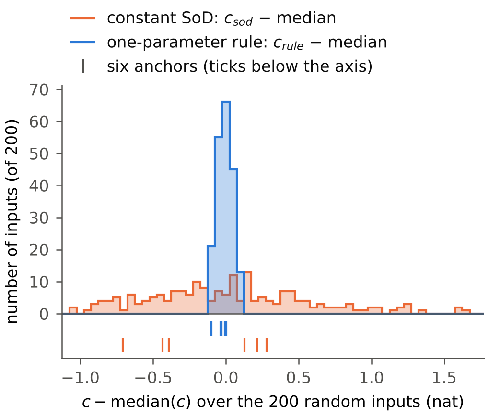

English copy of `report_round16_CN.md`. Where the two differ, the Chinese version is the report of record.

**Conclusion.**
- Over 200 random inputs, the information lost by the one-parameter rule relative to full sampling, c_rule, has a standard deviation of **0.053 nat** and a 5–95 % range of **0.172 nat**.
- Constant SoD at the same budget has **0.561 nat** and **1.889 nat**. The 5–95 % range of c_rule is 0.091 times that of c_sod.
- The rule's parameter e_fit lies in 1.561–1.588 σ (5–95 %). The gain over constant SoD is 8.34–10.82 nat, and it is ≥ 8.5 nat for 197 of the 200 inputs.
- c_rule is not constant. It ranks with the output's total variation (Spearman −0.97), but over a 5–95 % range that is about one eleventh of c_sod's.
- Predictions: 6 hits, 2 misses (Q2: range 1.889 > 1.8; Q6: U is at the 21.5th percentile of c_sod, not in the lowest 10 %).

**Prompt.** `reports_CN/prompt_round16_random_inputs_EN.md`. Branch `round16-random-inputs`, created from the head of `round14-one-parameter-rule` at **`6b79535`** (the Round 14 report). Commits:
- `21497a9`: the prompt (first commit);
- `960ec97`: `round16/predictions_round16.md`, before any computation (second commit);
- `aff7b26`: code (`random16.py`, `run_round16.py`);
- `9824f30`: stage anchors (check 1 PASS) and sequence script;
- `e8d2194`: summary code, before the summary was run;
- `290dae1`: in-progress checkpoint of the random stage (DECISION 16-11);
- `988ec47`, `945b989`, `7f38af7`: stages random, derived, floor;
- `6d3b7c0`, `2f2193d`: summary, and the summary re-run with descriptive context lines (no number changed);
- this report: the commit after that.

**Scope.**
- System, frequencies `dr.w`, a₀ = 1, noise s, K = 5000 and B = 316.8921168493721 are as in Rounds 4–14.
- Monte Carlo only: no DP, no grid evaluator. R = 2000 trajectories per run, noise seed 20261113 for every run and every input (common random numbers).
- I is log det J at θ₀. c = I − I_full is the information lost relative to full sampling; it is negative, and "lower" means more information lost.
- No causes are claimed. §4 is a description.

**Sources.** Paths are relative to `code_8_3_stage2/stage2_pkg/evaluator/`.
- `[L X:n]` is line n of `round16/logs/X.log`; `[J a.b]` is field `a.b` of `round16/results/round16.json`.
- Code: `round16/random16.py` (inputs, Monte Carlo, fits), `round16/run_round16.py` (stages anchors, random, derived, floor, summary), `round16/summary16.py`, `round16/run_round16_sequence.sh`.
- Differences between the prompt and the code: §12.

## 1. Answers to Q1–Q7

- **Q1 — c_rule is narrow.** sd **0.053 nat**; 5–95 % range **0.172 nat** (−11.590 … −11.418); worst case **0.125 nat** from the median (r049, −11.620); min–max 0.247 nat [L summary:4, 54].
- **Q2 — c_sod is wide.** sd **0.561 nat**; 5–95 % range **1.889 nat** (−22.192 … −20.303); worst case **1.641 nat** from the median (r108, −19.727); min–max 2.677 nat [L summary:5, 55].
- **Q3 — yes.** The ratio of the 5–95 % ranges, c_rule / c_sod, is **0.091** ≤ 1/3 [L summary:56].
- **Q4 — yes.** e_fit: P5 1.5611, median **1.5761**, P95 1.5876 σ, i.e. +0.0115 / −0.0150 σ around the median (≤ 0.03). Min 1.5570, max 1.5912 [L summary:57].
- **Q5 — yes.** gain ≥ 8.5 nat for **197/200** inputs (98.5 %). Min **8.336** (r108), median 9.875, max **10.816** (r051). The three inputs below 8.5 (r108, r113, r099) are the three with the smallest total variation of the random set [L summary:58–62].
- **Q6 — inside the distributions, but not across all of it.**
  - The anchors' c_rule lie at the 4.5–52nd percentiles (N 4.5, SCH 31, P5514 34, LO 34, U 44.5, HI 52): none is in the upper half.
  - Their c_sod lie at the 9.5–70.5th percentiles (LO 9.5, U 21.5, N 23, HI 59.5, SCH 67.5, P5514 70.5).
  - Their total variation is at the 39.5–92nd percentiles of the random set. The inputs with the highest c_rule and c_sod are small-TV inputs, a region that no anchor occupies [L summary:46–52].
- **Q7 — in these sets, mainly with power.** The 5–95 % range of c_sod is:
  - phase-only (uniform power, 50 phase vectors): **0.606 nat** (sd 0.191);
  - power-only (zero phases, 50 power vectors): **1.496 nat** (sd 0.512);
  - full random set: 1.889 nat.

  The corresponding ranges of c_rule are 0.050, 0.100 and 0.172 nat [L summary:63–66]. The two derived sets have different reference points (uniform power, zero phases), so they are not a decomposition of the random set's spread.

## 2. Distribution over the 200 random inputs

277 draws, **77 rejected** (min p < 0.02), 200 accepted [L random:2]. c, gain in nat; e_fit, Δ_fit in σ; information per transmission (S − 1)/(B − 1) [L summary:4–12].

| quantity | mean | sd | min | P5 | median | P95 | max | P95 − P5 |
|---|---:|---:|---:|---:|---:|---:|---:|---:|
| c_rule | −11.5014 | 0.0527 | −11.6201 | −11.5897 | −11.4954 | −11.4180 | −11.3731 | **0.1717** |
| c_sod | −21.3403 | 0.5611 | −22.4041 | −22.1917 | −21.3680 | −20.3025 | −19.7270 | **1.8892** |
| gain = I_rule − I_SoD | 9.8390 | 0.5165 | 8.3358 | 8.8736 | 9.8749 | 10.6114 | 10.8164 | 1.7378 |
| e_fit | 1.5754 | 0.0074 | 1.5570 | 1.5611 | 1.5761 | 1.5876 | 1.5912 | 0.0265 |
| Δ_fit / σ | 19.495 | 5.004 | 9.696 | 11.871 | 18.610 | 29.444 | 33.551 | 17.573 |
| info per transmission, rule | 4.4079 | 0.0256 | 4.3477 | 4.3612 | 4.4105 | 4.4496 | 4.4679 | 0.0883 |
| info per transmission, SoD | 1.5365 | 0.0951 | 1.3528 | 1.3947 | 1.5287 | 1.7279 | 1.8245 | 0.3332 |
| c_rule − c_rule(U) | +0.0021 | 0.0527 | −0.1166 | −0.0862 | +0.0081 | +0.0855 | +0.1303 | 0.1717 |
| c_sod − c_sod(U) | +0.4637 | 0.5611 | −0.6000 | −0.3876 | +0.4360 | +1.5016 | +2.0771 | 1.8892 |

c_rule(U) = −11.5035 and c_sod(U) = −21.8040 (this round, same seed) [L anchors:3]. The random inputs' output range is 477–1737 σ, total variation 3470–11322 σ, largest per-step motion 1.93–4.41 σ [J feature_ranges, max_step_sigma].



**Figure (`round16/results/fig_round16.png`).** Information lost relative to full sampling over the 200 random inputs, each centred on its own median: the one-parameter rule (blue, c_rule − median) and constant SoD at the same budget (orange, c_sod − median). Bins are 0.05 nat. The ticks below the axis are the six anchors (upper row: rule; lower row: SoD), minus the same medians. **Look at the width of the two histograms:** the blue one spans 5 bins (−0.125 … +0.125 nat), the orange one 55 (−1.04 … +1.64 nat).

## 3. Extremes

Random inputs with the lowest and the highest c_rule and c_sod. The other c is in brackets [L summary:13–32; J extremes].

| | input | c_rule | (c_sod) | p | χ | range (σ) | TV (σ) |
|---|---|---:|---:|---|---|---:|---:|
| c_rule lowest | r049 | −11.6201 | (−22.4041) | (0.833, 0.051, 0.045, 0.070) | (5.688, 6.033, 2.913, 0.731) | 1737.2 | 11321.8 |
| | r035 | −11.6158 | | (0.732, 0.058, 0.138, 0.072) | (4.355, 5.579, 3.636, 2.677) | 1716.1 | 10835.4 |
| | r131 | −11.6119 | | (0.547, 0.077, 0.102, 0.275) | (6.047, 5.040, 1.731, 1.879) | 1541.8 | 9850.2 |
| | r014 | −11.6117 | | (0.704, 0.175, 0.087, 0.034) | (2.891, 4.661, 0.081, 3.763) | 1687.9 | 10636.0 |
| | r058 | −11.6053 | | (0.632, 0.183, 0.024, 0.160) | (0.561, 0.358, 2.668, 4.833) | 1605.2 | 10000.9 |
| c_rule highest | r113 | −11.3731 | (−19.7907) | (0.024, 0.257, 0.413, 0.307) | (1.471, 3.946, 5.792, 2.489) | 494.6 | 3583.7 |
| | r108 | −11.3912 | (−19.7270) | (0.028, 0.030, 0.839, 0.103) | (0.239, 1.638, 4.697, 0.408) | 477.4 | 3470.1 |
| | r047 | −11.3977 | | (0.058, 0.044, 0.093, 0.805) | (5.099, 2.978, 2.908, 0.101) | 615.2 | 4062.6 |
| | r045 | −11.3985 | (−20.1144) | (0.027, 0.432, 0.374, 0.166) | (3.795, 5.309, 5.180, 1.844) | 524.9 | 3992.3 |
| | r027 | −11.4004 | | (0.049, 0.434, 0.332, 0.185) | (0.348, 3.225, 1.682, 3.986) | 641.1 | 4205.1 |

| | input | c_sod | p | χ | range (σ) | TV (σ) |
|---|---|---:|---|---|---:|---:|
| c_sod lowest | r049 | −22.4041 | (0.833, 0.051, 0.045, 0.070) | (5.688, 6.033, 2.913, 0.731) | 1737.2 | 11321.8 |
| | r051 | −22.4024 | (0.698, 0.097, 0.044, 0.160) | (0.066, 2.115, 5.811, 4.941) | 1557.9 | 10046.1 |
| | r040 | −22.3163 | (0.749, 0.080, 0.045, 0.126) | (5.406, 0.840, 3.191, 4.661) | 1641.9 | 10460.4 |
| | r190 | −22.2746 | (0.677, 0.048, 0.078, 0.197) | (5.737, 3.235, 5.191, 5.184) | 1576.8 | 10008.2 |
| | r143 | −22.2504 | (0.570, 0.321, 0.070, 0.039) | (5.030, 1.255, 0.216, 3.323) | 1552.8 | 9168.0 |
| c_sod highest | r108 | −19.7270 | (0.028, 0.030, 0.839, 0.103) | (0.239, 1.638, 4.697, 0.408) | 477.4 | 3470.1 |
| | r099 | −19.7445 | (0.045, 0.214, 0.554, 0.187) | (0.004, 1.507, 1.328, 3.371) | 552.9 | 3742.0 |
| | r113 | −19.7907 | (0.024, 0.257, 0.413, 0.307) | (1.471, 3.946, 5.792, 2.489) | 494.6 | 3583.7 |
| | r015 | −20.0302 | (0.063, 0.087, 0.497, 0.353) | (0.331, 3.389, 1.381, 4.764) | 616.8 | 3989.7 |
| | r045 | −20.1144 | (0.027, 0.432, 0.374, 0.166) | (3.795, 5.309, 5.180, 1.844) | 524.9 | 3992.3 |

- The input with the lowest c_rule (r049) also has the lowest c_sod.
- Three of the five highest c_rule (r113, r108, r045) are also among the five highest c_sod.
- The lowest-c inputs have one dominant power (p₁ = 0.55–0.83) and TV 9168–11322 σ. The highest-c inputs have TV 3470–4205 σ.

## 4. What the spread goes with (descriptive)

Spearman ρ over the 200 random inputs [L summary:33–35]:

| | total variation | output range | max p | min p | I_full |
|---|---:|---:|---:|---:|---:|
| c_rule | **−0.972** | −0.945 | +0.136 | −0.083 | −0.100 |
| c_sod | **−0.944** | −0.940 | +0.118 | −0.077 | −0.087 |

Beyond the prompt's list (descriptive):
- ρ(c_rule, c_sod) = +0.852;
- ρ(e_fit, TV) = −0.983;
- ρ(gain, TV) = +0.926;
- ρ(Δ_fit, output range) = +0.981.

Both c rank closely with total variation and output range, and hardly with max p, min p or I_full.

## 5. Phase-only and power-only sets (§4d)

(i) phase-only: χ of r000–r049 with p = (¼, ¼, ¼, ¼); (ii) power-only: p of r000–r049 with χ = 0. For reference, r000–r049 themselves. In nat [L summary:36–45].

| set | quantity | mean | sd | min | P5 | median | P95 | max | P95 − P5 |
|---|---|---:|---:|---:|---:|---:|---:|---:|---:|
| phase-only | c_rule | −11.5031 | 0.0155 | −11.5285 | −11.5250 | −11.5033 | −11.4748 | −11.4676 | **0.0503** |
| phase-only | c_sod | −21.4508 | 0.1909 | −21.9093 | −21.7659 | −21.4359 | −21.1603 | −21.0712 | **0.6057** |
| power-only | c_rule | −11.5094 | 0.0290 | −11.6013 | −11.5853 | −11.5012 | −11.4852 | −11.4778 | **0.1001** |
| power-only | c_sod | −21.6097 | 0.5118 | −22.5876 | −22.4648 | −21.5645 | −20.9692 | −20.8640 | **1.4956** |
| r000–r049 | c_rule | −11.4979 | 0.0568 | −11.6201 | −11.6048 | −11.4882 | −11.4015 | −11.3977 | 0.2032 |
| r000–r049 | c_sod | −21.2829 | 0.5568 | −22.4041 | −22.2365 | −21.3812 | −20.3942 | −20.0302 | 1.8423 |

| set | TV (σ) min / P5 / P95 / max | ρ(c_rule, TV) | ρ(c_sod, TV) |
|---|---|---:|---:|
| phase-only | 6005 / 6142 / 7244 / 7434 | −0.707 | −0.591 |
| power-only | 5525 / 5735 / 10226 / 10956 | −0.865 | −0.960 |
| r000–r049 | 3990 / 4127 / 10557 / 11322 | −0.971 | −0.942 |
| random (200) | 3470 / 4204 / 9969 / 11322 | −0.972 | −0.944 |

In the phase-only set, the 5–95 % range of c_sod is 12.0 times that of c_rule. In the power-only set it is 15.0 times, and in the random set 11.0 times [L summary:63–66].

## 6. Anchors and noise floor

**Check 1 — anchors against the archives** (this round, seed 20261113; Round 14 `input_table.<name>.c_rule`, σ/120 lattice rule, U from Part 1b; Round 13 `partA_<name>.json → derived.c_sod`, matched SoD, σ/120) [L anchors:9–15]:

| input | c_rule | Round 14 | diff | c_sod | Round 13 | diff | e_fit | e_eff (R14) | Δ_fit/σ | M\*/24 (R13) |
|---|---:|---:|---:|---:|---:|---:|---:|---:|---:|---:|
| U | −11.5035 | −11.5107 | +0.0072 | −21.8040 | −21.8073 | +0.0033 | 1.5766 | 1.5771 | 20.000 | 20.000 |
| SCH | −11.5305 | −11.5354 | +0.0049 | −21.1547 | −21.1570 | +0.0023 | 1.5744 | 1.5750 | 19.872 | 19.875 |
| P5514 | −11.5253 | −11.5540 | +0.0287 | −21.0897 | −21.0854 | −0.0043 | 1.5727 | 1.5750 | 19.973 | 19.958 |
| LO | −11.5251 | −11.5443 | +0.0192 | −22.0757 | −22.0618 | −0.0139 | 1.5734 | 1.5750 | 23.408 | 23.375 |
| HI | −11.4924 | −11.4970 | +0.0046 | −21.2383 | −21.2427 | +0.0044 | 1.5787 | 1.5792 | 17.252 | 17.250 |
| N | −11.5960 | −11.6141 | +0.0181 | −21.7618 | −21.7548 | −0.0070 | 1.5632 | 1.5646 | 27.163 | 27.125 |

- Every abs(difference) is ≤ 0.06 nat (max 0.0287 for c_rule, 0.0139 for c_sod) → **PASS**.
- I_full agrees with Round 13 exactly (difference 0).
- e_fit − e_eff = −0.0023 … −0.0005 σ.
- Δ_fit/σ − M\*/24 = −0.003 … +0.038.
- Over the six anchors, c_rule spans 0.104 nat (Round 14: 0.117) and c_sod 0.986 nat (Round 13: 0.976).

The c_rule differences are all positive. The archived rules are not at E[N] = B: Round 14's fitted lattice rules lie 0.29–1.03 transmissions below B (E[N]₁₂₀ 315.87–316.61), while this round interpolates to E[N] = B.
- Multiplying each input's shortfall by the slope of the continuous rule near B (0.018–0.020 nat per transmission, computed from the Round 14 1d table between e = 1.56, 1.58 and 1.60) gives 0.005–0.020 nat. The observed differences are 0.005–0.029 nat.
- The three largest differences (P5514 +0.029, LO +0.019, N +0.018) belong to the three largest shortfalls (0.81, 1.03, 0.77).
- Round 13's matched SoD lies at E[N]₁₂₀ − B = −0.245 … +0.244 (integer M\*).

Description only.

**Check 2 — noise floor.** Input U, ten seeds 20261114 … 20261123 [L floor:14]:
```
CHECK2 noise floor, input U, ten seeds 20261114..20261123 (no common random numbers between seeds): sd c_rule 0.0075, c_sod 0.0076, e_fit 0.0007, D_fit 0.0029, gain 0.0094
```
- This is the Monte Carlo noise of **a single input's values without common random numbers**: sd 0.0075 nat (c_rule), 0.0076 nat (c_sod), 0.0007 σ (e_fit), 0.0029 (Δ_fit/σ).
- The ten-seed means are c_rule −11.5054 and c_sod −21.8077, against −11.5035 and −21.8040 at seed 20261113 [J checks.check2].
- Over the random set, the sd of c_rule (0.0527) is 7.0 times this noise, and that of c_sod (0.5611) is 74 times.
- The noise of a *difference* between two inputs under common random numbers was not measured. The within-run diagnostic (10 groups of 200 trajectories, DECISION 16-4) gives median group standard errors of 0.0065 nat (c_rule) and 0.0043 nat (c_sod) [L summary:79].

**Check 3 — pair LO/HI** [L anchors:16]:
```
CHECK3 c_rule(LO) - c_rule(HI) -0.0327 vs R14 -0.0473 (diff +0.0146); c_sod(LO) - c_sod(HI) -0.8374 vs R13 -0.8190 (diff -0.0184)
```

**Q6 — percentiles of the anchors in the random distributions** [L summary:46–52]:

| anchor | c_rule percentile | c_sod percentile | gain percentile | TV (σ) / percentile | range (σ) / percentile |
|---|---:|---:|---:|---|---|
| U | 44.5 | 21.5 | 83.0 | 7038 / 60.0 | 1144 / 56.5 |
| SCH | 31.0 | 67.5 | 30.0 | 6793 / 54.5 | 1121 / 53.5 |
| P5514 | 34.0 | 70.5 | 27.0 | 6837 / 56.0 | 1136 / 55.0 |
| LO | 34.0 | 9.5 | 92.0 | 8066 / 79.5 | 1347 / 81.5 |
| HI | 52.0 | 59.5 | 37.5 | 6102 / 39.5 | 869 / 28.0 |
| N | 4.5 | 23.0 | 73.5 | 9206 / 92.0 | 1483 / 91.5 |

## 7. Predictions (`round16/predictions_round16.md`, `960ec97`)

**6 hits, 2 misses** [L summary:67–75].

| line | values | result |
|---|---|---|
| Check 1: all six anchors within 0.06 nat on both | max abs(diff) 0.029 (c_rule), 0.014 (c_sod) | hit |
| Q1: P95 − P5 ≤ 0.30; sd ≤ 0.10; worst ≤ 0.45 of median | 0.172 ✓; 0.053 ✓; 0.125 ✓ | hit |
| Q2: P95 − P5 of c_sod ∈ [0.6, 1.8] | **1.889** | **miss** |
| Q3: yes | ratio 0.091 | hit |
| Q4: yes; median e_fit ∈ [1.565, 1.590] | +0.0115 / −0.0150 ✓; 1.5761 ✓ | hit |
| Q5: yes; median gain ∈ [9.2, 10.0] | 197/200 ≥ 8.5 ✓; 9.875 ✓ | hit |
| Q6: U in the lowest 10 % of c_sod; anchors' c_rule in [P2, P98] | **U at 21.5**; 4.5–52 ✓ | **miss** |
| Q7: phase-only c_sod range ≥ 4 × c_rule range | 12.05 | hit |

## 8. Checks (prompt §3)

1. **Anchors:** §6, PASS.
   ```
   [L anchors:15] CHECK1 max |diff| c_rule 0.0287, c_sod 0.0139 (tolerance 0.06) -> PASS
   ```
2. **Noise floor:** §6 (sd 0.0075 / 0.0076 nat).
3. **Pair LO/HI:** §6. c_rule difference −0.0327 against Round 14's −0.0473; c_sod difference −0.8374 against Round 13's −0.8190.
4. **Every run and every interpolation:**
   ```
   [L summary:76] CHECK4 3805 runs, 632 interpolations: W_k in [2.764e-210, 1.0], max per-trajectory c 1.0, min N 83; failures [] -> PASS
   [L summary:77] CHECK4 list extensions: rule 0 inputs []; SoD 13 inputs [('r015', [8.0]), ('r027', [8.0]), ('r045', [8.0]), ('r047', [8.0]), ('r086', [8.0]), ('r098', [8.0]), ('r099', [8.0]), ('r108', [8.0]), ('r113', [8.0]), ('r127', [8.0]), ('r141', [8.0]), ('r164', [8.0]), ('r171', [8.0])]
   ```
   - Each run passed `0 ≤ W_k ≤ 1`, `N ≥ 1` and finite log det J (with positive sign), checked in `random16.check_run` as soon as the run ended.
   - Each interpolation uses two adjacent runs that bracket B.
   - Within every fit, E[N] was strictly decreasing in the parameter (asserted; never failed).
   - The rule list {1.52, …, 1.64} bracketed B for all 316 inputs.
   - The SoD list needed one extension, to Δ/σ = 8, for 13 random inputs with small output range.

The anchor U arrays are bitwise those of `eval13` (XK, HK). Rounds 4–15 and the frozen files are unchanged, and no empty folder was created [L X: CLEANUP lines, e.g. L summary:82]:
```
CLEANUP removed empty folders []; git status on rounds 4-15 and the frozen files: clean
```

## 9. DECISION list

- **DECISION 16-1.** Random set: min p ≥ 0.02 (the bound fixed by the prompt, §1).
  - Draw order per attempt: `p = rng.dirichlet(ones(4))`, then `chi = rng.uniform(0, 2π, 4)`. Both are drawn on every attempt, accepted or not.
  - 277 draws, 77 rejected, 200 accepted [L random:2].
- **DECISION 16-2.** Scoring conventions were fixed in `round16/predictions_round16.md` before running (`960ec97`):
  - percentiles are `numpy.percentile` (linear); "5–95 % range" = P95 − P5; sd uses ddof = 1;
  - percentile rank = 100 (#{c < v} + ½ #{c = v}) / 200 within the random set;
  - Q4 is two-sided (P95 − median ≤ 0.03 and median − P5 ≤ 0.03);
  - Q6 uses this round's anchor values.
- **DECISION 16-3.** "The same noise seed 20261113 for every run and every input": one generator `default_rng(20261113)` per run, with 2000 trajectories in one batch. Rounds 11 and 14 used 20 batches with seeds seed + b.
  - The random-number order is that of `eval11._mc_batch`: one normal vector for the initial r, then one per step.
  - The noise-floor runs use the same layout with seeds 20261114 … 20261123.
- **DECISION 16-4.** Diagnostic only, not used in any answer: W_k is also accumulated in 10 contiguous groups of 200 trajectories. Stored per run: a group standard error of log det J. Stored per input: a group standard error of the interpolated c (same bracketing pair, linear in each group's E[N]).
- **DECISION 16-5.** Inputs.
  - Anchors: `eval13` is imported (input U bound; nothing of its evaluator is called) so that the Round 13 inputs are registered in `dr.CFG`. x and H come from `dr.input_arrays(name)` (χ reduced mod 2π), which is what Rounds 13 and 14 used. They are asserted equal to `dr.output(a, χ)` and `dr.regressors(a, χ, dr.t)`, and for U bitwise equal to `eval13.XK` and `eval13.HK`.
  - Random and derived inputs: x and H from `dr.output` and `dr.regressors` with a = sqrt(p), χ as drawn.
- **DECISION 16-6.** Fits.
  - Within one fit, E[N] must be strictly decreasing in the parameter over all runs (asserted).
  - The bracketing pair is the unique adjacent pair with E[N](a) ≥ B ≥ E[N](b).
  - Extension: if every E[N] > B, one step above the largest parameter; if every E[N] < B, one step below the smallest.
  - SoD: the one-third and two-thirds points are placed in the coarse bracketing pair (after any extension). The interpolation pair is the adjacent bracketing pair of the refined list.
- **DECISION 16-7.** Information per transmission (S − 1)/(B − 1) uses the interpolated S.
- **DECISION 16-8.** "The first 50" (§4d) are the first 50 accepted random inputs in draw order (r000–r049). As a reference, the same statistics are also given for r000–r049 themselves.
- **DECISION 16-9.** Figure: bins of 0.05 nat with 0 at a bin centre. The anchor ticks are the anchors' values minus the random set's median. File `round16/results/fig_round16.png`, 3.4 in wide, all text 8 pt.
- **DECISION 16-10.** 4c reports Spearman ρ (`scipy.stats.spearmanr`) only, without p-values (descriptive). Four further correlations (§4) and the per-set TV lines (§5) were added to the summary after its first run, which was committed (`6d3b7c0`); no number changed (`2f2193d`).
- **DECISION 16-11.** Execution.
  - A Pool of 4 worker processes, one input per task; the runs inside a task are sequential. Each stage was committed when it finished.
  - One in-progress checkpoint commit of the random stage (`290dae1`) was made because the session's stop hook required the working tree to be committed.
  - `numba` was missing in the fresh container, and `eval13` imports it. numba 0.68.1 was installed (Round 14: 0.68.0; numpy 2.5.3, scipy 1.18.1 and Python 3.13.18 as in Round 14). No numba code is executed in this round.
- **DECISION 16-12.** Rounds 4–15 were not modified. Importing `eval13` may write numba cache files under `round13/__pycache__`, which is git-ignored.

## 10. Wall times

- One Monte Carlo run of 2000 trajectories: median 1.32 s (0.97–2.17 s) [L summary:80]. One input (12 or 13 runs, sequential) took 15–17 s.
- Stages on 4 workers: anchors 32.4 s, random 809.8 s, derived 389.8 s, floor 46.6 s, summary 1.2 s. About 21 min in total for 3805 runs (316 input fits).

## 11. Not done

- Not in this round (prompt §6):
  - the designed tables (a DP per input);
  - other frequencies, total powers, systems or budgets;
  - model mismatch;
  - inputs with min p < 0.02.
- The random inputs were not evaluated on the grid evaluator. Their values are Monte Carlo only, validated through the six anchors (check 1).
- The Monte Carlo noise of a difference between two inputs under common random numbers was not measured. Only the single-input floor (check 2) and the group diagnostic (DECISION 16-4) are given.

## 12. Where the prompt and the code differ

1. **§2: "W_k = mean over trajectories of `dr.cfun(...)`".** `dr.cfun` returns a pair (cev, cno). The per-step information fraction used everywhere in the code (`eval11._mc_batch`, `rule14._mc_cont`, `dr` itself) is c = cev + cno, and W_k is the mean of that sum.
2. **§2: "vectorised over trajectories as `eval11._mc_batch`" with one seed for every run.** `eval11.monte_carlo` (and `rule14.monte_carlo`) split R into 20 batches with seeds seed + b. The loop and random-number order of `_mc_batch` were kept, and the seed layout of the prompt was used (DECISION 16-3).
3. **§3 check 1 compares with archived values that are not at E[N] = B.** Round 14's rules lie below B by 0.29–1.03 transmissions (`fit_rule` returns the largest feasible j); Round 13's matched SoD lies within ±0.245 of B. This round interpolates to B. The differences in §6 include these offsets.
4. **§8 runtime guide** ("about 13 runs per input … about 4300 runs, 25–35 min"). The fixed lists give 12 runs per input (13 with one extension): 3805 runs, about 21 min.
5. **§0 "Rounds 4–15 are read-only".** There is no `round15/` on this branch (Round 15 runs on another branch, which was not touched). The clean-up and `git status` check include `round15/` if it exists.
