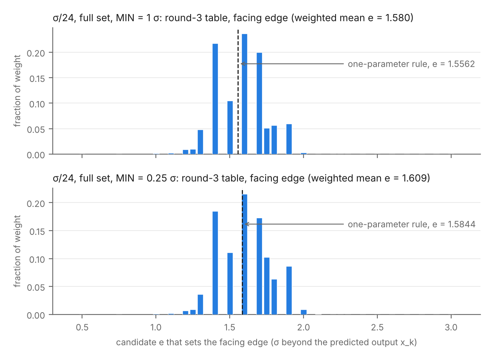

# verification/sec4: independent cross-check of Section IV

This folder holds an independent re-implementation (numpy/scipy only, no imports from the repository) used
to cross-check the numbers of Sections IV-A (interval triggers) and IV-B (upper bound for SoD-class
triggers). Nothing outside this folder was changed.

## Files

| file | what it is |
|---|---|
| `check_interval.py` | Section IV-A check. Added byte for byte as supplied (sha256 `4f1c236b…cd790`). |
| `check_cert.py` | Section IV-B check. Added byte for byte as supplied (sha256 `5748ffa8…0ab`). |
| `check_cert_min.py` | `check_cert.py` plus an optional fifth argument MIN (Task 3, see below). |
| `results_interval.txt` | stdout of `python check_interval.py` |
| `a_opt.npy` | written by `check_interval.py` itself (`np.save('a_opt.npy', a)`): the optimal a_k of the allocation problem |
| `run_*.txt` | stdout of each `check_cert*.py` run |
| `*.meta` | written by `runlog.py`: command, start/end, wall time, CPU time, peak RSS, exit code |
| `*.err` | stderr of each run; all are empty (0 bytes) |
| `runlog.py` | wrapper used for every run: runs the command with stdout → `.txt` and stderr → `.err`, pins `OMP/OPENBLAS/MKL_NUM_THREADS=1`, writes `.meta` |
| `summarize.py` | parses `run_*.txt` + `.meta` and prints the tables in this README (`python3 summarize.py [--overview] run_*.txt`) |
| `check_shape.py` | Task B (second batch): recomputes the best tables of a `check_cert*.py` run and collects edge statistics of the round-3 table and of the one-parameter rule; imports `check_cert_min.py` unchanged |
| `shape_*.txt`, `shape_*.npz` | stdout of each `check_shape.py` run (via `runlog.py`, with `.meta`/`.err`) and the weighted histograms it saved |
| `make_shape_fig.py` | draws `fig_shape.png` from the `shape_*.npz` files and prints the plotted numbers |
| `fig_shape.png`, `fig_shape.txt` | Task B figure and the numbers it plots |

### How the runs were made

- Environment: Python 3.13.18, numpy 2.5.3, scipy 1.18.1, x86_64, 4 vCPUs, 16 GB.
- Every run was single-threaded (BLAS/OpenMP threads pinned to 1) and started as its own background process from this folder.
- Several runs shared the 4 vCPUs at once, so the wall times below include contention:
  - 19:08–19:20 UTC: four runs (24 full, 12 full, and the two 8 small runs);
  - 19:20–20:29 UTC: four runs (24 full, 12 full, 12 full MIN 0.5, 12 full MIN 0.25);
  - 20:29–21:20 UTC: 24 full alone.
- All runs ended with exit code 0, and no run was stopped early.
- Nothing was tuned. Each script ran with exactly the arguments listed.

## Overview (all `check_cert*.py` runs; round 3 = last tangent-point round)

"smallest bound" is the smallest upper bound over the three rounds; in every run this is the round-3 bound.
"gap" is that bound minus the round-3 best feasible table. "max abs(diff)" is the largest |V* − forward score|
over all 33 backward passes of the run. "all below bound" is True when every "below bound" entry printed by
the script is True (5 entries per run: constant SoD, the three tables, and the one-parameter rule).

| run | grid | edge values | MIN (sigma) | const. SoD E[N] | const. SoD log det J | best table, round 3 | its E[N] | smallest bound | gap | max abs(diff) | one-parameter rule | all below bound | wall time (s) | peak RSS (MB) |
|---|---|---|---|---|---|---|---|---|---|---|---|---|---|---|
| `run_fac8_small.txt` | sigma/8 | 7 + None | 1 | 316.9002 | 197.1995 | 207.5925 | 316.552 | 207.6593 | 0.0668 | 6.8e-13 | 207.4760 (e = 1.5174) | True | 671 | 263.0 |
| `run_fac8_small_min1.txt` | sigma/8 | 7 + None | 1 | 316.9002 | 197.1995 | 207.5925 | 316.552 | 207.6593 | 0.0668 | 6.8e-13 | 207.4760 (e = 1.5174) | True | 679 | 262.8 |
| `run_fac12_full.txt` | sigma/12 | 30 + None | 1 | 316.8952 | 197.2004 | 207.6260 | 316.624 | 207.7023 | 0.0764 | 1.4e-12 | 207.4941 (e = 1.5366) | True | 4110 | 372.6 |
| `run_fac24_full.txt` | sigma/24 | 30 + None | 1 | 316.8922 | 197.2010 | 207.6420 | 316.837 | 207.7114 | 0.0693 | 2.4e-12 | 207.5051 (e = 1.5562) | True | 7958 | 667.4 |
| `run_fac12_full_min0.5.txt` | sigma/12 | 30 + None | 0.5 | 316.8952 | 197.2004 | 207.7096 | 316.480 | 207.8014 | 0.0918 | 1.3e-12 | 207.5662 (e = 1.5569) | True | 4134 | 370.7 |
| `run_fac12_full_min0.25.txt` | sigma/12 | 30 + None | 0.25 | 316.8952 | 197.2004 | 207.7519 | 316.859 | 207.8421 | 0.0901 | 1.4e-12 | 207.5961 (e = 1.5648) | True | 4168 | 370.4 |

## Task 1: interval triggers (`check_interval.py`)

`python check_interval.py > results_interval.txt` took 0.7 s wall time.

| quantity | expected | obtained |
|---|---|---|
| optimum of the allocation problem, log det | 209.0686 | **209.06855** (E[N] = 316.892200, 34 fixed-point iterations) |
| constant half-width a, at the same budget | 1.8578 | **a = 1.8578** |
| log det at that constant half-width | 208.9566 | **208.95658** (0.1120 below the optimum) |

Other lines of the output:
- The bracket for the allocation optimum is [209.06855, 209.06855].
- The optimality condition a_k² γ_k is constant: 1.881594e-02 at both its minimum and maximum.
- a_k ranges over 1.545–2.048, and q_k over 4.06–12.24 %.
- With all samples sent, log det = 219.0085.
- The optimum is 11.8675 above constant SoD (197.2010).
- Section (1): the argmax of c at fixed q matches the symmetric window (−a) to 1e-4, and the numerical and analytic dc/dα agree to the printed digits.
- Section (2): the slope of c_max equals a² to the printed digits.
- Cosmetic: the "table at q=6.3%" line prints `np.float64(0.326)` etc. This is numpy 2's repr, and the values are 0.326, 0.304, 0.269.

## Task 2: certificate check at finer settings (`check_cert.py`, unchanged)

`python check_cert.py 12 full 5 3` and `python check_cert.py 24 full 5 3`. The "full" set has 30 finite edge
values {0.5, 0.75, 1.0, 1.1, …, 3.0, 3.5, 4, 5, 6, 1.25, 1.75, 2.25} plus "no edge", i.e. 31 × 31 = 961
actions per node. Every edge is at least 1σ from the last transmitted value r (hard-coded as FAC nodes).

#### `python3 check_cert.py 12 full 5 3`  →  `run_fac12_full.txt`

- grid sigma/12 (14070 nodes); candidate set: 30 values + None; MIN = 1 sigma (hard-coded: FAC nodes)
- constant SoD: E[N] = 316.8952, log det J = 197.2004

| round | tangent point | best feasible table: log det J | E[N] | upper bound | gap | max abs(diff) in round |
|---|---|---|---|---|---|---|
| 1 | constant SoD | 207.2876 (+10.0872) | 316.358 | 219.7959 (+22.5955) | 12.5083 | 1.4e-12 |
| 2 | table of round 1 | 207.5591 (+10.3587) | 316.889 | 207.8697 (+10.6692) | 0.3105 | 8.0e-13 |
| 3 | table of round 2 | 207.6260 (+10.4256) | 316.624 | 207.7023 (+10.5019) | 0.0764 | 4.9e-13 |

- largest abs(diff) between V* and the forward score, all 33 backward passes: 1.4e-12
- one-parameter rule: `one-parameter rule, e = 1.5366:   207.4941 (+10.2937), E[N] = 316.818   below bound: True`
- 'below bound' entries: 5, all True: True
- wall time: 4110 s (script); wrapper: 4110.5 s wall, 3195.5 s user CPU, peak RSS 372.6 MB, exit code 0, stderr 0 bytes

#### `python3 check_cert.py 24 full 5 3`  →  `run_fac24_full.txt`

- grid sigma/24 (28138 nodes); candidate set: 30 values + None; MIN = 1 sigma (hard-coded: FAC nodes)
- constant SoD: E[N] = 316.8922, log det J = 197.2010

| round | tangent point | best feasible table: log det J | E[N] | upper bound | gap | max abs(diff) in round |
|---|---|---|---|---|---|---|
| 1 | constant SoD | 207.3086 (+10.1076) | 316.841 | 219.8246 (+22.6236) | 12.5160 | 2.4e-12 |
| 2 | table of round 1 | 207.5656 (+10.3646) | 316.651 | 207.8758 (+10.6748) | 0.3102 | 1.9e-12 |
| 3 | table of round 2 | 207.6420 (+10.4411) | 316.837 | 207.7114 (+10.5104) | 0.0693 | 1.1e-12 |

- largest abs(diff) between V* and the forward score, all 33 backward passes: 2.4e-12
- one-parameter rule: `one-parameter rule, e = 1.5562:   207.5051 (+10.3041), E[N] = 316.847   below bound: True`
- 'below bound' entries: 5, all True: True
- wall time: 7958 s (script); wrapper: 7958.3 s wall, 6520.3 s user CPU, peak RSS 667.4 MB, exit code 0, stderr 0 bytes

### Comparison with the repository's own σ/24 numbers

Source: `reports_CN/report_round11b_EN.md` on branch `round11-edge-actions` (Round 11b). It is also quoted in
`prompt_round14_one_parameter_rule_EN.md` and `prompt_round18_accumulated_information_EN.md` on later round branches.

| quantity | repository (Round 11b, σ/24) | this check, `24 full 5 3` (σ/24), round 3 | difference (check − repo) |
|---|---|---|---|
| constant SoD | log det 197.20097668, E[N] = B = 316.8921168 | log det 197.2010, E[N] 316.8922 | equal to the printed digits |
| design table | T′: **207.6467** (σ/24; 207.6445 at σ/120), E[N] 316.843 (σ/24) | best feasible table: **207.6420**, E[N] 316.837 | −0.0047 |
| class bound at budget B | UB_SoD(S ∪ S′; B) = 207.7097 | **207.7114** (budget = this grid's constant-SoD E[N]) | +0.0017 |
| class bound at B + 0.25 (the certificate value **207.715** = 207.7146 quoted in later rounds) | 207.7146 | not computed (the check uses budget B) | (207.7114 − 207.7146 = −0.0032) |
| gap (bound − table) at B | 0.0630 | 0.0693 | +0.0063 |

The two sets of numbers are consistent with each other in this sense:
- The repository's T′ (207.6467) is below the check's bound (207.7114).
- The check's best table (207.6420) is below the repository's bound (207.7097).

Because the classes differ (next list), neither statement is a formal containment argument.

**Differences in setting.** Taken from the Round 11 / 11b reports. I did not compare the two codes line by line.
1. **Action set (class).**
   - The repository's class is S ∪ S′, 884 actions per node:
     - S′ (784 actions): edge values E′ = {0.5, 0.75, 1.0, 1.1, …, 3.0, 3.5, 4, 5, 6, ∞}, minimum distance **1σ** from r.
     - S (100 actions): E = {1, 1.25, 1.5, 1.75, 2, 2.25, 2.5, 3, 4, ∞}, minimum distance **2σ** from r (lower edge = min(x̄_k − e⁻σ, r − 2σ), etc.).
   - The check's "full" class has 961 actions per node. Its edge values are E′ ∪ {1.25, 1.75, 2.25}, and *all* actions have minimum distance 1σ.
   - So, in terms of the action definitions, the check's class contains S′, plus 1σ actions with e = 1.25, 1.75, 2.25 that S ∪ S′ lacks.
   - It does **not** contain the repository's 2σ actions (S). When r ∓ 2σ is the active edge, it cannot be written as x̄_k ∓ e σ with a candidate e.
   - So neither class contains the other. Each code also discretises on its own grid (the check's grid starts 14σ below min x).
   - Round 11b reports 88.5 % of T′'s mass on S′-block actions. The rest is on S-block codes, some of which may coincide with an S′ action at that node, because ties go to the S block.
2. **Tangent point.**
   - Repository: a single tangent point, A₁ = J(T₁)⁻¹, where T₁ is Round 11's edge_j1 table (I = 207.3552).
   - Check: starts at constant SoD and re-tangents twice. The round-3 tangent point is J of its own round-2 table (207.5656).
3. **Price search.**
   - Repository: λ₀ = 5γ̄, doubling, ×0.8, then 8 bisections (12 evaluations).
   - Check: λ₀ = 3γ̄, ×0.7 down / ×1.5 up, then bisection until hi/lo < 1.0005, at most 11 evaluations per round.
   - Both report the minimum of the dual over the evaluated λ only.
4. **Budget.**
   - Check: B is the constant-SoD E[N] on its own grid (316.8922 at σ/24, equal to the repository's B to the printed digits).
   - Repository: the quoted certificate 207.715 is at B + 0.25 (Round 11b decision 11b-6). At B itself the repository's bound is 207.7097.
5. **Evaluation.**
   - Repository: T′ is also re-evaluated at σ/120 (I = 207.6445, E[N] = 316.633).
   - Check: evaluates its tables on its own grid only.
   - The check's discretisation follows its own docstring: the continuous c-formula at the edge-node positions, half weight on edge nodes in the send probability and the transitions, and outward rounding of edges. I have not verified that these details match the repository's implementation.

## Task 3: minimum distance MIN between the window edges and r (`check_cert_min.py`)

`check_cert_min.py FAC SET [NBIS] [NRND] [MIN]`:
- MIN is the minimum distance (in σ, default 1.0) of each window edge from the last transmitted value r.
- It must be a positive multiple of 1/FAC, otherwise the script exits with an error.
- M = MIN·FAC grid nodes replaces FAC wherever FAC set that minimum distance:
  - `windows()`: `idx + 1 ∓ M`
  - `backward()`: `iL`, `iU`, and the region boundaries `i_hi = b.max() − M − 1`, `i_lo = a.min() + M`
  - `rule_win()`: `idx + 1 ∓ M`
- Kept unchanged:
  - the constant-SoD half-width `hw = 20*FAC`;
  - the grid step `d = sig/FAC` and the grid margin.
- One line, `MIN = … sigma (… nodes)`, is printed after the grid line.

The full diff against `check_cert.py` is those five code lines, the argument parsing (4 lines), the extra
print, and the docstring.

**Reproduction check (MIN = 1).**
- `check_cert_min.py 8 small 5 3 1` and the unchanged `check_cert.py 8 small 5 3` were run side by side.
- After removing the added `MIN = 1 sigma (8 nodes)` line and the elapsed-time stamps (`(… s)` and `time … s`), the two outputs are identical: `diff` is empty.
- This covers every λ, E[N], log det, V*, forward score, diff, bound, table, and the one-parameter-rule line.
- Both match the reference from your machine: round 3 best table 207.5925, upper bound 207.6593, gap 0.0668.
- The diff column is at most 6.8e-13 in absolute value.

#### `python3 check_cert.py 8 small 5 3`  →  `run_fac8_small.txt`

- grid sigma/8 (9380 nodes); candidate set: 7 values + None; MIN = 1 sigma (hard-coded: FAC nodes)
- constant SoD: E[N] = 316.9002, log det J = 197.1995

| round | tangent point | best feasible table: log det J | E[N] | upper bound | gap | max abs(diff) in round |
|---|---|---|---|---|---|---|
| 1 | constant SoD | 207.2468 (+10.0473) | 316.493 | 219.6807 (+22.4813) | 12.4340 | 6.8e-13 |
| 2 | table of round 1 | 207.5273 (+10.3278) | 316.589 | 207.8429 (+10.6434) | 0.3156 | 6.5e-13 |
| 3 | table of round 2 | 207.5925 (+10.3930) | 316.552 | 207.6593 (+10.4598) | 0.0668 | 4.1e-13 |

- largest abs(diff) between V* and the forward score, all 33 backward passes: 6.8e-13
- one-parameter rule: `one-parameter rule, e = 1.5174:   207.4760 (+10.2765), E[N] = 316.783   below bound: True`
- 'below bound' entries: 5, all True: True
- wall time: 671 s (script); wrapper: 670.9 s wall, 554.7 s user CPU, peak RSS 263.0 MB, exit code 0, stderr 0 bytes

#### `python3 check_cert_min.py 8 small 5 3 1`  →  `run_fac8_small_min1.txt`

- grid sigma/8 (9380 nodes); candidate set: 7 values + None; MIN = 1 sigma (8 nodes)
- constant SoD: E[N] = 316.9002, log det J = 197.1995

| round | tangent point | best feasible table: log det J | E[N] | upper bound | gap | max abs(diff) in round |
|---|---|---|---|---|---|---|
| 1 | constant SoD | 207.2468 (+10.0473) | 316.493 | 219.6807 (+22.4813) | 12.4340 | 6.8e-13 |
| 2 | table of round 1 | 207.5273 (+10.3278) | 316.589 | 207.8429 (+10.6434) | 0.3156 | 6.5e-13 |
| 3 | table of round 2 | 207.5925 (+10.3930) | 316.552 | 207.6593 (+10.4598) | 0.0668 | 4.1e-13 |

- largest abs(diff) between V* and the forward score, all 33 backward passes: 6.8e-13
- one-parameter rule: `one-parameter rule, e = 1.5174:   207.4760 (+10.2765), E[N] = 316.783   below bound: True`
- 'below bound' entries: 5, all True: True
- wall time: 679 s (script); wrapper: 679.7 s wall, 563.5 s user CPU, peak RSS 262.8 MB, exit code 0, stderr 0 bytes

#### `python3 check_cert_min.py 12 full 5 3 0.5`  →  `run_fac12_full_min0.5.txt`

- grid sigma/12 (14070 nodes); candidate set: 30 values + None; MIN = 0.5 sigma (6 nodes)
- constant SoD: E[N] = 316.8952, log det J = 197.2004

| round | tangent point | best feasible table: log det J | E[N] | upper bound | gap | max abs(diff) in round |
|---|---|---|---|---|---|---|
| 1 | constant SoD | 207.3460 (+10.1456) | 316.121 | 220.2423 (+23.0419) | 12.8963 | 1.3e-12 |
| 2 | table of round 1 | 207.6299 (+10.4294) | 316.758 | 207.9869 (+10.7865) | 0.3570 | 3.4e-13 |
| 3 | table of round 2 | 207.7096 (+10.5091) | 316.480 | 207.8014 (+10.6010) | 0.0918 | 3.1e-13 |

- largest abs(diff) between V* and the forward score, all 33 backward passes: 1.3e-12
- one-parameter rule: `one-parameter rule, e = 1.5569:   207.5662 (+10.3658), E[N] = 316.835   below bound: True`
- 'below bound' entries: 5, all True: True
- wall time: 4134 s (script); wrapper: 4134.3 s wall, 3230.5 s user CPU, peak RSS 370.7 MB, exit code 0, stderr 0 bytes

#### `python3 check_cert_min.py 12 full 5 3 0.25`  →  `run_fac12_full_min0.25.txt`

- grid sigma/12 (14070 nodes); candidate set: 30 values + None; MIN = 0.25 sigma (3 nodes)
- constant SoD: E[N] = 316.8952, log det J = 197.2004

| round | tangent point | best feasible table: log det J | E[N] | upper bound | gap | max abs(diff) in round |
|---|---|---|---|---|---|---|
| 1 | constant SoD | 207.3772 (+10.1768) | 316.384 | 220.4238 (+23.2234) | 13.0466 | 1.4e-12 |
| 2 | table of round 1 | 207.6612 (+10.4608) | 316.833 | 208.0348 (+10.8344) | 0.3736 | 3.3e-13 |
| 3 | table of round 2 | 207.7519 (+10.5515) | 316.859 | 207.8421 (+10.6417) | 0.0901 | 2.7e-13 |

- largest abs(diff) between V* and the forward score, all 33 backward passes: 1.4e-12
- one-parameter rule: `one-parameter rule, e = 1.5648:   207.5961 (+10.3957), E[N] = 316.848   below bound: True`
- 'below bound' entries: 5, all True: True
- wall time: 4168 s (script); wrapper: 4168.7 s wall, 3259.9 s user CPU, peak RSS 370.4 MB, exit code 0, stderr 0 bytes

### Effect of MIN at σ/12, full set (round 3)

| MIN (σ) | best table | change vs MIN = 1 | smallest bound | change vs MIN = 1 | gap | one-parameter rule |
|---|---|---|---|---|---|---|
| 1 | 207.6260 | — | 207.7023 | — | 0.0764 | 207.4941 (e = 1.5366) |
| 0.5 | 207.7096 | +0.0836 | 207.8014 | +0.0991 | 0.0918 | 207.5662 (e = 1.5569) |
| 0.25 | 207.7519 | +0.1259 | 207.8421 | +0.1398 | 0.0901 | 207.5961 (e = 1.5648) |

Observations. These are stated as measured, with no tuning; the larger classes were run on σ/12 only.
1. **Class size.** Lowering MIN enlarges the class, and in these runs both the best table and the bound increase.
2. **Tables above the MIN = 1 bound.**
   - The MIN = 0.5 and MIN = 0.25 tables (207.7096, 207.7519) are *above* the MIN = 1 bound on the same grid (207.7023), by 0.0073 and 0.0496.
   - This does not contradict that bound: it holds only for the class with edges at least 1σ from r.
   - It does show that tables with edges closer than 1σ to r reach higher log det than any table of the 1σ class on this grid and budget.
3. **Comparison with the repository's certificate.**
   - The MIN = 0.25 table at σ/12 (207.7519) is also above the repository's σ/24 certificate 207.7146 (by 0.0373); the MIN = 0.5 table is below it (by 0.0050).
   - The grids differ. For MIN = 1, going from σ/12 to σ/24 changed the best table by +0.0160 and the bound by +0.0091.
   - The MIN < 1 classes were not run at σ/24.
4. **Gap.** The gap after three tangent-point rounds is 0.076–0.092 at σ/12, i.e. three rounds do not close it.
5. **One-parameter rule.** Its best e increases slightly as MIN decreases (1.5366 → 1.5569 → 1.5648).

## Notes and things that did not go as expected

- **diff column.**
  - The largest |V* − forward score| is 6.8e-13 (σ/8), 1.4e-12 (σ/12) and 2.4e-12 (σ/24).
  - This is in line with "about 1e-13" from your machine at σ/8. The maximum grows with the number of grid nodes.
- **Wall time.**
  - 12 full took 4110 s (about 68 min) and 24 full took 7958 s (about 2.2 h), with up to four runs sharing 4 vCPUs.
  - 17–22 % of the CPU time was system time (e.g. 24 full: 6520 s user, 1380 s system).
- **Memory.** Peak RSS was 263 MB (σ/8), 371–373 MB (σ/12) and 667 MB (σ/24), all below 1 GB.
- **Feasibility.**
  - "best feasible table" means E[N] ≤ B, with B the constant-SoD E[N] on the same grid. Every reported best table satisfies it.
  - The one-parameter rule is evaluated at e* + 1e-4, so its E[N] is just below B.

---

# Second batch (25 Nov): Tasks A, B, C

Same environment, same wrapper (`runlog.py`, BLAS/OpenMP threads pinned to 1). `check_cert.py` and
`check_cert_min.py` were not modified; all new code is in new files (`check_shape.py`, `make_shape_fig.py`).
Nothing was tuned.

## Task A: σ/24, full set, smaller minimum distance MIN (`check_cert_min.py`, unchanged)

**Commands.** Each was started as its own background process at 19:27 UTC through the wrapper, e.g.
`python3 runlog.py run_fac24_full_min05.txt python3 check_cert_min.py 24 full 5 3 0.5`. None of the three
outputs existed before, so none was skipped. None was stopped early; all exited with code 0 and empty stderr.

**CPU sharing.** The three runs shared the 4 vCPUs with:
- `check_shape.py` (MIN = 1), 19:32–19:47;
- the Task D reproduction run, 20:46–22:08;
- the two Task D `fine` runs, from 22:08.

So the wall times include contention.

### `python3 check_cert_min.py 24 full 5 3 0.5`  →  `run_fac24_full_min05.txt`

- grid sigma/24 (28138 nodes); candidate set: 30 values + None; MIN = 0.5 sigma (12 nodes)
- constant SoD: E[N] = 316.8922, log det J = 197.2010

| round | tangent point | best feasible table: log det J | E[N] | upper bound | gap | max abs(diff) in round |
|---|---|---|---|---|---|---|
| 1 | constant SoD | 207.3677 (+10.1667) | 316.820 | 220.2724 (+23.0715) | 12.9047 | 2.9e-12 |
| 2 | table of round 1 | 207.6424 (+10.4414) | 316.874 | 207.9956 (+10.7947) | 0.3532 | 5.9e-13 |
| 3 | table of round 2 | 207.7297 (+10.5287) | 316.866 | 207.8098 (+10.6089) | 0.0801 | 5.1e-13 |

- largest abs(diff) between V* and the forward score, all 33 backward passes: 2.9e-12
- one-parameter rule: `one-parameter rule, e = 1.5761:   207.5762 (+10.3753), E[N] = 316.828   below bound: True`
- 'below bound' entries: 5, all True: True
- wall time: 10014 s (script); wrapper: 10015.0 s wall, 8030.5 s user CPU, peak RSS 664.4 MB, exit code 0, stderr 0 bytes

### `python3 check_cert_min.py 24 full 5 3 0.25`  →  `run_fac24_full_min025.txt`

- grid sigma/24 (28138 nodes); candidate set: 30 values + None; MIN = 0.25 sigma (6 nodes)
- constant SoD: E[N] = 316.8922, log det J = 197.2010

| round | tangent point | best feasible table: log det J | E[N] | upper bound | gap | max abs(diff) in round |
|---|---|---|---|---|---|---|
| 1 | constant SoD | 207.3920 (+10.1910) | 316.588 | 220.4544 (+23.2535) | 13.0625 | 2.6e-12 |
| 2 | table of round 1 | 207.6707 (+10.4697) | 316.875 | 208.0420 (+10.8410) | 0.3712 | 5.5e-13 |
| 3 | table of round 2 | 207.7610 (+10.5600) | 316.767 | 207.8511 (+10.6502) | 0.0902 | 6.0e-13 |

- largest abs(diff) between V* and the forward score, all 33 backward passes: 2.6e-12
- one-parameter rule: `one-parameter rule, e = 1.5844:   207.6065 (+10.4055), E[N] = 316.804   below bound: True`
- 'below bound' entries: 5, all True: True
- wall time: 10118 s (script); wrapper: 10119.5 s wall, 8113.4 s user CPU, peak RSS 663.9 MB, exit code 0, stderr 0 bytes

### `python3 check_cert_min.py 24 full 5 3 0.125`  →  `run_fac24_full_min0125.txt`

- grid sigma/24 (28138 nodes); candidate set: 30 values + None; MIN = 0.125 sigma (3 nodes)
- constant SoD: E[N] = 316.8922, log det J = 197.2010

| round | tangent point | best feasible table: log det J | E[N] | upper bound | gap | max abs(diff) in round |
|---|---|---|---|---|---|---|
| 1 | constant SoD | 207.4074 (+10.2064) | 316.732 | 220.5368 (+23.3358) | 13.1294 | 2.8e-12 |
| 2 | table of round 1 | 207.6720 (+10.4710) | 316.288 | 208.0632 (+10.8623) | 0.3912 | 6.7e-13 |
| 3 | table of round 2 | 207.7612 (+10.5602) | 316.053 | 207.8705 (+10.6695) | 0.1093 | 6.0e-13 |

- largest abs(diff) between V* and the forward score, all 33 backward passes: 2.8e-12
- one-parameter rule: `one-parameter rule, e = 1.5889:   207.6217 (+10.4208), E[N] = 316.816   below bound: True`
- 'below bound' entries: 5, all True: True
- wall time: 10159 s (script); wrapper: 10160.3 s wall, 8159.6 s user CPU, peak RSS 664.6 MB, exit code 0, stderr 0 bytes

### Effect of MIN at σ/24, full set (round 3)

| MIN (σ) | best table | its E[N] | change vs MIN = 1 | smallest bound | change vs MIN = 1 | gap | one-parameter rule |
|---|---|---|---|---|---|---|---|
| 1 | 207.6420 | 316.837 | — | 207.7114 | — | 0.0693 | 207.5051 (e = 1.5562) |
| 0.5 | 207.7297 | 316.866 | +0.0877 | 207.8098 | +0.0984 | 0.0801 | 207.5762 (e = 1.5761) |
| 0.25 | 207.7610 | 316.767 | +0.1190 | 207.8511 | +0.1397 | 0.0902 | 207.6065 (e = 1.5844) |
| 0.125 | 207.7612 | **316.053** | +0.1192 | 207.8705 | +0.1591 | 0.1093 | 207.6217 (e = 1.5889) |

Grid effect at equal MIN (σ/24 − σ/12):

| MIN (σ) | best table | bound |
|---|---|---|
| 1 | +0.0160 | +0.0091 |
| 0.5 | +0.0201 | +0.0084 |
| 0.25 | +0.0091 | +0.0090 |

Observations, as measured (nothing tuned):
1. **The bound rises monotonically as MIN decreases** (the class grows): 207.7114, 207.8098, 207.8511, 207.8705. In every run the smallest bound is the round-3 bound.
2. **The best table at MIN = 0.125 is only +0.0002 above MIN = 0.25. This comparison is affected by unused budget.**
   - The MIN = 0.125 round-3 best feasible table has E[N] = 316.053, 0.84 transmissions below B = 316.8922.
   - The last λ evaluated in that round (λ/γ̄ = 3.0674) gave E[N] = 316.895. That is 0.003 *above* B, so it is infeasible, with log det 207.7781.
   - The search then stopped at its fixed maximum of 11 evaluations per round.
   - The round-2 table of this run, the round-3 tangent point, also sits 0.60 below B (E[N] = 316.288).
   - The other runs' best tables are within 0.13 of B.
   - Nothing was re-run. The table value at MIN = 0.125 is therefore a lower bound for what the class reaches at this budget on this grid. The upper bound does not depend on which table is feasible.
3. **The gap after three tangent-point rounds grows as MIN decreases:** 0.0693, 0.0801, 0.0902, 0.1093. Part of the MIN = 0.125 gap is item 2.
4. **Tables above the MIN = 1 bound.**
   - The MIN = 0.5, 0.25 and 0.125 tables lie above the MIN = 1 bound (207.7114) by 0.0183, 0.0496 and 0.0498.
   - They lie above the repository's σ/24 certificate 207.7146 by 0.0151, 0.0464 and 0.0466.
   - As in the first batch, this does not contradict the MIN = 1 bound, which covers only edges at least 1σ from r.
5. **One-parameter rule.** e rises from 1.5562 to 1.5889 as MIN goes from 1 to 0.125. Its log det rises by +0.0711, +0.1014, +0.1166 relative to MIN = 1.
6. **Grid.** At MIN = 0.5 and 0.25 the step from σ/12 to σ/24 changes the bound by +0.0084 and +0.0090, about as at MIN = 1 (+0.0091).
7. **Checks.** max abs(diff) ≤ 2.9e-12 in every run; all 5 "below bound" entries True in every run.
8. **Wall time and memory.** 10015 s, 10120 s and 10160 s (≈ 2.8 h each, shared CPUs); peak RSS 664 MB each.

## Task B: shape of the constructed trigger (`check_shape.py`)

### What the script does

`python3 runlog.py shape_fac24_full_min1.txt python3 check_shape.py 24 full 1 run_fac24_full.txt shape_fac24_full_min1.npz`
(904 s wall, peak RSS 391 MB, exit code 0, stderr empty).

**Recomputing the round-3 table.**
- The round-3 table of `run_fac24_full.txt` uses the tangent point J(round-2 table). That table was never stored, and neither was the round-1 table it depends on.
- So `check_shape.py` recomputes all three rounds, with **one backward sweep per round (three in total)**. Each sweep is at the price λ that gave that round's best feasible table in the log.
- The λ values are not searched again:
  - the λ sequence of the log is replayed with the script's own arithmetic (λ₀ = 3γ̄; ×0.7, ×1.5 or bisection);
  - each feasibility decision is read from the log (printed E[N] ≤ B; no printed E[N] is within 0.001 of B);
  - the best entry is the feasible entry with the largest printed log det. It is unique at the printed precision.
- The edge codes (`CL`, `CU` of `backward()`) of the round-3 sweep are kept in memory and used in the statistics pass.

**Reproduction.** Every recomputed number equals the logged one to the printed digits.

| round | λ/γ̄ (replayed) | recomputed E[N] / log det J / V* | log |
|---|---|---|---|
| 1 | 3.0146484375 | 316.841 / 207.3086 / 11.036084 | 316.841 / 207.3086 / 11.036084 |
| 2 | 2.9490234375 | 316.651 / 207.5656 / 3.270737 | 316.651 / 207.5656 / 3.270737 |
| 3 | 2.9701171875 | 316.837 / 207.6420 / 3.090760 | 316.837 / 207.6420 / 3.090760 |
| rule, e = 1.5562 | — | 316.847 / 207.5051 | 316.847 / 207.5051 |

- The statistics pass is a line-by-line copy of `forward()` with the counting added. Its `w` is bit-identical to `forward()`'s for the same table (`np.array_equal`: True).
- As a test before the σ/24 run, the same script reproduced all numbers of `run_fac8_small.txt` (σ/8, small set). That output is not committed.

### Definitions, exactly as in the code

- **Weights.** At step k the weight of node i is `m[i]`: the array `m` of `forward()` at the start of step k. That is the probability mass of the last transmitted value r = `nodes[i]`, i.e. the weights in `w[k] = m @ c`.
  - Steps are the code indices k = 2, …, 4999 (`x[0]` is the first sample, always sent; `forward()`'s loop starts at k = 1, which is left out).
  - `m` sums to 1 at every step (conservation to 1e-12), so every step carries the same total weight. The total is 4998.
  - A "fraction" is weight / total weight. In item 4 it is weight / the weight of the restricted set.
- **Facing edge.** The upper edge if `nodes[i] < x[k]`, the lower edge if `nodes[i] > x[k]`. The far edge is the other one. `nodes[i] == x[k]` is counted apart; its weight is 0 in every run here.
- **Edge positions and rounding.** Everything is compared as integer node indices, padded by +1 as in `check_cert_min.py`.
  - The **MIN edge** of node i is `i+1−M` (lower) and `i+1+M` (upper), with M = MIN·FAC. It is exact: r is a grid node and M is an integer, so no rounding enters.
  - The **e-edge** is the stored code's candidate e, rounded outward exactly as `edge_idx()` does: `floor((x_k − eσ − lo0)/d + 1e-9) + 1` (lower) and `ceil((x_k + eσ − lo0)/d − 1e-9) + 1` (upper).
  - The window edge actually used is the min (lower) or max (upper) of the two, as in `windows()`.
- **Status of an edge.**
  - "set by e": the rounded e-edge lies strictly beyond the MIN edge.
  - "tie": the rounded e-edge is the MIN node itself, so the position is the same either way.
  - "set by MIN": the code is None, or the e-edge lies strictly inside the MIN edge.
- **Within "set by MIN", the split None / e-inside carries no information.** Every code whose e-edge lies inside gives the same value, and `argmax` keeps the first index (the smallest e). In the one-edge regions of `backward()` the unused edge code is None. Only the edge position is meaningful.
- **Quantile q.** The smallest candidate value v whose cumulative weight fraction is ≥ q. The quantiles are therefore candidate values. The mean is the weighted mean of e over the cases with status "set by e".
- **One-parameter rule.** Taken at the 4-decimal e printed in the run's rule line (1.5562 for MIN = 1), not re-solved. Its windows are `rule_win()` of `check_cert_min.py`, copied, because that function is local to the `__main__` block. Its E[N] and log det reproduce the printed line.

### Results: σ/24, full set, MIN = 1 (`shape_fac24_full_min1.txt`)

| item | quantity | round-3 table | one-parameter rule, e = 1.5562 |
|---|---|---|---|
| | log det J / E[N] (recomputed) | 207.6420 / 316.837 | 207.5051 / 316.847 |
| 2 | facing edge set by a candidate e | **1** (exactly; tie 0, MIN 0) | 1 (exactly) |
| 2 | facing e: weighted mean | **1.5804** | 1.5562 |
| 2 | facing e: 5 / 25 / 50 / 75 / 95 % | **1.3 / 1.4 / 1.6 / 1.7 / 1.9** | 1.5562 (all) |
| 2 | facing edge set by MIN (not by e) | **0** | 0 |
| 3 | far edge exactly at the MIN distance (r ∓ 1σ) | **0.9167** (of which tie 0) | 0.9456 (of which tie 0.0041) |
| 3 | far edge set by a candidate e | **0.0833** | 0.0544 |
| 4 | fraction with abs(r − x_k) < σ | **0.1244** | 0.0999 |
| 4 | facing e, abs(r − x_k) ≥ σ only: mean | **1.5638** | 1.5562 |
| 4 | facing e, abs(r − x_k) ≥ σ only: 5 / 25 / 50 / 75 / 95 % | **1.3 / 1.4 / 1.6 / 1.7 / 1.9** | 1.5562 (all) |
| 4 | facing edge set by MIN, abs(r − x_k) ≥ σ only | **0** | 0 |

Further numbers from the same output (fractions of the weight named):

**Far edge by distance.** The far edge is set by e only when abs(r − x_k) < σ.
- abs(r − x_k) < σ: set by e in 0.6702 of that weight (table) and 0.5450 (rule, plus 0.0408 tie).
- abs(r − x_k) ≥ σ: set by e in 0 of that weight, for both.
- When the table's far edge is set by e: mean e 1.7174; quantiles 1.5 / 1.6 / 1.7 / 1.8 / 1.9.

**Both edges set by e.** This happens in 0.0833 of all weight (table) and 0.0544 (rule). All of it is in abs(r − x_k) < σ.

**Facing e, abs(r − x_k) < σ only (table).** Mean 1.6977; quantiles 1.5 / 1.6 / 1.7 / 1.8 / 1.9.

**Facing e by side (table).**
- r < x_k (facing = upper; 0.559 of the weight): mean 1.5571; quantiles 1.3 / 1.4 / 1.6 / 1.7 / 1.75.
- r > x_k (facing = lower; 0.441): mean 1.6100; quantiles 1.3 / 1.5 / 1.6 / 1.7 / 1.9.

**Weighted histogram of the facing e (table, status "set by e").** Fraction of the total weight W, and of the weight with abs(r − x_k) ≥ σ. Values with fraction < 1e-4 are left out (2.1: 2e-5). No e < 1 is ever chosen for the facing edge.

| e | 1.0 | 1.1 | 1.2 | 1.25 | 1.3 | 1.4 | 1.5 | 1.6 | 1.7 | 1.75 | 1.8 | 1.9 | 2.0 |
|---|---|---|---|---|---|---|---|---|---|---|---|---|---|
| all | 0.0015 | 0.0023 | 0.0094 | 0.0099 | 0.0480 | 0.2176 | 0.1046 | 0.2365 | 0.2001 | 0.0508 | 0.0565 | 0.0595 | 0.0033 |
| abs(r−x_k) ≥ σ | 0.0018 | 0.0026 | 0.0106 | 0.0111 | 0.0542 | 0.2456 | 0.1006 | 0.2453 | 0.1966 | 0.0353 | 0.0421 | 0.0535 | 0.0007 |

### Results: σ/24, full set, MIN = 0.25 (`shape_fac24_full_min0.25.txt`)

`python3 runlog.py shape_fac24_full_min0.25.txt python3 check_shape.py 24 full 0.25 run_fac24_full_min025.txt shape_fac24_full_min0.25.npz`
(1133 s wall, peak RSS 392 MB, exit code 0, stderr empty). It used the Task A output `run_fac24_full_min025.txt`.

**Reproduction.** All three rounds equal the log to the printed digits, and `w` is bit-identical to `forward()`.
- The best feasible entries are 10, 8 and 9: in rounds 2 and 3 the best table is not the last one evaluated.
- λ/γ̄ = 3.1113281250, 3.0234375000, 3.0585937500.
- Recomputed values: E[N] = 316.588, 316.875, 316.767; log det J = 207.3920, 207.6707, 207.7610.

**The rule line does not reproduce at the printed e.**
- At e = 1.5844 exactly, the rule gives log det 207.6063 and E[N] = 316.792; the run printed 207.6065 and 316.804.
- The run's rule used e* + 1e-4 unrounded. On the σ/24 grid the rounding of e to 4 decimals changes a few outward-rounded edge nodes.
- The rule column below is therefore for e = 1.5844 exactly. (For MIN = 1 the printed e reproduced the line.) The rule was not part of the MIN = 0.25 request; it is shown for comparison.

| item | quantity | table, MIN = 1 (above) | **table, MIN = 0.25** | rule, MIN = 0.25, e = 1.5844 |
|---|---|---|---|---|
| | log det J / E[N] | 207.6420 / 316.837 | 207.7610 / 316.767 | 207.6063 / 316.792 |
| 2 | facing edge set by a candidate e | 1 | **1** (exactly; tie 0, MIN 0) | 1 |
| 2 | facing e: weighted mean | 1.5804 | **1.6088** | 1.5844 |
| 2 | facing e: 5 / 25 / 50 / 75 / 95 % | 1.3 / 1.4 / 1.6 / 1.7 / 1.9 | **1.3 / 1.5 / 1.6 / 1.75 / 1.9** | 1.5844 (all) |
| 2 | facing edge set by MIN (not by e) | 0 | **0** | 0 |
| 3 | far edge exactly at the MIN distance (r ∓ MIN σ) | 0.9167 | **0.8296** (of which tie 0) | 0.8740 (of which tie 0.0040) |
| 3 | far edge set by a candidate e | 0.0833 | **0.1704** | 0.1260 |
| 4 | fraction with abs(r − x_k) < σ | 0.1244 | **0.1184** | 0.0938 |
| 4 | facing e, abs(r − x_k) ≥ σ only: mean | 1.5638 | **1.5923** | 1.5844 |
| 4 | facing e, abs(r − x_k) ≥ σ only: 5 / 25 / 50 / 75 / 95 % | 1.3 / 1.4 / 1.6 / 1.7 / 1.9 | **1.3 / 1.4 / 1.6 / 1.7 / 1.9** | 1.5844 (all) |
| 4 | facing edge set by MIN, abs(r − x_k) ≥ σ only | 0 | **0** | 0 |

Further numbers (table, MIN = 0.25):

**Far edge by distance.**
- abs(r − x_k) < σ: set by e in all of that weight (1.0000; MIN = 1: 0.6702).
- abs(r − x_k) ≥ σ: set by e in 0.0589 of that weight (MIN = 1: 0).
- When set by e: mean e 1.7216; quantiles 1.6 / 1.6 / 1.7 / 1.8 / 1.9.

**Both edges set by e.** 0.1704 of all weight. The rule: 0.1260.

**Facing e.**
- abs(r − x_k) < σ only: mean 1.7313.
- By side:
  - r < x_k (0.559 of the weight): mean 1.5838; quantiles 1.3 / 1.4 / 1.6 / 1.7 / 1.8;
  - r > x_k (0.441): mean 1.6404; quantiles 1.4 / 1.5 / 1.6 / 1.75 / 1.9.

**No e below 0.5, and no e below 1, sets either edge.** The fractions of the new e < 0.5 lines are 0. They were added to `check_shape.py` for Task D, after the MIN = 1 run; that addition changes no other number.

**Weighted histogram of the facing e (table, status "set by e").**

| e | 1.0 | 1.1 | 1.2 | 1.25 | 1.3 | 1.4 | 1.5 | 1.6 | 1.7 | 1.75 | 1.8 | 1.9 | 2.0 | 2.1 |
|---|---|---|---|---|---|---|---|---|---|---|---|---|---|---|
| all | 0.0010 | 0.0020 | 0.0070 | 0.0087 | 0.0359 | 0.1848 | 0.1109 | 0.2155 | 0.1731 | 0.1023 | 0.0631 | 0.0864 | 0.0091 | 0.0003 |
| abs(r−x_k) ≥ σ | 0.0011 | 0.0023 | 0.0079 | 0.0098 | 0.0406 | 0.2083 | 0.1177 | 0.2181 | 0.1730 | 0.0908 | 0.0436 | 0.0805 | 0.0060 | 0.0002 |

### Figure

**`fig_shape.png`.** Weighted distribution of the candidate e that sets the facing edge of the round-3 table (σ/24, full set). Top panel: MIN = 1; bottom panel: MIN = 0.25. The dashed line is the one-parameter rule's e at the same MIN.
- Look at the spread of the table's e around the rule's single value. Most of the weight is on 1.4–1.9σ.
- With MIN = 0.25 the weight shifts slightly towards larger e (mean 1.580 → 1.609).
- The plotted numbers are in `fig_shape.txt`.

### Reading of Task B (descriptive; modelling choices as stated)

- **Facing edge.**
  - In both settings the facing edge is always set by the predicted output: x_k ± eσ with e between 1.0 and 2.1, and never by the minimum distance to r.
  - The table spreads e over 1.3–1.9σ (5–95 %), around a mean 0.02–0.03σ above the rule's single e.
- **Far edge.**
  - With MIN = 1 the far edge sits at r ∓ 1σ in 92 % of the weight. It is set by e only when abs(r − x_k) < σ.
  - With MIN = 0.25 it is set by e in 17 % of the weight, including 6 % with abs(r − x_k) ≥ σ.
- **Caveats.**
  - These statistics depend on the candidate set (e on a 0.1σ lattice plus 1.25, 1.75, 2.25) and on the outward rounding to σ/24 nodes.
  - The table is the best of 11 λ evaluations in round 3, not an optimum of the class.

## Task C: where three earlier statements come from (no new computation)

**Search scope.** I searched the round reports and prompts on every branch:
- `reports_CN/report_round*_{CN,EN}.md` and `prompt_round*_EN.md` on `round10-…` to `round19-…`;
- the round-19 README;
- the "paper 1" input-design reports `code_8_3_stage2/stage2_pkg/stage{2,3,4}/*_report.md`, also present on this branch.

**Notation.**
- I is log det J at θ₀, in nat.
- I_full is log det of the full-sampling information (every sample sent).
- c = I − I_full is the information *lost* relative to full sampling.
- All inputs: four fixed frequencies ω = (3√2, 3π, 12, 12.3) rad/s, offset a₀ = 1, total power Σ a_m² = 1, budget B = 316.892, K = 5000.
- No report uses a peak or amplitude constraint.

### (i) "with a constant threshold, different inputs give information that differs by 1 to 2 nat"

**No report contains this sentence**, nor "1 to 2 nat" or "1–2 nat". The two closest sources both measure the spread of **c_sod = I_SoD − I_full**, not of I_SoD:

**(a) Round 13 Part A.**
- Where: `reports_CN/report_round13_partA_CN.md` (+ EN copy), branch `round13-input-trigger`, §1 "Verdict" and §4 "Constant-SoD contrast".
- Statement: *"Under the matched constant SoD, c_sod ranges over 0.976 nat."*
- Inputs: six hand-picked inputs.
  - U: uniform amplitudes, zero phases.
  - SCH: uniform amplitudes, Schroeder phases.
  - P5514: paper 1's input (powers within 1 % of uniform, optimised phases).
  - LO: powers (0.4, 0.3, 0.2, 0.1), zero phases.
  - HI: powers (0.1, 0.2, 0.3, 0.4), zero phases.
  - N: paper 1's best input without a budget (skewed powers, optimised phases).
- Trigger: constant SoD with the threshold **re-tuned per input** ("matched SoD").
  - The half-width is an integer M\* on the σ/24 lattice, M\*/σ = 17.25 … 27.13.
  - The resulting E[N] is 316.65 … 317.14 on σ/120, i.e. within ±0.25 of B, not exactly B.
- Evaluation: grid density recursion, σ/120.
- Numbers:
  - c_sod from −22.062 (LO) to −21.085 (P5514): range **0.976 nat**;
  - pairwise: I_SoD(SCH) − I_SoD(U) = +0.650, I_SoD(P5514) − I_SoD(U) = +0.721, c_sod(LO) − c_sod(HI) = −0.819 nat.
- The I_SoD column of the §2 table runs from 195.9725 (LO) to 197.9226 (P5514), a range of 1.950 nat. This is my subtraction; the report does not state this range.

**(b) Round 16.**
- Where: `reports_CN/report_round16_CN.md` (+ EN copy), branch `round16-random-inputs`; "Conclusion", §1 Q2, §2 table.
- Statement: over 200 random inputs, c_sod has sd **0.561 nat**, 5–95 % range **1.889 nat**, min–max 2.677 nat.
- Inputs: 200 random inputs, varying powers and phases.
  - Powers p ~ Dirichlet(1, 1, 1, 1) with Σp = 1, accepted only if min p ≥ 0.02 (77 of 277 draws rejected).
  - Phases independent and uniform on [0, 2π).
  - Frequencies fixed.
- Trigger: constant SoD with the threshold **re-tuned per input**.
  - Runs at Δ/σ ∈ {12, 16, 20, 24, 28, 34}, extended to 8 for 13 inputs, plus the 1/3 and 2/3 points of the bracketing interval.
  - Linear interpolation to E[N] = B exactly.
- Evaluation: Monte Carlo of the continuous trigger, R = 2000 trajectories, the same noise seed (20261113) for every input.

**Reading.**
- "1 to 2 nat" fits (a) at the low end (0.976, range over six inputs) and (b) at the high end (1.889, 5–95 % range over 200 random inputs).
- The setting is therefore **ambiguous** in three ways:
  - which set of inputs;
  - which spread measure (range of six, 5–95 %, or min–max 2.68);
  - "information" in the statement is in both sources the information *lost*, c_sod, not I_SoD.
- In Round 16 the two differ a lot. From the archived per-input values in `round16/results/round16.json` (no simulation, my arithmetic): I_SoD − I_SoD(U) has a 5–95 % range of 4.84 nat and a min–max of 8.09 nat, mostly because I_full itself varies by 4.49 nat (5–95 %) when the powers vary.

### (ii) "with the one-parameter rule the spread is about 0.17 nat"

- Where: Round 16 report (same file as (i)(b)): "Conclusion", first bullet; §1 Q1; §2 table, row c_rule.
- Statement: *"c_rule … has a standard deviation of 0.053 nat and a 5–95 % range of 0.172 nat"*. Precisely: 5–95 % range **0.1717 nat** (−11.5897 … −11.4180); min–max 0.247 nat; worst case 0.125 nat from the median.
- Inputs: the same 200 random inputs as (i)(b).
- Trigger: the one-parameter rule lo = min(x_k − eσ, r − σ), hi = max(x_k + eσ, r + σ), continuous, with the true model.
- **e re-tuned per input to the budget:** runs at e ∈ {1.52, 1.56, 1.60, 1.64} and linear interpolation to E[N] = B. e_fit is 1.557 … 1.591 (5–95 %: 1.561 … 1.588).
- Evaluation: Monte Carlo, R = 2000, seed 20261113 for every input.
- Quantity: **c_rule = I_rule − I_full** (nat), again the information lost, not I_rule. From the archive (my arithmetic), I_rule − I_rule(U) has a 5–95 % range of 4.60 nat.
- Comparison in the same report, same inputs, same spread measure: c_sod 1.889 nat; the ratio is 0.091.
- Related, smaller sets:
  - Round 14 report (`reports_CN/report_round14_CN.md`, branch `round14-one-parameter-rule`, §1 Q5): range of c_rule over the six Round-13 inputs **0.117 nat**. That is the σ/120 lattice rule, fitted per input with `fit_rule`, so E[N] is 0.29–1.03 below B.
  - Round 16's Monte Carlo re-run of the same six gives 0.104 nat.
  - The phase-only subset of Round 16 (50 phase vectors, uniform power) gives 0.050 nat (c_sod: 0.606).

### (iii) "tuning amplitudes and phases at fixed frequencies gains at most +0.70; the best of 200 random inputs gains +0.77"

**+0.70: paper 1's input design under constant SoD.**

Where:
- `code_8_3_stage2/stage2_pkg/stage2/stage2_report.md`, §3 Tables B and C: NM-none-P5514, Δm_D^(C) = +0.689 (se 0.008) at R = 2000;
- `stage4/stage4_report.md`, confirmation at R = 8000: NM-none-P5514 **+0.700 [+0.684, +0.717]**;
- grid re-evaluation +0.7013 (`evaluator/round2a/report_recheck_bounds_CN.md`, `evaluator_fast`, n = 24);
- in Round 13 Part A, "SoD at Δ\*" column: 197.9022 − 197.2010 = +0.701, E[N] 316.47;
- quoted as "paper 1 gained only 0.70 nat by designing the input" in `reports_CN/prompt_round13_partA_input_invariance_EN.md` §1.

Setting:
- **What was varied:** amplitudes a_m = √p_m with p = softmax(z₁, z₂, z₃, 0), i.e. total power Σ a_m² = 1, and the four phases. The four frequencies were fixed.
- **Threshold:** constant SoD at the **fixed** threshold Δ\* = 0.002384694 (σ = Δ\*/20), **not re-tuned** per input.
- **Budget:** enters as a constraint. A candidate qualifies if its expected number of sends is not above the uniform input's at Δ\*, by a paired test (`mc85_post.py::qual`: ok / over / undecided).
- **Criterion:** Δm_D^(C) = log det J(candidate) − log det J(uniform) on common random numbers, in nat.
- **Search size:**
  - stage 2: 4458 screened candidates (stage-1 amplitude and phase grids plus 3000 random LHS inputs), 40 refined at R = 2000, Nelder–Mead from several starts;
  - stage 4: 48 budgeted and 10 unbudgeted Nelder–Mead runs, 17 331 evaluations; 21 candidates re-evaluated at R = 8000.
- **The winner:** NM-none-P5514 has powers (0.252, 0.251, 0.252, 0.245) and phases (5.140, 5.338, 1.097, 4.207). Its amplitude part is +0.011 ± 0.007 nat; its phase-only projection gives +0.678.

"At most" is **not** what the reports claim:
- they call it "the best evaluated candidate" and say "nothing here is a global optimum";
- stage 4's further budgeted search improved the incumbent by only +0.0004 (se 0.0010);
- without the budget constraint, the 10 unbudgeted endpoints reach +1.79 … +2.11 nat, with 90–109 more sends than the uniform input (stage 4, P2.1).

**+0.77: not stated in any report text.** The only matching number is in the Round 16 archive, `code_8_3_stage2/stage2_pkg/evaluator/round16/results/round16.json` (branch `round16-random-inputs`):

`records.random.r187.derived.I_SoD − records.anchors.U.derived.I_SoD` = 197.9746 − 197.2045 = **+0.7701 nat**.

- That is the largest I_SoD among the 200 random inputs, relative to U, under the **re-tuned** constant SoD of (i)(b): E[N] = B by interpolation, Δ_fit = 13.94σ for r187 against 20.00σ for U. Monte Carlo, R = 2000.
- r187: p = (0.128, 0.274, 0.362, 0.235), χ = (1.256, 1.549, 1.754, 4.435).
- Next best: r066 +0.674, r160 +0.646. 16 of the 200 have I_SoD > I_SoD(U).
- This number is my reading of archived values (a subtraction), not a reported result.
- The Round 16 report itself gives c_sod − c_sod(U), whose maximum is +2.077 (§2). That is a different quantity, the information lost, and should not be confused with +0.77.
- Under the rule, r187 is 0.487 nat **below** U (I_full is 0.530 below U).

**The two numbers are not on the same footing.**
- +0.70 is at the fixed threshold Δ\* with the budget as an inequality; +0.77 is at a threshold re-tuned per input to E[N] = B.
- On the re-tuned footing, P5514 is +0.721 (Round 13, σ/120) and +0.714 (Round 16 Monte Carlo, same seed as r187).
- So with the same seed, the best random input exceeds P5514 by 0.770 − 0.714 = 0.056 nat. Round 16 did not measure the Monte Carlo noise of such a difference; the single-input noise is sd 0.0076 nat without common random numbers.
- The random inputs vary powers and phases; the "+0.70" search did too, but over a far larger number of candidates and under the fixed-threshold budget constraint.

### (iv) How the allocation problem behind 209.07 (bracket 209.0685–209.0722) was originally solved

**Where.**
- Branch `round10-upper-bound`, Round 10 (commit `94d92af`, 2026-11-07).
- Code: `code_8_3_stage2/stage2_pkg/evaluator/round10/ub.py`, driven by `round10/run_round10.py` (`main()`, section "§3 solves").
- Plan: `reports_CN/plan_round10_logdet_upper_bound_EN.md` §2.
- Report: `reports_CN/report_round10_CN.md` (+ EN copy), §1 table and §7 DECISIONs 10-1, 10-2, 10-4, 10-6.
- Log: `round10/logs/run_round10.log`, lines 41–67. Results: `round10/results/round10.json["budgets"]["B316"]`.

**Problem** (`ub.py` docstring and `Problem` class).
- UB(B) = max_q f(q), with f(q) = log det(σ⁻²[h₁h₁ᵀ + Σ_{k≥2} c_max(q_k) h_k h_kᵀ]) over C = {0 ≤ q_k ≤ 1, Σ_{k≥2} q_k ≤ B − 1}.
- c_max(q) = q + 2aφ(a) with a = Φ⁻¹(1 − q/2) (functions `c_max`, `dc_max`; dc/dq = a²).
- f is concave.
- The gradient is analytic: γ_k·a_k², with γ_k = σ⁻² h_kᵀ J⁻¹ h_k from one Cholesky factor (`Problem.fg`, `Problem.gamma`).

**Main solver: `ub.solve()`, a hand-written projected gradient ascent** (no `scipy.optimize`).
- Start: uniform q = (B − 1)/(K − 1).
- Direction: d = P_C(q + t g) − q.
  - The projection is `ub.project()`: clip(y − τ, 0, 1), with τ found by bisection (at most 200 steps), returning the feasible end of the bracket.
- Step size t: Barzilai–Borwein, alternating BB1/BB2, clipped to [1e-12, 1e12]; t₀ = 0.1·mean(q)/mean|g|.
- Damping: s = 0.99 if the projected point touches 0 or 1, else 1.
- Armijo backtracking s ← s/2 with parameter 1e-4.
- `max_iter` = 20000.
- **Stopping rule: certificate gap U_cert − f(q̂) ≤ `tol` = 0.01 nat** (`TOL_GAP` in `run_round10.py`; plan §2).
- **Certificate: `ub.u_cert()` / `ub.lin_max()`.** U_cert = f(q̂) + max_{v∈C} ∇f(q̂)ᵀ(v − q̂), the tangent plane of the concave f.
  - The inner maximum is solved exactly by sorting the gradient and filling to the budget.
  - So [f(q̂), U_cert] brackets UB.

**Result at B = 316.8921168493721.**
- 5 iterations, 6 function evaluations, 0.01 s.
- No damping, backtracking or step shrink was triggered.
- f(q̂) = **209.0685398686887**, U_cert = **209.07220154478713**, gap 3.66e-3.
- This is the bracket 209.0685–209.0722.

**Cross-check: `ub.kkt_fixed_point()` with `ub.water_fill()` and `ub._inv_dc_sym()`** (DECISION 10-1).
- With J fixed, q_k(λ) = 2Φ̄(√(λ/γ_k)).
- λ by 100 bisection steps on log λ ∈ [−60, 20], so that Σq = B − 1.
- Damped update q ← ½q + ½q_new.
- Stop at max|Δq| ≤ 1e-13: 39 iterations, final max|Δq| = 7.1e-14.
- Result: f = 209.06854028327803, with its own certificate gap 4.8e-13.
- Pass criterion: |f_KKT − f_PGA| ≤ 0.01; actual +4.1e-7.
- The report gives this tight interval only as a supplement (DECISION 10-6). The main result stays the projected-gradient bracket.

**Libraries.**
- Python 3.13.18, numpy 2.5.3, scipy 1.18.1, from the log header. numba 0.68.0 is loaded by the driver for the frozen round-4 evaluator, not by `ub.py`.
- scipy is used only for `scipy.stats.norm` (`isf`, `pdf`, `ppf`, `sf`, `cdf`), `scipy.special.erfcx` (one-sided variant only) and `scipy.linalg.cholesky` / `solve_triangular`.
- No general-purpose optimiser (scipy.optimize, cvxpy, …) is used.

**Relation to Task 1 of the first batch.**
- `check_interval.py` re-solved the same problem independently with its own fixed-point iteration on a_k² γ_k = const: 34 iterations, 209.06855.
- That matches the KKT value 209.068540, and lies inside the Round 10 bracket.
